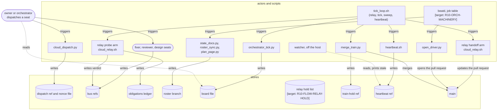

# R10-ARCH-DOCS study note: dev/README.md "Its components" figure

Head 28d46c4918285d36c409c1fb2f72eb77e04e569e. Read-only, git only. Design note 16954f0c resolved after unshallow (dev/programme/designs/R10-ARCH-DOCS-FIRST.md); read first. Line refs are tools/audit/seat/ at this head; lines cited are code, located by a scout and not each re-read by me (flagged "unread" where I did not see the line myself).

## Re-count of triage evidence (mermaid source, this head)
- Edges: **23** (triage said 24). Scripted count over the block. Edges touching target nodes (beat, ledger, hold, model, kit): **11** (matches).
- "is read by" edges: the six named hold (tick-->orch, ledger-.->tick, roster-->docs, model-.->docs, kit-.->model, hold-.->relayh). Three more are reversed in the same way: disp-->seats, relayh-->bus (really a PR update), relayh-.->ledger (relay reads the level).
- orch has no incoming edge: confirmed. It is the only entrypoint candidate, but the owner is a separate node and has an incoming edge from watch.
- Target markers look stale: `beatd.py`, `beatd.jobs.json` and `ledger.py` exist on main at this head. Fixer must re-check each marker against the roster state (design note section 3 rule).
- Nothing invokes `beatd.py` anywhere in tools/, .github/, .claude/ or the role contracts (scout grep). beatd is a built supervisor with no launcher.

## (1)+(2) Edge table
Verb: W=writes, T=triggers. Status: right / reversed / missing / spurious.

| # | edge in figure | actor -> target, verb | performed at | status |
|---|---|---|---|---|
| 1 | beat -.-> tick | beatd -> orchestrator_tick: T | none. Job `tick-digest` only reads the board (beat_jobs.py:257, no subprocess). orchestrator_tick.py is run by tick_loop.sh:168 | spurious |
| 2 | beat -.-> relayp | beatd -> cloud_relay: T | none in beatd.jobs.json or beat_jobs.py. Relay is run by tick_loop.sh:130 | spurious |
| 3 | beat -.-> relayh | same | same | spurious |
| 4 | beat -.-> docs | beatd -> state_docs.py: T | beat_jobs.py:366 (job plan-beat, after replan.py :362) | right |
| 5 | beat -.-> hb | beatd -> heartbeat: T | none. heartbeat.sh --once is run by tick_loop.sh:174 | spurious |
| 6 | tick --> orch | tick -> orch | orch reads the board; tick_loop.sh:169 writes the out file | reversed (orch reads tick; not an actor edge) |
| 7 | orch --> pick | orch decides | role contract only, no code | right (decision, no code) |
| 8 | pick -->|dispatch| disp | orch -> cloud_dispatch.py: T; W dispatch ref | cloud_dispatch.py:394 push, :421 ref name, :429 publish_seat (:437) | right |
| 9 | disp --> seats | dispatch record -> seat | seat fetches the ref (reads); orch fires the seat | reversed |
| 10 | seats -->|push| bus | seat -> bus refs: W | body_push.sh / handoff_push.sh (named by the brief, line unread) | right |
| 11 | relayp -->|grade and post verdict| bus | cloud_relay -> bus.sh: T | cloud_relay.sh:187 push_run, caller :238, runs bus.sh:264 push-verdict | right |
| 12 | relayh -->|open or update PR| bus | cloud_relay handoff arm -> PR: W | cloud_relay.sh:435 handoff_arm, update at :520 (update_pr.sh), :524. **No PR open in the relay**: opening is beat job `opener` -> open_driver.py (beat_jobs.py:417) | reversed target (goes to PR, not bus); "open" half is spurious |
| 13 | hold -.-> relayh | hold file -> relay | cloud_relay.sh:368 hold_file, read at :444 hold_list. The hold list is a state-dir file, drawn as a store: ok | reversed |
| 14 | relayp -.-> ledger | relay probe arm -> ledger: W | cloud_relay.sh:185/:249 ledger_open verdict-unposted, :268 dispose | right |
| 15 | relayh -.-> ledger | handoff arm -> ledger | cloud_relay.sh:561 `ledger level` is a read | reversed |
| 16 | ledger -.-> tick | ledger -> tick | orchestrator_tick.py:1043 loads ledger.py, :1085 fold | reversed |
| 17 | roster --> docs | roster -> state_docs | state_docs.py reads the roster; roster_sync (state_docs.py:331) WRITES it | reversed |
| 18 | model -.-> docs | model -> docs | no model builder exists; plan_page.py:75 uses roster_lib directly | reversed + target not built |
| 19 | kit -.-> model | toolkit -> model | none; toolkit is a target | reversed + target not built |
| 20 | hb --> watch | heartbeat -> watcher | hb W ref heartbeat/orchestrator heartbeat.sh:35; watcher R :41 | right only through the ref; the ref is no store in the figure |
| 21 | watch -->|stopped beat| owner | watcher -> owner | heartbeat.sh:42,:46 print `HEARTBEAT STALE`, return 1. No owner notifier; no caller of --watch found | spurious |
| 22 | pick -->|board at a pitch| train | orch -> merge_train.py: T | by hand nudge.md:52 (`merge_train.py run`); automated sweep tick_loop.sh:148 | right (two triggers) |
| 23 | train --> main | train -> main: W | merge_train.py merges verdicted PRs; merge line not located (unread) | right (line to cite in fixer step) |

## Missing edges (in code, not in figure)
| edge | verb | performed at |
|---|---|---|
| tick_loop.sh node (the actual driver, no node exists) -> relay pass | T | tick_loop.sh:130 |
| tick_loop.sh -> orchestrator_tick.py, writes board file | T, W | tick_loop.sh:168-169 |
| tick_loop.sh -> merge_train.py sweep (hourly) | T | tick_loop.sh:148 |
| tick_loop.sh -> heartbeat.sh --once | T | tick_loop.sh:174 |
| beatd -> roster_queue.py run (job roster-drain) | T | beat_jobs.py:301, :341 |
| beatd -> open_driver.py --board (job opener, opens PRs) | T | beat_jobs.py:416-417 |
| beatd -> pulse.py, owed_unactioned.py, cancel_superseded.py, worktree_gc.sh, review_strength.py | T | beat_jobs.py:374/383, :281/284, :395, :410, :431/456 |
| state_docs.py -> plan_page.py | T | state_docs.py:450 |
| state_docs.py -> roster_sync.py (writes roster) | T, W | state_docs.py:92 import, :331 |
| cloud_dispatch.py -> ledger (opens dispatch) | W | cloud_dispatch.py:515 |
| open_driver.py -> ledger landed | T | open_driver.py:163 |
| merge_train.py -> train-hold ref | W | merge_train.py:2395 hold_refresh (:2425, :2432), release :2441 (:2451) |
| merge_train.py reads ledger train-stop | R | merge_train.py:3572. No writer of train-stop found in tools (only ledger.py:114 kind table) |
| bus.sh push-verdict reads dispatch record | R | bus.sh:191 dispatch_binding, :195. A local `$S/dispatched` file, not the git ref |
| postmerge.py -> ledger open/close postmerge-owed | W | postmerge.py:23, :83 |
| seat -> orch: only through bus refs (orch reads them via tick) | R | orchestrator_tick.py, not drawn |

## Findings for the fixer
1. The figure draws beatd as the parent of tick, relay and heartbeat. The code has tick_loop.sh as that driver; beatd drives a disjoint job set (tick-digest, owed-check, roster-drain, plan-beat, pulse, cancel-sweep, disk, opener, head-watch, audit-dispatch). Either draw tick_loop.sh now with beatd as the target that replaces it, or confirm with R10-ORCH-MACHINERY that the job table takes over relay/heartbeat (it does not at this head).
2. Draw only writes and triggers. Reads come out as "store" nodes the actor points at.
3. "dispatch records" are two things: the `dispatch/<role>-<topic>` ref (cloud_dispatch.py:394) and the local nonce file bus.sh reads (:195). The figure's label mixes them.
4. Watcher -> owner has no mechanism; either mark it a target or draw the watcher as printing only.
5. Stale `[target: ...]` markers: ledger and beatd are on main; re-check against the roster per design note section 3.

## (3) Redrawn draft
One entrypoint, top-down, stores grouped apart (actors above, stores in a subgraph). Edges are W or T from actor; reads are an actor edge to the store, labelled "reads".

Legend: rectangle = script, stadium = seat or person, cylinder = ref or store; solid arrow = actor writes or triggers (label says which), dashed = read; `[target: ...]` = lands with that group.
Fixer notes: reads (tick reads ledger, relayh reads hold and ledger, docs read roster) are omitted on purpose to keep the rule "edges are writes or triggers"; the legend line carries the dashed reads that remain. Check the edge `owner -.-> board`: the owner reads via the tick, whose board file tick_loop.sh:169 writes.

## Caveats
- Lines come from a scout's grep and my reads; several (body_push.sh/handoff_push.sh, merge_train.py merge call) are not re-read. The fixer must open every cited line before pinning.
- No train-stop writer was found; the fixer should check before drawing it.
- No file changed; no PR opened; no notification sent.
