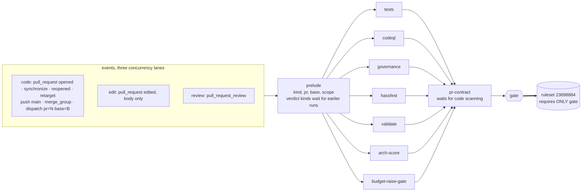

# One umbrella, one required check: the CI design, phase 2 (PR 2)

Read-only design seat. Tree: `origin/main` at `07a09406a1cc97076a6f28581f87f313b322a6b6`.
Builds on phase 1 (`DESIGN-P1.md`, now PR 1) and its reader survey
`measure/p1/readers.md`. Measured 2026-10-18. Nothing in the repository was changed.

**Revision 1** (design-revision seat, 2026-10-18) answers the design review
`probe/design-ci-review` (`f7b28312`, verdict *revise*). Every one of its twelve items
is resolved here; `RESPONSE.md` maps each item to the sections it changed and the
evidence, and inline markers read *(rev1, item N)*. Phase 2's own measurements are
under `measure/p2/` (cited by bare file name where unchanged); revision 1's
instruments are under `measure/rev/`.

**Owner rulings, already made, and what they fix here:**
- **D-1** (PR 1: `record-autofix` out of the Tests push run): approve. The refused
  branch stays specified (section 5).
- **D-2**: `arch-score / arch-score` is gate-required **when the PR's diff reaches
  `custom_components/`** (section 4.1).
- **D-3**: keep `merge_group`.
- **D-4**: drop C1 in PR 1, since the revision shows the proof covered
  (`DESIGN-P1.md` 2(c)).
- **D-5**: keep O17 with the extracted-files soundness check (U3).
- **Variant**: a review event re-runs **only `budget-raise-gate` and `gate`**; every
  other unit is carried (section 4.3).

The owner's ask: **simple, robust, visual, wall-clock effective, no unacceptable
risk; redesign the underlying workflows where that simplifies the whole; look
carefully for scoping wins and for dependencies.**

---

## 0. The answer on one screen



Plain-text version:

```
events ──► prelude ──► tests ───────┐
 (run-name     ├─────► codeql ──────┤
  records      ├─────► governance ──┤
  the kind)    ├─────► hassfest ────┤
               ├─────► validate ────┼──► pr-contract ──► gate ══► the one required check
               ├─────► arch-score ──┤        (code scanning      (applicability from the
               └─────► budget-raise-gate      processed first)     event; carries by title)
 code units run on code events only; an edit runs arch-score, budget-raise-gate,
 pr-contract; a review runs budget-raise-gate; the gate carries the rest
```

| | today (origin/main) | after PR 1 | after PR 2 |
|---|---|---|---|
| workflow files | 13 | 15 (+ `nightly.yml`, + the inert `ci.yml` stub) | **14**: `ci.yml` real; `pr-contract-rerun.yml` deleted; `budget-raise-gate-rerun.yml` replaced by `gate-sweep.yml`, which M-2 may delete (then 13) |
| required contexts in ruleset 23698884 | 17 | 17 | **1** (`gate`, app 15368) |
| workflows a PR event starts | 8 | 8 | **1** (`ci.yml`), plus `gate-sweep.yml` on its completion |
| concurrency lanes of the PR graph | 10 blocks | 10 | **1 block, 3 lanes** (`code`, `edit`, `review`) plus run-id lanes for bot and dispatch runs |
| `cancel-superseded` jobs | 2 | 2 | **1** |
| held-run approval steps | 4 copies, 375 run lines | 4 | **4, retargeted, until M-3 decides** (section 5): 0 if a held run shadows nothing |
| dispatch targets after a bot push | 4 workflows | 4 | **1** (`ci.yml -f pr=N -f base=B`) |
| PR critical path (section 3) | coverage → closures → composed-proof | max(fast, closures), C1 gone | same, plus the umbrella's tail: median **≈ −180 to −290 s** per PR run |

**Two PRs, phase 1 first** (section 8, unchanged ruling, agreed by the review).

---

## 1. What the measurements change about the brief

1. **The real PR critical path was a `needs:` edge.** `closures` needed `coverage`
   only for one composed recording, idling a median **972 s** (`critpath.txt`). PR 1
   removes the composition at its source (W1). At the measured bare cost of the one
   script (221-480 s on CI) the PR run ends a median **232-264 s** sooner; at the
   239.1 s phase 2 charged, 342 s. 2 of 24 runs are slower, by up to 404 s
   (`measure/rev/c1_sweep.txt`). *(rev1, item 8: phase 2's 342 s and "upper bound"
   are withdrawn.)*
2. **Section 4.1's own function reproduces today's verdict.** Over the 22 heads,
   `gate_model.gate`, the predicate `tools/ci/gate.py` ports, agrees with the
   17-context ruleset on **22 of 22**, and its perturbations move it as designed
   (`measure/rev/gate_replay2.txt`). Over 22 event sequences with GitHub's documented
   concurrency rule, revision 1 matches an independent oracle on all 16 unplanted
   ones under all three readings of which `gate` binds (newest created, newest
   completed, every suite's, the last being #2009's), and refuses all 6 plants; phase
   2 as written misses 4, 4 and 6 of them and refuses no plant (`measure/rev/gate_sim.txt`). *(rev1, item 10.)*
3. **Bot heads run the code twice** on 4 of 22 heads (`dupes.txt`). Whether the
   dispatch alone suffices depends on whether a held run shadows a dispatched `gate`,
   which is measured in U0, not assumed (section 5). *(rev1, item 6.)*
4. **Body edits and reviews are frequent and arrive with the push.** 14 edit runs and
   7 review runs over 22 heads (`heads.txt`); 13 of the 14 edits land 0-4 s after the
   code event at the same head (review `ev/edit_after_push.txt`). So a verdict event
   almost always meets a code run in flight. Revision 1 gives verdict events their own
   concurrency lanes and makes their preludes wait: a measured **1406 s median wait,
   8.07 runner-hours over the 22 heads** (`measure/rev/verdict_wait.txt`). *(rev1,
   item 1.)*
5. **The other workflows are cheap and off the critical path.** Governance median 190 s
   wall, Hassfest 31 s, Validate 52 s, PR contract 32 s, Architecture score 66 s,
   Budget raise gate 19 s, CodeQL 1306 s (python leg 1242 s), against Tests 2059 s
   (`durations.txt`).
6. **Only two apps write check runs at a PR head**: GitHub Actions and code scanning
   (`github-advanced-security`, check `CodeQL`), over all 22 heads
   (`measure/rev/check_writers.txt`). The code-scanning check concludes within
   −8 to +63 s of the first analysis job's end (median −6 s: before the uploading job
   has finished), and at 9 of 17 heads it concluded after the last `pr-contract` run,
   twice red. *(rev1, item 5.)*
7. **`arch-score` is described as required but is not.** Owner ruling D-2 makes it
   gate-required when the diff reaches `custom_components/`.
8. **The merge queue has never run** (0 `merge_group` runs, no `merge_queue` rule).
   Owner ruling D-3 keeps it.

---

## 2. The umbrella layout

### 2.1 Files

| file | role | `on:` after |
|---|---|---|
| `.github/workflows/ci.yml` (replaces PR 1's stub) | the umbrella: prelude, the unit calls, `cancel-superseded`, `refresh`, `gate` | `pull_request: [opened, synchronize, reopened, edited]`, `pull_request_review: [submitted, edited, dismissed]`, `push: [main]`, `merge_group`, `workflow_dispatch` (inputs `pr`, `base`, `recheck`, `no-skip`) |
| `tests.yml` | unit | `workflow_call` only *(rev1: its standalone `workflow_dispatch` goes; a dispatch is `ci.yml`'s, with the same inputs)* |
| `governance.yml`, `codeql.yml` | unit | `workflow_call` + their weekly `schedule` (runs on main only). Their `workflow_dispatch` goes *(rev1, item 5)* |
| `hassfest.yml`, `validate.yml` | unit | `workflow_call` only |
| `pr-contract.yml`, `arch-score.yml`, `budget-raise-gate.yml` | unit | `workflow_call` only *(rev1: phase 2's "dispatch for unit probing" withdrawn; a unit is probed through `ci.yml`)* |
| `pr-contract-rerun.yml` | **deleted** | its premise is made true (section 4.3, item 5) |
| `budget-raise-gate-rerun.yml` | **replaced by `gate-sweep.yml`**: on every `CI` completion whose `gate` is green at a PR head, re-run the `gate` job of every older run at that head whose `gate` is not green. Kept until M-2 shows the merge box reads only the newest `gate` (section 4.3, items 4 and 1) | `workflow_run` |
| `nightly.yml` (PR 1), `merge-main.yml`, `release.yml`, `pages.yml` | standalone, not called | unchanged triggers; every job of each that has `workflow_dispatch` gains a ref guard (section 4.3, item 5) |

**One naming rule:** the caller job id equals the unit's file stem, so every check
name is `<file stem> / <job>`, for example `tests / fast (3.14)`.

**One forgery rule** *(rev1, item 12(b))*: `entities.py` pins that no workflow file but
`ci.yml` defines a job whose id or `name:` is `gate`, that inside `ci.yml` exactly one
job carries that check name (`gate`), and that no workflow grants
`checks: write`. A dispatch of any other workflow on a PR branch therefore cannot
write a newer `gate` at the head, and nothing can write one through the Checks API.

### 2.2 `ci.yml`, sketched

```yaml
name: CI
# The run's title is fixed when the run is CREATED, from the event alone, so the
# runs API (`display_title`) says what every run was, including one cancelled
# before any job started. gate.py reads it (section 4.1). (rev1, item 2)
run-name: >-
  ${{ format('CI {0} pr={1} base={2}',
      github.event_name == 'pull_request_review' && 'review'
      || (github.event_name == 'pull_request' && github.event.action == 'edited'
          && !github.event.changes.base) && 'edit'
      || 'code',
      github.event.pull_request.number || inputs.pr || '-',
      github.event.pull_request.base.ref || inputs.base || '-') }}
on:
  pull_request: { types: [opened, synchronize, reopened, edited] }
  pull_request_review: { types: [submitted, edited, dismissed] }
  push: { branches: [main] }
  merge_group: { types: [checks_requested] }
  workflow_dispatch:
    inputs:                                   # all optional strings (PR 1's stub declares them)
      pr:       { required: false, description: "PR this ref heads (bot heads); empty for a batch proof or main" }
      base:     { required: false, description: "that PR's base ref; required with pr" }
      recheck:  { required: false, description: "tests: lane proofs and lane skip, as tests.yml's input today" }
      no-skip:  { required: false, description: "tests: force every lane (R9-CI-SKIP)" }

permissions: {}            # every job states its own grant

# ONE block, THREE lanes per PR (rev1, item 1). GitHub keeps one running and ONE
# pending run per group and a newly queued run cancels the pending one whatever
# cancel-in-progress says, so code and verdict events never share a group: an edit
# or a review can never replace a pending code run. Within a lane a newer event
# supersedes an older one of the same kind, which re-reads everything the older
# one would have. Bot-sent and dispatch runs keep run-id groups, as today.
concurrency:
  group: >-
    ${{ format('CI-{0}',
        (github.event_name == 'pull_request' || github.event_name == 'pull_request_review')
        && github.event.sender.login != 'github-actions[bot]'
        && format('{0}-{1}',
             github.event_name == 'pull_request_review' && 'review'
             || (github.event.action == 'edited' && !github.event.changes.base) && 'edit'
             || 'code',
             github.event.pull_request.number)
        || github.run_id) }}
  cancel-in-progress: >-
    ${{ (github.event_name == 'pull_request' || github.event_name == 'pull_request_review')
        && github.event.sender.login != 'github-actions[bot]' }}

jobs:
  prelude:            # base-restored tools/ci/prelude.py; read-only
    permissions: { contents: read, actions: read, pull-requests: read }
    timeout-minutes: 150     # a verdict prelude may wait out a whole code run (max measured 3450 s)
    outputs: { kind, pr, base, head, gate_scope, codeql_actions, codeql_js, codeql_python }
  cancel-superseded:  # the one copy; --workflow ci.yml
    permissions: { contents: read, pull-requests: read, actions: write }

  # code units: run on code events only, keyed on the kind (rev1, item 3: governance,
  # hassfest and validate included; phase 2's `action != 'edited'` guard skipped
  # them on a retarget, which is a code event)
  tests:
    needs: prelude
    if: needs.prelude.outputs.kind == 'code'
    uses: ./.github/workflows/tests.yml
    with: { gate_scope: "${{ needs.prelude.outputs.gate_scope }}", pr: "${{ needs.prelude.outputs.pr }}",
            base: "${{ needs.prelude.outputs.base }}", head: "${{ needs.prelude.outputs.head }}",
            recheck: "${{ inputs.recheck }}", no-skip: "${{ inputs.no-skip }}" }       # rev1, item 7
    secrets: { CLOSURES_PUSH_TOKEN: "${{ secrets.CLOSURES_PUSH_TOKEN }}",
               HPO_RUNS_PEM: "${{ secrets.HPO_RUNS_PEM }}", HPO_RUNS_APPID: "${{ secrets.HPO_RUNS_APPID }}" }  # until M-3
    permissions: { contents: write, actions: write, pull-requests: read }   # = union of tests' job-level grants
  codeql:
    needs: prelude
    if: needs.prelude.outputs.kind == 'code'
    uses: ./.github/workflows/codeql.yml
    with: { legs: "${{ toJSON(needs.prelude.outputs) }}" }
    permissions: { contents: read, security-events: write }
  governance:
    needs: prelude
    if: needs.prelude.outputs.kind == 'code'
    uses: ./.github/workflows/governance.yml
    permissions: { contents: read, pull-requests: read, issues: write }
  hassfest:   { needs: prelude, if: "needs.prelude.outputs.kind == 'code'", uses: ./.github/workflows/hassfest.yml, permissions: { contents: read } }
  validate:   { needs: prelude, if: "needs.prelude.outputs.kind == 'code'", uses: ./.github/workflows/validate.yml, permissions: { contents: read } }

  # body units
  arch-score:          # code and edit events that name a PR
    needs: prelude
    if: needs.prelude.outputs.pr != '' && needs.prelude.outputs.kind != 'review'
    uses: ./.github/workflows/arch-score.yml
    with: { pr: "${{ needs.prelude.outputs.pr }}", base: "${{ needs.prelude.outputs.base }}", head: "${{ needs.prelude.outputs.head }}" }
    permissions: { contents: read, pull-requests: read }
  budget-raise-gate:   # every event that names a PR, reviews included
    needs: prelude
    if: needs.prelude.outputs.pr != ''
    uses: ./.github/workflows/budget-raise-gate.yml
    with: { pr: "${{ needs.prelude.outputs.pr }}", base: "${{ needs.prelude.outputs.base }}", head: "${{ needs.prelude.outputs.head }}" }
    permissions: { contents: read, pull-requests: read, issues: read }
  pr-contract:         # code and edit events that name a PR; runs last so its red list is final
    needs: [prelude, tests, codeql, governance, hassfest, validate, arch-score, budget-raise-gate]
    if: ${{ !cancelled() && needs.prelude.outputs.pr != '' && needs.prelude.outputs.kind != 'review' }}
    uses: ./.github/workflows/pr-contract.yml
    permissions: { contents: read, checks: read, pull-requests: read, security-events: read }   # rev1, item 5

  refresh:             # rev1: an event can make an earlier green `gate` at this head stale
    if: github.event_name == 'pull_request' || github.event_name == 'pull_request_review'
    permissions: { actions: write }
    # base-restored `tools/ci/gate.py --refresh`: re-run the `gate` job of every completed
    # ci.yml run at this head whose latest `gate` is green. Each re-judges at once and,
    # since this run is still being judged, goes red until this run's own `gate` decides.
    # Fail-soft (a notice, exit 0) where the token cannot re-run: a fork PR.
  gate:
    needs: [prelude, tests, codeql, governance, hassfest, validate, arch-score, budget-raise-gate, pr-contract]
    if: ${{ !cancelled() }}         # never skippable: a skipped required check would pass
    permissions: { contents: read, actions: read, pull-requests: read }
    # base-restored tools/ci/gate.py, section 4.1; a fetch-depth 0 checkout for D-2's diff
```

The guards, each saying one thing:
- **Code units** (`tests`, `codeql`, `governance`, `hassfest`, `validate`): `kind == 'code'`.
- **Body units**: `arch-score` and `pr-contract` on code and edit events that name a
  PR; `budget-raise-gate` on every event that names a PR.
- **`gate`**: only `!cancelled()`. It trusts no guard: it derives what each event owes
  from the event itself (4.1).
- **`refresh`**: PR events only; it judges nothing itself.

What revision 1 changed in this sketch, and why:
- **Three lanes instead of one** (item 1). Phase 2's single `CI-<pr>` group let an edit
  replace a pending code run (review `ev/gate41_model.txt`, case E) and let anyone who
  can review cancel one. Now an edit and a review can only replace their own kind.
- **`cancel-in-progress` is true in every PR lane** for a non-bot sender. A retarget is
  a code event and supersedes the run against the old base; a newer edit re-reads the
  body the older edit read; a newer review re-reads every review. Bot and dispatch
  runs are never cancelled, as today.
- **`run-name`** records each run's kind, PR and base at creation (item 2).
- **Code-unit guards on the prelude's kind** (item 3).
- **W4 is withdrawn**: governance, hassfest and validate now need the prelude, which
  adds a prelude and a queue hop (about 10 s) to paths that end minutes before
  `tests` (`durations.txt`); the critical path does not move.
- **`recheck` and `no-skip` pass through** (item 7).
- **`refresh`, and `gate-sweep.yml`** (4.3) replace phase 2's two rerun workflows. The
  tree records that "GitHub's ruleset refuses a merge while any suite at the head
  carries a non-success run" (`tools/policy/budget_raise_gate.py:604`, #2009), and it
  also relies on the newest run answering an older red (a body edit answers
  `pr-contract`). Which one the merge box does for `gate` is unmeasured (M-2), so the
  design must be right under both: every `gate` at a head must converge on the head's
  current verdict. `refresh` turns stale greens red when an event arrives; the sweep
  turns stale reds green once the newest `gate` is green.

### 2.3 The prelude: compute once, pass explicitly

One job, one base-restored program, `tools/ci/prelude.py`. It replaces `tests.yml`'s
"Decide the gate scope" step, `codeql.yml`'s `scope` job, and the merge-queue naming
step in `pr-contract`, `arch-score` and `budget-raise-gate`.

| output | how | consumers |
|---|---|---|
| `kind` | the same expression as `run-name`: `review` on `pull_request_review`; `edit` on `pull_request` `edited` without `changes.base`; `code` otherwise (a retarget, every other `pull_request` action, `push`, `merge_group`, `workflow_dispatch`) | unit guards; `gate` cross-checks it |
| `pr`, `base`, `head` | the payload on `pull_request`/review. On `merge_group`, from the queue ref, as `pr-contract.yml` does today. On dispatch, from inputs `pr` and `base`, **verified**: the PR is open, `pulls/N.head.sha == github.sha`, same repository, and `pulls/N.base.ref == inputs.base`; otherwise the prelude fails (and the gate, which re-verifies, fails) | body units, `tests` (autofix), `gate` cross-checks |
| `gate_scope` | `auto` on `pull_request`, `merge_group` and dispatch; `full` on `push` (CLAUDE.md rule 1, unchanged) | `tests` |
| `codeql_<leg>` | `tools/pr/codeql_scope.py decide`, unchanged | `codeql` |

**On `kind != code` the prelude waits** until every **earlier** `ci.yml` run at this
head has completed: every run with a lower run id whose status is `queued`,
`pending`, `waiting`, `requested` or `in_progress`. A held run (`action_required`)
is not waited on: it has no jobs until someone approves it. The wait is bounded by
the job's `timeout-minutes`; on timeout the prelude fails and the gate fails
closed. *(rev1, item 1: phase 2 waited for "code runs" only, which a run that has not
started yet cannot be identified as; waiting for every earlier run needs no kind and
orders the runs: each verdict run's `gate` is first judged after every earlier run's
`gate` has completed. The re-runs of 4.3 add later judgements of older runs, which
4.1's defer rule keeps consistent with the newest.)* No wait cycle exists, because a run only ever waits for runs with a
lower id.

Cost, measured: over the 22 heads, 18 of 21 verdict events would have waited, a
median 1406 s and at most 3450 s, **8.07 runner-hours of polling in all**, about
22 runner-minutes per head (`measure/rev/verdict_wait.txt`; the lanes'
cancel-in-progress trims it from 8.10). It is runner time, not wall clock: the code
run it waits for is the PR's critical path anyway. Considered and rejected: running
every body unit at the end of the code run instead, so that an event arriving while a
code run is in flight needs no run of its own. That puts `arch-score` (62 s) on every
PR run's critical path and still needs a wait for events landing in the last minute.

`closure-scope` stays inside `tests` (lane proofs, `closures.json`, and
`a1_dispatch_arms.sh`'s `steps[2]` pin).

---

## 3. Dependencies: every edge, what it carries, what it costs

`measure/p2/deps.py` parses every `needs:` edge, classifies what the dependent reads
of its need, and replays every measured PR run's DAG once per edge with that edge
removed (`deps.txt`):

| edge | carries | binding in | run ends sooner without it: median | max |
|---|---|---|---|---|
| **`coverage → closures`** | artifact `composed-closures` (one script's recording) | 29/30 | **323 s** (with no bare cost charged; with it, section 3.1) | 1358 s |
| `closure-scope → coverage` | output `coverage_skip` | 30/30 | 26 s | 150 s |
| `scope → analyze` (CodeQL) | output `[matrix.language]` | 10/10 | 20 s (off the critical path) | 90 s |
| `closures → composed-proof` | artifacts | 27/30 | 18 s | 1223 s |
| `mutation-pins → mutation-autofix` | artifact `mutation-pins*` | 4/30 | 0 s | 106 s |
| every other edge (31) | outputs / result / artifact | – | 0 s | ≤ 27 s |

No edge carries nothing; the three that look order-only (`fast`, `coverage` and
`closures` into `ci-ratchet`) read metrics artifacts through the Actions API.

### 3.1 W1: drop the C1 composition (owner ruling D-4; lands in PR 1)

The full change, the proof that nothing is left to prove, and the cost table are in
`DESIGN-P1.md` 2(c) *(rev1, item 8)*. In short:

| bare cost of `boost_drift_replay.py` | V1 (drop C1) median gain | runs slower | worst | V2 (keep C1, split `closures`) |
|---|---|---|---|---|
| 239.1 s (`closures.json`) | 342 s | 1/24 | −163 s | 343 s |
| 427 s (median of 4 CI recordings) | 264 s | 2/24 | −351 s | 343 s |
| 480 s (slowest CI recording) | 232 s | 2/24 | −404 s | 343 s |

V1 is not as fast as V2 at measured cost. It is chosen because it deletes the
composition, its proof job, a workflow edge and four `closure.py` entry points,
leaving one recording path; V2 keeps all of it and adds a job. On a push to main
`closures` (median 1554 s, plus at most 480 s) stays under `fast` (median 2893 s).

**A PR run before and after** (run 39158231320, head `0e238c3042`, its own job times;
"after" is the replay at the slowest measured bare cost plus the umbrella's tail, 3.3):

```mermaid
gantt
  title One PR run (39158231320), seconds from start
  dateFormat X
  axisFormat %s
  section before
  closure-scope        :14, 33
  coverage             :76, 1102
  fast (3.14)          :43, 1967
  closures (waits for coverage) :crit, 1105, 2291
  composed-proof       :crit, 2295, 2314
  codeql python        :97, 1680
  section after (W1 at 480 s + umbrella)
  prelude              :0, 9
  closure-scope        :14, 33
  coverage             :76, 1102
  fast (3.14)          :43, 1967
  closures (+480 s boost bare) :36, 1702
  codeql python        :97, 1680
  pr-contract + gate   :crit, 1975, 2030
```



### 3.2 Dependencies the graph does not show (cross-run and cross-workflow)

| reader | reads | produced by | effect |
|---|---|---|---|
| `fast` drift baseline | cache `drift-baseline-*` | main push and PR runs | none: caches are scoped by repository and branch |
| `coverage` per-script cache, `covtrust` | cache keyed by base, provenance `push refs/heads/main $BASE` | main push run's coverage | none: same event, same key |
| `closure-scope` lane skip | caches `lane-proof-{fast,coverage,browser}-*` | `lane-proofs` of an earlier PR run | none: same keys; `recheck`/`no-skip` now reach it as `inputs.*` (item 7) |
| `closures` proof-consume | `actions/artifacts?name=closure-recordings-tree-<T>` | batch-proof dispatch run | none: looked up by name, repository-wide |
| **`ci-ratchet`** | `actions/workflows/tests.yml/runs?event=push` durations, and the `ci-metrics-*` artifacts | Tests push runs | **changes meaning**: it must read `ci.yml` push runs and measure the span of the `tests / *` jobs, not the run's wall time. Null control: its number over the last 8 old push runs equals the new reader's over the same runs |
| `nightly-status` | `nightly.yml` runs (PR 1) | the nightly | none |
| `pr-contract` red list | `commits/<head>/check-runs`, every failing name | `ci.yml` jobs and code scanning (section 1.6) | names become `<unit> / <job>`; it excludes `gate` and its own name; it waits for code scanning (4.3) |
| `cancel_superseded.py --workflow X` | runs of its own workflow on the branch | itself | one copy, `--workflow ci.yml` |
| `merge_main_bot.py` PIN_CHAIN | in-flight runs' job names | tests | regex gains the `tests / ` prefix |
| `stamp.py` | "the Tests workflow for HEAD succeeded" (push runs, :1413-1415) | Tests push run | reads the `gate` job of the `ci.yml` push run at HEAD |
| tick, `merge_train` | ruleset contexts live, minus `PR_ONLY` | ruleset | the required set is `{gate}`; `PR_ONLY` becomes empty; the tick classifies a red unit check by `gate_required`, not by the ruleset (section 9, item 11) |
| `budget-raise-gate` re-grade | reviews, live | reviewer | a review is a verdict event of `ci.yml` (4.3); the review run's `budget-raise-gate` is then the newest source, and `gate-sweep.yml` re-judges the code run's stale red `gate` until M-2 (item 4) |
| a past run's kind | `display_title` (`run-name`) | `ci.yml` at run creation | **new**: the one cross-run fact the gate reads besides job conclusions |

### 3.3 What the umbrella itself adds to the critical path

`pr-contract` now runs last, so that its red list is final; `gate` follows it.
- `pr-contract`: median 28 s (`durations.txt`), plus its code-scanning wait, which is
  0 s in the sampled runs whenever CodeQL ended before `tests` (the python leg's
  median 1242 s against Tests' 2059 s) and at most the processing lag after that;
- `gate`: about 15 s (estimate, by analogy with `budget-raise-gate`'s 16 s job), plus
  a fetch-depth 0 checkout for D-2's diff when a PR is named;
- the prelude: about 5 s plus a queue hop, now ahead of every unit;
- queue hops: about 4 s each (phase 1 `tail.txt`).

Total about **+60 s**, against W1's −232 to −342 s median. Net, the median PR run is
about **3 to 5 minutes faster**.

Rejected: **splitting the autofix chain out of `tests`** so the gate need not wait for
it (an earlier red only on the 2 of 20 PRs whose `mutation` refuses).

---

## 4. The gate: exact semantics and their null control

### 4.1 The predicate

`tools/ci/gate.py`, restored from the base as every grader is, run under
`python3 -I`. **Its reference implementation is `measure/rev/gate_model.py`**, which
the fixer ports line for line and which both replays drive *(rev1, item 10)*. It
reads the Actions and pulls APIs (`actions: read`, `pull-requests: read`) and the
git history of its own checkout.

```
REQUIRED = {                                   # the 17 contexts of ruleset 23698884, renamed
  code units:
  "tests":       ["fast (3.14)", "browser", "briefs", "typing", "mutation", "closures",
                  "closure-scope" (not on push: it never runs there)],
  "codeql":      ["Analyze (actions)", "Analyze (javascript-typescript)", "Analyze (python)"],
  "governance":  ["policy-docs", "wave-script", "env-matrix"],
  "hassfest":    ["hassfest"],   "validate": ["validate-hacs"],
  body units (only when the EVENT names a PR):
  "budget-raise-gate": ["budget-raise-gate"],   "pr-contract": ["pr-contract"],
  "arch-score":  ["arch-score"]   only when the three-dot diff reaches custom_components/  (D-2)
}
WORKSET(kind, pr):  code → every unit, body units only if pr
                    edit → arch-score, budget-raise-gate, pr-contract
                    review → budget-raise-gate                    (owner variant)

gate(run):                                     # a green result certifies the head's CURRENT state
  kind, pr, base = from github.event_name, .action, .changes.base, the payload, or
                   the dispatch inputs                            # never from the prelude
  prelude must have concluded success, and its kind and pr must equal these   # item 2
  on dispatch: pr named → the PR is open and heads this SHA;
               none named → FAIL if this SHA heads an open PR ("dispatch -f pr=N -f base=B")
  judge_base = the PR's base ref read LIVE (pulls/N), else base
  any OTHER ci.yml run at this head not completed (held runs aside) → FAIL
      "still being judged; their gate decides"                    # the defer rule
  for each required unit U:
    source = the run with the highest id at this head, THIS run included, whose
             display_title parses to the same pr and to judge_base, whose kind's
             WORKSET holds U, and whose U jobs have all completed  (this run's own
             U jobs always count once it owns U: its needs ran them)
             none → FAIL "no run at this head judged base B"
             an unparseable title → FAIL
    each required name of U in the source: absent → FAIL ABSENT; success → ok;
             skipped → FAIL SKIPPED; anything else → FAIL
  every other job: reported in the summary, never gating
```

What revision 1 changed, and why:
- **Applicability comes from the event** (item 2). Phase 2 took "a PR is named" from
  the prelude it was judging, so a prelude emitting `pr=''` on a `pull_request` event
  gave a green gate with `pr-contract` and `budget-raise-gate` never run (review
  case B). Now that prelude fails the cross-check, and the body units are owed anyway.
- **The prelude must succeed** (item 2).
- **A past run's kind is its title** (item 2). The runs API returns no `action` and no
  job outputs, so phase 2's "newest completed run with kind == code" could not be
  computed. `run-name` is rendered when the run is created, so even a run cancelled
  before its first job says what it was. An artifact written by the prelude, the
  review's example, would be absent for exactly those runs.
- **Sources are judged at the PR's live base** (items 2, 3). A code run against the old
  base is never a source after a retarget, and a dispatch naming the wrong base finds
  no source.
- **The gate is a function of the head, not of its own run.** Phase 2's gate read its
  own run and carried code units only on verdict events (P2:414-418). Revision 1's
  gate takes every unit from the newest run at the head that evaluated it, its own
  included, and refuses while any other run there is unfinished. So any `gate` at a
  head, judged or re-judged at any time, gives the same answer as the newest one,
  which is what lets `refresh` and the sweep (4.3) re-run only `gate` jobs. The
  review's item 4 asked the hook to re-run `budget-raise-gate` and `pr-contract` too,
  because phase 2's gate "reads only its own run"; under this rule a re-run `gate`
  reads the review run's newer `budget-raise-gate` directly, so re-running `gate` is
  enough and no unit is re-run.
- **This run's skipped row never shadows a source; a unit this run owns is never filled
  from an older run** (item 12(c)). A run that does not own a unit is not a source
  for it, so its skipped caller row is ignored and the source's jobs win; a run that
  owns a unit and skipped it is the newest source, and the gate fails SKIPPED.
- **The defer rule** makes a cancelled or pending source harmless: whatever cancelled
  it is a newer run of the same lane, which is either finished (and is then the
  source) or unfinished (and the gate is red until it finishes).

### 4.2 No required job ever skips

Unchanged from phase 2. A scope decision is a step-level stand-down, so the job
succeeds and prints its decision (`fast`'s `fast_skip`, the CodeQL legs' O17,
`closures`' docs-only arm). The one required job with a job-level scope skip,
`browser`, moves its skip to step level (it executed on 20 of 20 measured PR runs
anyway). So **every** skipped required job in a run that owns it is a defect the gate
refuses (`gate_replay2.txt`, "browser skipped").

### 4.3 Events, and what each one recomputes

| event | lane | runs | carried |
|---|---|---|---|
| `pull_request` opened / synchronize / reopened | code | everything (`refresh` finds nothing at a new head) | nothing |
| `pull_request` edited, `changes.base` (retarget) | code | `refresh` at once; then everything at the new base | nothing |
| `pull_request` edited, body only | edit | `refresh`; arch-score, budget-raise-gate, pr-contract, gate | code units, from the newest code run at this head and live base |
| `pull_request_review` | review | `refresh`; budget-raise-gate, gate | code units, arch-score, pr-contract, each from the newest run that evaluated it |
| `workflow_dispatch -f pr=N -f base=B` (bot heads) | run id | everything | nothing |
| `workflow_dispatch` (no `pr`: batch proof, main) | run id | code units; body units stand down | – (refused at a PR head) |
| `push` main | run id | code units, FULL scope | – |
| `merge_group` | run id | everything, PR from the queue ref | – |

Consequences:
- **`pr-contract-rerun.yml` is deleted, and its premise is now true** *(rev1, item 5)*.
  Phase 2 said no workflow outside the umbrella writes a check at a PR head. Two
  writers broke that: code scanning's `CodeQL` check (at 17 of 22 heads, red at 2, and
  concluding after the last `pr-contract` at 9; `check_writers.txt`), and a manual
  `workflow_dispatch` of any standalone workflow on a PR branch. Revision 1 closes
  both:
  - `pr-contract`'s step "List the red checks" first **waits for code scanning**: for
    each CodeQL leg this run's `codeql` unit (or the carried code run's) uploaded, it
    polls `GET code-scanning/analyses?ref=<PR ref>&sha=<head>` until an analysis for
    that category exists (`security-events: read`), bounded at 10 minutes, failing
    closed; then it lists reds with **no app filter**, as today, so the code-scanning
    `CodeQL` red is listed and the body must answer it. The measured lag is seconds
    (1.6), so the wait is about zero once `codeql`, which `pr-contract` needs, has
    ended. U6 plants a red code-scanning result to show it is listed.
  - Every standalone workflow that keeps `workflow_dispatch` (`nightly.yml`,
    `merge-main.yml`, `release.yml`, `pages.yml`) guards every job on
    `github.ref == 'refs/heads/main'` (release and pages: or a `v*` tag), and the units
    lose their standalone dispatch (2.1). `entities.py` pins both. Then the only
    writers at a PR head are `ci.yml`'s jobs and code scanning, and `pr-contract`,
    which runs after every unit and after code scanning, sees every red that can land.
  - Excluding the code-scanning check from the red list instead would be a policy
    change needing the owner; the wait needs none.
- **`budget-raise-gate-rerun.yml` becomes `gate-sweep.yml`, kept until M-2 measures it
  unneeded** *(rev1, item 4)*. Its header and commit `5f1ca69d5` record that after an
  approval the review run passes "but the earlier pull_request run's red stays on the
  pull request until someone runs gh run rerun", and `budget_raise_gate.py:604`
  (#2009) records that the ruleset refuses a merge while **any** suite at the head
  carries a non-success run. Phase 2 relied on the opposite (the review run's newer
  `gate` displacing the code run's red one) while listing it as unmeasured. Revision 1
  keeps a re-run hook and widens it to every way a `gate` goes stale:
  - trigger `workflow_run: workflows: ["CI"], types: [completed]`; it reads the
    completed run's latest `gate` job and acts only when that concluded `success` at a
    PR head;
  - it re-runs the `gate` job (`POST actions/jobs/<id>/rerun`) of every **older**
    `ci.yml` run at that head whose latest `gate` is not `success`. Under 4.1 each
    re-run reads the newest sources, so after an approval the code run's `gate` reads
    the review run's green `budget-raise-gate` and turns green; nothing else re-runs;
  - it cannot loop: it never re-runs the run that triggered it nor a green `gate`, and
    a re-run that stays red triggers nothing; each green completion re-runs strictly
    fewer reds;
  - checkout, program restore and `python3 -I` exactly as the file does today; grant
    `actions: write, contents: read`;
  - M-2 (section 10, U0/U8) measures whether an older red `gate` blocks the merge box
    beside a newer green one. If it does not, PR 2 deletes `gate-sweep.yml`; if it
    does, or the reading is not decisive, PR 2 ships it. `gate_sim.txt` shows what is
    at stake: without the sweep, the every-suite reading agrees with the oracle on 9
    of 16 scenarios (with it, 16 of 16). Phase 2's fallback (P2:818-823, "re-runs the
    `gate` job instead of the gate's own run") is corrected to this.
  - A **dismissal** re-grades: the review run's `budget-raise-gate` reads the dismissed
    state and its `gate` fails; `refresh` has already re-judged the older green gates,
    which fail while the review run is unfinished and afterwards read its red.
- **`refresh` closes the stale-green window** *(rev1)*. When an event changes what a
  head's verdict should be (an edit, a review, a retarget), an earlier green `gate`
  at the head stays green until the new run's own `gate` lands: about 35 minutes for
  a retarget's code run, 108 s for an edit. `refresh` re-runs those green `gate` jobs
  within seconds of the event; each re-judges red while the new run is unfinished
  (4.1's defer rule) and, after it, reads its result. `gate_sim.txt`: the longest
  window in which any reading of the merge box is green while the oracle is red is
  11 s with `refresh` and 2048 s without it.
- **The `#1514` hazard can't occur.** The only required check, `gate`, is never
  skipped; the skipped caller rows on verdict events are named `tests`, `codeql` and
  so on.
- **`R9-RC-PRCONTRACT` and `#2007`** (a synchronize and an edited event at one head
  cancelling each other) can't occur. **Restated against the documented rule**
  *(rev1, item 1)*: GitHub keeps at most one pending run per concurrency group, and a
  newly queued run cancels the pending one whatever `cancel-in-progress` says
  (review `ev/gh_docs_actions-group-concurrency.md`). Phase 2's "verdict events queue,
  never cancel, and are never cancelled by another verdict event" was false under that
  rule. Revision 1 keeps code, edit and review events in separate lanes, so an event
  can only cancel or replace an older event **of its own kind**, whose work the newer
  one repeats with fresher inputs, and never a code run.

### 4.4 Null control and perturbations (run here)

**`python3 -I measure/rev/gate_replay2.py measure/p2/raw measure/rev/reaches_cc.txt`**
(`gate_replay2.txt`), which imports `gate_model.gate` itself:

| control | result |
|---|---|
| null: 22 heads, each as one `pull_request` run of `ci.yml`, gate vs the 17-context ruleset | **agree 22/22**, 0 differ by design, 0 otherwise |
| required job absent / pending / failed / cancelled | ruleset FAIL, gate FAIL (4 of 4) |
| required job skipped (`fast (3.14)`, `browser`) | ruleset pass, gate **FAIL**: the designed difference |
| non-required red (`delivery-status`, `nightly-status`) | pass / pass |
| D-2: `arch-score` red or absent, diff reaches `custom_components/` | pass / **FAIL** |
| D-2: `arch-score` red, diff misses `custom_components/` | pass / pass |
| item 2: prelude failed; prelude emits `pr=''` | pass / **FAIL** |
| push: `closure-scope` absent, body rows skipped | gate pass |
| edit run taking the code units from the code run (12(c)) | pass |
| … the only code run judged another base; or the PR was retargeted since | FAIL (no source at the live base) |
| … a newer code run cancelled pending, its replacement running / red / green | FAIL (defer) / FAIL / pass |
| … an earlier run with an unreadable title | FAIL |
| … a held run at the head | pass: neither waited for nor a source |
| the newest code run skipped its own `hassfest` | FAIL (never filled from an older run) |
| an older code run's red `gate` re-judged after a newer edit / after a newer green code run | FAIL / pass (the sweep's case) |

`GATE-REPLAY2 rc 0` (28 of 28 rows `ok`).

**`python3 -I measure/rev/gate_sim.py`** (`gate_sim.txt`) replays 22 timed event
sequences through GitHub's documented concurrency rule, fixed job durations, body
readers that read the body and reviews at their own start, the gate at its own time,
and both hooks. An **independent oracle** says, once every run has completed, whether
the PR should be mergeable (every code unit green at the final head and base, the
body readers green for the final body and reviews). Each row is scored under **three
readings** of the merge box when several `gate` checks exist at one head: the newest
by creation, the newest completed, and every suite's latest attempt (#2009's reading).
M-2 measures which one GitHub uses; the design must be right under all three.

| | revision 1 | phase 2 as written |
|---|---|---|
| agrees with the oracle, unplanted scenarios: newest-created / newest-completed / every-suite | **16/16, 16/16, 16/16** | 12/16, 12/16, 10/16 |
| planted defects refused under all three readings (prelude `pr=''`, prelude failed, prelude kind wrong, a unit `if: false`, an unnamed dispatch at a PR head, a dispatch naming the wrong base) | **6 of 6** | 0 of 6 |
| review case B (prelude `pr=''`) | FAIL | pass |
| review case C (retarget runs to completion) | pass | FAIL (governance/hassfest/validate skipped) |
| review case D (retarget pending, then an edit) | FAIL, correctly (code red at the new base) | **pass**, green for 6952 s with code red |
| review case E (push, then an edit 2 s later) | pass | FAIL, stuck until the next push |
| case F (approval of a budget raise), every-suite reading | pass | FAIL: the code run's red stays (#2009, item 4) |
| longest window with any reading green and the oracle red | **11 s** (`refresh`'s own latency) | 6952 s |
| revision 1 without `gate-sweep.yml` | every-suite reading 9/16 | – |
| revision 1 without `refresh` | all readings 16/16 at the end, but a 2048 s false-green window (a retarget) | – |

`GATE-SIM rc 0`. The last two rows are the hooks' own null control: each removal
moves the instrument, so each hook is load-bearing under some reading.

---

## 5. Permissions, secrets, held runs, loop guards

**Permissions.** A caller job's `permissions:` caps the token of every job in the unit
it calls; each callee job keeps its own job-level block. **Each callee also keeps its
top-level `permissions:` floor** *(rev1, item 12(e))*, for example `tests.yml`'s
`contents: read` and `codeql.yml`'s `contents: read, security-events: write`: a
callee job with no block of its own receives that floor, capped by the caller, not
the caller's grant. That answers half of what phase 2 listed as unmeasured; M-4 (U1,
U5) reads the received token from the "Set up job" headers, and the static null
control's `|floor` row refuses any change to a floor the map does not admit.

**Secrets.** Passed explicitly per caller, never `inherit`:
- `tests` needs `CLOSURES_PUSH_TOKEN` (the autofix pushes) and, **until M-3 decides**,
  `HPO_RUNS_PEM` / `HPO_RUNS_APPID` for the approve steps (below).
- Every other unit uses `GITHUB_TOKEN` alone.
- With D-1 approved, the ledger and record secrets and their `environment:`s are in
  `nightly.yml` (PR 1), which stays standalone.
- **D-1 refused** *(rev1)*: `record-autofix` stays in `tests.yml` with `environment:
  record-writer`. A called workflow's job may name an environment, and its environment
  secrets are then read from that environment, not passed by the caller; its
  repository secrets (`HPO_RECORD_*`, `HPO_LEDGER_*`, `HPO_APPROVER_*` as `tests.yml`
  reads them today) are passed explicitly in `tests`' `secrets:`. Its job has no
  permissions block today, so it receives `tests.yml`'s `contents: read` floor under
  the caller's cap, unchanged. `tests.yml` keeps `schedule:` for it alone (PR 1's
  refused branch); those standalone schedule runs write unprefixed rows on main's
  commit, as today. For `gate` the refusal means a record failure reddens main's
  verdict: `REQUIRED` gains `tests / record-autofix` **on `push` events only**, so
  `stamp.py`, which reads the push run's `gate`, keeps refusing on it as it does today.

**Held runs: kept until measured** *(rev1, item 6)*. Phase 2 deleted every approval
step and called a held run "a harmless second verdict". The tree records the opposite:
`tools/pr/approve_held_runs.sh:12-15` measured on PR #1276 that a held `Tests` run
"sat action_required beside green workflow_dispatch equivalents … and its held check
shadowed the dispatched one in the merge box", and `nudge.md:85` requires the tool
after every App push. The measurements disagree on whether held runs still occur
(`ci-autofix.md` says a `GITHUB_TOKEN` push's runs are held since 2026-10-15;
`merge-main.yml`'s 2026-10-09 note says none; 0 `action_required` runs at phase 2's
fetch). So PR 2 keeps every approval, retargeted:
- the three autofix jobs and `merge-main` dispatch `gh workflow run ci.yml --ref
  "$HEAD_REF" -f pr="$PR_NUMBER" -f base="$BASE_REF"` (one dispatch instead of four)
  and keep their "Approve the runs…" steps, which now approve held `ci.yml` runs;
  `merge-main`'s `pushed.txt` gains the PR number and base ref;
- `tools/pr/approve_held_runs.sh`, `nudge.md:85` and `INSTRUMENTS.md:36` stand;
- the `hpo-runs` identity (CLAUDE.md, decision 0011) keeps its job.

**M-3** (U0 and U10) decides the rest on a draft probe PR: (a) does an App push, and
does a `GITHUB_TOKEN` push, leave a held `ci.yml` run; (b) with a held run and a
green dispatched `gate` at one head, what do the merge-box readers report for `gate`
(the PR's `statusCheckRollup` contexts, and `commits/<sha>/check-runs?check_name=gate&filter=latest`).
If (a) finds no held run, or (b) shows the dispatched `gate` unshadowed, PR 2 deletes
the approve steps and the 4-of-22 duplicate code runs go with them; `nudge.md:85`,
`INSTRUMENTS.md:36` and the tool are then retired in the same PR (a policy edit, owner
approval). Otherwise they stay, and the duplicates are the price of an unshadowed
`gate`. Until M-3, W2's saving is not claimed.

**Bot loop guards, re-checked:**

| guard | today | after |
|---|---|---|
| `autofix_allowed(event_name == 'pull_request', …, commit_subject != loop_subject)` | keys on the event and the head subject | unchanged: inside a called workflow `github.event_name` is the caller's; a dispatch still skips the autofix jobs |
| subjects `ci: re-record closures` / `ci: drop inherited claims` / `ci: pin killed mutants` / `ci: merge main` | head-subject loop guards | unchanged |
| a dispatch re-dispatching | autofix jobs run only on `pull_request` | unchanged |
| verdict events | – | run no code unit, so never an autofix |
| `workflow_run` re-runners | two | **one**, `gate-sweep.yml`, until M-2: it re-runs only `gate` jobs, never the run that triggered it nor a green one, so each green completion leaves strictly fewer reds and it terminates |

---

## 6. Scoping: verdict per workflow, and every opportunity looked at

The rule: **a unit may be scoped only by measured closures, and CodeQL defaults to
always-on.** Tests is the only unit on the wall-clock path; every scope decision is a
step-level stand-down (4.2).

| unit | verdict | why |
|---|---|---|
| `tests` | **scoped, unchanged**: `GATE_SCOPE=auto` from measured `tests/closures.json` on PR, merge_group and dispatch; `full` on push | CLAUDE.md rule 1. The prelude passes the value; `closure-scope` keeps deciding |
| `codeql` | **called on every code event (always-on)**; O17's per-leg stand-down kept under **owner ruling D-5**, with U3's soundness check: on push runs, each leg's extracted source archive contains no file with a suffix on that leg's INERT list, a check shown to fail when `.py` is added to python's list | O17 is a suffix allow-list, fail-closed, not a measured closure; D-5 is what admits it |
| `governance` | always-on | no measured closures; 190 s wall, off path |
| `hassfest`, `validate` | always-on | 31 s / 52 s; `hacs/action` reads repository metadata outside the tree |
| `arch-score` | **always run** on code and edit events naming a PR; **gate-required only when the diff reaches `custom_components/`** (owner ruling D-2) | the base's scorer reads only the two commits' `custom_components/`, so a diff that misses it cannot move the score; the gate computes the reach itself (`git diff --name-only $(git merge-base origin/<base> HEAD) HEAD -- custom_components/`) |
| `pr-contract`, `budget-raise-gate` | always-on per event (4.3) | body, review and base readers, seconds long |

Every scoping opportunity examined:

| candidate | exact? | runner s / PR | wall s / PR | verdict |
|---|---|---|---|---|
| **W1 drop the C1 edge** (3.1, in PR 1) | yes: the bare path is the only path left | −16 (`composed-proof`) +221-480 | **−232 to −342 median** | **do** (D-4) |
| **W2 one dispatch at bot heads** (5) | yes | one duplicate code run on 4/22 heads, **only if M-3 shows no shadowing** | 0 | **do, conditionally** |
| **W3 verdict events carry code** (4.3) | yes: inputs unchanged; carry needs same PR and base | +8.07 runner-hours of verdict waits over 22 heads (2.3) | 0 | **do** |
| W4 no prelude edge for governance/hassfest/validate | – | – | – | **withdrawn** (item 3: their guard is the prelude's kind) |
| **W5 CodeQL `scope` folded into the prelude** | yes | −1 job (16 s) | 0 | **do** |
| `typing` stand-down via `tests/typing_ruler.py`'s closure | unverified (`--mypy` argv) | 79 | 0 | no: off path |
| `arch-score` stand-down when the diff misses `custom_components/` | yes by construction | 62 | 0 | no: off path; D-2 is met by gating, not skipping |
| `hassfest`/`validate` path skip | no (repository metadata) | 75 | 0 | no |
| `governance` jobs scoped | no closures | ~455 | 0 | no |
| CodeQL JS leg skips a python-only diff | yes by extractor | 72 | 0 | no: CodeQL default always-on |
| carry verdicts across a bot `ci: re-record closures` commit | **no**: `closures.json` decides `GATE_SCOPE` | ~a full run | ~35 min on 2-3/20 PRs | **no: unacceptable risk** |
| extend lane proofs to every unit | yes | only on identical re-runs | only there | no |
| split autofix out of `tests` (3.3) | – | 0 | earlier red on 2/20 | no |

---

## 7. Ruleset plan (mandate 6175172275)

Today, ruleset 23698884 requires 17 contexts, only `budget-raise-gate` pinned to app
15368; the live read equals `tools/policy/fixtures/required-contexts.json` (review
`ev/ruleset_23698884_live.json`). After:

```json
"required_status_checks": [ { "context": "gate", "integration_id": 15368 } ]
```

Every other part of the ruleset stays byte-identical: the `pull_request` rule
(`require_code_owner_review`) and both `always` bypass actors (Integration 5094721,
DeployKey). The edit is checked by reading the ruleset back and diffing it against the
saved copy with only `required_status_checks` changed.

**The cut-over.** The orchestrator holds the freeze (`orchestrator.md` section 7):
1. Freeze merges. Save the live ruleset JSON as the rollback copy.
2. PR 2 is green on its own head: its `pull_request` runs use the head's `ci.yml`, so
   it produces `gate` and none of the 17 old names. Edit the ruleset to `[gate]`
   under the mandate.
3. Merge PR 2. Then `main`'s push run must show `gate` green (`orchestrator.md` §11).
4. For every open PR, merge `main` in (`merge_train` "main merged in"; `merge-main`
   handles only DIRTY ones). A PR based before PR 2 runs the old workflows and has no
   `gate` until then.
5. Unfreeze.

**Rollback, in this order** *(rev1, item 12(a))*: **first** restore the saved ruleset,
**then** open and merge the revert of PR 2. The revert's head runs the old workflows
and writes no `gate`, so under `[gate]` it could never merge; under the restored 17
contexts it can.

**Recorded state.** `required-contexts.json` becomes `contexts: ["gate"]` plus a
`gate_required` list (the 17 renamed names, and `arch-score / arch-score` marked
`when: diff reaches custom_components/`). `counts.mjs`'s live drift check compares one
context. `entities.py` asserts that `gate.py`'s `REQUIRED` equals `gate_required`.

---

## 8. Two PRs, phase 1 first

Phase 1 is not subsumed by the umbrella:
- it moves the ledger and record jobs, their `environment:`s and App secrets into
  `nightly.yml`, so a called `tests.yml` needs one environment-free secret set;
- it deletes `recheck-gate`;
- it needs no ruleset edit, while PR 2 must be timed to a freeze;
- its nightly-status window and its closures re-record cycle should not share a merge
  with a ruleset cut-over.

**PR 1, fully specified in `DESIGN-P1.md`** *(rev1, item 8)*: phase 1 with 2(c)
replaced by W1 at its source (`coverage_tree.sh`, `derive_closures.sh`, `closure.py`,
the two deleted files, `tests.yml`'s three C1 sites and the `composed-proof` job,
`entities.py`'s pins, `closure.py prune`); `composed-proof` neither moves to
`nightly.yml` nor joins `REQUIRED_LANES`; the nightly-arm upload and the
coverage-restore check go; plus the inert `ci.yml` stub, which declares PR 2's four
dispatch inputs.

**PR 2** is the umbrella and every reader of section 9 in one diff, authored by
`hpo-author` via `tools/pr/app_push.sh`, a policy PR (section 9's policy rows) needing
the owner's approving review before merge.

---

## 9. Every reader's change (PR 2, one diff)

Phase 1's `readers.md` covers the tests.yml job ids, which do not change. This table
adds the check-name, workflow-name, workflow-file and dispatch readers
(`measure/p2/readers2.txt`) and, **marked (rev1)**, the readers the review found
(item 11), each read by hand (`measure/rev/readers_triage.txt` classifies the rest).

| reader | change |
|---|---|
| `tools/policy/fixtures/required-contexts.json` | `["gate"]` + `gate_required` (section 7) |
| `tests/entities.py` `_rc_producer` / `_RC_SKIPPED` / merge-group producers (:27701-27752, :28003-28036) | the producer of `gate` is `ci.yml:gate`; assert `gate` has no `if:` beyond `!cancelled()`, `ci.yml` has no path or branch filter on PR events, and every `gate_required` name maps to a unit job |
| `tests/entities.py` `edited` rule (:27650-27688, `_EDITED_NULL`) | replace: `ci.yml` lists `edited` and `pull_request_review`; every code-unit caller is guarded on `needs.prelude.outputs.kind == 'code'`; no required job is skippable (4.2) |
| `tests/entities.py` concurrency pins (:27770-27969) | one block in `ci.yml` with the three lanes and their cancel rule (2.2); **every callee has no top-level `concurrency:`**; the `run-name` expression equals the prelude's kind derivation |
| `tests/entities.py` rerun-list derivation (:28511-28575) | replace: the only `workflow_run` file is `gate-sweep.yml` (until M-2), watching `CI`, re-running only jobs named `gate`; `ci.yml`'s `refresh` job has `actions: write` and no other grant |
| (rev1) `tests/entities.py`, new | the forgery pins (2.1, item 12(b)); every dispatchable standalone workflow's jobs carry a ref guard (4.3, item 5); `pr-contract`'s red-list step polls code scanning before listing and has no app filter |
| `tests/entities.py` `_NS_OVERRIDES`, `_PRW_SUBJECTS`, `_prw_defects` | `ci.yml:cancel-superseded` replaces `tests.yml:` and `codeql.yml:`; each caller's grant equals the union of its callee's job-level grants; each callee keeps its top-level floor (12(e)) |
| `tests/entities.py` `_AF_DISPATCHED` (:20189) | `{"ci.yml"}` with `-f pr= -f base=` |
| `tests/closure.py` `GATE_FILES` | the stub's entry now covers the real `ci.yml`; `+ tools/ci/` (prelude, gate) |
| `tests/ci_ratchet.py:177,185` (`"Tests"`) and the `ci-ratchet` job's `tests.yml/runs` URL | `ci.yml` push runs, measuring the `tests / *` span (3.2) |
| `tools/release/stamp.py:13,173` `TESTS_WORKFLOW` | reads the `gate` job of the `ci.yml` push run at HEAD; fixtures :810-835 |
| `tools/audit/seat/proof_watch.py` (`"Tests"` fixtures, `self.required`) | `gate` |
| `tools/audit/seat/merge_train.py` `DISPATCH` (:290), `PR_ONLY` (:286), `--ignore-red nightly-status` (:3097) | `DISPATCH = (("ci.yml", ("-f", "recheck=true")),)` *(rev1, item 7: phase 2 dropped the input)*; `PR_ONLY = ()`; `tests / nightly-status` |
| `tools/audit/seat/orchestrator_tick.py` `PR_ONLY` (:120) | `()` |
| (rev1) `tools/audit/seat/orchestrator_tick.py:921-925` | phase 2 called NIGHTLY_CLASS "unaffected". With `req = {gate}` every unit check is non-required, so a red `tests / closures` on main would print as "non-required red (nightly/record class)" (the regex has `closures`). The tick's `req` for this classification becomes `gate_required` ∪ `{gate}` from the fixture, so a required unit's red is reported as REQUIRED |
| `tools/pr/merge_main_bot.py` PIN_CHAIN (:146) + self-test | `^tests / (?:mutation\|mutation-pins(?: \(.*\))?\|mutation-autofix)$` |
| `.github/workflows/merge-main.yml` | dispatch `ci.yml -f pr= -f base=`; approve step kept until M-3; `pushed.txt` carries PR number and base ref; a ref guard on its `workflow_dispatch` |
| `tools/policy/policy_lint.mjs` `PR_CONTRACT_CHECK` (:6077), `MAIN_STATE_REPORTERS` (:6096), REPORTER_INPUTS | `pr-contract / pr-contract`; `tests / nightly-status`, `governance / delivery-status`; REPORTER_INPUTS `+ ci.yml` |
| `pr-contract.yml` "List the red checks" | exclude its own name **and `gate`** (red whenever anything required is red; not excluding it deadlocks the body); the code-scanning wait (4.3) |
| `tools/audit/round4/D11/governance_cost.py` GOV | drop `rerun-stale-contract` and `rerun-stale-verdict`, add `gate-sweep.yml`'s job; check-run seconds strip the `<unit> / ` prefix |
| `tools/policy/agreement_py.py` / `agreement.mjs` (governance-workflow-jobs pair) | `_GOV_FILES` drops `pr-contract-rerun.yml` and `budget-raise-gate-rerun.yml` and gains `gate-sweep.yml`; `ci.yml` ids `pr-contract`, `budget-raise-gate` are in GOV **and** job ids of governance files: the pair agrees; `governance`, `gate`, `refresh`, `prelude` are in neither |
| `dev/audit/rounds/round6/D11/fix/codeowners_gap.py` `self_test_only_required` | the one required id is `gate` |
| `tools/pr/ci_predict.py`, `ci_predict_replay.sh`, `failure_logs.sh` | job names with the `tests / ` prefix |
| (rev1) `tools/audit/seat/autofix_statuses.sh:29` | lists `actions/workflows/tests.yml/runs?event=pull_request`: becomes `ci.yml`, and its job names gain `tests / ` |
| `tools/audit/seat/ci-watch.sh` fixtures (REQ17/PRESENT12) | a `gate` fixture |
| `tools/audit/seat/record_row.py` | none (the required set is passed in) |
| `tools/pr/contract_rerun.py` | entry point retired with `pr-contract-rerun.yml` |
| `tools/policy/budget_raise_gate.py --rerun-stale` | retired with `budget-raise-gate-rerun.yml`; its every-red-twin rule (#2009) becomes `tools/ci/gate.py --sweep`, over `gate` jobs |
| (rev1) `tools/pr/approve_held_runs.sh`, `tools/audit/seat/INSTRUMENTS.md:36` | unchanged until M-3 (it lists held runs by branch, any workflow); retired with the approve steps if M-3 says so |
| (rev1) `dev/governance/roles/nudge.md:85` | "Run `approve_held_runs.sh` after every App push" stays until M-3; "A red Tests run on `main`" becomes "a red `gate` on `main`" |
| (rev1) `dev/governance/roles/nudge.md:93` | the stamp precondition "the latest Tests run on the current `origin/main` is green" becomes "the latest `ci.yml` push run's `gate` on the current `origin/main` is green" |
| (rev1) `dev/governance/rules/defect-root-cause.md:143` | `nightly-status`'s inputs: `nightly.yml` (PR 1); `delivery-status`'s: `governance.yml`, unchanged |
| (rev1) `dev/audit/harnesses/ci_script_seconds.py:37` | `gh run list -w Tests --branch main` finds no push runs after PR 2: read `-w CI` push runs and the `tests / fast (3.14)` job; older runs from `Tests`, so the series stays continuous |
| (rev1) `dev/audit/harnesses/superseded_runs.py:55-56` | lists runs per workflow file for six files; after PR 2 those PR runs are all `ci.yml`'s. `WORKFLOWS` gains `ci`, and a superseded run is compared per lane (its `display_title` kind), since one file now carries three lanes; the six files stay for runs before PR 2 |
| (rev1) `dev/audit/rounds/round4/D11/dora_keys.py:327` (loaded by `entities.py:29634`) | change failure rate "Tests only" over a fixed 2026-09 window: unchanged; a re-run over a window after PR 2 reads `CI`'s `gate` |
| (rev1) `tools/audit/merge_throughput.py:13-20` | "A Tests workflow run with event=push on branch main is the forced-full" run: becomes the `ci.yml` push run, older runs from `tests.yml` |
| (rev1) `dev/audit/harnesses/r10_replay_loopnorm.py` | `slow` lives in `nightly.yml` after PR 1 (`DESIGN-P1.md`); no PR 2 change |
| (rev1) the code-scanning `CodeQL` check (app `github-advanced-security`) | a check writer at PR heads: `pr-contract` waits for it and lists its red (4.3) |
| `tests/arch_score.py:132` (reads `arch-score.yml` steps) | unchanged path |
| `tools/audit/seat/a1_dispatch_arms.sh` `steps[2]` | unchanged |
| **policy text** (owner approval before merge) | `ci-autofix.md` (one dispatch, approve steps until M-3, `tests / ` names), `orchestrator.md` §11 ("every gate lane ran" becomes "`gate` passed at the head"), `defect-root-cause.md` (reporter names, :143), `nudge.md` (:85, :93), `.claude/skills/steward/SKILL.md:106` (pr-contract runs last), `.claude/workflows/web-fragments.md` (the `gh workflow run ci.yml -f pr= -f base=` mapping), `.github/PULL_REQUEST_TEMPLATE.md:23`, then `node tools/policy/rules_sync.mjs` and `--check` |
| record | `dev/programme/HANDOVER.md`, `tests/README.md`, `nudge.md:23,52,57` |
| `tests/closures.json` | **not edited by hand** (`ci-autofix.md`, `gate-scoping.md`) |

---

## 10. Fan-out: the iteration units

The plan: the fixer phase fans out to cloud workers, one per unit, each verifying with
`workflow_dispatch` CI. Each unit lives on its own `probe/ci-layout-<unit>` ref, where
`ci.yml` calls `prelude`, that one unit, `refresh` and `gate`, with `REQUIRED` cut
to that unit. **PR 1's stub must be on `main`** for any `gh workflow run ci.yml --ref
probe/ci-layout-<unit>` to dispatch.

**Per-unit null control: `measure/rev/unitcheck2.py`** *(rev1, item 9)*.
- **Static half**, always: main's `<unit>.yml` against the probe's callee, parsed,
  per job and per step, every step whether or not a run executed it, plus the file's
  `|floor` and `|triggers` rows, under the unit's closed map. Its self-test shows it
  refusing the review's three plants (a job deleted, the steps BEFORE skipped deleted,
  a body gutted under its old name) and a changed `if:`, a widened grant and a widened
  floor (`unitcheck2_selftest.txt`, 12/12).
- **Runtime half**: executed steps and the token set from "Set up job" headers. An
  `UNREAD` header **refuses** (exit 2); phase 2's `UNREAD == UNREAD` passed. The two
  runs must match event and sender class, read from the saved run listings, or it
  refuses.
- **A PR-only job gets a `pull_request` AFTER.** Each unit with PR-only jobs (U4, U5,
  U6, U7, U8) runs a draft probe PR from its ref; its `ci.yml` `pull_request` run is the
  AFTER, and the BEFORE is the `pull_request` run of the same diff on main's layout
  (a twin draft PR from `probe/ci-layout-<unit>-before`), pushed by the same identity.
  Dispatch pairs (dispatch BEFORE, dispatch AFTER) cover the dispatch arms. Both
  drafts are App-pushed, so `approve_held_runs.sh` approves their held runs until M-3.
- **Pass = static rc 0 under the map, and runtime lost 0, gained 0 on each pair.**

| unit | ref | what it changes | depends on | null control and live checks |
|---|---|---|---|---|
| U0 skeleton | `probe/ci-layout-gate` | `ci.yml` (lanes, `run-name`, guards, `refresh`), `tools/ci/prelude.py`, `tools/ci/gate.py` (the predicate, `--refresh`, `--sweep`) ported from `gate_model.py`, `gate-sweep.yml` | stub on main | `gate_replay2.py` and `gate_sim.py` driving the ported `gate.py`, not the model. Live perturbations on a draft probe PR: a unit forced red → FAIL; a required job `if: false` → FAIL SKIPPED; a unit removed → FAIL ABSENT; a body edit 1 s after a push → no code run lost (item 1). **M-1**: a run's `display_title` equals its `run-name`, including a run cancelled while pending. **M-3(a)**: held runs after an App push and after a `GITHUB_TOKEN` push. **M-4**: `<caller> / <job>` names, `event_name` and `event` inherited, caller cap, callee floor (12(e)), queue latency of a call |
| U1 hassfest | `probe/ci-layout-hassfest` | `workflow_call` only; drop `concurrency`, `push`, `pull_request`, `merge_group`, `workflow_dispatch` | U0 interface | static: map `changed: |triggers`; runtime: dispatch BEFORE (`hassfest.yml` at the base) vs `ci.yml` dispatch AFTER |
| U2 validate | `probe/ci-layout-validate` | as U1 | U0 interface | as U1 |
| U3 codeql | `probe/ci-layout-codeql` | `workflow_call`; legs from inputs; `scope` job, `cancel-superseded` and `workflow_dispatch` removed; the extracted-files soundness check (D-5) | U0 (prelude computes legs) | static: `scope|` and `cancel-superseded|` rows `dropped`, `scope`'s decide step re-appears as a prelude step; runtime: dispatch pair; the D-5 check shown failing when `.py` joins python's INERT list |
| U4 governance | `probe/ci-layout-governance` | `workflow_call`; `concurrency` and `workflow_dispatch` removed; `record`/`delivery-status-publish` keep their `push` guards | U0 interface | static; runtime: `pull_request` pair on draft PRs (delivery-status is PR-only); the `issues: write` push jobs checked once after merge (R-3) |
| U5 tests | `probe/ci-layout-tests` | `workflow_call` inputs (`gate_scope`, `pr`, `base`, `head`, `recheck`, `no-skip`); `fast` reads `gate_scope`; `lane-proofs` and `laneskip` read `inputs.recheck`/`inputs.no-skip` (item 7); `browser` stand-down at step level; `cancel-superseded`, `concurrency` and `workflow_dispatch` removed; autofix dispatch `ci.yml -f pr= -f base=`; approve steps retargeted to `ci.yml` | **PR 1 merged**, U0 | static: map with `cancel-superseded|` dropped, "Decide the gate scope" moved to the prelude, `browser|` and its new "say the decision" step `changed`/`gained`, the `if:`s reading `inputs.*` `changed`; runtime: a `pull_request` pair (PR-only jobs: lane-proofs, graders-head-copy, nightly-status, the autofix chain) and a dispatch pair with `-f recheck=true` (lane proofs and lane skip run) and with `-f no-skip=true` (every lane runs) |
| U6 pr-contract | `probe/ci-layout-pr-contract` | `workflow_call`; PR from inputs; red list excludes `gate`; the code-scanning wait; `security-events: read` | U0 | static; runtime `pull_request` pair; perturbations: a red non-required job at the head appears in `--red`; a planted code-scanning alert at the head appears in `--red` (item 5) |
| U7 arch-score | `probe/ci-layout-arch-score` | `workflow_call`; PR from inputs | U0 | static; runtime `pull_request` pair; D-2: a diff touching `custom_components/` with a planted rise → `gate` FAIL, one that misses it → `arch-score` reported, `gate` pass |
| U8 budget-raise-gate | `probe/ci-layout-budget` | `workflow_call`; review trigger moves to `ci.yml`; `gate-sweep.yml` | U0 | static; runtime `pull_request` pair; on the draft probe PR that raises a budget: submit a review, then dismiss it → one review run each, `gate` pass then FAIL, no code unit re-runs. **M-2**: with the sweep disabled on the probe, a red code-run `gate` and a newer green review-run `gate` at one head; read which one the PR's `statusCheckRollup` and `check-runs?check_name=gate&filter=latest` report, and whether `mergeStateStatus` reports the check blocking; then with the sweep enabled, show the code run's `gate` re-run green and nothing else re-run |
| U9 readers | `probe/ci-layout-readers` | section 9's table | the naming rule | each changed self-test's perturbation on the ref; **the scoped-gate control runs on `probe/ci-layout-all`** *(rev1, item 12(d))*, because `entities.py` reads the actual workflow files and is meaningful only beside U0-U8 |
| U10 bots | `probe/ci-layout-bots` | `merge-main.yml` (one dispatch, ref guard), `pr-contract-rerun.yml` deleted | U0, U5 | dry-run `merge-main` dispatch (`dry_run=true`) prints one `ci.yml` dispatch per branch with `-f pr -f base`; **M-3(b)**: a held `ci.yml` run beside a green dispatched `gate` at one head, read through the same two readers as M-2 |

Dependency order: U0 first, as the interface contract this document fixes (inputs,
outputs, lanes, `run-name`, the naming rule, `REQUIRED`); U1-U4 and U6-U8 in parallel
from it; U5 after PR 1 merges; U10 after U5; U9 last, on `probe/ci-layout-all`, where
PR 2 is assembled.

**The final combined null control** (on a draft PR from `probe/ci-layout-all`, pushed
by the App, against a twin carrying the same diff on main's layout):
1. **Static and runtime sets.** `unitcheck2.py static` per unit file under its map, and
   `runtime` with BEFORE = the union of the 8 old workflows' `pull_request` runs on the
   twin and AFTER = the umbrella's `pull_request` run: `lost 0 gained 0`. Allowed:
   `prelude`, `gate`, `refresh` and one `cancel-superseded` gained;
   two `cancel-superseded` and CodeQL `scope` dropped.
2. **Verdict equality.** `gate_replay2.py`'s history arm at both heads.
3. **Events**: a body edit 1 s after a push (both runs complete, no code run lost,
   `gate` carries); a review submit then dismiss on a budget-raising branch (pass, then
   FAIL, with the sweep turning the code run's `gate` green after the approval); a
   retarget (`refresh` turns the old green `gate` red within seconds, then the new
   code run's `gate` decides); a commit that
   breaks `briefs` (`gate` FAIL naming `tests / briefs`).
4. **Bot head.** `gh workflow run ci.yml --ref <branch> -f pr=<n> -f base=main`
   produces a complete `gate`; M-3's outcome decides whether a held run is approved
   beside it.

---

## 11. Risks, and what could not be measured

**Risks**
- **R-1, the cut-over window.** PRs based before PR 2 have no `gate` until `main` is
  merged in. Bounded by the freeze; rollback is two actions, ruleset first (section 7).
- **R-2, verdict waits** *(rev1)*. An edit or review made while a code run is in flight
  produces its `gate` only after that run ends; the polling prelude holds a runner
  meanwhile: a median 1406 s, 8.07 runner-hours over 22 heads (2.3). The alternative
  that saves the runner puts 62 s on every PR's critical path.
- **R-3, grants on `push`-only jobs.** Governance's `record` and
  `delivery-status-publish` hold `issues: write`, granted by the caller on every
  event; their event `if:`s and job-level blocks are unchanged, and U4's runtime half
  shows no other governance job receives it. Their push-event token can only be read
  after merge.
- **R-4, one stuck unit holds the gate** to its timeout, as today's ruleset waits for
  each context.
- **R-5, the `ci-ratchet` meaning change** (3.2), covered by its null control.
- **R-6, D-4 reverses a round-9 decision.** 2 of 24 runs slower by up to 404 s at the
  slowest measured bare cost; median gain 232-264 s (3.1).
- **R-7, the GitHub platform.** The design rests on documented behaviour, each fact
  confirmed in U0 (M-1, M-4) before anything larger moves: `run-name` is rendered at
  creation and returned as `display_title`; `github.event_name`, `github.event` and
  `github.workflow` are the caller's in a callee; a caller job's `permissions` cap the
  callee; a callee keeps its top-level floor; the check name is `<caller> / <job>`;
  a re-run of one job re-runs its dependents; one running and one pending run per
  concurrency group.
- **R-8 (rev1), the sweep and the held-run approvals stay until measured.** Before the
  cut-over a probe PR's `gate` is not a required context, so M-2 and M-3 may not read
  decisively there (`statusCheckRollup` reports checks whether or not they bind). If
  either is not decisive, PR 2 ships `gate-sweep.yml` and the approve steps, and both
  are re-measured inside the freeze, after the ruleset edit, on PR 2's own head, then
  removed in a follow-up only if the measurement says so. Shipping them is safe under
  every reading (`gate_sim.txt`); removing them early is not.
- **R-9 (rev1), red noise.** The defer rule makes a code run's `gate` red whenever an
  edit or review arrived while it ran (13 of 14 measured edits did); the sweep turns it
  green within about 35 s of the verdict run's green `gate`. Readers that list reds at
  a head see a `gate` red in that window; `pr-contract` excludes `gate` from its list.

**Not measured**
- **Which `gate` check-run binds when several exist at one head** (the newest, or
  every suite's, as #2009 recorded for `budget-raise-gate`). Revision 1 is scored right
  under three readings (`gate_sim.txt`); M-2 measures the platform, and
  `gate-sweep.yml` stays until it does.
- **Whether held runs still occur, and whether one shadows a dispatched `gate`**: M-3.
- **The extra queue latency of a reusable-workflow call**: M-4; 3.3 uses phase 1's
  job-to-job hop.
- **Whether `tests/typing_ruler.py`'s recorded closure was taken with `--mypy`.**
- **The environments' deployment-branch rules** (PR 1, R-3): the environments API is
  closed to the seats that tried; an owner check before PR 1 merges.
- **Fork PRs, `merge_group` runs and scheduled CodeQL/Governance under the new
  callees.** None sampled; they keep their standalone `schedule`.
- **Out-of-tree seat scripts** (`SEAT-BLOCK.md` and similar). Only the tree was searched.
- **Runner concurrency headroom.** The verdict waits add at most one waiting job per
  verdict lane per PR; the account's concurrent-job limit was not read.

---

## Enumerators (every figure above)

All read-only, over saved responses. Phase 2's (`measure/p2/`):

| command | prints |
|---|---|
| `sh measure/p2/fetch.sh`, `sh measure/p2/fetch2.sh` | `raw/`: ruleset, branch rules, workflows, PR runs and jobs of 7 workflows, check-runs and runs at 22 heads, one "Set up job" log header per job |
| `python3 -I measure/p2/durations.py measure/p2/raw` | `durations.txt` |
| `python3 -I measure/p2/permset.py measure/p2/raw <run>` | `permset_baseline.txt` |
| `python3 -I measure/p2/heads.py measure/p2/raw` | `heads.txt` |
| `python3 -I measure/p2/dupes.py measure/p2/raw` | `dupes.txt` |
| `python3 -I measure/p2/critpath.py measure/p2/raw` | `critpath.txt` |
| `python3 -I measure/p2/deps.py <checkout> measure/p2/raw` | `deps.txt` |
| `python3 -I measure/p2/simplify.py <checkout>` | `simplify.txt` |
| `sh measure/p2/readers2.sh` (from a checkout) | `readers2.txt` |
| `python3 -I measure/p2/gate_replay.py`, `c1_counterfactual.py`, `unitcheck.py` | **superseded** by the revision 1 instruments below; kept as the record the review re-ran |

Revision 1's (`measure/rev/`):

| command | prints | item |
|---|---|---|
| `python3 -I measure/rev/gate_replay2.py measure/p2/raw measure/rev/reaches_cc.txt` | `gate_replay2.txt`: section 4.1's own function over 22 heads, perturbations, event paths | 2, 10, 12(c) |
| `python3 -I measure/rev/gate_sim.py` | `gate_sim.txt`: 22 event sequences × two layouts under the documented concurrency rule, scored against an oracle | 1, 2, 3, 10 |
| `python3 -I measure/rev/reaches_cc.py measure/p2/raw` (from a full checkout) | `reaches_cc.txt`: D-2's input per head | D-2 |
| `python3 -I measure/rev/verdict_wait.py measure/p2/raw` | `verdict_wait.txt`: the verdict preludes' waits | 1 |
| `python3 -I measure/rev/check_writers.py measure/p2/raw` | `check_writers.txt`: who writes checks at PR heads; code scanning's lag | 5 |
| `python3 -I measure/rev/unitcheck2.py self-test measure/rev/fixtures/tests.yml measure/p1/raw 39158300302` | `unitcheck2_selftest.txt` | 9 |
| `python3 -I measure/rev/c1_counterfactual.py measure/p2/raw [--boost S \| --sweep]` | `c1_counterfactual_480.txt`, `c1_sweep.txt` | 8 |
| `sh measure/rev/c1_consumers.sh <rev>` | `c1_consumers.txt` | 8 |
| `measure/rev/readers_triage.txt` | the review's reader survey, every live file it found unnamed, read and dispositioned | 11 |
