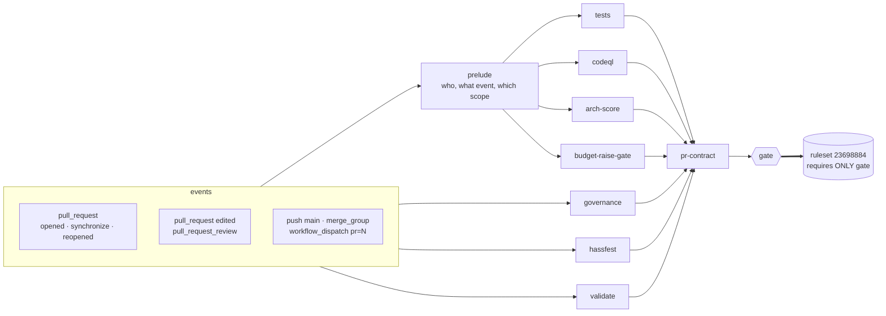

# One umbrella, one required check: the CI design, phase 2

Read-only design seat. Tree: `origin/main` at `07a09406a1cc97076a6f28581f87f313b322a6b6`.
Builds on phase 1, `refs/heads/probe/design-ci-layout` at `b7a76185` (its `DESIGN.md`
inventory and its `measure/readers.md` reader survey). Measured 2026-10-18. Nothing
in the repository was changed.

The owner's ask, mid-seat: **simple, robust, visual, wall-clock effective, no
unacceptable risk; redesign the underlying workflows where that simplifies the
whole; look carefully for scoping wins and for dependencies.** Each section below
says which of those it serves. The dependency investigation (section 3) produced the
largest single finding of the seat.

---

## 0. The answer on one screen



Plain-text version of the same picture:

```
events ──► prelude ──► tests ─────┐
   │          └──────► codeql ────┤
   ├────────────────► governance ─┤
   ├────────────────► hassfest ───┤
   ├────────────────► validate ───┼──► pr-contract ──► gate ══► the one required check
   │      prelude ──► arch-score ─┤
   │      prelude ──► budget-raise-gate
   (body units need the prelude only for the PR it verified)
```

| | today (origin/main) | after phase 1 | after this design |
|---|---|---|---|
| workflow files | 13 | 14 (+ `nightly.yml`) | **13**: `ci.yml` added; `pr-contract-rerun.yml`, `budget-raise-gate-rerun.yml` deleted |
| required contexts in ruleset 23698884 | 17 | 17 | **1** (`gate`, app 15368) |
| workflows a PR event starts | 8 | 8 | **1** (`ci.yml`) |
| top-level `concurrency:` blocks to reason about | 10 | 10 | **1** for the PR graph (`ci.yml`), plus the standalone ones that keep their own events: `merge-main`, `release`, `pages`, `nightly` |
| `cancel-superseded` jobs | 2 | 2 | **1** |
| held-run approval steps (`Approve the runs…`) | 4 copies, 375 run lines | 4 | **0** |
| dispatch targets after a bot push | 4 workflows | 4 | **1** (`ci.yml -f pr=N`) |
| PR critical path (section 3) | coverage → closures → composed-proof | same, composed-proof cheaper | **max(fast, closures)**: median **−342 s** per PR run, max −2012 s |

Every number is printed by a script under `measure/` (section 11 lists them).

**One-PR-or-two ruling: two PRs, phase 1 first** (section 8). Phase 1 is not
subsumed: it moves the scheduled lanes and their `environment:` secrets out of
`tests.yml`, which the umbrella then calls as a plain reusable. The dependency
finding below (drop the C1 composition) belongs in PR 1 in place of phase 1's
section 2(c).

---

## 1. What the measurements change about the brief

1. **The real PR critical path is a `needs:` edge, not a slow lane.** `closures`
   needs `coverage` only to download one composed recording
   (`tests/composed_closures.json` lists one script, `tests/boost_drift_replay.py`).
   For that, `closures` sits idle a median **972 s** after `closure-scope` has given
   it everything else (`critpath.txt`), and `composed-proof`, which proves that
   composition, is the last job of **22 of 24** PR runs. Replaying every PR run's DAG
   with that edge removed and the script recorded bare (charged its full recorded
   239.1 s on every run, an upper bound) ends the run a median **342 s** sooner, max
   2012 s; 1 of 24 runs is 163 s slower (`c1_counterfactual.txt`). It also deletes
   `composed-proof` from the PR graph. Section 3.
2. **Today's ruleset verdict is reproducible by one gate.** Over the 22 heads phase 1
   sampled, the proposed gate predicate and the 17-context ruleset agree on **22 of
   22**, and 10 of 10 perturbations move the gate as designed (`gate_replay.txt`).
   The gate is stricter in exactly one place, by design: a required job that is
   skipped without a declared scope decision fails it, where the ruleset counts a
   skip as passing.
3. **Bot heads run the code twice.** On **4 of 22** heads, Tests, CodeQL, Hassfest
   and Validate each ran once by dispatch **and** once more as the approved held
   `pull_request` run (`dupes.txt`). The umbrella's dispatch carries the PR number,
   so one dispatched run yields a complete gate. Approving held runs becomes
   unnecessary, and so does all 375 lines of it.
4. **Body edits and reviews are frequent and cheap.** Over 22 heads there were 14
   extra `pull_request` runs of each body reader (`edited`) and 7
   `pull_request_review` runs (`heads.txt`). Those events must never re-run the
   code. Section 4 makes them **verdict-only** events.
5. **The other workflows are cheap and off the critical path.** Governance median 190 s
   wall, Hassfest 31 s, Validate 52 s, PR contract 32 s, Architecture score 66 s,
   Budget raise gate 19 s, CodeQL 1306 s (python leg 1242 s), against Tests 2059 s
   (`durations.txt`, phase 1 `summary.md`). So per-job scoping of these buys runner
   seconds, never wall clock (section 6).
6. **`arch-score` is described as a required check but is not one.** Its own header,
   `tools/audit/archscore/ABOUT.md:7`, `tests/arch_score.py:4` and
   `.github/PULL_REQUEST_TEMPLATE.md:23` call it required. Ruleset 23698884 does not
   list it (`raw/ruleset_23698884.json`). Owner ruling D-2.
7. **The merge queue has never run.** `actions/runs?event=merge_group` returns 0 runs,
   and the rules on `main` carry no `merge_queue` rule (`raw/runs_merge_group.json`,
   `raw/rules_branch_main.json`). The design keeps `merge_group` for parity, because
   `tests/entities.py:28003-28036` pins it. Owner ruling D-3.

---

## 2. The umbrella layout

### 2.1 Files

| file | role | `on:` after |
|---|---|---|
| `.github/workflows/ci.yml` (new) | the umbrella: prelude, the unit calls, `cancel-superseded`, `gate` | `pull_request: [opened, synchronize, reopened, edited]`, `pull_request_review: [submitted, edited, dismissed]`, `push: [main]`, `merge_group`, `workflow_dispatch` (inputs `pr`) |
| `tests.yml` | unit | `workflow_call` + `workflow_dispatch` (unit probing; phase 1 already made dispatch PR-like) |
| `governance.yml` | unit | `workflow_call` + `workflow_dispatch` + its weekly `schedule` (standalone, unchanged) |
| `codeql.yml` | unit | `workflow_call` + `workflow_dispatch` + its weekly `schedule` (standalone, unchanged) |
| `hassfest.yml`, `validate.yml` | unit | `workflow_call` + `workflow_dispatch` |
| `pr-contract.yml`, `arch-score.yml`, `budget-raise-gate.yml` | unit | `workflow_call` + `workflow_dispatch` (new, for unit probing) |
| `pr-contract-rerun.yml`, `budget-raise-gate-rerun.yml` | **deleted** | their reason to exist is gone (section 4.3) |
| `nightly.yml` (phase 1), `merge-main.yml`, `release.yml`, `pages.yml` | standalone, not called | unchanged triggers |

**One naming rule:** the caller job id equals the unit's file stem. Every check
name is therefore `<file stem> / <job>`, for example `tests / fast (3.14)` or
`codeql / Analyze (python)`. A reader can find any check's source from its name
alone.

### 2.2 `ci.yml`, sketched

```yaml
name: CI
on:
  pull_request: { types: [opened, synchronize, reopened, edited] }
  pull_request_review: { types: [submitted, edited, dismissed] }
  push: { branches: [main] }
  merge_group: { types: [checks_requested] }
  workflow_dispatch:
    inputs:
      pr: { description: "PR whose head this ref is (bot heads); empty for a batch proof or main", required: false }

permissions: {}            # every job states its own grant

# THE ONE CONCURRENCY BLOCK of the PR graph. Callees carry none: inside a called
# workflow `github.workflow` is the CALLER's name, so a callee group would collide
# with this one.
concurrency:
  group: CI-${{ (github.event_name == 'pull_request' || github.event_name == 'pull_request_review')
                && github.event.sender.login != 'github-actions[bot]'
                && github.event.pull_request.number || github.run_id }}
  # Only a code push cancels; a body edit or a review QUEUES behind the run in flight.
  cancel-in-progress: ${{ github.event_name == 'pull_request' && github.event.action != 'edited'
                          && github.event.sender.login != 'github-actions[bot]' }}

jobs:
  prelude:            # read-only; base-restored program tools/ci/prelude.py
    permissions: { contents: read, actions: read, pull-requests: read }
    outputs: { kind, pr, base, head, gate_scope, codeql_actions, codeql_js, codeql_python }
  cancel-superseded:  # the one copy; --workflow ci.yml
    permissions: { contents: read, pull-requests: read, actions: write }

  # code units: skipped on verdict events (edited, review), by the event alone
  tests:
    needs: prelude
    if: needs.prelude.outputs.kind == 'code'
    uses: ./.github/workflows/tests.yml
    with: { gate_scope: "${{ needs.prelude.outputs.gate_scope }}", pr: "${{ needs.prelude.outputs.pr }}",
            base: "${{ needs.prelude.outputs.base }}", head: "${{ needs.prelude.outputs.head }}" }
    secrets: { CLOSURES_PUSH_TOKEN: "${{ secrets.CLOSURES_PUSH_TOKEN }}" }
    permissions: { contents: write, actions: write, pull-requests: read }   # = union of tests' job-level grants
  codeql:
    needs: prelude
    if: needs.prelude.outputs.kind == 'code'
    uses: ./.github/workflows/codeql.yml
    with: { legs: "${{ toJSON(needs.prelude.outputs) }}" }
    permissions: { contents: read, security-events: write }
  governance:         # no needs: it reads nothing the prelude decides
    if: github.event.action != 'edited' && github.event_name != 'pull_request_review'
    uses: ./.github/workflows/governance.yml
    permissions: { contents: read, pull-requests: read, issues: write }
  hassfest:   { if: <same>, uses: ./.github/workflows/hassfest.yml, permissions: { contents: read } }
  validate:   { if: <same>, uses: ./.github/workflows/validate.yml, permissions: { contents: read } }

  # body units: run on every event that names a PR (they take pr/base/head from the prelude)
  arch-score:
    needs: prelude
    if: needs.prelude.outputs.pr != ''
    uses: ./.github/workflows/arch-score.yml
    with: { pr: "${{ needs.prelude.outputs.pr }}", base: "${{ needs.prelude.outputs.base }}", head: "${{ needs.prelude.outputs.head }}" }
    permissions: { contents: read, pull-requests: read }
  budget-raise-gate:
    needs: prelude
    if: needs.prelude.outputs.pr != ''
    uses: ./.github/workflows/budget-raise-gate.yml
    with: { pr: "${{ needs.prelude.outputs.pr }}", base: "${{ needs.prelude.outputs.base }}", head: "${{ needs.prelude.outputs.head }}" }
    permissions: { contents: read, pull-requests: read, issues: read }
  pr-contract:
    needs: [prelude, tests, codeql, governance, hassfest, validate, arch-score, budget-raise-gate]
    if: ${{ !cancelled() && needs.prelude.outputs.pr != '' }}
    uses: ./.github/workflows/pr-contract.yml
    permissions: { contents: read, checks: read, pull-requests: read }

  gate:
    needs: [prelude, tests, codeql, governance, hassfest, validate, arch-score, budget-raise-gate, pr-contract]
    if: ${{ !cancelled() }}         # never skippable: a skipped required check would pass
    permissions: { contents: read, actions: read }
    # base-restored tools/ci/gate.py; section 4
```

The guards are as simple as possible, and each says one thing:
- **Code units** carry an event-only `if:` (skipped on verdict events).
- **Body units** carry `pr != ''` (skipped where no PR is named: `push`, a batch-proof
  dispatch). The gate does not require them on those events (4.1), so those skips
  are never required skips.
- **`gate`** carries only `!cancelled()`.

### 2.3 The prelude: compute once, pass explicitly

The prelude is one job and one base-restored program, `tools/ci/prelude.py`. It
replaces these, each of which today derives the event or the diff on its own:
- `tests.yml`'s "Decide the gate scope" step;
- `codeql.yml`'s `scope` job;
- the merge-queue naming step in `pr-contract`, `arch-score` and `budget-raise-gate`.

| output | how | consumers |
|---|---|---|
| `kind` | `code` for `pull_request` opened/synchronize/reopened, `push`, `merge_group`, `workflow_dispatch`, **and an `edited` whose payload carries `changes.base`** (a retarget moves the merge base, so the code verdict cannot be carried); `verdict` for any other `edited` and every `pull_request_review` | code units' `if:`; `gate` |
| `pr`, `base`, `head` | the payload on `pull_request`/review. On `merge_group`, from the queue ref, as `pr-contract.yml` does today. On dispatch, from input `pr`, **verified**: `pulls/N.head.sha == github.sha` and same repository, or the prelude fails and the gate fails closed | body units, `tests` (autofix), `gate` |
| `gate_scope` | `auto` on `pull_request`, `merge_group` and dispatch; `full` on `push` (CLAUDE.md rule 1, unchanged) | `tests` (`fast` reads the input instead of deciding) |
| `codeql_<leg>` | `tools/pr/codeql_scope.py decide`, unchanged | `codeql` |

On `kind == verdict`, the prelude first **waits** for any code run of `ci.yml` at this
head that is still in progress, by polling `actions/workflows/ci.yml/runs?head_sha=`,
bounded by `timeout-minutes`. Concurrency already serialises the same-PR group. The
wait covers dispatch runs, which sit in run-id groups. It also guarantees that this
run's `gate` check is created after the code run's, so the newest `gate` at the head
is always the one that saw both the code verdict and the newest body or review.

`closure-scope` stays inside `tests`. It is the measured-closure machinery itself:
lane proofs, `closures.json`, and `a1_dispatch_arms.sh`'s `steps[2]` pin. Moving it
would be churn with no wall-clock gain, since `fast` and `closures` need its outputs
either way.

---

## 3. Dependencies: every edge, what it carries, what it costs

The investigation the owner asked for. `measure/deps.py` parses every `needs:` edge
in every workflow file. It classifies what the dependent reads of its need:
- an output;
- the need's result;
- an artifact the need uploads;
- an Actions-API read of the run;
- or nothing, meaning the edge only orders the two jobs.

It then replays every measured PR run's DAG, with durations and per-job queue
latency held fixed, once per edge with that edge removed. The table lists every
edge that costs wall clock, in order of cost. Full output: `deps.txt`.

| edge | carries | binding in | run ends sooner without it: median | max |
|---|---|---|---|---|
| **`coverage → closures`** | artifact `composed-closures` (one script's recording) | 29/30 | **323 s** | 1358 s |
| `closure-scope → coverage` | output `coverage_skip` | 30/30 | 26 s | 150 s |
| `scope → analyze` (CodeQL) | output `[matrix.language]` | 10/10 | 20 s (off the critical path) | 90 s |
| `closures → composed-proof` | artifacts | 27/30 | 18 s | 1223 s |
| `mutation-pins → mutation-autofix` | artifact `mutation-pins*` | 4/30 | 0 s | 106 s |
| every other edge (31) | outputs / result / artifact | – | 0 s | ≤ 27 s |

No edge carries nothing. The three that looked order-only, `fast`, `coverage` and
`closures` into `ci-ratchet`, read those jobs' metrics artifacts through the Actions
API. Those are data edges the static parse cannot see.

### 3.1 The finding: drop the C1 composition (W1)

Why the composition exists:
- `closures` re-records every in-scope script under `strace`.
- C1 (round 9) lets it take one script's recording, `tests/boost_drift_replay.py`'s,
  from `coverage`'s traced run instead. That needs the `coverage → closures` edge,
  plus `composed-proof` to prove traced equals bare.

What it costs, measured:
- `closures` waits a median 972 s for that one artifact (`critpath.txt`).
- The saving it buys is that script's bare recording: 239.1 s, recorded seconds in
  `tests/closures.json`.
- `composed-proof` then ends 22 of 24 PR runs.

**Recommendation: drop it.**
- Remove `closures`' `needs: coverage`, the "Fetch/Verify and stage the composed
  recordings" steps, the `composed-proof` job, and `coverage`'s composed upload.
- Bare recording is already the path every C1 refusal takes ("a refusal consumes
  nothing: every script records bare"). The change therefore adds no new code path.
  It makes the fail-closed path the only path.

| variant | median gain | min | max | runs slower |
|---|---|---|---|---|
| **V1: drop C1** (script charged 239.1 s on every run, an upper bound) | **342 s** | −163 s | 2012 s | 1/24 |
| V2: split `closures` into `closures-record` (parallel) + a 120 s judge after `coverage` | 343 s | −69 s | 1234 s | 1/24 |

V2 keeps C1 and gains the same median, but adds a job, a second artifact hop and the
proof machinery. **V1 is chosen**, because it is as fast and strictly simpler. It
can later delete, too:
- `tests/composed_closures.json`;
- `tools/coverage/composed_proof.sh`;
- `closure.py composed-verify` / `CHEAP_ARGV_OR_ENV`;
- their `entities.py` pins.

This is also why phase 1's 2(c) (re-gate composed-proof, 18.5 s) is superseded: the
job leaves the PR graph instead.

On a push to main, `closures` (median 1554 s, plus at most 239 s) stays under `fast`
(median 2893 s), so main's wall clock does not move (phase 1 `summary.md`, push
table).

C1 was an owner-accepted round-9 measure, so this is **owner ruling D-4**. It does
not depend on the umbrella, and lands in PR 1 (section 8).

**What a PR run looks like, before and after.** This is run 39158231320, head
`0e238c3042`, whose measured V1 gain (339 s) is near the median. The bars are its
own job times; the "after" is the replay plus the umbrella's tail, estimated in
3.3.

```mermaid
gantt
  title One PR run (39158231320), seconds from start
  dateFormat X
  axisFormat %s
  section before
  closure-scope        :14, 33
  coverage             :76, 1102
  fast (3.14)          :43, 1967
  closures (waits for coverage) :crit, 1105, 2291
  composed-proof       :crit, 2295, 2314
  codeql python        :97, 1680
  section after (W1 + umbrella)
  closure-scope        :14, 33
  coverage             :76, 1102
  fast (3.14)          :43, 1967
  closures (+239 s boost bare) :36, 1461
  codeql python        :97, 1680
  pr-contract + gate   :crit, 1975, 2030
```



### 3.2 Dependencies the graph does not show (cross-run and cross-workflow)

Each reader below must keep reading the same thing after the move. "Effect" says
what the umbrella does to it.

| reader | reads | produced by | effect |
|---|---|---|---|
| `fast` drift baseline | cache `drift-baseline-*` | main push and PR runs | none: caches are scoped by repository and branch, not by workflow |
| `coverage` per-script cache, `covtrust` | cache keyed by base, provenance `push refs/heads/main $BASE` | main push run's coverage | none: same event, same key |
| `closure-scope` lane skip | caches `lane-proof-{fast,coverage,browser}-*` | `lane-proofs` of an earlier PR run | none: same keys |
| `closures` proof-consume | `actions/artifacts?name=closure-recordings-tree-<T>` | batch-proof dispatch run | none: the artifact is looked up by name, repository-wide |
| **`ci-ratchet`** | `actions/workflows/tests.yml/runs?event=push` durations, and the `ci-metrics-*` artifacts | Tests push runs | **changes meaning.** A `ci.yml` run's wall time includes CodeQL's and Governance's. `tests/ci_ratchet.py` must measure the span of the `tests / *` jobs inside the `ci.yml` push run, not the run's wall time, or `tests/ci_budgets.json`'s ratchet compares two different quantities. Null control: its number over the last 8 old push runs equals the new reader's over the same runs |
| `nightly-status` | `nightly.yml` runs (phase 1) | the nightly | none: `nightly.yml` stays standalone and its job names keep no prefix |
| `pr-contract` red list | `commits/<head>/check-runs`, every failing name | every workflow | names change to `<unit> / <job>`, and it must also exclude `gate` (section 4.3) |
| `cancel_superseded.py --workflow X` | runs of its own workflow on the branch | itself | one copy, `--workflow ci.yml` |
| `merge_main_bot.py` PIN_CHAIN | in-flight runs' job names | tests | regex gains the `tests / ` prefix |
| `stamp.py` | "the Tests workflow for HEAD succeeded" | Tests push run | reads the `gate` job of the `ci.yml` push run at HEAD, which is stricter and exact |
| tick, `merge_train` | ruleset contexts live, minus `PR_ONLY` | ruleset | the required set is `{gate}`; `gate` runs on every event, so `PR_ONLY` becomes empty |
| `budget-raise-gate` re-grade | reviews, live | reviewer | becomes a verdict event of `ci.yml` (section 4) |
| artifacts **between units** | – | – | **new capability.** Artifacts are per run, and the umbrella is one run. Nothing in this design needs it beyond what `tests` already does internally; it is noted so no one adds a cross-run API lookup for a same-run artifact |

### 3.3 What the umbrella itself adds to the critical path

`pr-contract` now runs last, so that its red list is final. That deletes the rerun
workflow whose only job was to catch reds landing after it. `gate` follows it.

Estimated tail:
- `pr-contract`: median 28 s (`durations.txt`);
- `gate`: about 15 s. This is an estimate, by analogy with `budget-raise-gate`'s 16 s
  checkout-plus-python job;
- two queue hops: about 4 s each (phase 1 `tail.txt`).

Total about **+50 s**, against W1's −342 s. Net, the median PR is about **5 minutes
faster**.

Considered and rejected:
- **Splitting the autofix chain out of `tests` so the gate need not wait for it.** It
  would only move a red verdict earlier on the 2 of 20 PRs whose `mutation` refuses
  (the pin chain, median 2940 s). The required check is red either way. The cost
  would be workflow-output plumbing for three job results.

---

## 4. The gate: exact semantics and their null control

### 4.1 The predicate

`tools/ci/gate.py`, restored from the base as every grader is, and run under
`python3 -I`. Its inputs are its own run id and attempt, and the prelude's `kind`,
`pr` and `head`. It reads only the Actions API, with `actions: read`.

```
REQUIRED = {                                   # the 17 contexts of ruleset 23698884, renamed
  "tests":       ["fast (3.14)", "browser", "briefs", "typing", "mutation", "closures",
                  "closure-scope"*],            # * not on push: it never ran there (if:)
  "governance":  ["policy-docs", "wave-script", "env-matrix"],
  "codeql":      ["Analyze (actions)", "Analyze (javascript-typescript)", "Analyze (python)"],
  "hassfest":    ["hassfest"],   "validate": ["validate-hacs"],
  "pr-contract": ["pr-contract"]†, "budget-raise-gate": ["budget-raise-gate"]†,
  "arch-score":  ["arch-score"]†‡,             # † only when a PR is named   ‡ owner ruling D-2
}

gate(run):
  if kind == code and pr == "" and event != push:
      if head is the head of any open PR: FAIL "name the PR (dispatch -f pr=N)"
  jobs  = latest attempt of every job in THIS run
  if kind == verdict:
      code_run = newest COMPLETED ci.yml run at head with kind == code      # the prelude waited for it
      if none: FAIL "no code verdict at this head"
      jobs = jobs ∪ { the code units' jobs of code_run }                    # carried, never re-run
  for unit, names in REQUIRED (applicable to this event):
      for n in names:
          j = jobs["<unit> / <n>"]
          absent            -> FAIL "<unit> / <n>: ABSENT"
          not completed     -> FAIL "PENDING"
          success           -> ok
          skipped           -> FAIL "SKIPPED"            # no exceptions, see 4.2
          anything else     -> FAIL <conclusion>
  every other job: reported in the summary, never gating   # as today: coverage, nightly-status, autofix …
```

### 4.2 "Unless the skip is the scope decision": no required job ever skips

The brief allows a skip that is the scope decision. The simpler and more robust
version is that **no required job may skip at job level at all**. A scope decision
is a **step-level stand-down**, so the job succeeds and prints its decision:
- `fast` already works this way (`fast_skip`);
- so do the CodeQL legs (O17);
- and so does `closures`' docs-only arm.

The one required job with a job-level scope skip today is `browser`
(`if: … browser_skip != 'skip'`). It moves to step level. That costs one runner-start
on the PRs where it scopes out, and it executed on 20 of 20 measured PR runs anyway
(phase 1 `summary.md`).

With that change:
- the gate needs no scope declarations;
- a carried run needs none either;
- **every** skipped required job is a defect the gate refuses.

`gate_replay.py`'s perturbation "browser skipped, prelude declared no skip" is
exactly that refusal.

### 4.3 Events, and what each one recomputes

Each unit's inputs are explicit, so each event recomputes only the units whose
inputs it changes, and carries the rest:

| event | tree | body | reviews | runs | carried |
|---|---|---|---|---|---|
| `pull_request` opened / synchronize / reopened | changed | – | – | everything | nothing |
| `pull_request` edited (body) | – | changed | – | arch-score, budget-raise-gate, pr-contract, gate | code units from the newest code run at the head |
| `pull_request` edited (`changes.base`, a retarget) | merge base moves | – | – | everything (`kind = code`) | nothing |
| `pull_request_review` | – | – | changed | arch-score, budget-raise-gate, pr-contract, gate (arch-score re-runs its 62 s rather than adding a third carry rule) | code units |
| `workflow_dispatch -f pr=N` (bot heads) | changed | – | – | everything | nothing |
| `workflow_dispatch` (no `pr`: batch proof, main) | changed | – | – | code units; body units stand down | – (refused at a PR head) |
| `push` main | changed | – | – | code units, FULL scope | – |
| `merge_group` | changed | – | – | everything, PR from the queue ref | – |

Consequences, each a simplification:
- **`pr-contract-rerun.yml` is deleted.** `pr-contract` needs every unit, so its red
  list is final within the run. Workflows outside the umbrella write no check at a PR
  head except `merge-main`, which writes none.
- **`budget-raise-gate-rerun.yml` is deleted.** A review is a verdict event of `ci.yml`
  itself, so its `gate` is the newest at the head. A **dismissal** also re-grades:
  today's rerun only fires on `success`, while the review run's own red stays visible.
- **The `#1514` hazard can't occur.** A skipped job writes a check run that supersedes
  the real one. Here the only required check, `gate`, is never skipped. The code
  units' skipped caller rows on verdict events are named `tests`, `codeql` and so on,
  not any required name.
- **`R9-RC-PRCONTRACT` and `#2007`** can't occur either. Those were a synchronize and
  an edited event at one head cancelling each other. Verdict events queue, never
  cancel, and are never cancelled by another verdict event.

### 4.4 Null control and perturbations (run here)

`python3 -I measure/gate_replay.py measure/raw` (`gate_replay.txt`):

| control | result |
|---|---|
| null: 22 measured heads, gate vs the 17-context ruleset | agree on **22/22**, 0 differ |
| required job absent / pending / failed / cancelled | ruleset FAIL, gate FAIL (4 of 4) |
| required job skipped, no scope decision | ruleset **pass**, gate **FAIL**: the designed difference |
| browser skipped by the scope decision | pass / pass |
| browser skipped, nothing declared it | pass / **FAIL** |
| non-required red (`delivery-status`, `nightly-status`) | pass / pass: not newly required |

Run: `GATE-REPLAY rc 0`.

After 4.2, the declared-skip arm is dead by construction. The replay keeps it so the
historical `browser` skips, if any had occurred, would still be classified.

---

## 5. Permissions, secrets, held runs, loop guards

**Permissions.** A caller job's `permissions:` caps the token of every job in the
unit it calls. Each callee job keeps its own job-level block, which can only narrow
the token. The caller grants in 2.2 are each the union of that unit's job-level
grants, and no more. Today's per-job token sets were measured from the "Set up job"
log headers (`permset_baseline.txt`, 29 jobs, 8 workflows). They are the before-side
of every unit's null control (section 7).

What a callee job **without** its own block receives was not measured (section 10).
That is exactly what `unitcheck.py`'s permission half compares.

**Secrets.** Passed explicitly per caller, never `inherit`:
- `tests` needs only `CLOSURES_PUSH_TOKEN`. The autofix pushes use it, and phase 1
  moves the ledger and record secrets, with their `environment:`s, into
  `nightly.yml`, which stays standalone.
- `HPO_RUNS_PEM` and `HPO_RUNS_APPID` are no longer read by any called workflow
  (below).
- Every other unit uses `GITHUB_TOKEN` alone.

**Held runs.** After a `GITHUB_TOKEN` push, the three autofix jobs and `merge-main`
dispatch:

```
gh workflow run ci.yml --ref "$HEAD_REF" -f pr="$PR_NUMBER"
```

That one run yields a complete `gate`, body units included, because the prelude
verified the PR. Nothing needs approving:
- the four "Approve the runs…" steps (375 run lines) are deleted;
- the 4-of-22 duplicate code runs go with them;
- `merge-main`'s `pushed.txt` gains the PR number.

A `CLOSURES_PUSH_TOKEN` (PAT) push still re-triggers `pull_request` and dispatches
nothing, as today. If GitHub holds a `pull_request` run at a bot head, it stays held.
A held run has no jobs and writes no `gate`. If someone approves it later, it is a
harmless second verdict.

**Bot loop guards, re-checked:**

| guard | today | after |
|---|---|---|
| `autofix_allowed(event_name == 'pull_request', …, commit_subject != loop_subject)` | keys on the event and the head subject | unchanged. `github.event_name` inside a called workflow is the caller's event; a dispatch still skips the autofix jobs |
| subjects `ci: re-record closures` / `ci: drop inherited claims` / `ci: pin killed mutants` / `ci: merge main` | head-subject loop guards | unchanged |
| a dispatch re-dispatching | autofix jobs run only on `pull_request` | unchanged: a `ci.yml` dispatch runs no autofix job, so it cannot loop |
| verdict events | – | a body edit or a review runs no code unit, so it can never trigger an autofix |
| a `workflow_run` re-run loop | two rerun workflows re-ran jobs on completion | **none left**: no `workflow_run` trigger re-runs anything in the PR graph |

---

## 6. Scoping: verdict per workflow, and every opportunity looked at

The rule, from the brief: **a unit may be scoped only by measured closures, and CodeQL
defaults to always-on.** Two measured facts frame every row:
- Tests is the only unit on the wall-clock path (section 1.5).
- Every scope decision is a step-level stand-down (section 4.2).

| unit | verdict | why |
|---|---|---|
| `tests` | **scoped, unchanged**: `GATE_SCOPE=auto` from measured `tests/closures.json` on PR, merge_group and dispatch; `full` on push | the whole safety argument of CLAUDE.md rule 1. The prelude only passes the value; `closure-scope` keeps deciding |
| `codeql` | **called on every event (always-on)**; the existing O17 per-leg stand-down is kept | O17 is not a reach approximation. It is a suffix allow-list of what each extractor provably never reads, fail-closed (an unknown suffix analyzes; `.github/` analyzes every leg). Its measured value is 23-26 min saved on 76 of 144 round-10 PRs (`codeql_scope.py`'s docstring). To make it *measured* in the rule's sense, unit U3 adds a check: on push runs, the files each leg's database extracted (its source archive) contain no file with a suffix on that leg's INERT list. That check demonstrably fails if `.py` is added to python's list. Owner ruling D-5 |
| `governance` | always-on | no measured closures; 190 s wall, off path |
| `hassfest`, `validate` | always-on | 31 s / 52 s; `hacs/action` also reads repository metadata outside the tree, so no tree closure could be exact |
| `pr-contract`, `arch-score`, `budget-raise-gate` | always-on per event (the table in 4.3) | body, review and base readers, seconds long |

Every scoping opportunity examined, with its measured value:

| candidate | exact? | runner s / PR | wall s / PR | verdict |
|---|---|---|---|---|
| **W1 drop the C1 edge** (3.1) | yes: the bare path is today's fallback | −16 (`composed-proof`) +≤239 | **−342 median** | **do** |
| **W2 one dispatch at bot heads** (5) | yes | one whole duplicate code run, on 4/22 heads | 0 (the duplicate ran beside it) | **do** |
| **W3 verdict events carry code** (4.3) | yes: inputs unchanged | no change from today's split files | 0 | **do** (it is what makes `edited` safe in one file) |
| **W4 no prelude edge for units that read nothing from it** (2.2) | – | – | ~20 s off the paths of governance, hassfest and validate (none critical) | **do**, for simplicity: no edge that carries nothing |
| **W5 CodeQL `scope` folded into the prelude** | yes | −1 job (16 s) | 0 | **do**: one decision job |
| `typing` stand-down via `tests/typing_ruler.py`'s measured closure (82 files) | only if that recording's argv is the CI `--mypy` invocation: **unverified** | 79 | 0 | no: off path |
| `arch-score` stand-down when the diff misses `custom_components/` | yes by construction: the base's scorer reads only the two commits' `custom_components/` | 62 | 0 | no: off path, and D-2 is open |
| `hassfest`/`validate` path skip | no (repository metadata) | 75 | 0 | no |
| `governance` jobs scoped | no closures | ~455 | 0 | no |
| CodeQL JS leg skips a python-only diff | yes by extractor | 72 | 0 | no: CodeQL default always-on |
| carry verdicts across a bot `ci: re-record closures` commit | **no**: `closures.json` decides `GATE_SCOPE` for every script | ~a full run | ~35 min on 2–3/20 PRs | **no: unacceptable risk** |
| extend lane proofs to every unit (same diff and base already green) | yes | only on identical re-runs | only there | no: the one frequent case, bot heads, is W2 |
| split autofix out of `tests` (3.3) | – | 0 | earlier red on 2/20 | no |

---

## 7. Ruleset plan (mandate 6175172275)

Today, ruleset 23698884 requires 17 contexts, with no integration id except
`budget-raise-gate` (15368) (`raw/ruleset_23698884.json`).

After:

```json
"required_status_checks": [ { "context": "gate", "integration_id": 15368 } ]
```

Pinning the GitHub Actions app means no other app can satisfy `gate`. Today 16 of
the 17 contexts are unpinned.

**The cut-over.** The orchestrator holds the freeze (`orchestrator.md` section 7):
1. Freeze merges. Save the live ruleset JSON as the rollback copy.
2. PR 2 is green on its own head. Its `pull_request` runs use the head's `ci.yml`, so
   it produces `gate` and none of the 17 old names. Edit the ruleset to `[gate]`
   under the mandate.
3. Merge PR 2. Then `main`'s push run must show `gate` green (`orchestrator.md` §11:
   "then `main` is green after it").
4. For every open PR, merge `main` in (`merge_train` "main merged in"; `merge-main`
   only handles DIRTY ones). A PR based before PR 2 runs the old workflows and has no
   `gate` until then. Its old checks no longer bind.
5. Unfreeze.

**Rollback:** revert PR 2 and restore the saved ruleset. Both are single actions.

**Recorded state.** `tools/policy/fixtures/required-contexts.json` becomes
`contexts: ["gate"]`, plus a `gate_required` list: the 17 renamed names, plus
`arch-score / arch-score` if D-2 rules it in. `counts.mjs`'s live drift check then
compares one context. `entities.py` gains one assertion: `gate.py`'s `REQUIRED`
equals the fixture's `gate_required`.

---

## 8. One PR or two: **two, phase 1 first**

Phase 1 is not subsumed by the umbrella, for four reasons:
- It moves `mutation-ledger`/`-push` (`environment: ledger`) and `record-autofix`
  (`environment: record-writer`) and their App secrets into `nightly.yml`. A called
  `tests.yml` then needs one secret and no environment.
- It deletes `recheck-gate`, which the umbrella would otherwise have to re-plumb
  through inputs.
- It needs no ruleset edit. PR 2 needs one, so PR 2 is the one that must be timed
  to a freeze.
- Its nightly-status window (phase 1 R-4) and its closures re-record cycle should not
  share a merge with a ruleset cut-over.

Two changes to PR 1 come out of this seat:
1. **Replace phase 1's 2(c) with W1** (drop the C1 composition), owner ruling D-4.
   It is tests-internal, needs no umbrella, and is worth −342 s per PR now.
2. **Add an inert `ci.yml` stub to `main`.** Its content is `on: workflow_dispatch`
   and one no-op job. `workflow_dispatch` only dispatches a workflow file that
   exists on the default branch. Without the stub, no `probe/ci-layout-<unit>` ref
   can dispatch the umbrella, and the fan-out below cannot be verified. Classify it
   with the rest of the change, in `tests/closure.py`'s `GATE_FILES` (it decides
   `GATE_SCOPE`), so `tests/entities.py` does not refuse an unclassified file. If the
   owner wants PR 1 untouched, the stub is a one-file PR 1b.

PR 2 is the umbrella and every reader of section 9, in one diff. It is authored by
`hpo-author` via `tools/pr/app_push.sh`, and is a policy PR (section 9's policy
rows), so it needs the owner's approving review before merge.

---

## 9. Every reader's change (PR 2, one diff)

Phase 1's `readers.md` covers the tests.yml job readers. Its sections (a)–(i) still
hold for the job **ids**, which do not change. This table adds what the **check
names**, workflow **names**, workflow **files** and **dispatch** readers need
(`readers2.sh` → `readers2.txt`).

| reader | change |
|---|---|
| `tools/policy/fixtures/required-contexts.json` | `["gate"]` + `gate_required` (section 7) |
| `tests/entities.py` `_rc_producer` / `_RC_SKIPPED` / merge-group producers (:27701-27752, :28003-28036) | the producer of `gate` is `ci.yml:gate`; assert `gate` has no `if:` beyond `!cancelled()`, `ci.yml` has no path or branch filter on PR events, and every `gate_required` name maps to a unit job |
| `tests/entities.py` `edited` rule (:27650-27688, `_EDITED_NULL`) | replace with: `ci.yml` lists `edited` and `pull_request_review`; every code-unit caller is guarded by the event alone; no required job is skippable (the browser change, 4.2) |
| `tests/entities.py` concurrency pins (:27770-27969) | one block in `ci.yml` (cancel only on code `pull_request` by a non-bot sender); **every callee has no top-level `concurrency:`**; the pr-contract and budget-raise-gate twin pins move to the edited/review queueing rule |
| `tests/entities.py` rerun-list derivation (:28511-28575) | replace with: no `workflow_run` file re-runs a PR-graph job |
| `tests/entities.py` `_NS_OVERRIDES`, `_PRW_SUBJECTS`, `_prw_defects` | `ci.yml:cancel-superseded` replaces `tests.yml:` and `codeql.yml:`; new assertion that each caller's grant equals the union of its callee's job-level grants |
| `tests/entities.py` `_AF_DISPATCHED` (:20189) | `{"ci.yml"}` with `-f pr=` |
| `tests/entities.py` C1 pins (`composed_closures.json`, `CHEAP_ARGV_OR_ENV`) | removed with W1 (PR 1) |
| `tests/closure.py` `GATE_FILES` | `+ .github/workflows/ci.yml`, `+ tools/ci/` (prelude/gate programs) |
| `tests/ci_ratchet.py:177` (`"Tests"`) and the `ci-ratchet` job's `tests.yml/runs` URL | `ci.yml`, measuring the `tests / *` span (3.2) |
| `tools/release/stamp.py:173` `TESTS_WORKFLOW` | reads the `gate` job of the `ci.yml` push run at HEAD; fixtures :810-835 |
| `tools/audit/seat/proof_watch.py` (`"Tests"` fixtures, `self.required`) | `gate` |
| `tools/audit/seat/merge_train.py` `DISPATCH` (:290), `PR_ONLY` (:286), `--ignore-red nightly-status` (:3097) | `(("ci.yml", ()),)` (a batch proof names no PR); `PR_ONLY = ()`; `tests / nightly-status` |
| `tools/audit/seat/orchestrator_tick.py` `PR_ONLY` (:120) | `()`. NIGHTLY_CLASS/BOT_LANE are substring regexes: unaffected |
| `tools/pr/merge_main_bot.py` PIN_CHAIN (:146) + self-test | `^tests / (?:mutation\|mutation-pins(?: \(.*\))?\|mutation-autofix)$` (pin-plan already folded by phase 1) |
| `.github/workflows/merge-main.yml` | dispatch `ci.yml -f pr=`; approve step deleted; `pushed.txt` carries the PR number |
| `tools/policy/policy_lint.mjs` `PR_CONTRACT_CHECK` (:6077), `MAIN_STATE_REPORTERS` (:6096), REPORTER_INPUTS | `pr-contract / pr-contract`; `tests / nightly-status`, `governance / delivery-status`; REPORTER_INPUTS `+ ci.yml` |
| `pr-contract.yml` "List the red checks" | exclude its own name **and `gate`** (`gate` is red whenever anything required is red; not excluding it deadlocks the body) |
| `tools/audit/round4/D11/governance_cost.py` GOV | drop `rerun-stale-verdict`, `rerun-stale-contract`; its check-run seconds strip the `<unit> / ` prefix |
| `tools/policy/agreement_py.py` / `agreement.mjs` (governance-workflow-jobs pair) | `_GOV_FILES` drops the two rerun files. New `ci.yml` ids `pr-contract`, `budget-raise-gate` are in GOV **and** job ids of governance files: both readers say yes, the pair agrees; `governance`, `gate`, `prelude` are in neither |
| `dev/audit/rounds/round6/D11/fix/codeowners_gap.py` `self_test_only_required` | the one required id is `gate`, which is not self-test-only |
| `tools/pr/ci_predict.py`, `tools/audit/seat/ci_predict_replay.sh`, `autofix_statuses.sh`, `failure_logs.sh` | job names with the `tests / ` prefix |
| `tools/audit/seat/ci-watch.sh` fixtures (REQ17/PRESENT12) | a `gate` fixture |
| `tools/audit/seat/record_row.py` | none (the required set is passed in) |
| `tools/policy/budget_raise_gate.py --rerun-stale`, `tools/pr/contract_rerun.py` | entry points retired with their workflows |
| `tests/arch_score.py:132` (reads `arch-score.yml` steps) | unchanged path; its steps keep their names |
| `tools/audit/seat/a1_dispatch_arms.sh` `steps[2]` | unchanged (`closure-scope` keeps its steps) |
| **policy text** (owner approval before merge) | `dev/governance/rules/ci-autofix.md` (one dispatch, no approval, `tests / ` names), `dev/governance/roles/orchestrator.md` §11 ("every gate lane ran" becomes "`gate` passed at the head"), `defect-root-cause.md` (reporter names), `.claude/skills/steward/SKILL.md:106` (pr-contract runs last), `.claude/workflows/web-fragments.md` (the `gh workflow run ci.yml -f pr=` mapping), `.github/PULL_REQUEST_TEMPLATE.md:23`, then `node tools/policy/rules_sync.mjs` and `--check` |
| record | `dev/programme/HANDOVER.md`, `tests/README.md`, `nudge.md:23,52,57` |
| `tests/closures.json` | **not edited by hand**: the closures re-record lands via `closures-autofix` on Linux (`ci-autofix.md`, `gate-scoping.md`) |

---

## 10. Fan-out: the iteration units

Each unit is developed on its own `probe/ci-layout-<unit>` ref. There, `ci.yml`
calls only `prelude`, that one unit, and `gate`, with `REQUIRED` cut to that unit.
Each is verified alone by:

```
gh workflow run ci.yml --ref probe/ci-layout-<unit> [-f pr=<a draft probe PR from that ref>]
```

This needs the stub from PR 1 on `main`.

**Per-unit null control: `measure/unitcheck.py`.**
- **BEFORE** is that unit's workflow run today, at the probe's base: dispatched where
  the file has `workflow_dispatch`; otherwise the newest `pull_request` run.
- **AFTER** is the probe dispatch.
- It compares (a) the **executed step set** (phase 1's `stepset.py` rule) and (b) the
  **token-permission set per job**, read from the "Set up job" log header, with the
  `<unit> / ` prefix stripped. The umbrella's own jobs are ignored.
- **Pass = lost 0, gained 0 on both.**
- Its self-test, run here on three units (`unitcheck_selftest.txt`):
  - a prefixed copy passes;
  - one dropped step fails;
  - one widened grant fails.

| unit | ref | what it changes | depends on | null control |
|---|---|---|---|---|
| U0 skeleton | `probe/ci-layout-gate` | `ci.yml`, `tools/ci/prelude.py`, `tools/ci/gate.py`, the naming rule, concurrency | stub on main | `gate_replay.py` over the probe's own runs. Plus three live perturbation refs: a unit forced red → `gate` FAIL; a required job given `if: false` → `gate` FAIL "SKIPPED"; a unit removed → FAIL "ABSENT" |
| U1 hassfest | `probe/ci-layout-hassfest` | `workflow_call`; drop `concurrency`, `push`, `pull_request`, `merge_group` | U0 interface | unitcheck vs `hassfest.yml` dispatched at the base |
| U2 validate | `probe/ci-layout-validate` | as U1 | U0 interface | as U1 |
| U3 codeql | `probe/ci-layout-codeql` | `workflow_call`; legs from inputs; `scope` job and `cancel-superseded` removed; the extracted-files soundness check (D-5) | U0 (prelude computes legs) | unitcheck, ignoring `scope` (moved); `scope`'s step "decide" re-appears as a prelude step |
| U4 governance | `probe/ci-layout-governance` | `workflow_call`; `concurrency` removed; `record`/`delivery-status-publish` keep their `push` guards | U0 interface | unitcheck vs a dispatch; on push the `issues: write` jobs are checked once after merge (R-3) |
| U5 tests | `probe/ci-layout-tests` | `workflow_call` inputs (`gate_scope`, `pr`, `base`, `head`); `fast` reads `gate_scope`; `browser` stand-down to step level; `cancel-superseded` and `concurrency` removed; autofix dispatch `ci.yml -f pr=`; approve steps deleted | **PR 1 merged**, U0 | unitcheck vs a dispatch, with a map: dropped `cancel-superseded`, dropped approve steps, renamed "Decide the gate scope" → prelude; the browser stand-down gains a "say the decision" step |
| U6 pr-contract | `probe/ci-layout-pr-contract` | `workflow_call` + `workflow_dispatch`; PR from inputs; red list excludes `gate` | U0 | unitcheck vs its `pull_request` run on a draft probe PR; perturbation: a red non-required job at the head must appear in `--red` |
| U7 arch-score | `probe/ci-layout-arch-score` | as U6, minus the red list | U0 | as U6 |
| U8 budget-raise-gate | `probe/ci-layout-budget` | `workflow_call`; review trigger moves to `ci.yml`; rerun file deleted | U0 | unitcheck vs its `pull_request` run; then submit and dismiss a review on the draft probe PR: two verdict runs, gate pass then FAIL, no code unit re-runs |
| U9 readers | `probe/ci-layout-readers` | section 9's table | the naming rule only (fixed in this design) | `./tests/run.sh` scoped gate green; each changed self-test's perturbation |
| U10 bots | `probe/ci-layout-bots` | `merge-main.yml`; the two rerun deletions | U0, U5 | dry-run `merge-main` dispatch (`dry_run=true`) prints one `ci.yml` dispatch per branch |

Dependency order:
- U0 first, as an interface contract this document fixes: inputs, outputs, the
  naming rule and the `REQUIRED` table.
- U1–U4 and U6–U9 run in parallel from it.
- U5 waits for PR 1.
- U10 waits for U5.

PR 2 is assembled from all units on `probe/ci-layout-all`.

**The final combined null control, which the owner runs once** (on a draft PR from
`probe/ci-layout-all`, pushed by the App):
1. **Step and permission sets.** `unitcheck.py` with BEFORE = the union of the 8 old
   workflows' `pull_request` runs on a twin PR carrying the same diff on main's
   layout, and AFTER = the umbrella run. It must print `lost 0 gained 0`. The only
   allowed map entries: `prelude`, `gate` and one `cancel-superseded` gained; two
   `cancel-superseded` and CodeQL `scope` dropped; the C1 steps already gone in PR 1.
2. **Verdict equality.** `gate_replay.py` at both heads: the ruleset-17 verdict on the
   twin equals the `gate` verdict on the umbrella head.
3. **Three events.**
   - A body edit: one verdict run, no code unit executes, and `gate` keeps the
     carried verdict.
   - A review submit then dismiss: gate pass, then FAIL, on a branch that raises a
     budget.
   - A commit that breaks `briefs`: `gate` FAIL naming `tests / briefs`.
4. **Bot head.** `gh workflow run ci.yml --ref <branch> -f pr=<n>` produces a complete
   `gate`, with no held run approved.

---

## 11. Risks, and what could not be measured

**Risks**
- **R-1, the cut-over window.**
  - What: PRs based before PR 2 have no `gate` until `main` is merged in (section 7,
    step 4).
  - Bounded by: the freeze. Rollback is two actions.
- **R-2, verdict-event queueing.**
  - What: a body edit made while a code run is in flight produces its `gate` only
    after that run ends (median 2059 s today). The body fix lands in the code run's
    own `pr-contract`, which reads the body live at the end.
  - Why accepted: the wait is the price of never cancelling a verdict and never
    carrying a pending one. A shorter alternative needs a re-run hook, which is
    exactly the `workflow_run` machinery this design deletes.
- **R-3, grants on `push`-only jobs.**
  - What: Governance's `record` and `delivery-status-publish` hold `issues: write`,
    and the caller grants it on every event.
  - The guard: their event `if:`s and job-level blocks are unchanged, and the
    permission half of U4's null control shows no other governance job receives it.
  - What is unverified: their own push-event token can only be checked after merge
    (dispatch is not push).
- **R-4, one stuck unit holds the gate.**
  - What: `gate` waits for every unit. A hung unit (CodeQL's 30-minute
    `timeout-minutes`, `tests`' 100-minute `closures`) delays the verdict to its
    timeout.
  - This is unchanged in kind from today, where the ruleset waited for each
    context.
- **R-5, the `ci-ratchet` meaning change** (3.2).
  - What: a reader left measuring run wall time would see CodeQL and Governance
    inside "Tests" time, and `ci_budgets.json` would move.
  - Covered by: the null control named in 3.2.
- **R-6, D-4 (drop C1) reverses a round-9 decision.**
  - The cost is at most 239 s more `closures` time, on runs whose scope reaches
    `boost_drift_replay.py`.
  - The measured benefit is median −342 s per PR, and 1 of 24 runs is slower by up
    to 163 s (upper bound).
- **R-7, the GitHub platform.** The design rests on documented reusable-workflow
  behaviour:
  - `github.event_name` and `github.event` are the caller's;
  - `github.workflow` is the caller's name;
  - a caller job's `permissions` cap the callee;
  - the check name is `<caller> / <callee job>`;
  - each called workflow's jobs are listed in the run's jobs API.

  U0 and U1 confirm each before anything larger moves.

**Owner rulings**
- **D-2:** is `arch-score / arch-score` in `gate_required`? Its documentation says
  required; the ruleset does not.
- **D-3:** keep `merge_group` (never used)? Recommended: keep, for parity with the
  `entities.py` pins.
- **D-4:** drop C1 in PR 1? Recommended: yes.
- **D-5:** keep O17 under the "CodeQL always-on" rule, with the extracted-files
  soundness check? Recommended: yes.
- **Brief variant:** the brief has the gate read a standalone `budget-raise-gate`
  through check-runs. This design instead makes the review a verdict event of
  `ci.yml`, which deletes two workflows and every cross-workflow name lookup. If the
  owner prefers the brief's variant, `gate.py` reads the newest `budget-raise-gate`
  check-run at the head (app 15368), and `budget-raise-gate-rerun.yml` re-runs the
  `gate` job instead of the gate's own run.

**Not measured**
- **The token a callee job without its own `permissions:` block receives** under a
  caller cap. The instrument is ready (`unitcheck.py`, permission half); U1–U5 measure
  it.
- **Which `gate` check-run a ruleset reads when two exist at one head**: newest
  created or newest completed. The design avoids depending on it, because the prelude
  waits on verdict events. U8's review perturbation observes it.
- **What GitHub does with a `GITHUB_TOKEN` push today.** `ci-autofix.md` says it
  creates held runs; `merge-main.yml`'s 2026-10-09 measurement says it creates none.
  `actions/runs?status=action_required` read 0 now (`raw/runs_action_required.json`).
  The design works either way.
- **The extra queue latency of a reusable-workflow call**, against a top-level job.
  U1 measures it; the 3.3 estimate uses phase 1's job-to-job hop.
- **Whether `tests/typing_ruler.py`'s recorded closure was taken with `--mypy`.** It
  only matters if the owner later wants the 79 s `typing` stand-down (section 6).
- **Fork PRs, `merge_group` runs and scheduled CodeQL/Governance under the new
  callees.** None sampled. They keep their standalone `schedule`.
- **Out-of-tree seat scripts** (`SEAT-BLOCK.md` and similar) that name check
  contexts. Only the tree was searched.

---

## Enumerators (every figure above)

All read-only. Fetchers use unauthenticated GETs (the repository is public). Every
script runs over saved responses in `measure/raw/`.

| command | prints |
|---|---|
| `sh measure/fetch.sh`, `sh measure/fetch2.sh` | `raw/`: ruleset, branch rules, repository, workflow list, PR runs and jobs of 7 workflows, check-runs and runs at 22 heads, the "Set up job" log headers of one run per workflow. Phase 1's Tests runs and jobs are copied in as `raw/tests_*` |
| `python3 -I measure/durations.py measure/raw` | `durations.txt`: per-workflow job durations and reds |
| `python3 -I measure/permset.py measure/raw <run>` | `permset_baseline.txt`: today's token set per job |
| `python3 -I measure/gate_replay.py measure/raw` | `gate_replay.txt`: gate vs ruleset on 22 heads, and 10 perturbations |
| `python3 -I measure/heads.py measure/raw` | `heads.txt`: runs per head, edited and review frequency |
| `python3 -I measure/dupes.py measure/raw` | `dupes.txt`: double code runs at bot heads |
| `python3 -I measure/critpath.py measure/raw` | `critpath.txt`: the coverage→closures wait |
| `python3 -I measure/c1_counterfactual.py measure/raw` | `c1_counterfactual.txt`: V1 and V2 |
| `python3 -I measure/deps.py <checkout> measure/raw` | `deps.txt`: every needs edge, its payload, its replayed cost |
| `python3 -I measure/unitcheck.py measure/raw --self-test <run>` | `unitcheck_selftest.txt`: the per-unit null control's own controls |
| `python3 -I measure/simplify.py <checkout>` | `simplify.txt`: approval steps, dispatch steps, cancel jobs, concurrency blocks, rerun files |
| `sh measure/readers2.sh` (from a checkout) | `readers2.txt`: the phase-2 reader survey |
