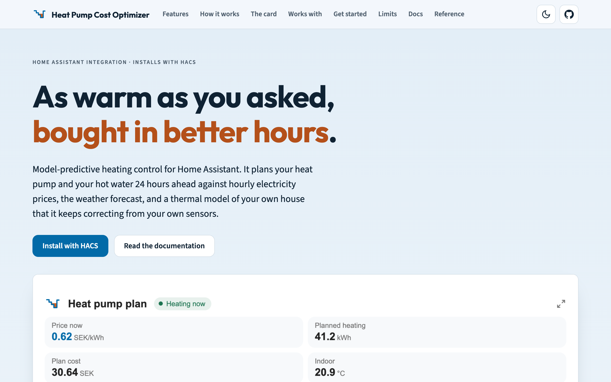
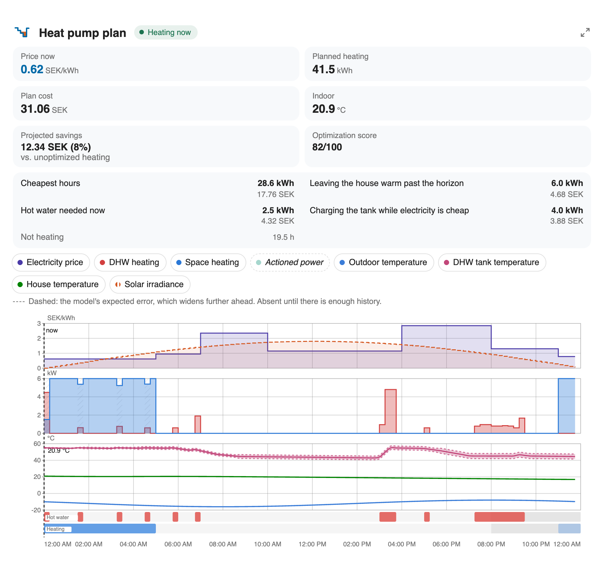
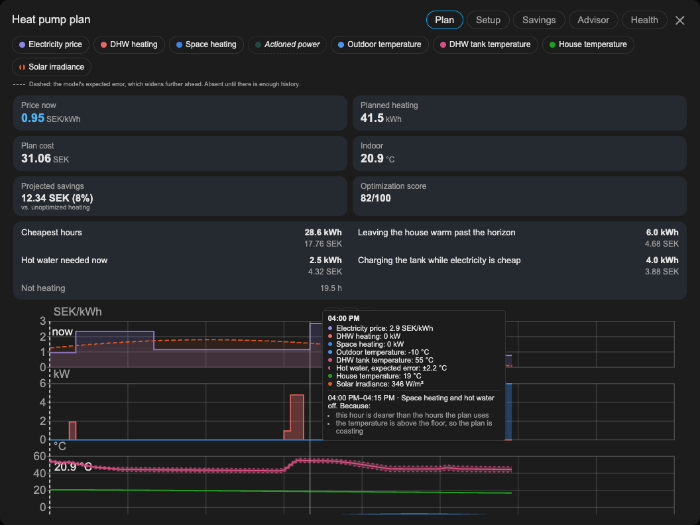
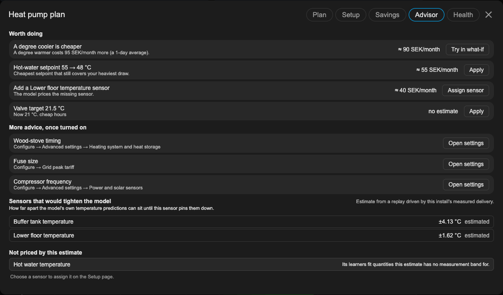
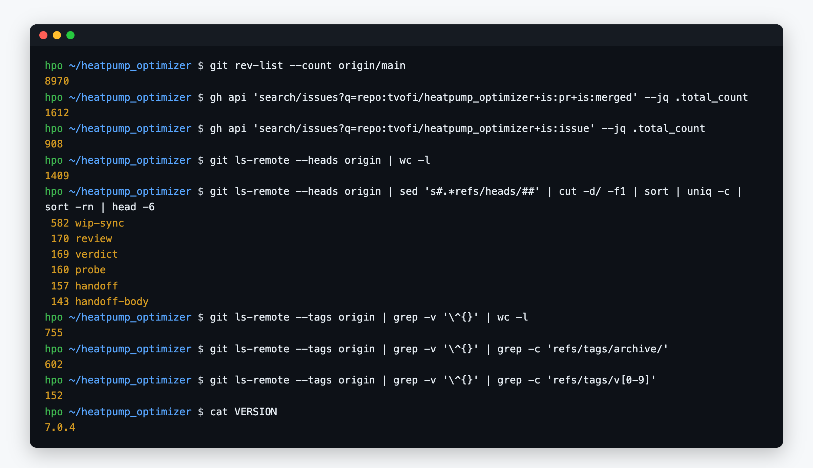
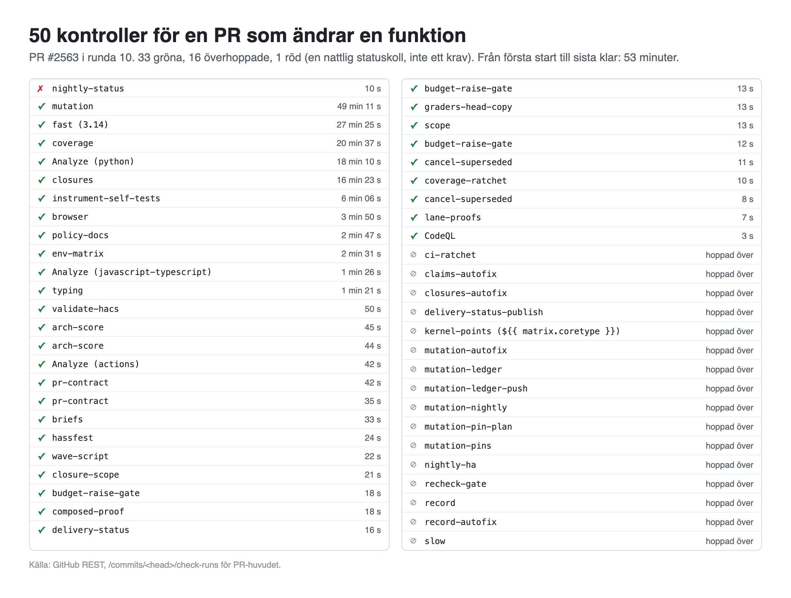
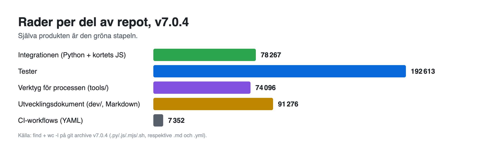
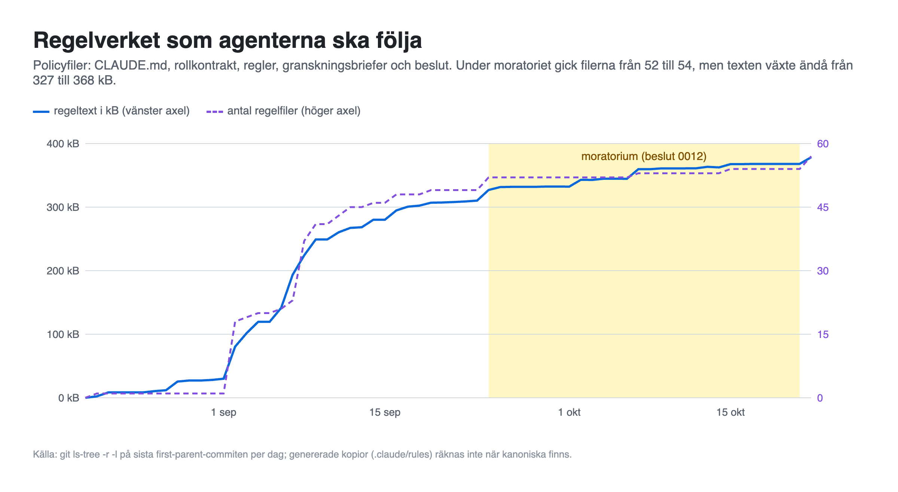
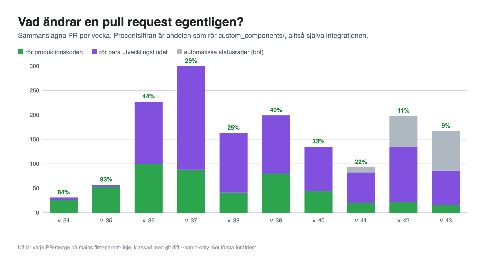
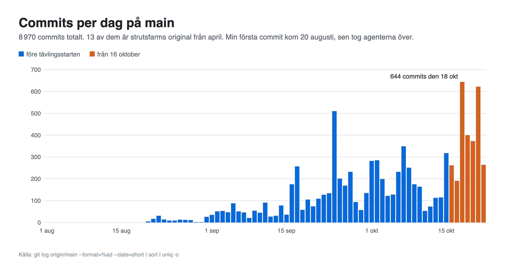

<!--
Uppdelat efter fälten i inlämningsformuläret (projekt.sweclockers.com/asus/lamna-in).
Teckengränser: Rubrik 120, I en mening 160, Vad byggde du 8000, Vad gick fel 4000,
Modeller och verktyg 500, Hårdvara 300. Bildmarkeringarna visar ordningen; bilderna
laddas upp separat i formuläret, max 10 st, PNG under 5 MB.
Rader som börjar med [ÄGAREN] måste fyllas i av tvofi innan inlämning.
-->

# Rubrik

Värmepumpsoptimering i Home Assistant: ett hobbyprojekt och ett test av AI-orkestrerad kodning

# I en mening

En Home Assistant-integration som styr värmepumpen efter timpriset, skriven nästan helt av AI-agenter som granskar varandra.

# Spår

Verktyget du alltid saknat

# Vad byggde du, och hur?

Hej!

Jag har byggt en integration till Home Assistant som styr värmepumpen efter elpriset. Jag utgick från strutsfarms Heatpump_optimizer runt v2.2.0 och har byggt vidare därifrån. Målet var att sänka elräkningen utan att det blir kallt inne på vintern.

Integrationen hämtar timpriser (Tibber eller en prissensor som Nord Pool) och väderprognos. Sedan planerar den, utifrån en termisk modell av huset, när det lönar sig att värma huset och varmvattnet och när det går att hålla igen utan att komforten blir lidande. Med tiden lär den sig hur huset håller värmen. De flesta modellparametrar är självlärande, förutsatt att startinställningen ligger någorlunda rätt.

Den kan styra pumpen via en vanlig av/på-entitet, en ECL110-värmekurva, entiteter för driftläge och börvärde, eller kompressorfrekvensen via till exempel en Modbus-integration. Den kan också bara publicera planen som sensorer, så att man styr själv. Den fungerar med ett fåtal entiteter, men modellen blir bättre med fler sensorer och det finns ganska många valbara. Kortet i Home Assistant rekommenderar vilka nya sensorer som skulle ge störst effekt.

Kod och dokumentation: https://github.com/tvofi/heatpump_optimizer
Webbsida (även den genererad): https://tvofi.github.io/heatpump_optimizer/

Ärligt talat var den större drivkraften att testa hur långt man kan komma med LLM-baserad kodning när flera agenter med olika roller arbetar tillsammans. Nästan all kod och dokumentation (jag skulle gissa över 95 %) är skriven av AI. Jag har mest agerat beställare och granskare. Det som visade sig knepigast var inte att få fram fungerande kod, utan att få koden och framför allt dokumentationen kontrollerad:

- Projektet körs i granskningsrundor där separata agenter letar fel inom olika områden: optimering, robusthet, fysik, tester, dokumentation och så vidare.
- Varje fynd ska backas upp av en körbar mätning. Det blir en åtgärd, och en annan agent granskar den innan något mergeas.
- CI har spärrar mot att koden växer okontrollerat i komplexitet. Mutationstester kontrollerar att testerna faktiskt fångar fel.

Det har fungerat bättre än jag trodde, men det är inte gratis. Mycket av arbetet handlar om att hindra agenterna från att lura sig själva. README:n har ett avsnitt om vad AI-skriven kod i det här projektet haft för styrkor och begränsningar.

Gällande modeller har jag testat allt från Claude, Grok och GPT till DeepSeek, GLM och Qwen, men fastnade till slut för ett flöde med Claude Opus 5.5 som orkestrator och Opus, Sonnet och Haiku som underagenter. Jag kör det på två Claude Max-abonnemang parallellt. Trots det betydligt högre priset per token jämfört med de billigare modellerna tycker jag att jag fått mest arbete utfört per krona med den uppsättningen, eftersom det blir så mycket mindre omarbete än med till exempel DeepSeek eller Grok. Orkestratorn kan självständigt styra processen i veckolånga pass utan att jag behöver gå in, vilket var omöjligt med de andra uppsättningarna jag provade.

**Vad som fanns före 16 oktober och vad som gjorts sedan.** Projektet är äldre än tävlingen. v7.0.0 taggades 14 oktober, och det är utgångsläget. Sedan 16 oktober har det kommit fyra releaser (v7.0.1 till v7.0.4), 256 sammanslagna pull requests och 2 768 commits. I produktionskoden har det under perioden ändrats 45 filer (+4 445 / −2 250 rader). Resten är testsvit och utvecklingsflöde, se nedan. Hela historiken ligger öppet på GitHub.

**Resultat på min installation (hittills)**

Integrationen har styrt pumpen sedan augusti, så det finns ännu inga vinterdata. I september drog den 305 kWh (ungefär 171 kWh till uppvärmning och 133 kWh till varmvatten) och kostade 326 kr med timpris. Samma förbrukning hade kostat 369 kr med månadsmedelpris. Att flytta körningen till billigare timmar sparade alltså cirka 43 kr, eller 11,7 %. Besparingen hittills i oktober är ca 20 %, eftersom dygnspriset varierat mer. I augusti, med nästan bara varmvatten, var skillnaden 47 mot 53 kr.

Det är blygsamt, och det är väntat. Prisskillnaderna under dygnet är små på hösten och värmebehovet är litet. Det riktiga testet kommer i vinter.

Modellens prognos för innetemperaturen ligger i snitt 0,28 °C fel, och komforten har legat inom tillåtet komfortband utan manuella ingrepp.

Begränsningar finns, och de står i README:n. Integrationen är ett hobbyprojekt och skarpt testad på en installation, min egen. Den är utvecklad för att stödja ett brett spann av installationer, men det är otestat i praktiken. Just nu kör jag v7.0.2 på min egen installation och har hittills inte hittat några produktionsbuggar. Senaste release är v7.0.4.

Frågor och synpunkter tas gärna emot, både om värmepumpsdelen och om AI-arbetsflödet.

# Vad gick fel på vägen?

För min egen installation har produktionskoden fungerat bra i flera huvudversioner. Det som strulat är nästan uteslutande processen runt den.

**QA-monstret.** De tidiga rundorna fokuserade väl mycket på heltäckande testning och på att minimera risken för produktionsbuggar. Resultatet: 192 613 rader test mot 78 267 rader produktionskod. En PR som ändrar en funktion går igenom 50 kontroller, och bara mutationstestet tar 49 minuter.

**Agenter som lurar sig själva.** Det vanligaste felet är inte dålig kod utan självsäkra påståenden om koden: en siffra som inte mäter det den påstår, eller ett test som är grönt av fel anledning. Därför ska varje påstådd besparing också mätas med platta elpriser, där den ska bli noll. Fem mätupplägg har fallit på den kontrollen. Ett visade 20 % vinst med platta priser, ett annat förlorade 37,6 %.

**Spärrar utan marginal.** En strukturspärr mäter 18 strukturmått som bara får gå nedåt, och flera ligger på noll marginal. Det som växer på ett ställe måste betalas med förbättringar någon annanstans.

**Siffror som driver.** Optimeringen ger inte samma flyttal på olika BLAS-byggen. Samma kod och samma paket gav 60,54 till 63,48 kr på fyra BLAS-kärnor. Därför får förväntade testvärden inte spelas in på nytt, utan avvikelsen ska deklareras med riktning i en fil, som har ändrats i 327 commits.

**Köer och GitHub.** PR:er landar via ett mergetåg och väntar på CI. GitHubs sekundära rate limit svarar 403 medan rate_limit fortfarande visar 5 000 kvar, så ett skript som sväljer felet skriver ut en säker men för liten siffra. Sedan dess skriver mätskripten för GitHub-data ut antalet API-fel bredvid varje siffra.

**Regelverket svällde.** Agenternas regelverk gick från noll till 52 filer och 327 kB text på ungefär en månad. Ett moratorium (beslut 0012) skulle stoppa nya regelfiler från 24 september, men texten fortsatte växa till 368 kB innan moratoriet hävdes 21 oktober.

**Runda tio handlar mest om flödet.** I den pågående rundan rör 9 av 10 pull requests utvecklings- och testflödet snarare än produktionskoden, mot ungefär 50/50 de tidiga rundorna. 33 av 332 PR rör själva integrationen. Räknar man bort de automatiska statusraderna är det 33 av 188, men det är fortfarande flödet som dominerar. Senare rundor har därför handlat om att få flödet effektivare, inte om fler tester.

# Modeller och verktyg

Claude Opus 5.5 som orkestrator, Opus, Sonnet och Haiku 5.5 som underagenter, i Claude Code på två Claude Max-abonnemang. Tidigare provat Grok, GPT, DeepSeek, GLM och Qwen. GitHub Actions för CI. Integrationen bygger på strutsfarm/heatpump_optimizer (v2.2.0) och använder numpy och scipy, i Home Assistant.

# Hårdvara

[ÄGAREN] Fyll i datorn som körde Claude Code, och värmepumpen och styrningen hemma.

# Var kördes AI:n

I molnet

# Tokens

[ÄGAREN] Formuläret kräver två tal (lokalt och moln) och en metod. Enligt ägarens instruktion har den här seaten inte räknat eller uppskattat något. Tvofi fyller i själv.
