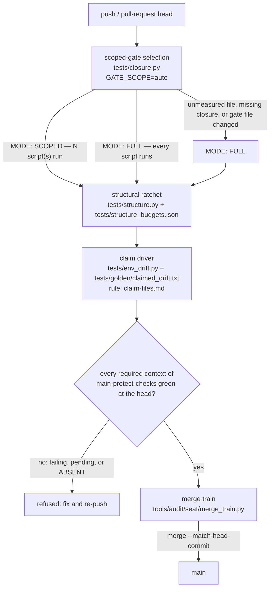

# The CI gate: its shape and its requirements

The gate is the path a change takes from a branch push to `main`. Every stage
below is a refusal, not a warning: a change that does not pass stops there.
This document draws the shape and states the requirements; the binding rules
are `CLAUDE.md` rule 1-4 and the rule files it names.

## The shape



Read the diagram as the order a change must survive, not as four separate CI
jobs. The scoped selection, the structural ratchet and the claim driver are all
scripts the selection runs; the required contexts are the ruleset's own gate on
the pull-request head; the merge train is what lands the result.

### Stage 1: scoped-gate selection

`tests/closure.py` decides which scripts a diff can reach from the measured
dependency closures in `tests/closures.json`. The selection is conservative:
an unmeasured changed file, a script with no closure, a missing table, a change
to the gate itself, or any `closure.py` failure turns scoping off and runs
everything.

The mode line is the decision, and it has two shapes:

```
MODE: SCOPED -- N script(s) run, ...
MODE: FULL   -- every test script runs, nothing is scoped out.
```

**Key on the mode line, never on the count.** `MODE: SCOPED -- 0 script(s) run`
and `MODE: FULL` both print zero and mean opposite things. The line exists only
on a branch: a push to `main` forces `full`, and that path never calls the code
that prints it, so a `main` run prints no mode line at all. The safety argument
is the forced full run on `main`: a wrong closure turns main red within one
merge instead of never.

Run it on a branch with:

```
GATE_SCOPE=auto GOLDEN_MODE=drift GOLDEN_REF=$(git merge-base origin/main HEAD) ./tests/run.sh
```

### Stage 2: the structural ratchet

`tests/structure.py` measures every metric keyed in
`tests/structure_budgets.json` over
`custom_components/heatpump_optimizer/**/*.py`, with `file:line` evidence
printed above each result. Every metric may only move down. Several sit at zero
headroom, so an ordinary change can be refused by arithmetic.

The count of metrics is derived from the budget file, never carried: it is the
file's keys less `recorded_at`, and `structure.py`'s `ok` lines are a third
number because they add the counting-rule and `const.py` symbol checks. Pay a
breach by improving the code. Where no payment exists, re-record deliberately
with the reason in the commit message; a raise merges only on the owner's
approving review at the head (`budget-raise-gate`, decision 0013), except under
a mandate in force scoped `budget-raise` or `all`, where the body's
`## Raise justification` records each payment tried and its
`Architecture score: dS` line.

### Stage 3: the claim driver

`tests/env_drift.py` is the claim driver and the `claimnotes` merge driver.
Solver floats do not reproduce across BLAS builds, so a value-bearing golden
fixture is **claimed**, never re-recorded by a branch. Drift is declared in
`tests/golden/claimed_drift.txt` (and `card_claimed_drift.txt`) with its
direction; `claims-for:` must equal `VERSION`; a fixture cannot be both claimed
and `may-drift`, and `env_drift.py` refuses the pair.

The driver unions note comments and refuses when both sides rewrote the bare
claim list. A branch that claims nothing leaves both files byte-identical to
the fork point, so it cannot conflict. GitHub cannot run the merge driver, so a
claim-file conflict there is the `DIRTY` case below. The full rule is
`dev/governance/rules/claim-files.md`.

### Stage 4: the required contexts and the merge train

`main-protect-checks` (ruleset `23698884`) carries the required status checks,
the `pull_request` review rule and the deploy key's bypass. The branch endpoint
is the authority for the live set:
`repos/tvofi/heatpump_optimizer/rules/branches/main`. The recorded shape the
policy lint compares against is `tools/policy/fixtures/required-contexts.json`,
which names these contexts:

- `Analyze (actions)`, `Analyze (javascript-typescript)`, `Analyze (python)`
- `briefs`, `browser`, `budget-raise-gate`
- `closure-scope`, `closures`, `env-matrix`
- `fast (3.14)`, `hassfest`, `mutation`
- `policy-docs`, `pr-contract`, `typing`
- `validate-hacs`, `wave-script`

Read the endpoint, not this list, when the two disagree; the lint reddens on
any name or ruleset id it and the live set do not share, in either direction.
Two recorded traps: a `skipped` or `neutral` required check satisfies the rule,
and a `scheduled` context must never be made required, because one failing
night then blocks every merge, including the one that repairs it.

`tools/audit/seat/merge_train.py` then lands verdicted pull requests in order:
recarry, every check at the head, carry the verdict, confirm `main` is still
contained, apply the policy decision, approve as `hpo-approver`, and merge with
`--match-head-commit`. It stops at the first refusal. `batch` is the batch
form; a workflow, claim, grader or `*_budgets.json` change goes serial.

## The four refusing rules

`CLAUDE.md` states four rules that will refuse a pull request. The rule files
are the policy; this is the shape.

1. **The gate is scoped by measured dependency closures.** `GATE_SCOPE=auto`
   runs only the scripts the diff can reach, as measured in
   `tests/closures.json`. A push to `main` forces `full`, so a wrong closure
   goes red within one merge. The mode line, not the script count, says which
   gate ran. Commands, the gate lease and the re-derivation trap are in
   `dev/governance/rules/gate-scoping.md`.
2. **A structural ratchet refuses growth.** `tests/structure.py` measures every
   metric in `tests/structure_budgets.json`; every metric may only move down.
   Pay by improving code; failing that, re-record deliberately with the reason
   in the commit message. A raise needs the owner's explicit confirmation
   before the branch is pushed and merges only on the owner's approving review
   (`budget-raise-gate`), except under a mandate scoped `budget-raise` or
   `all`. Never loosen one quietly and never delete working functionality to
   fit.
3. **Value-bearing golden fixtures are claimed, not re-recorded.** Solver
   floats do not reproduce across BLAS builds, so only a canonical environment
   can honestly record one. Drift is declared in
   `tests/golden/claimed_drift.txt` or `card_claimed_drift.txt` with its
   direction; `claims-for:` must equal `VERSION`; a fixture cannot be both
   claimed and `may-drift`. Check claims, and any branch-vs-main comparison,
   three-dot: `git diff $(git merge-base origin/main HEAD)...HEAD`.
4. **Versions are assigned after the merge, by
   `tools/release/stamp.py`.** A branch never touches `VERSION`, the manifest
   version, or the `RELEASE_NOTES.md` heading. The stamp refuses a note that
   omits any merged pull request in its window, and pushes only over the deploy
   key.

## Absent is not green

A required context that never reports at a head is **ABSENT**, not passing. A
push whose tip is a `GITHUB_TOKEN` push by `github-actions[bot]` fires no
`pull_request` run at all, so the contexts only a `pull_request` run writes
stay ABSENT forever and the head sits unmergeable while looking green. The
responses are:

- `tools/audit/seat/ci-watch.sh` alerts on required contexts ABSENT at a
  settled head, and on stalled zero-runs; an unreadable ruleset alerts BLIND
  once rather than silently skipping the ABSENT arm.
- `tools/pr/approve_held_runs.sh` approves the workflow runs GitHub holds
  `action_required` after an App push, so the runs can start.
- `tools/audit/seat/merge_train.py` refuses a head whose tip is a
  `GITHUB_TOKEN` push before reading any check; the cure is an App push (a
  recarry is one).
- Zero check runs is not green either: it is a stalled head, not a passing one.

## DIRTY is not queued

GitHub computes `mergeStateStatus` on its own side, where the `claimnotes`
merge driver cannot run. Every open pull request flips to `DIRTY` the moment
`main` touches a claim file. GitHub will not build a merge
commit for a `DIRTY` pull request, so the `pull_request` workflows never fire:
such a pull request does not go red, it **cannot run**. A run already in flight
survives; no new one queues.

Before treating the conflict as real, confirm it:

```
git merge-tree --write-tree origin/main HEAD
```

Then merge `main` in locally, or let the merge-main bot do it where the driver
can run. A branch that claims nothing should never reach this state, because it
never edits the claim files.

## Where the gate is wired

- `.github/workflows/tests.yml` runs the gate, including the forced full run
  on `main`.
- `.github/workflows/governance.yml` runs the policy and record checks.
- `tests/README.md` describes what each script pins and how selection works.
- `dev/governance/rules/gate-scoping.md` is the rule for running the gate.
- `dev/governance/rules/claim-files.md` is the rule for the claim files.
- `dev/governance/rules/ratchet-budgets.md` is the rule for re-recording a cap.
