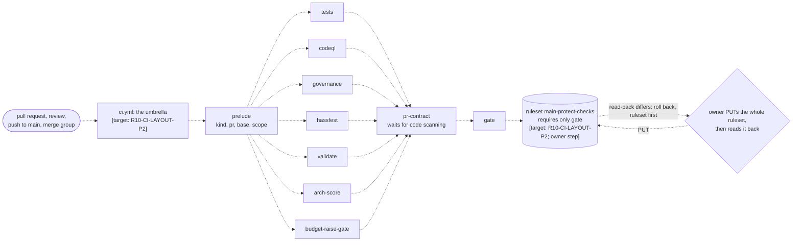
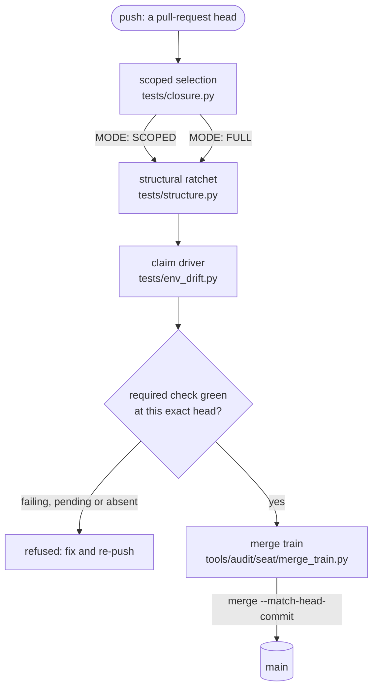
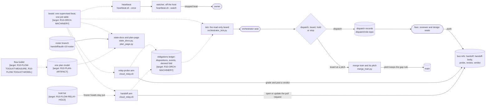
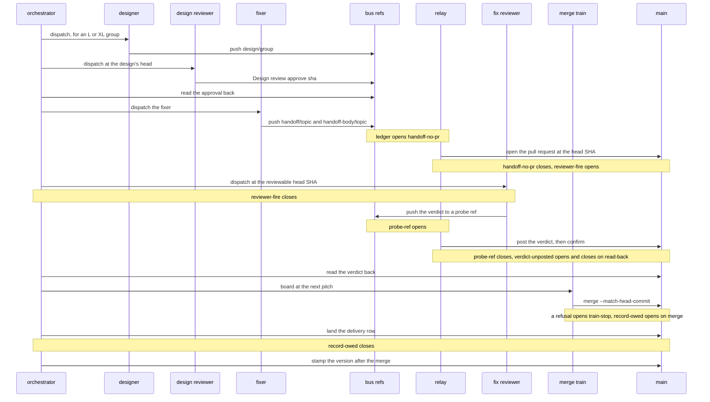

# Development in this repository

This is the orientation for anyone, person or agent, doing development here:
what lives under `dev/`, which document binds which part of the work, the order
the work runs in, what must be in place before a branch is pushed, the shape of
CI, and the shape of the machinery that moves a change from a seat to `main`.

**This file is not policy.** `CLAUDE.md` is the index that names every policy
document and the obligation each carries; the named file is the policy, not
this summary. Where this README and a policy file disagree, the policy file
wins.

**It describes the shape at the end of the current programme.** What is
already on `main` is written from the tree. What a roster group has still to
land carries a marker naming that group: `[target: <group>]` for an element
that exists once the group merges, `[retired-by: <group>]` for one the group
removes, and `; owner step` where the change lands only on the owner's own
action. The groups are the keys of `dev/programme/rosters/wave-r10-groups.json`,
and `tests/doc_claims.py` refuses a marker naming anything else. Resolving the
markers once their groups are done is R10-ARCH-DOCS's end-of-round check.

## Reading the figures

Meaning is carried by shape, so a figure reads the same in a light and a dark
theme:

| shape | means |
|---|---|
| stadium `([ ])` | a seat: an agent session or a person doing a role |
| rectangle `[ ]` | a script, or a job run detached by `tools/audit/seat/daemonize.py` |
| rhombus `{ }` | a decision made by a person or an agent |
| cylinder `[( )]` | a git ref or a store |
| dashed edge | flow that exists once its marked group lands |

## The `dev/` layout

```text
dev/
  governance/          canonical policy and the record of decisions
    rules/             the rule files (loaded by the harness through .claude/rules/)
    roles/             one contract per role: COMMON (the finder), fixer, fix-review, designer, ...
    dimensions/        one brief per audit dimension
    decisions/         the ADRs: identity, merge boundary, verdicts, process
    config/            policy_budgets.json, policy_known_bad.json, corpus exclusions
  programme/           plan of record, living state, and delivery record
    plan-2026-09-open-issues.md   the plan of record
    HANDOVER.md                   the one living handover (state, not policy)
    delivery/                     one row per pull request: <N>.md
    carries/                      forward-carry files: carry-<N>.json
    rosters/                      wave group rosters: wave-r<N>-groups.json
    designs/                      approved architect notes, one per designed group
    register/                     the audit register
  audit/               audit evidence and re-runnable measurement
    config/            scopes.json, bugclasses.json, finding.schema.json, rotation.json
    harnesses/         re-runnable harnesses (indexed by a command, below)
    rounds/            round<N>/D<k>/: reports, harnesses, .out runs and verdicts
    rca/               root-cause documents
    README.md          the harness contract and the instruments kept live
  archive/             retired plans, rosters, carries, handoffs and audits
```

Counts change; the commands do not. `ls dev/governance/decisions/` lists the
ADRs, `ls dev/governance/dimensions/` the dimension briefs, and
`ls dev/governance/roles/` the role contracts.

`dev/archive/` is a record, not a work surface: nothing new lands there except
material being retired. `dev/audit/rounds/` is write-once evidence; a later
round adds its own directory rather than rewriting an earlier one.

## Governing documents

| document | where | one-line purpose |
|---|---|---|
| `CLAUDE.md` | repository root | the index: names every policy file, the obligation each carries, and the role or dimension it binds |
| `AGENTS.md` | repository root | the harness-neutral entry point; it defers to `CLAUDE.md` and states no policy of its own |
| `tools/audit/seat/INSTRUMENTS.md` | `tools/audit/seat/` | the operator's guide to the seat instruments: what each does and which refusal saves you (usage, not policy) |
| role contracts | `dev/governance/roles/` | one contract per role: `COMMON.md` (the finder's contract), `fixer.md`, `fix-review.md`, `designer.md`, `design-review.md`, `verifier.md`, `judge.md`, `root-cause.md`, `orchestrator.md`, `nudge.md` |
| rules | `dev/governance/rules/` | the canonical rule files; `.claude/rules/` is generated from them by `node tools/policy/rules_sync.mjs`, never edited by hand |
| dimension briefs | `dev/governance/dimensions/` | each in the owner's words: what the dimension measures and how |
| decisions | `dev/governance/decisions/` | the ADRs: the identity split, the merge boundary, verdict authorship, the design seats |
| audit contract | `dev/audit/README.md` | the harness contract, the evidence layout, and the instruments a judge still re-runs |
| suite manual | `tests/README.md` | what each gate script pins, how the scoped gate selects, and why a test that re-implements a production formula pins nothing |
| architecture | `docs/architecture.md` | the integration's own shape: the Home Assistant boundary, the pure core and the learners |
| living handover | `dev/programme/HANDOVER.md` | durable state and corrections to the record; volatile state goes on issue #201 |
| prose caps | `dev/governance/config/policy_budgets.json` | one-sided caps on the policy corpus |

`node tools/policy/rules_sync.mjs --check` refuses drift between the canonical
rules and their generated copies, and `node tools/policy/policy_lint.mjs`
refuses dead citations and uncovered policy directories.

## The work, in order

audit → [design → design review, for an L or XL group] → fix → fix review →
train → merge → record → stamp. The order is the orchestrator's contract,
`dev/governance/roles/orchestrator.md`, with the design step from
`dev/governance/roles/designer.md` and `dev/governance/roles/design-review.md`.

1. **Audit: find, verify, judge.** One finder per scope of
   `dev/audit/config/scopes.json`, against a pinned baseline, under
   `dev/governance/roles/COMMON.md`: a finding carries a claim, evidence, a
   harness, a metric, a perturbation and a null control.
   `dev/governance/roles/verifier.md` carries three lenses over every finding,
   and a refute sends it to the judge as disputed; `dev/governance/roles/judge.md`
   decides, and a finding whose harness does not move under its own
   perturbation is void. Evidence lands under `dev/audit/rounds/`, causes under
   `dev/audit/rca/`.
2. **Design, for an L or XL group.** The designer writes an architect note at
   `design/<group>`, never production code. The design reviewer reads it at its
   handoff SHA, and only `Design review: approve <sha>`, read back, dispatches
   the fixer. The approved note is the group's architect note.
3. **Fix.** `dev/governance/roles/fixer.md`: one pull-request group, a failing
   test first, a mutation proof, the finder's harness at both ends, a null
   control for every quantified claim. The handoff freezes the branch.
4. **Fix review.** `dev/governance/roles/fix-review.md`: a fresh context in a
   detached worktree at the head SHA, using the finder's harness, never the
   fixer's. A head that moved under the review is a blocked verdict.
5. **Train and merge.** `tools/audit/seat/merge_train.py` lands verdicted pull
   requests in order at a pitch, and stops at the first refusal.
6. **Record.** The pull request's row is `dev/programme/delivery/<N>.md`, written
   at each merge, not at session end; `tools/audit/seat/record_row.py` drives
   the record-autofix job that rows a merge no branch rowed.
7. **Stamp.** `tools/release/stamp.py` assigns the version after the merge. A
   branch never touches `VERSION`, the manifest version, or the
   `RELEASE_NOTES.md` heading.

## Requirements before you push

- **Identity.** Pull requests are authored by the `hpo-author` App through
  `tools/pr/app_push.sh`; verdicts post as the `hpo-approver` App through
  `tools/audit/seat/bus.sh`; only the owner reviews code-owned paths named by
  `.github/CODEOWNERS`. `tools/pr/approve_held_runs.sh` approves the runs GitHub
  holds after an App push. Decision 0011 is the rule.
- **Seat interpreter.** `tools/audit/seat/seat_venv.sh` builds the seat
  interpreter from the CI pins; `--check` reports what it holds. Do not run the
  gate on a system Python.
- **Gate lease.** `python3 tests/gate_lock.py needs-lease <script>` says which
  lease a script takes; hold one by hand only through `tests/gate_lock.py`,
  never with `mkdir`.
- **Scoped gate.** On a branch, run only what the diff can reach, against the
  merge base:

  ```text
  GATE_SCOPE=auto GOLDEN_MODE=drift GOLDEN_REF=$(git merge-base origin/main HEAD) ./tests/run.sh
  ```

  Read the `MODE:` line, never the script count (`CLAUDE.md` rule 1).
- **Classification.** Every new tracked file is in a measured closure or on
  `tests/closure.py`'s `INERT` list, and every path matches one category of
  `tests/layout.json`.
- **Claims and the ratchet.** A branch that claims no golden drift leaves both
  claim files byte-identical (`CLAUDE.md` rule 3); `tests/structure.py` may only
  move down (rule 2).
- **A check your commits turned red owes an answer** in the pull-request body
  (`dev/governance/rules/defect-root-cause.md`).

## The CI shape

### The job graph at programme end

One umbrella workflow calls every unit and ends in one check, `gate`, which is
the only context the ruleset requires. The check name of a unit's job is
`<file stem> / <job>`, for example `tests / fast (3.14)`.



The cut-over is the owner's: the ruleset object is written whole, read back
and diffed, and rolled back ruleset-first if the read-back or the first runs
fail. The orchestrator boards it at a pitch that keeps the gap rule. Those
steps are the ORCHESTRATOR-PROMPT checklist the orchestrator runs; this figure
shows only where they sit.

### The workflows on `main` today

Each unit file below starts on its own pull-request event today, and the
ruleset requires each of its contexts by name. The umbrella above turns every
one into a callable unit.

- `.github/workflows/tests.yml`: the gate scripts, the scoped selection, the
  closures and the autofix jobs
- `.github/workflows/governance.yml`: policy, record and instrument self-tests
- `.github/workflows/codeql.yml`, `.github/workflows/hassfest.yml`,
  `.github/workflows/validate.yml`: code scanning and the two Home Assistant
  validators
- `.github/workflows/pr-contract.yml`, `.github/workflows/arch-score.yml`,
  `.github/workflows/budget-raise-gate.yml`: the body contract, the
  architecture score and the raise gate
- `.github/workflows/ci.yml`: the inert umbrella stub that phase one landed
- `.github/workflows/pr-contract-rerun.yml` [retired-by: R10-CI-LAYOUT-P2]
- `.github/workflows/budget-raise-gate-rerun.yml` [retired-by: R10-CI-LAYOUT-P2]
- `.github/workflows/gate-sweep.yml`, which re-runs a stale `gate` at a pull request's live head [target: R10-CI-LAYOUT-P2]
- `.github/workflows/nightly.yml`, `.github/workflows/merge-main.yml`,
  `.github/workflows/release.yml`, `.github/workflows/pages.yml`,
  `.github/workflows/kernel-points.yml`: standalone, called by nothing

`ls .github/workflows/` is the list; this one is a reading aid.

### The order a change is refused in



Read it as the order a change must survive, not as separate jobs. The required
check is every context the ruleset names today, and `gate` alone once the
cut-over lands [target: R10-CI-LAYOUT-P2; owner step]. Two traps hold in both
shapes: a required context that never reports at a head is absent, not green,
and a `DIRTY` pull request does not go red, it cannot run
(`dev/governance/rules/claim-files.md`).

## The orchestration machinery

### Its components



- **Detached jobs** run under `tools/audit/seat/daemonize.py` today: the tick
  loop (`tools/audit/seat/tick_loop.sh`), the relay's pass
  (`tools/audit/seat/cloud_relay.sh pass`), the state documents and the plan
  page (`tools/audit/seat/state_docs.py`, `tools/audit/seat/plan_page.py`). The
  heartbeat (`tools/audit/seat/heartbeat.sh`) pushes one liveness ref, which a
  watcher off the host reads.
- **One supervised beat** replaces the hand-launched loops: `tools/audit/seat/beatd.py`
  with its job table `tools/audit/seat/beatd.jobs.json`, one job per arm, where an unreadable table refuses to start [target: R10-ORCH-MACHINERY]
- **The obligations ledger**, `tools/audit/seat/ledger.py`, keeps two stores and one derived fold, with one writer per fact [target: R10-ORCH-MACHINERY]
  - derived, recomputed every pass: `handoff-no-pr`, `handoff-update`, `probe-ref`, `stage-mismatch`, `absorb-edge-missing`, `record-owed` [target: R10-ORCH-MACHINERY]
  - events, opened and closed: `reviewer-fire`, `verdict-unposted`, `train-stop` [target: R10-ORCH-MACHINERY]
- **The bus refs** are the seats' only channel to the orchestrator: a fixer
  pushes `handoff/<topic>` and `handoff-body/<topic>`; a cloud reviewer pushes
  `probe/rev-<pr>-<nonce>`, which `tools/audit/seat/cloud_relay.sh` grades and
  posts through `tools/audit/seat/bus.sh push-verdict`.
- **Dispatch records** are written by `tools/audit/seat/cloud_dispatch.py`, one
  per dispatched seat, and `bus.sh` refuses a verdict whose nonce no record
  holds.
- **The merge train**, `tools/audit/seat/merge_train.py`, boards verdicted pull
  requests at a pitch. The pitch's gap rule keeps a disruptive merge away from
  a critical-chain pull request about to board; a `train-hold` ref stops the
  record autofix from merging into a running train.
- **The relay's hold list** keeps a frozen pull request's head still while its handoff branch moves [target: R10-FLOW-RELAY-HOLD]
- **The roster branch**, `handoff/audit-r10-roster`, is written through
  `tools/audit/seat/roster_edit.py`; `tools/audit/seat/roster_sync.py`, run by
  the state-documents beat, derives each group's stage from its branch's pull
  request.
- **One plan model** feeds the plan page and the plan table, extended by the flow toolkit's projection [target: R10-PLAN-ARTIFACT, R10-FLOW-TOOLKIT-MODEL]
- **The flow toolkit**'s measuring instruments land under `tools/audit/seat/` for any round [target: R10-FLOW-TOOLKIT-MEASURE]

### One handoff's path



- The ledger kinds the notes name are `tools/audit/seat/ledger.py`'s [target: R10-ORCH-MACHINERY]
- **The reviewable head is a SHA.** A head that moved under a review is a
  blocked verdict, never a re-read: "moved" means the head SHA, not the body
  bytes. `dev/governance/roles/fix-review.md` is the rule.
- **The end state** of the programme is no open pull request and no owed
  handoff: every obligation the ledger names is closed.

### Who decides

| step | decided by | carried out by |
|---|---|---|
| which group a seat works, and when | the orchestrator | `tools/audit/seat/cloud_dispatch.py` writes the dispatch record |
| whether a design is sound | the design reviewer | the orchestrator reads the verdict back before dispatching the fixer |
| what a fix is and what it proves | the fixer | `tools/pr/prepr.sh` and the scoped gate refuse what is missing |
| whether a fix merges | the fix reviewer, at one head SHA | `tools/audit/seat/bus.sh` posts it; the relay grades a cloud verdict |
| when a pull request boards | the orchestrator, at a pitch | `tools/audit/seat/merge_train.py` refuses a head that moved or a red check |
| a policy change or a budget raise | the owner, by approving review | `budget-raise-gate` and the code-owner rule refuse the merge without it |
| the ruleset | the owner | read back and diffed after the change |
| the version | nobody: it is derived | `tools/release/stamp.py`, after the merge |

## Harnesses

The re-runnable harnesses live in `dev/audit/harnesses/`, and the index is a
command rather than a file, so it cannot fall behind the directory:

```text
git ls-files 'dev/audit/harnesses/*' | while read -r f; do
  printf '%s\t%s\n' "$f" "$(grep -m1 -v -e '^#!' -e '^\s*$' "$f" | cut -c1-100)"
done
```

Each harness states in its own header what it measures and how it is run;
`dev/audit/README.md` is the contract a harness keeps.
