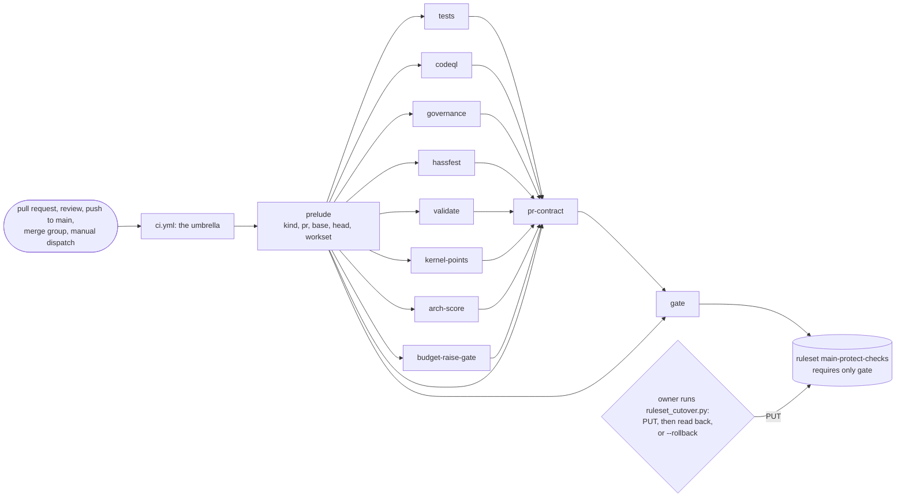
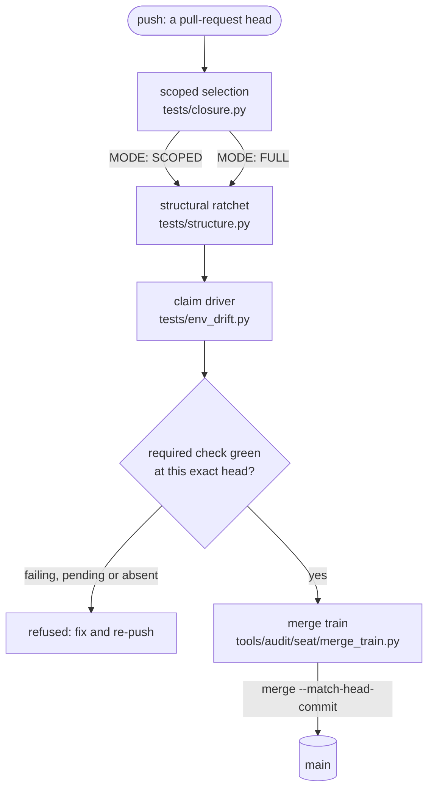
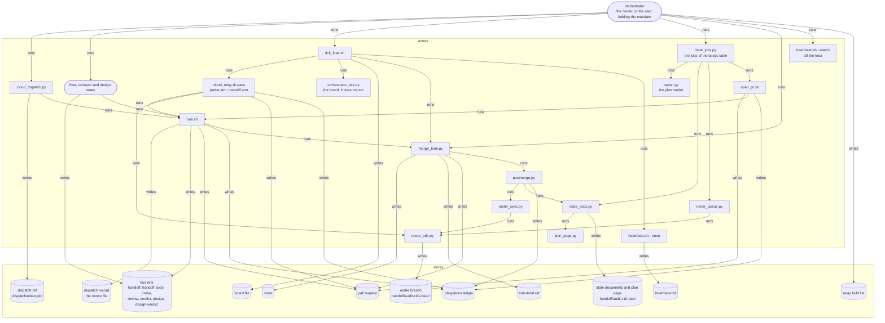
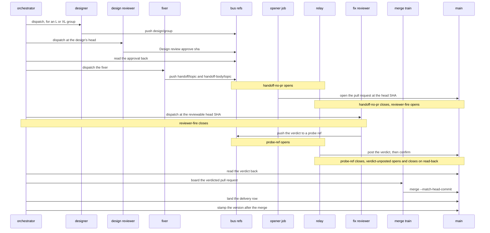

# Development in this repository

This is the orientation for anyone, person or agent, doing development here:
what lives under `dev/`, which document binds which part of the work, the order
the work runs in, what must be in place before a branch is pushed, the shape of
CI, and the shape of the machinery that moves a change from a seat to `main`.

**This file is not policy.** `CLAUDE.md` is the index that names every policy
document and the obligation each carries; the named file is the policy, not
this summary. Where this README and a policy file disagree, the policy file
wins.

**It describes `main`.** Everything it names is written from the tree, and
`tests/doc_claims.py` resolves each path, script argument, workflow job,
ledger kind and diagram node it names. A page that describes a shape still to
land marks each such element with the roster group that lands it:
`[target: <group>]` for an element that exists once the group merges,
`[retired-by: <group>]` for one the group removes, and `; owner step` where
the change lands only on the owner's own action. `tests/doc_claims.py` refuses
a marker naming no roster group, and a marker outside an HTML comment whose
groups are all done.

## Reading the figures

Meaning is carried by shape, so a figure reads the same in a light and a dark
theme:

| shape | means |
|---|---|
| stadium `([ ])` | a seat: an agent session or a person doing a role |
| rectangle `[ ]` | a script, or a job run detached by `tools/audit/seat/daemonize.py` |
| rhombus `{ }` | a decision made by a person or an agent |
| cylinder `[( )]` | a git ref or a store |

## The `dev/` layout

```text
dev/
  governance/          canonical policy and the record of decisions
    rules/             the rule files (loaded by the harness through .claude/rules/)
    roles/             one contract per role: COMMON (the finder), fixer, fix-review, designer, ...
    dimensions/        one brief per audit dimension
    decisions/         the ADRs: identity, merge boundary, verdicts, process
    config/            policy_budgets.json, policy_known_bad.json, corpus exclusions
  programme/           plan of record, living state, and delivery record
    plan-2026-09-open-issues.md   the plan of record
    HANDOVER.md                   the one living handover (state, not policy)
    delivery/                     one row per pull request: <N>.md
    carries/                      forward-carry files: carry-<N>.json
    rosters/                      wave group rosters: wave-r<N>-groups.json
    designs/                      approved architect notes, one per designed group
    register/                     the audit register
  audit/               audit evidence and re-runnable measurement
    config/            scopes.json, bugclasses.json, finding.schema.json, rotation.json
    harnesses/         re-runnable harnesses (indexed by a command, below)
    rounds/            round<N>/D<k>/: reports, harnesses, .out runs and verdicts
    rca/               root-cause documents
    README.md          the harness contract and the instruments kept live
  archive/             retired plans, rosters, carries, handoffs and audits
```

Counts change; the commands do not. `ls dev/governance/decisions/` lists the
ADRs, `ls dev/governance/dimensions/` the dimension briefs, and
`ls dev/governance/roles/` the role contracts.

`dev/archive/` is a record, not a work surface: nothing new lands there except
material being retired. `dev/audit/rounds/` is write-once evidence; a later
round adds its own directory rather than rewriting an earlier one.

## Governing documents

| document | where | one-line purpose |
|---|---|---|
| `CLAUDE.md` | repository root | the index: names every policy file, the obligation each carries, and the role or dimension it binds |
| `AGENTS.md` | repository root | the harness-neutral entry point; it defers to `CLAUDE.md` and states no policy of its own |
| `tools/audit/seat/INSTRUMENTS.md` | `tools/audit/seat/` | the operator's guide to the seat instruments: what each does and which refusal saves you (usage, not policy) |
| role contracts | `dev/governance/roles/` | one contract per role: `COMMON.md` (the finder's contract), `fixer.md`, `fix-review.md`, `designer.md`, `design-review.md`, `verifier.md`, `judge.md`, `root-cause.md`, `orchestrator.md`, `nudge.md` |
| rules | `dev/governance/rules/` | the canonical rule files; `.claude/rules/` is generated from them by `node tools/policy/rules_sync.mjs`, never edited by hand |
| dimension briefs | `dev/governance/dimensions/` | each in the owner's words: what the dimension measures and how |
| decisions | `dev/governance/decisions/` | the ADRs: the identity split, the merge boundary, verdict authorship, the design seats |
| audit contract | `dev/audit/README.md` | the harness contract, the evidence layout, and the instruments a judge still re-runs |
| suite manual | `tests/README.md` | what each gate script pins, how the scoped gate selects, and why a test that re-implements a production formula pins nothing |
| architecture | `docs/architecture.md` | the integration's own shape: the Home Assistant boundary, the pure core and the learners |
| living handover | `dev/programme/HANDOVER.md` | durable state and corrections to the record; volatile state goes on issue #201 |
| prose caps | `dev/governance/config/policy_budgets.json` | one-sided caps on the policy corpus |

`node tools/policy/rules_sync.mjs --check` refuses drift between the canonical
rules and their generated copies, and `node tools/policy/policy_lint.mjs`
refuses dead citations and uncovered policy directories.

## The work, in order

audit → [design → design review, for an L or XL group] → fix → fix review →
train → merge → record → stamp. The order is the orchestrator's contract,
`dev/governance/roles/orchestrator.md`, with the design step from
`dev/governance/roles/designer.md` and `dev/governance/roles/design-review.md`.

1. **Audit: find, verify, judge.** One finder per scope of
   `dev/audit/config/scopes.json`, against a pinned baseline, under
   `dev/governance/roles/COMMON.md`: a finding carries a claim, evidence, a
   harness, a metric, a perturbation and a null control.
   `dev/governance/roles/verifier.md` carries three lenses over every finding,
   and a refute sends it to the judge as disputed; `dev/governance/roles/judge.md`
   decides, and a finding whose harness does not move under its own
   perturbation is void. Evidence lands under `dev/audit/rounds/`, causes under
   `dev/audit/rca/`.
2. **Design, for an L or XL group.** The designer writes an architect note at
   `design/<group>`, never production code. The design reviewer reads it at its
   handoff SHA, and only `Design review: approve <sha>`, read back, dispatches
   the fixer. The approved note is the group's architect note.
3. **Fix.** `dev/governance/roles/fixer.md`: one pull-request group, a failing
   test first, a mutation proof, the finder's harness at both ends, a null
   control for every quantified claim. The handoff freezes the branch.
4. **Fix review.** `dev/governance/roles/fix-review.md`: a fresh context in a
   detached worktree at the head SHA, using the finder's harness, never the
   fixer's. A head that moved under the review is a blocked verdict.
5. **Train and merge.** `tools/audit/seat/merge_train.py` lands verdicted pull
   requests in order at a pitch, and stops at the first refusal.
6. **Record.** The pull request's row is `dev/programme/delivery/<N>.md`, written
   at each merge, not at session end; `tools/audit/seat/record_row.py` drives
   the record-autofix job that rows a merge no branch rowed.
7. **Stamp.** `tools/release/stamp.py` assigns the version after the merge. A
   branch never touches `VERSION`, the manifest version, or the
   `RELEASE_NOTES.md` heading.

## Requirements before you push

- **Identity.** Pull requests are authored by the `hpo-author` App through
  `tools/pr/app_push.sh`; verdicts post as the `hpo-approver` App through
  `tools/audit/seat/bus.sh`; only the owner reviews code-owned paths named by
  `.github/CODEOWNERS`. `tools/pr/approve_held_runs.sh` approves the runs GitHub
  holds after an App push. Decision 0011 is the rule.
- **Seat interpreter.** `tools/audit/seat/seat_venv.sh` builds the seat
  interpreter from the CI pins; `--check` reports what it holds. Do not run the
  gate on a system Python.
- **Gate lease.** `python3 tests/gate_lock.py needs-lease <script>` says which
  lease a script takes; hold one by hand only through `tests/gate_lock.py`,
  never with `mkdir`.
- **Scoped gate.** On a branch, run only what the diff can reach, against the
  merge base:

  ```text
  GATE_SCOPE=auto GOLDEN_MODE=drift GOLDEN_REF=$(git merge-base origin/main HEAD) ./tests/run.sh
  ```

  Read the `MODE:` line, never the script count (`CLAUDE.md` rule 1).
- **Classification.** Every new tracked file is in a measured closure or on
  `tests/closure.py`'s `INERT` list, and every path matches one category of
  `tests/layout.json`.
- **Claims and the ratchet.** A branch that claims no golden drift leaves both
  claim files byte-identical (`CLAUDE.md` rule 3); `tests/structure.py` may only
  move down (rule 2).
- **A check your commits turned red owes an answer** in the pull-request body
  (`dev/governance/rules/defect-root-cause.md`).

## The CI shape

### The job graph

One umbrella workflow, `.github/workflows/ci.yml`, calls every unit and ends in
one check, `gate`, which is the only context the ruleset requires. The check
name of a unit's job is `<file stem> / <job>`, for example `tests / fast (3.14)`.



An arrow from one job to the next means the second job needs the first. The
prelude (`tools/ci/prelude.py`) computes once what the run is, and each unit
runs when the prelude's work set names it; the figure names five of the
prelude's outputs. `ci.yml` carries three more jobs: `cancel-superseded` and
`refresh` need no other job, and `sweep-self` needs `gate`.

The ruleset is the owner's. `tools/ci/ruleset_cutover.py` is the instrument
that cut its required contexts over to `gate`: it saves a rollback copy, PUTs
the ruleset's six writable keys, refuses with the difference where either half
of the read-back fails, and `--rollback` PUTs the saved copy back.
`dev/governance/roles/nudge.md` section 4 is the rule for reading it: the live
ruleset every turn, never a remembered list.

### The workflow files

- `.github/workflows/ci.yml`: the umbrella; it starts on a pull request, a
  review, a push to `main`, a merge group or a manual dispatch
- `.github/workflows/tests.yml`: the gate scripts, the scoped selection, the
  closures and the autofix jobs
- `.github/workflows/governance.yml`: policy, record and instrument
  self-tests
- `.github/workflows/codeql.yml`, `.github/workflows/hassfest.yml`,
  `.github/workflows/validate.yml`: code scanning and the two Home Assistant
  validators
- `.github/workflows/pr-contract.yml`, `.github/workflows/arch-score.yml`,
  `.github/workflows/budget-raise-gate.yml`, `.github/workflows/kernel-points.yml`:
  the body contract, the architecture score, the raise gate and the kernel
  benchmark
- `.github/workflows/gate-sweep.yml`: starts when a CI run completes and
  runs `tools/ci/gate.py --sweep`, which is `tools/ci/sweep.py`. Once that
  run's `gate` is green at the pull request's live head, the sweep re-runs
  the red `gate` job of every other CI run at that head. Where no green
  `gate` covers the newest event, it re-runs each red `gate` that judged
  before another run's jobs had finished
- `.github/workflows/marketplace.yml`: on a schedule or a manual dispatch,
  calls the two Home Assistant validators
- `.github/workflows/nightly.yml`, `.github/workflows/merge-main.yml`: start
  on a push to `main` or a manual dispatch; the nightly also on a schedule
- `.github/workflows/dependency-graph.yml`: starts on a push to `main` that
  touches one of its three path filters, on a schedule or a manual dispatch
- `.github/workflows/release.yml`, `.github/workflows/pages.yml`: start on a
  `v*` tag or a manual dispatch
- `.github/workflows/dependabot-automerge.yml`: starts on a
  `pull_request_target` event, the one pull-request trigger outside the
  umbrella

Every unit the umbrella calls is a `workflow_call` file, so none of them
starts on a pull-request event of its own. `.github/workflows/governance.yml`
also runs on a schedule and `.github/workflows/kernel-points.yml` on a manual
dispatch. `ls .github/workflows/` is the
list; this one is a reading aid.

### The order a change is refused in



Read it as the order a change must survive, not as separate jobs. The required
check is `gate`. Two traps hold: a required context that never reports at a
head is absent, not green,
and a `DIRTY` pull request does not go red, it cannot run
(`dev/governance/rules/claim-files.md`).

## The orchestration machinery

### Its components

Start at the top: the orchestrator dispatches a seat. Follow the arrows down
from the seat's push to the merge on `main`. An arrow runs from the actor to
its target and its label is the verb, `runs` or `writes`; no arrow means "is
read by". A script node names one script, the one whose code the arrow's row
cites, and the arrows are the runs and writes of a normal pass, not every
one in the code.



Every arrow is one row here, with the line of code or contract that performs
it. `tests/doc_claims.py` refuses an arrow with no row, a row with no arrow, a
row whose quoted text is not in the file it cites, an arrow that starts at a
store, a script node that names no script or two, and a script's row that
cites any file but that script.

| actor | verb | target | performed at |
|---|---|---|---|
| orchestrator | runs | cloud_dispatch.py | `tools/audit/seat/cloud_dispatch.py`: `Render the cloud-runner trigger payload for one seat` |
| orchestrator | runs | fixer, reviewer and design seats | `tools/audit/seat/instruments/cloud_dispatch.py.md`: `or fire the standing trigger` |
| orchestrator | runs | tick_loop.sh | `tools/audit/seat/instruments/tick_loop.sh.md`: `in place of a seat looping the tick` |
| orchestrator | runs | beat_jobs.py | `tools/audit/seat/instruments/beatd.py.md`: `until a supervisor unit is applied it runs under` |
| orchestrator | runs | merge_train.py | `dev/governance/roles/nudge.md`: `tools/audit/seat/merge_train.py run` |
| orchestrator | runs | heartbeat.sh --watch | `tools/audit/seat/instruments/heartbeat.sh.md`: `the owner schedules a cloud task` |
| orchestrator | writes | relay hold list | `tools/audit/seat/cloud_relay.sh`: `only the orchestrator writes or edits it` |
| cloud_dispatch.py | writes | dispatch ref | `tools/audit/seat/cloud_dispatch.py`: `"push", "-q", "origin", f"{commit}:refs/heads/{ref}"` |
| cloud_dispatch.py | runs | bus.sh | `tools/audit/seat/cloud_dispatch.py`: `str(HERE / "bus.sh"), "dispatch"` |
| fixer, reviewer and design seats | writes | bus refs | `tools/audit/seat/body_push.sh`: `git push -q origin "$C:refs/heads/$REF"` |
| fixer, reviewer and design seats | runs | bus.sh | `dev/governance/roles/fix-review.md`: `tools/audit/seat/bus.sh push-verdict` |
| tick_loop.sh | runs | cloud_relay.sh pass | `tools/audit/seat/tick_loop.sh`: `bash "$relay" pass --confirm` |
| tick_loop.sh | runs | orchestrator_tick.py | `tools/audit/seat/tick_loop.sh`: `python3 "$HERE/orchestrator_tick.py"` |
| tick_loop.sh | writes | board file | `tools/audit/seat/tick_loop.sh`: `mv -f "$tmp" "$out"` |
| tick_loop.sh | runs | merge_train.py | `tools/audit/seat/tick_loop.sh`: `python3 "$HERE/merge_train.py" sweep` |
| tick_loop.sh | runs | heartbeat.sh --once | `tools/audit/seat/tick_loop.sh`: `heartbeat.sh}" --once` |
| cloud_relay.sh pass | runs | bus.sh | `tools/audit/seat/cloud_relay.sh`: `bash "$HERE/bus.sh" push-verdict` |
| cloud_relay.sh pass | runs | roster_edit.py | `tools/audit/seat/cloud_relay.sh`: `python3 -I "$HERE/carry_fold.py"` |
| cloud_relay.sh pass | writes | pull request | `tools/audit/seat/cloud_relay.sh`: `upd=(bash "$why/update_pr.sh")` |
| cloud_relay.sh pass | writes | obligations ledger | `tools/audit/seat/cloud_relay.sh`: `ledger_open verdict-unposted` |
| bus.sh | writes | dispatch record | `tools/audit/seat/bus.sh`: `>> "$S/dispatched"` |
| bus.sh | writes | bus refs | `tools/audit/seat/bus.sh`: `append_commit review` |
| bus.sh | writes | pull request | `tools/audit/seat/bus.sh`: `"$POSTER" "$REPO" "$pr" "$body"` |
| bus.sh | writes | obligations ledger | `tools/audit/seat/bus.sh`: `close reviewer-fire "$pr" "$h"` |
| bus.sh | runs | merge_train.py | `tools/audit/seat/bus.sh`: `merge_train.py"} add "$1" "$sha"` |
| beat_jobs.py | runs | replan.py | `tools/audit/seat/beat_jobs.py`: `"tools/plan/replan.py", "--out"` |
| beat_jobs.py | runs | state_docs.py | `tools/audit/seat/beat_jobs.py`: `"tools/audit/seat/state_docs.py", "--push"` |
| beat_jobs.py | runs | roster_queue.py | `tools/audit/seat/beat_jobs.py`: `"tools/audit/seat/roster_queue.py", "run"` |
| beat_jobs.py | runs | open_pr.sh | `tools/audit/seat/beat_jobs.py`: `"tools/audit/seat/open_driver.py", "--board"` |
| state_docs.py | runs | plan_page.py | `tools/audit/seat/state_docs.py`: `str(SEAT / "plan_page.py")` |
| state_docs.py | writes | state documents and plan page | `tools/audit/seat/state_docs.py`: `f"{commit}:refs/heads/{state_ref}"` |
| roster_queue.py | runs | roster_edit.py | `tools/audit/seat/roster_queue.py`: `"--lint-cwd", a.lint_clone, "--push"]` |
| roster_edit.py | writes | roster branch | `tools/audit/seat/roster_edit.py`: `refspec = f"{head}:refs/heads/{branch}"` |
| open_pr.sh | writes | pull request | `tools/audit/seat/open_pr.sh`: `bash "$_push"` |
| open_pr.sh | runs | bus.sh | `tools/audit/seat/open_pr.sh`: `bash "$SEAT/bus.sh" rekey "$T" "$N"` |
| open_pr.sh | writes | obligations ledger | `tools/audit/seat/open_pr.sh`: `"$SEAT/ledger.py" attempt "refs/heads/handoff/$T"` |
| merge_train.py | writes | main | `tools/audit/seat/merge_train.py`: `"--merge", "--match-head-commit"` |
| merge_train.py | writes | train-hold ref | `tools/audit/seat/merge_train.py`: `git/refs/heads/train-hold` |
| merge_train.py | writes | pull request | `tools/audit/seat/merge_train.py`: `["gh", "pr", "ready", str(pr), "--repo", t.repo]` |
| merge_train.py | runs | postmerge.py | `tools/audit/seat/merge_train.py`: `tool("postmerge"), str(pr), "--repo"` |
| postmerge.py | runs | roster_sync.py | `tools/audit/seat/postmerge.py`: `/roster_sync.py", "--repo", repo, "--apply"` |
| postmerge.py | runs | state_docs.py | `tools/audit/seat/postmerge.py`: `/state_docs.py", "--repo", repo, "--push"` |
| postmerge.py | writes | obligations ledger | `tools/audit/seat/postmerge.py`: `"open", "postmerge-owed"` |
| roster_sync.py | runs | roster_edit.py | `tools/audit/seat/roster_sync.py`: `roster_edit.write_roster(` |
| heartbeat.sh --once | writes | heartbeat ref | `tools/audit/seat/heartbeat.sh`: `"$c:refs/heads/$REF"` |

How to read a row:

- A person's row cites the contract or instrument guide that says the person
  does it; the one-script rule binds script actors only.
- A script that writes through a helper it runs is drawn as the writer, and
  the helper is not a node: `tools/audit/seat/open_pr.sh` runs
  `tools/pr/app_push.sh` and `tools/audit/seat/ledger.py`, the relay runs its pull-request updater, and
  `tools/audit/seat/bus.sh` runs its comment poster.
- Two launchers stand between drawn scripts and are not nodes. The
  orchestrator starts `tools/audit/seat/beatd.py`, which starts each job's
  command line from `tools/audit/seat/beatd.jobs.json`, and every job there
  is a `tools/audit/seat/beat_jobs.py` call. The opener job runs
  `tools/audit/seat/open_driver.py`, which launches
  `tools/audit/seat/open_pr.sh`. Each of those two rows cites the line that
  starts the launcher.
- `tools/audit/seat/roster_sync.py` imports `tools/audit/seat/roster_edit.py`
  and calls it. The relay's carry-fold arm starts
  `tools/audit/seat/carry_fold.py`, which imports
  `tools/audit/seat/roster_edit.py` and calls it with `--push`; that helper
  is not a node either. Each other `runs` arrow from a script starts its
  target as a process.
- `tools/audit/seat/bus.sh` runs `tools/audit/seat/merge_train.py add` when it
  posts a merge verdict and a train state directory is set.
- A run that only reads is left out with the other reads, for example:
  `tools/audit/seat/cloud_relay.sh`, `tools/audit/seat/bus.sh` and
  `tools/audit/seat/postmerge.py` each run
  `tools/audit/seat/merge_train.py classify`, and `tools/audit/seat/bus.sh`
  runs `tools/audit/seat/cloud_relay.sh held`.
- A write on a refusal path is left out:
  `tools/audit/seat/cloud_dispatch.py` reopens `reviewer-fire` in the ledger
  when the dispatch ref could not be published.
- The figure draws what one normal pass does. A second caller of a drawn
  script that is no node is left out: `tools/audit/seat/merge_pr.sh` also runs
  `tools/audit/seat/postmerge.py`.

What the figure leaves out is the reading, because a read moves nothing:

- `tools/audit/seat/orchestrator_tick.py` reads the pull requests and their
  checks from the GitHub API, the tree, the design refs and the ledger's
  derived rules, and prints the board. It pushes, merges and closes nothing.
  The board lists what needs a decision or a seat.
- `tools/audit/seat/cloud_relay.sh pass` reads the probe and handoff refs and
  the hold list. Its probe arm takes a reviewer's `probe/rev-<pr>-<nonce>`
  ref and publishes the verdict through `tools/audit/seat/bus.sh push-verdict`.
  Its handoff arm updates an open pull request from `handoff/<topic>` and
  `handoff-body/<topic>`, and leaves a pull request on the hold list alone.
- `tools/audit/seat/bus.sh` refuses a verdict whose nonce the dispatch record
  does not hold.
- `tools/audit/seat/heartbeat.sh --watch` reads the heartbeat ref and prints
  `HEARTBEAT STALE` when it is old. The owner schedules it off the host; the
  schedule is not in the tree.

The parts, one by one:

- **Two loops**, each run detached under `tools/audit/seat/daemonize.py` by
  its instrument guide. `tools/audit/seat/tick_loop.sh` runs the relay's
  pass, the tick, the train's sweep when started with `--sweep`, and the
  heartbeat, in that order. `tools/audit/seat/beatd.py` runs the job table
  `tools/audit/seat/beatd.jobs.json`, where an unreadable table refuses to
  start. The figure draws three of its jobs, each of which writes a store
  drawn here: `roster-drain`, `plan-beat` and `opener`. No beat job runs the
  relay, the tick, the train or the heartbeat.
- **A seat is started by the orchestrator.** `tools/audit/seat/cloud_dispatch.py`
  publishes the dispatch ref, records the dispatch through
  `tools/audit/seat/bus.sh` and prints the payload; it fires no seat.
- **The bus refs** are the seats' only channel to the orchestrator: a fixer
  pushes `handoff/<topic>` and `handoff-body/<topic>`, a cloud reviewer
  pushes a probe ref, and a designer pushes `design/<group>` through
  `tools/audit/seat/bus.sh push-design`. `tools/audit/seat/bus.sh` itself
  writes the review, verdict, design and design-verdict refs.
- **A pull request is opened by the opener job**, `tools/audit/seat/open_driver.py`,
  which launches `tools/audit/seat/open_pr.sh` for a handoff with no pull
  request. The relay only updates one that is open.
- **The obligations ledger**, `tools/audit/seat/ledger.py`, keeps two stores,
  the dispositions and the events, and one derived level file that the relay
  rewrites every pass. Its `KINDS` table is the list of kinds:
  - derived, recomputed every pass, among them: `handoff-no-pr`, `handoff-update`, `probe-ref`, `review-owed`, `record-owed`
  - events, opened and closed: `reviewer-fire`, `verdict-unposted`, `approve-held-runs`, `dispatch`, `train-stop`, `postmerge-owed`
  - no script opens `train-stop`; the train's sweep reads it and adds nothing to the train while one is open
- **The merge train**, `tools/audit/seat/merge_train.py`, merges verdicted
  pull requests one at a time, each with `--match-head-commit` at the head
  its verdict carries to. A critical-path pull request skips the sweep of
  record pull requests before it; the sweep runs after its merge. While a
  run is live it creates and refreshes the `train-hold` ref and deletes it
  on release, and the record beat in `.github/workflows/nightly.yml` skips
  while that ref's commit is under an hour old.
  After each merge it runs `tools/audit/seat/postmerge.py`, which opens
  `postmerge-owed` for a step that failed.
- **The relay's hold list** is a file under the state directory, one pull
  request number per line. No script writes it; the relay's header says
  only the orchestrator does.
- **The roster branch**, `handoff/audit-r10-roster`, is written through
  `tools/audit/seat/roster_edit.py`, which the queue, the stage sync and
  the relay's carry fold each call. `tools/audit/seat/roster_queue.py`,
  the `roster-drain` job, drains queued edits into it, and
  `tools/audit/seat/roster_sync.py`, run by `tools/audit/seat/postmerge.py`
  after a merge, derives a group's stage from its pull request's state. No
  beat job runs `tools/audit/seat/roster_sync.py`.
- **The plan model** is `tools/plan/replan.py`. The `plan-beat` job runs it,
  then `tools/audit/seat/state_docs.py`, which renders the state documents,
  runs `tools/audit/seat/plan_page.py` for the plan page and pushes both in
  one commit.
- **Flow instruments** measure a round, four of them here: `tools/audit/seat/flow_metrics.py`
  from git alone, `tools/audit/seat/review_strength.py` from the verdict
  bus, `tools/audit/seat/ci_critpath.py` one workflow run's critical path,
  and `tools/audit/seat/gantt_drift.py` the plan's gantt against the real
  state.

### One handoff's path



- The ledger kinds the notes name are keys of `KINDS` in
  `tools/audit/seat/ledger.py`. A derived kind "opens" when a pass first
  computes it and "closes" when a pass no longer does.
- **The reviewable head is a SHA.** A head that moved under a review is a
  blocked verdict, never a re-read: "moved" means the head SHA, not the body
  bytes. `dev/governance/roles/fix-review.md` is the rule.
- **The end state** of the programme is no open pull request and no owed
  handoff: every obligation the ledger names is closed.

### Who decides

| step | decided by | carried out by |
|---|---|---|
| which group a seat works, and when | the orchestrator | `tools/audit/seat/cloud_dispatch.py` writes the dispatch record |
| whether a design is sound | the design reviewer | the orchestrator reads the verdict back before dispatching the fixer |
| what a fix is and what it proves | the fixer | `tools/pr/prepr.sh` and the scoped gate refuse what is missing |
| whether a fix merges | the fix reviewer, at one head SHA | `tools/audit/seat/bus.sh` posts it; the relay grades a cloud verdict |
| when a pull request boards | the orchestrator | `tools/audit/seat/merge_train.py` refuses a head that moved or a red check |
| a policy change or a budget raise | the owner, by approving review | `budget-raise-gate` and the code-owner rule refuse the merge without it |
| the ruleset | the owner | read back and diffed after the change |
| the version | nobody: it is derived | `tools/release/stamp.py`, after the merge |

## Harnesses

The re-runnable harnesses live in `dev/audit/harnesses/`, and the index is a
command rather than a file, so it cannot fall behind the directory:

```text
git ls-files 'dev/audit/harnesses/*' | while read -r f; do
  printf '%s\t%s\n' "$f" "$(grep -m1 -v -e '^#!' -e '^\s*$' "$f" | cut -c1-100)"
done
```

Each harness states in its own header what it measures and how it is run;
`dev/audit/README.md` is the contract a harness keeps.
