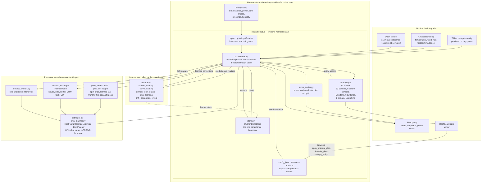

# Architecture

For anyone reading or changing the code. If you want to know what the
integration does rather than how it is built, start with
[how-it-works.md](how-it-works.md).

The shape is a thin Home Assistant layer wrapped around a much larger core that
mostly knows nothing about Home Assistant: 77 modules, of which 28 import the
`homeassistant` package at module level. The core takes numbers in and gives
numbers back; the glue reads entity states, writes actuators and persists
learned state. Keeping those two apart is what lets the model and the optimizer
be driven directly by the test suite, with no Home Assistant running.

## How the pieces fit



Read the diagram as four regions.

- **Outside the integration** are the things the integration talks to: the
  price source, the weather entity, Open-Meteo, the heat pump's own controls
  and the dashboard card. Each is reached through a Home Assistant entity or
  service, never imported.
- **The Home Assistant boundary** is where side effects live.
  `inputs.InputReader` performs every entity read;
  `coordinator.HeatPumpOptimizerCoordinator` is the orchestration seam that
  calls the core and then writes; `pump_arbiter` writes the pump's mode and
  set-points and owns the power switch; `store.QuarantiningStore` is the
  persistence boundary; `open_meteo.py` owns the network client; `issues.py`
  and `repairs.py` own the repair registry.
- **The pure core** — the model, the optimizer, the price and tariff
  arithmetic and the one-shot solve worker — takes plain numbers and returns
  plain numbers. No module there imports `homeassistant`.
- **The learners** consume the coordinator's evidence and return corrections.
  Most are pure; three still import `homeassistant` at module level —
  `accuracy` and `defrost` for the clock, `dhw_learning` for the clock and the
  `HomeAssistant` type — so the glue calls them and they never call the glue.

## The module map

```text
custom_components/heatpump_optimizer/
├── __init__.py           # Setup and unload, the 13 services, entry migrations
├── const.py              # Every config key, default and tuning constant
├── entry_config.py       # The entry's configuration, parsed once: one default
│                         #   and one coercion per key
├── store.py              # The store-load boundary: a Store whose loads refuse
│                         #   non-finite numeric leaves
├── config_flow.py        # Setup flow plus 23 option pages behind two menus
├── coordinator.py        # The update loop: read, fetch, solve, actuate, learn, publish
├── payload.py            # The typed contract of the payload the coordinator publishes
├── notifier.py           # The documented events, fired from the payload on each update
├── thermal_model.py      # Two-zone house + slab + buffer + DHW tank physics
├── optimizer.py          # The MPC solve: DHW by LP, space by L-BFGS-B, reason codes
├── dhw_planner.py        # The hot-water planner one solve builds: floors, LP, repairs
├── batchmath.py          # The batched row reduction every batch twin owes its scalar
├── process_worker.py     # One-shot interpreter for GIL-bound solves
├── open_meteo.py         # Irradiance forecast and satellite observation client
├── inputs.py             # Guarded state reads with a staleness watchdog
├── issues.py             # The repair-notice writer: raise, clear, the docs link
├── comfort_band.py       # The band's cross-field rules, shared by the config
│                         #   flow, the apply_schedule service and the thermostat
│
│   # Prices, tariffs and money
├── price_model.py        # Learned diurnal price shape for the unpublished tail
├── tariff.py             # Monthly capacity (effekt) tariff and peak tracking
├── grid_fee.py           # Time-of-use DSO transfer fees layered on the spot price
├── ledger.py             # Month-keyed ledger of settled energy and money
├── currency.py           # The one place the display currency is decided
├── wear.py               # Compressor start counting and the wear price it implies
├── wood_fuel.py          # Firewood price and the cheaper-than-pump rule
│
│   # Weather, sun and hot water
├── pv.py                 # PV production model and marginal-cost pricing
├── defrost.py            # Learned COP and capacity derate in the frosting band
├── dhw_schedule.py       # Demand-window parsing, merging and evaluation
├── dhw_draws.py          # Learned per-window draw quantiles, including heavy days
├── dhw_learning.py       # The hot-water learner: hourly draw profile, day types,
│                         #   standby rate, and the stores that persist them
│
│   # Plumbing and layout
├── mixing_valve.py       # The valve that lets a buffer tank actually store heat
├── topology.py           # One description of the configured system, shared by
│                         #   every picture of it
├── pump_schedule.py      # Hot-water circulation and space pump windows
│
│   # Learning, evidence and self-checks
├── accuracy.py           # Predicted versus realised, recorded per interval
├── draw_range.py         # The metered running draw, and the range it clamps a plan to
├── diagnosis.py          # One-input-at-a-time attribution of the last interval's error
├── drift.py              # The CUSUM primitive shared by every drift detector
├── snapshots.py          # Weekly learner snapshots and the rollback alarm
├── comfort_learning.py   # Revealed-preference comfort-weight tuning
├── curve_learning.py     # Standing cool-only bias on the ECL110 heat curve
├── sysid.py              # Active step-response identification
├── presets.py            # Building archetypes to thermal parameters
├── external_heat.py      # Wood-furnace detection with hysteresis and decay
├── setpoint_check.py     # Disinfection set-point consistency: configured vs live
│
│   # The pump's own account of itself
├── pump_mode.py          # Operating-mode vocabulary: can it heat, can it make
│                         #   hot water right now
├── pump_signals.py       # Mode, defrost, online and fault slots read together
│                         #   and resolved to the decisions the rest of the
│                         #   integration asks
├── pump_arbiter.py       # Opt-in: writes the pump's mode and set-points per
│                         #   plan step, and stands down on a manual change
├── early_cutoff.py       # Switches a space-heating pump off inside the
│                         #   interval once the room passes its threshold
├── flow_lift.py          # Supply and return water: how far the real supply
│                         #   sits from the model's own weather curve
├── flow_meter.py         # The water flow sensor: thermal output from flow,
│                         #   supply and return, when no power or frequency
│                         #   signal exists
├── silent_mode.py        # The pump's silent-mode schedule as a ceiling on
│                         #   the plan's power
├── quiet_windows.py      # The user's silent and off windows: per-step
│                         #   actions, the silent cap, the off mask, and
│                         #   the save-time overlap rules
├── modbus_prefill.py     # Option values a GCHV pump's Modbus registers
│                         #   suggest, for the options flow's pre-fill page
├── device_prefill.py     # The same suggestions from a heat-pump DEVICE's
│                         #   entity-registry records, one table per source
├── name_match.py         # The fallback: the roles a device's entity NAMES
│                         #   can fill where no table proves its model, and
│                         #   the disclaimer that says so on the page
├── prefill_offer.py      # Whether a device is worth OFFERING that pre-fill
│                         #   when the integration is set up: the qualifying
│                         #   minimum, read off the corpus measurement
├── quick_setup.py        # The quick-setup page's answer-to-config mapping:
│                         #   house questions to option keys, through presets
│
│   # People, safety and actuation
├── away.py               # Away state, return time and deadline-driven recovery
├── boost.py              # Two-hour maximum-heat overlays, hot water or space
├── manual_plan.py        # Pinned run slots, and what safety may still release
├── power_guard.py        # Live peak protection inside the metering window
├── freq_control.py       # Inverter frequency: observe first, actuate only on opt-in
├── battery.py            # The thermal stores, published as a virtual battery
├── narrative.py          # The plan told in sentences, grouped by reason
├── legionella.py         # The anti-legionella cycle: when it runs, what it refuses
├── disinfection.py       # The pump's own disinfection switch: observe first,
│                         #   turned on and off by the cycle only on opt-in
│
│   # Home Assistant entities and frontend
├── entity.py             # The shared entity base every platform builds on
├── sensor.py             # 62 sensors
├── binary_sensor.py      # Away Mode, External Heat Source, Input Problem,
│                         #   Mold Floor Breach, Open Window Detected,
│                         #   Wood Cheaper Than Heat Pump
├── button.py             # Optimize now, run identification, reset comfort
│                         #   weight, diagnose last interval; finalize the
│                         #   debug collection while that option is on
├── climate.py            # Virtual climate entity: modes, presets, DHW status
├── switch.py             # Away, Block DHW, Block Space Heating,
│                         #   Boost Space Heating, DHW Boost, Optimizer Active
├── datetime.py           # The away-override return instant, as one datetime entity
├── frontend.py           # Serves and registers the Lovelace card
├── services.py           # The domain's 13 services: schemas, handlers and registration
├── debugger.py           # A week of cycle rows for one entry, kept across a
│                         #   reload and carried by Download diagnostics
├── diagnostics.py        # Redacted config-entry diagnostics, that bundle included
├── repairs.py            # Fix flows Home Assistant loads by name when the user clicks Fix
│
├── www/                  # The dashboard card, one self-contained file
├── brand/                # Icon and logo
├── icon.png              # Integration icon
├── services.yaml         # The 13 service definitions
├── strings.json          # UI strings
├── translations/
│   ├── en.json           # English
│   └── sv.json           # Swedish
└── manifest.json         # Integration manifest
```

The package is one flat set of modules; the tree groups them by the concern
each owns, not by import order. `tests/entities.py` pins the map to the
package's `*.py` set, so a module is added with its row, and it re-derives the
counts this page publishes from the platforms rather than carrying them.

## The Home Assistant boundary

28 of the 77 modules import `homeassistant` at module level: `__init__`,
`config_flow`, `coordinator`, `open_meteo`, `frontend`, the six entity
platforms `sensor`, `binary_sensor`, `button`, `climate`, `switch`, `datetime`,
and the supporting modules `accuracy`, `away`, `boost`, `currency`, `debugger`, `defrost`,
`dhw_learning`, `diagnostics`, `early_cutoff`, `entity`, `issues`, `legionella`, `notifier`, `pump_arbiter`, `repairs`, `services`,
`store`. One module outside that set touches it at all: `inputs`
reaches for `homeassistant.util.dt` inside a function, as the fallback when no
clock function was injected.

The other 48 modules are deliberately free of it, so each can be driven
directly by `tests/features.py` with no Home Assistant running. That matters
because the failure mode of this integration is a *plausible* plan: a detector
that never fires, or a watchdog that lets a flatline through, produces output
that looks entirely normal. Only a mechanism-level test catches it.

The boundary is directional, and each side effect has one owner:

- **Reads** go through `inputs.InputReader`. It rejects `unavailable`,
  `unknown`, an over-age reading and a future timestamp, and it converts the
  entity's unit into the model's before the value reaches any caller. A caller
  that reads `hass.states` directly bypasses the freshness guard — the failure
  the module exists to prevent.
- **Actuator writes** come from the coordinator or `pump_arbiter`.
  `coordinator._apply_action` writes the current step; `pump_arbiter.apply`
  writes the pump's operating mode and set-points on opt-in, and
  `pump_arbiter.switch_supply` is the one writer of the power switch. The
  ECL110 path is published by `coordinator.async_publish_current_action`.
- **Persistence** goes through `store.QuarantiningStore`. Every load scrubs
  non-finite and absurd numeric leaves to `None`, so a corrupted store reaches
  a loader already sanitized. The coordinator, `dhw_learning`, `pump_arbiter`,
  `boost`, `away`, `legionella`, `notifier` and `debugger` each construct one.
- **External data** comes from `open_meteo.py` via
  `coordinator._fetch_solar_forecast` (the forecast and satellite endpoints),
  `coordinator._fetch_tibber_prices` (the Tibber API, or a configured price
  entity) and `coordinator._fetch_weather_forecast` (the weather entity's
  forecast).
- **Repair notices** are raised and cleared by `issues.py`; `repairs.py`
  supplies the fix flow Home Assistant loads by name.

The rule the code is held to is [`fixer.md`](../dev/governance/roles/fixer.md)
step 17: no `homeassistant` import below the glue; entity reads through
`inputs.py`; actuator writes from the coordinator or `pump_arbiter.py`;
computation stays pure. A module that breaks it is a design defect even when
its tests pass, because the pure core is the part that can be exercised without
a Home Assistant instance.

## The three big ones

**`coordinator.py`** is the update loop and the orchestration seam.
`HeatPumpOptimizerCoordinator` is a `DataUpdateCoordinator[Payload]`;
`_async_update_data` runs one cycle, `async_run_optimization` builds the
horizon with `_forecast_arrays`, folds it into a `SolveRecord` and hands its
`SolveInputs` to the optimizer, `_apply_action` writes the current step, and
`_build_data_dict` composes the published `Payload` from small per-domain
views — `_thermal_view`, `_dhw_view`, `_learning_view`, `_measurement_view`,
`_grid_view`, `_ecl110_view`, `_external_heat_view`, `_input_health_view` and
`_mixing_valve_view` — rather than one long literal. It is the only module that
talks to almost everything else; the physics lives in `thermal_model.py`, the
objective in `optimizer.py`, and the learning in the learner modules.

**`thermal_model.py`** holds the physics: two zones with their own masses and
losses, the slab, the buffer tank, the mixing valve when one is configured, the
DHW tank with its draws and standby losses, and the COP model with its learned
derates. `ThermalModel` is built from `ThermalParameters` and advanced from a
`ThermalState`; `marginal_cop` is the single answer to "what does one more kWh
into *this* store cost", shared by the trajectory simulation and by every
terminal and deferred valuation, and `compute_cop_dhw` is the tank's own law.
It is a simulator, not a controller — it answers "if this much power goes in
for this long, where does everything end up".

**`optimizer.py`** does the solve.
`HeatPumpOptimizer.optimize(inputs=SolveInputs) -> OptimizationResult`. Hot
water is planned first as a deferrable on/off load, by a linear program plus a
cheapest-first repair against the real tank simulation — the `DhwPlanner` in
`dhw_planner.py`, built once per solve from that solve's inputs; space heating
is then optimized around those fixed blocks by `_multi_start_minimize` with
L-BFGS-B over four candidate profiles; and one co-optimization pass re-plans
hot water where the two competed for the compressor. Comfort bounds are soft
penalties rather than hard constraints, so a cold morning can never be
infeasible.

## How a plan is made

The cycle is a fixed sequence in `coordinator._async_update_data`:

1. **Read.** `_update_current_state` reads every configured input through
   `inputs.InputReader`.
2. **Fetch.** `_fetch_tibber_prices`, `_fetch_weather_forecast` and
   `_fetch_solar_forecast` fill the forecast; `_async_learn_price_shape` folds
   any newly complete price day into the learned diurnal shape.
3. **Build the horizon.** `_forecast_arrays` returns a `ForecastArrays` — the
   price, temperature, wind, rain, irradiance, price-provenance, PV-surplus,
   price-dispersion, humidity and snowfall series on one grid. `_solve_record`
   folds that with the configured `ThermalParameters` and `OptimizationConfig`
   and this solve's `SolveLimits` into `SolveInputs`.
4. **Solve.** `_await_optimize` submits `optimize_in_process` through
   `process_worker.py`, a one-shot interpreter, so a long L-BFGS-B call does
   not hold the event loop's GIL. If the worker cannot carry the job, the call
   degrades to an in-process solve rather than to no plan.
   `HeatPumpOptimizer.optimize` returns one `OptimizationResult`.
5. **Act.** `_apply_action` writes the current step only: the power switch
   through `pump_arbiter.switch_supply`, the pump's mode and set-points
   through `pump_arbiter.apply`, and the ECL110 command through
   `async_publish_current_action`. The rest of the horizon is not written; it
   is re-solved next interval against fresher data.
6. **Learn and publish.** `_record_accuracy` pairs the previous interval's
   prediction with what actually happened, `_learn_measured_cop` folds the
   measured COP, and `_async_watch_learning_drift` runs the snapshot and
   drift-insurance pass. `_build_data_dict` then composes the `Payload` the
   entities read.

Both optimizer paths share one set of cost terms — the comfort penalty, the
terminal cost, the cycling and capacity charges — so enabling hot water cannot
change the space-heating objective. That is not hypothetical tidiness: it used
to, and the two objectives had silently drifted apart.

## Why the version floor is where it is

The floor used to be whatever the newest Home Assistant API the integration
provably used demanded — `ConfigEntry.runtime_data`, which put it at 2024.6.0.
That rule left the *Python* range undeclared and untested: 2024.6.0 implied
Python 3.12, CI ran only 3.13, and reported installations run 3.14, so neither
end of the implied range was exercised.

The floor is chosen by the Python range instead, which reverses the inference.
**2025.2.0 is the first Home Assistant release whose own `pyproject.toml` says
`requires-python = ">=3.13.0"`** — 2024.12.0 and 2025.1.0 both still say
`>=3.12.0`, and 2025.8.0 says `>=3.13.2`. So 2025.2.0 is the lowest Home
Assistant that can guarantee the declared Python 3.13, and it is comfortably
above the 2024.6.0 that `runtime_data` needs.

`tests/entities.py` pins the README's Home Assistant requirement line and
badge to the `hacs.json` floor, pins that floor at or above 2025.2.0, and
derives the Python floor and the suite's tested interpreters from the
`.github/workflows/tests.yml` matrix. None of this can rot away from the
measurement.

One consequence: config-flow `section()` grouping was rejected in part because
the floor predated it. At 2025.2.0 that objection is gone. The compatibility
shims written for older releases are left in place — removing them is a
separate change.

## Where the architecture is measured

Three instruments keep this page honest:

- `tests/entities.py` derives the module count, the importer set, the
  option-page count, the service count and the entity census from the tree,
  and fails a page that disagrees. It also checks that the module map lists
  every module and that the switch and binary-sensor rows name every entity
  their platforms construct.
- `tests/doc_claims.py` scans every count of a tree-measurable set across the
  reader docs, so a stale number here is a red check wherever it is written.
- [`tools/audit/archscore/ABOUT.md`](../tools/audit/archscore/ABOUT.md)
  describes the architecture score. It prices the coordinator and the
  structures around it; a decomposition elsewhere — the optimizer, for
  example — reads NULL. It is a review trigger, never a target a seat is
  rewarded for moving, and it is a required check on a pull request.

## Where to start reading

- Changing what the optimizer *wants*: `optimizer.py`, then the cost terms in
  its module docstring.
- Changing what the house *does*: `thermal_model.py`.
- Adding a setting: `const.py` for the key and default, `config_flow.py` for
  the page it belongs on, then wherever it is read.
- Adding an entity: the platform module, plus `translations/en.json` and
  `sv.json` for its name — display names come from the translation key, and
  `tests/entities.py` pins the entity counts the README publishes against the
  entities the platforms actually construct.
- Running or extending the test suite: [tests/README.md](../tests/README.md)
  covers the gate, the scoping closures and what each script is for.
