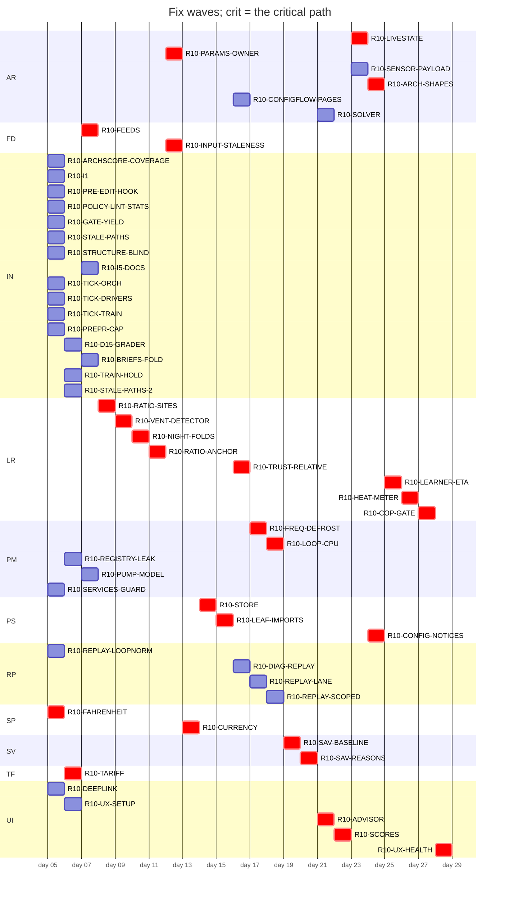

# Plan table (origin/main:dev/programme/rosters/wave-r10-groups.json)
Generated by `tools/audit/seat/plan_table.py` 2026-10-16; roster origin/main:dev/programme/rosters/wave-r10-groups.json.

54 open group(s) of 54; 26 wave(s); critical path: R10-FAHRENHEIT -> R10-TARIFF -> R10-FEEDS -> R10-RATIO-SITES -> R10-VENT-DETECTOR -> R10-NIGHT-FOLDS -> R10-RATIO-ANCHOR -> R10-INPUT-STALENESS -> R10-CURRENCY -> R10-STORE -> R10-LEAF-IMPORTS -> R10-TRUST-RELATIVE -> R10-FREQ-DEFROST -> R10-LOOP-CPU -> R10-SAV-BASELINE -> R10-SAV-REASONS -> R10-ADVISOR -> R10-SCORES -> R10-LIVESTATE -> R10-CONFIG-NOTICES -> R10-PARAMS-OWNER -> R10-ARCH-SHAPES -> R10-LEARNER-ETA -> R10-HEAT-METER -> R10-COP-GATE -> R10-UX-HEALTH (26).

## Swimlanes

| lane \ wave | 1 | 2 | 3 | 4 | 5 | 6 | 7 | 8 | 9 | 10 | 11 | 12 | 13 | 14 | 15 | 16 | 17 | 18 | 19 | 20 | 21 | 22 | 23 | 24 | 25 | 26 |
|---|---|---|---|---|---|---|---|---|---|---|---|---|---|---|---|---|---|---|---|---|---|---|---|---|---|---|
| AR |  |  |  |  |  |  |  |  |  |  |  |  |  |  |  |  | R10-SOLVER |  | R10-LIVESTATE R10-SENSOR-PAYLOAD |  | R10-PARAMS-OWNER | R10-ARCH-SHAPES |  |  | R10-CONFIGFLOW-PAGES |  |
| FD |  |  | R10-FEEDS |  |  |  |  | R10-INPUT-STALENESS |  |  |  |  |  |  |  |  |  |  |  |  |  |  |  |  |  |  |
| IN | R10-ARCHSCORE-COVERAGE R10-I1 R10-PRE-EDIT-HOOK R10-POLICY-LINT-STATS R10-GATE-YIELD R10-STALE-PATHS R10-STRUCTURE-BLIND R10-TICK-ORCH R10-TICK-DRIVERS R10-TICK-TRAIN R10-PREPR-CAP | R10-D15-GRADER R10-TRAIN-HOLD R10-STALE-PATHS-2 | R10-I5-DOCS R10-BRIEFS-FOLD |  |  |  |  |  |  |  |  |  |  |  |  |  |  |  |  |  |  |  |  |  |  |  |
| LR |  |  |  | R10-RATIO-SITES | R10-VENT-DETECTOR | R10-NIGHT-FOLDS | R10-RATIO-ANCHOR |  |  |  |  | R10-TRUST-RELATIVE |  |  |  |  |  |  |  |  |  |  | R10-LEARNER-ETA | R10-HEAT-METER | R10-COP-GATE |  |
| PM | R10-SERVICES-GUARD | R10-REGISTRY-LEAK | R10-PUMP-MODEL |  |  |  |  |  |  |  |  |  | R10-FREQ-DEFROST | R10-LOOP-CPU |  |  |  |  |  |  |  |  |  |  |  |  |
| PS |  |  |  |  |  |  |  |  |  | R10-STORE | R10-LEAF-IMPORTS |  |  |  |  |  |  |  |  | R10-CONFIG-NOTICES |  |  |  |  |  |  |
| RP | R10-REPLAY-LOOPNORM |  |  |  |  |  |  |  |  |  |  | R10-DIAG-REPLAY | R10-REPLAY-LANE | R10-REPLAY-SCOPED |  |  |  |  |  |  |  |  |  |  |  |  |
| SP | R10-FAHRENHEIT |  |  |  |  |  |  |  | R10-CURRENCY |  |  |  |  |  |  |  |  |  |  |  |  |  |  |  |  |  |
| SV |  |  |  |  |  |  |  |  |  |  |  |  |  |  | R10-SAV-BASELINE | R10-SAV-REASONS |  |  |  |  |  |  |  |  |  |  |
| TF |  | R10-TARIFF |  |  |  |  |  |  |  |  |  |  |  |  |  |  |  |  |  |  |  |  |  |  |  |  |
| UI | R10-DEEPLINK | R10-UX-SETUP |  |  |  |  |  |  |  |  |  |  |  |  |  |  | R10-ADVISOR | R10-SCORES |  |  |  |  |  |  |  | R10-UX-HEALTH |

## Waves

## Groups

| group | lane | wave | stage | issues | models | owner gate | what | live note |
|---|---|---|---|---|---|---|---|---|
| R10-FAHRENHEIT | SP | 1 | not-started | #2242, #2243, #2247 | opus/opus | - | A degF climate entity is written in degC. |  |
| R10-FEEDS | FD | 3 | not-started | **#2226**, **#2229**, **#2233**, #2236 | opus/opus | - | The price and weather ingest seam of the coordinator. |  |
| R10-RATIO-SITES | LR | 4 | not-started | #2239 | opus/opus | - | From STUDY R10-RESEED (NO-GO; harnesses `tools/audit/round10/study-reseed/reparam_sites.py` at 2c42ba4a0): `_space_demand_kw` in custom_components/heatpump_o... |  |
| R10-VENT-DETECTOR | LR | 5 | not-started | **#2241** | opus/opus | - | G-ID-2 from STUDY R10-IDENT. |  |
| R10-NIGHT-FOLDS | LR | 6 | not-started | **#2223** | opus/opus | - | G-ID-1. |  |
| R10-RATIO-ANCHOR | LR | 7 | not-started | #2239 | opus/opus | - | D-3 (D12-s2-71, medium, verified): the lower-floor learned ratio has no re-anchor, so a nameplate edit or a snapshot restore misattributes the change, upper... |  |
| R10-INPUT-STALENESS | FD | 8 | not-started | **#2234** | opus/opus | - | `INPUT_MAX_AGE_MINUTES` in custom_components/heatpump_optimizer/const.py is shorter than a report-on-change source's legitimate quiet interval: D14-s3-02 (me... |  |
| R10-CURRENCY | SP | 9 | not-started | **#2222**, **#2243** | opus/opus | - | A money figure is resolved by divergent currency precedence on different surfaces: D14-s3-01 (medium, verified; D14-s2-01 merged) finds 1 of 14 money seams m... |  |
| R10-STORE | PS | 10 | not-started | **#2224**, #2232, #2236, #2238 | opus/opus | - | Persistence: defects first, then the owner moves. |  |
| R10-TARIFF | TF | 2 | not-started | **#2230**, #2238 | opus/opus | - | 1. |  |
| R10-LEAF-IMPORTS | PS | 11 | not-started | #2247 | opus/opus | - | Structure-reducing; it goes before the groups that add code. |  |
| R10-TRUST-RELATIVE | LR | 12 | not-started | #2252 | opus/opus | - | From STUDY R10-RESEED: the learner's trust region is fixed in multiplier units, so its step grows with learned/prior, and reseeding only changes the step siz... |  |
| R10-DEEPLINK | UI | 1 | not-started | #2238, **#2253** | sonnet/opus | - | The deep-link class (owner, 2026-10-14): one mechanism is broken in three places, Advisor "Open settings", Setup "Configure" and Health "Show". |  |
| R10-UX-SETUP | UI | 2 | not-started | #2222, #2238, #2254 | opus/opus | - | Owner-reported Setup-tab redesign (tvofi, 2026-10-14), in the product's design identity: the same tokens, typography, chips and table styles as Plan, Savings... |  |
| R10-FREQ-DEFROST | PM | 13 | not-started | #2238 | sonnet/opus | - | D7-s2-01: `_observe_frequency` folds 8 defrost intervals into the frequency map over 8 defrost intervals; defrost is decided twice by divergent predicates (c... |  |
| R10-LOOP-CPU | PM | 14 | not-started | **#2237** | opus/opus | - | `estimate_recovery_hours` in custom_components/heatpump_optimizer/away.py runs a model kernel on the event loop (183 loop kernel calls over 6 cycles; `_repla... |  |
| R10-SAV-BASELINE | SV | 15 | not-started | #2255 | opus/opus | - | Owner-reported (tvofi, 2026-10-14), savings items 1, 2 and 5: September shows 1435.11 SEK saved (81 %) against a plain-thermostat baseline, which is implausi... |  |
| R10-SAV-REASONS | SV | 16 | not-started | #2256 | opus/opus | - | Owner-reported savings items 3 and 4: "Not heating" is the most expensive attribution category (137.58 SEK), and idle time cannot cost the most, so the reaso... |  |
| R10-ADVISOR | UI | 17 | not-started | #2257 | opus/opus | - | Owner-reported Advisor items: (6) the "worth doing" savings swing day to day; use a longer horizon, for example a 30-day rolling average. |  |
| R10-SCORES | UI | 18 | not-started | #2238, #2258 | opus/opus | - | Owner-reported plan scores (tvofi, 2026-10-14), read from `_scores_view` and `_close_score_day`: (1) the heat-pump score reads 0 with too little COP data, be... |  |
| R10-REGISTRY-LEAK | PM | 2 | not-started | **#2231** | sonnet/opus | - | `_STATES` in custom_components/heatpump_optimizer/early_cutoff.py is a module-level registry keyed by a coordinator: setup adds an entry and unload never rem... |  |
| R10-PUMP-MODEL | PM | 3 | not-started | #2232, #2238 | opus/opus | - | 1. |  |
| R10-LIVESTATE | AR | 19 | not-started | #2232, #2248 | opus/opus | - | The large coordinator move; it runs after every defect fix on the coordinator. |  |
| R10-CONFIG-NOTICES | PS | 20 | not-started | #2232 | sonnet/opus | - | ARCH2-s2 P1: a config-notices owner in custom_components/heatpump_optimizer/setpoint_check.py instead of coordinator fields written from several places (`dev... |  |
| R10-SERVICES-GUARD | PM | 1 | not-started | #2238 | sonnet/opus | - | D10-s1-51: `handle_apply_schedule` in custom_components/heatpump_optimizer/services.py stays silent on a bogus entry while its siblings raise; one guard for... |  |
| R10-ARCHSCORE-COVERAGE | IN | 1 | not-started | **#2228**, #2235, #2259 | opus/opus | yes: code-owned: archscore weights.json and calibration/expected.json | Fold the arch seats' leads into the archscore, one group on tools/audit/archscore/. |  |
| R10-PARAMS-OWNER | AR | 21 | not-started | **#2232**, #2249 | opus/opus | - | ARCH2-s1: a single owner of the thermal parameters with copy-on-write (`dev/audit/rounds/round10/D7/arch2-s1/P1_thermal_params_single_owner.patch` at 2c30ada... |  |
| R10-SENSOR-PAYLOAD | AR | 19 | not-started | #2238, **#2242** | opus/opus | - | Defect first: D8-s1-01 (low), the hot-water schedule sensor publishes "heating now" on 1 of 36 off-step snapshots through its fallback. |  |
| R10-ARCH-SHAPES | AR | 22 | not-started | **#2236**, #2238, **#2239** | opus/opus | - | Bug first: D7-s2-61 (P1, weakened low; D7-s3-81 merged into it): a power entity reading inf lifts the quiet-window cap to the 6.0 kW nameplate. |  |
| R10-LEARNER-ETA | LR | 23 | not-started | #2260 | opus/opus | - | G-ID-4. |  |
| R10-HEAT-METER | LR | 24 | not-started | #2261 | opus/opus | - | Owner request (tvofi, 2026-10-15). |  |
| R10-COP-GATE | LR | 25 | not-started | #2262 | opus/opus | - | From STUDY R10-IDENT Q2: no bin of the COP gate reaches 20 within 120 days, because 59 of 138 rows fall under the duty floor, and the sample definition assum... |  |
| R10-UX-HEALTH | UI | 26 | not-started | #2263 | opus/opus | - | Owner-reported Health tab (tvofi, 2026-10-14): (1) mixed casing, the integration's role labels next to the user's raw entity friendly names; every row shows... |  |
| R10-CONFIGFLOW-PAGES | AR | 25 | not-started | **#2238** | opus/opus | - | Bug first: D7-s2-56 (the catch-up judge re-classed it a bug): a cleared entity slot re-renders as the stored entity on a rejected options form (9 of 9 slots;... |  |
| R10-SOLVER | AR | 17 | not-started | **#2240**, #2250 | opus/opus | - | The solve internals of custom_components/heatpump_optimizer/optimizer.py. |  |
| R10-I1 | IN | 1 | not-started | **#2219** | opus/opus | yes: code-owned: tests/stress.py | A guard whose deletion leaves the gate green, or a miscounted kill: D3-s1-01 (medium, the forecast keep), D3-s1-02 (12 of 12 live guards), D3-s2-01 (the quar... |  |
| R10-PRE-EDIT-HOOK | IN | 1 | not-started | #2220 | sonnet/opus | yes: code-owned: .claude/hooks/ | D11-s1-01: the pre-edit hook decides the release-notes branch for Edit and Write but not MultiEdit (16 seams, 1 escape; `dev/audit/rounds/round10/D14/I3/hook... |  |
| R10-POLICY-LINT-STATS | IN | 1 | not-started | **#2220**, **#2221** | opus/opus | - | Three defects in the statistics half of tools/policy/policy_lint.mjs: D13-s2-02 (I4, medium) the verdicts histogram counts the rework class beside the verdic... |  |
| R10-GATE-YIELD | IN | 1 | not-started | **#2225** | sonnet/opus | yes: code-owned: .claude/workflows/web-fix-wave.js | D13-s2-01 (weakened to hygiene): the root-cause-unanswered verdict class accounts for 37 of 124 blocked verdicts, more than any engineering defect class. |  |
| R10-STALE-PATHS | IN | 1 | not-started | **#2227** | sonnet/opus | - | D13-s3-01: archived round harnesses import or resolve paths that a file move retired (the D11 round-4 harnesses import a library no longer on the path; 35 pa... |  |
| R10-STRUCTURE-BLIND | IN | 1 | not-started | **#2235** | opus/opus | yes: budget: a measurement change may move a ratchet metric | The structural ratchet measures a name proxy: D7-s1-01, a 1201-line move shifts 0 of 16 budget keys because `max_class_loc` is per class, not summed; D7-s3-0... |  |
| R10-I5-DOCS | IN | 3 | not-started | #2222, #2298 | sonnet/sonnet | yes: code-owned: tests/stress.py (comment only) | Docs and comments drifted against the code: five UI labels in README.md, docs/configuration.md and docs/setup.md (D5-s1-01); the console-banner sample in doc... |  |
| R10-TICK-ORCH | IN | 1 | not-started | #2264 | sonnet/opus | - | The orchestrator's tick (tools/audit/seat/orchestrator_tick.py): (a) it reports a required context ABSENT when the job is only waiting on its needs; read the... |  |
| R10-TICK-DRIVERS | IN | 1 | not-started | #2265 | opus/opus | yes: code-owned: audit-find.js, audit-verify.js, fold_ledger.py | Round-driver repairs patched only in scratch clones this round; tools live in the repository. |  |
| R10-TICK-TRAIN | IN | 1 | not-started | **#2266** | sonnet/opus | - | (f) The merge train's approval carry returned no carry for #2209 at its recarried head (owner approval at the first head citing the mandate, delta main-only)... |  |
| R10-PREPR-CAP | IN | 1 | not-started | #2267 | sonnet/opus | - | The prepr cap of 4 is advisory: at 22:57 on 2026-10-14 the tick read 10 prepr runs, each spawning a nested chain of self-test runs, and load1 reached 168 on... |  |
| R10-D15-GRADER | IN | 2 | not-started | #2268 | opus/opus | yes: policy: dev/governance/dimensions/D15.md | (a) Re-key the three bundle pins in tools/policy/check-wave-script.mjs on D15's brief existing, not on the bundle-dimensions declaration in the find workflow... |  |
| R10-BRIEFS-FOLD | IN | 3 | not-started | #2222, #2269 | opus/opus | yes: policy: dimension briefs | The D7 M7/M8 policy fold (tvofi, 2026-10-14) plus every brief edit the round owes, in one policy pull request. |  |
| R10-REPLAY-LOOPNORM | RP | 1 | not-started | #2270 | sonnet/opus | - | The loop CPU ratio's spread comes from runner class (correlation -0.94 with the reference time): the loop measure is interpreter-bound and the reference is B... |  |
| R10-DIAG-REPLAY | RP | 12 | not-started | #2271 | opus/opus | - | Owner (tvofi, 2026-10-14): wire the export into Download diagnostics. |  |
| R10-REPLAY-LANE | RP | 13 | not-started | #2272 | opus/opus | yes: code-owned: .github/workflows/ | Land the replay lane fully (tvofi, 2026-10-14): a real recorded day from the owner's install, exported through the allowlist into a new fixture under tests/r... |  |
| R10-REPLAY-SCOPED | RP | 14 | not-started | #2273 | opus/opus | yes: code-owned: .github/workflows/ | Owner (tvofi, 2026-10-15) on a per-PR timed replay: "Hard no, only when relevant." Run the timed replay lane on a pull request only when its diff reaches the... |  |
| R10-TRAIN-HOLD | IN | 2 | not-started | **#2302** | sonnet/opus | yes: code-owned: .github/workflows/ (workflow change, approved under mandate 6175172275) | The record beat in .github/workflows/tests.yml auto-merges record PRs on its own schedule, so a record PR can land while a merge train waits on CI and move m... |  |
| R10-STALE-PATHS-2 | IN | 2 | not-started | **#2312** | sonnet/opus | - | Class N-move-stale-path (#2227), the sibling seams that the pull request for the stale-path arm in tests/layout.py (PR #2289) left open, verified independent... |  |

## ETA

Cadence 2 days per wave (`--cadence`); 26 wave(s) of work, total 52 days from wave-1 start.

| wave | groups | starts (day) | ends (day) |
|---|---|---|---|
| 1 | 15 | 0 | 2 |
| 2 | 6 | 2 | 4 |
| 3 | 4 | 4 | 6 |
| 4 | 1 | 6 | 8 |
| 5 | 1 | 8 | 10 |
| 6 | 1 | 10 | 12 |
| 7 | 1 | 12 | 14 |
| 8 | 1 | 14 | 16 |
| 9 | 1 | 16 | 18 |
| 10 | 1 | 18 | 20 |
| 11 | 1 | 20 | 22 |
| 12 | 2 | 22 | 24 |
| 13 | 2 | 24 | 26 |
| 14 | 2 | 26 | 28 |
| 15 | 1 | 28 | 30 |
| 16 | 1 | 30 | 32 |
| 17 | 2 | 32 | 34 |
| 18 | 1 | 34 | 36 |
| 19 | 2 | 36 | 38 |
| 20 | 1 | 38 | 40 |
| 21 | 1 | 40 | 42 |
| 22 | 1 | 42 | 44 |
| 23 | 1 | 44 | 46 |
| 24 | 1 | 46 | 48 |
| 25 | 2 | 48 | 50 |
| 26 | 1 | 50 | 52 |
