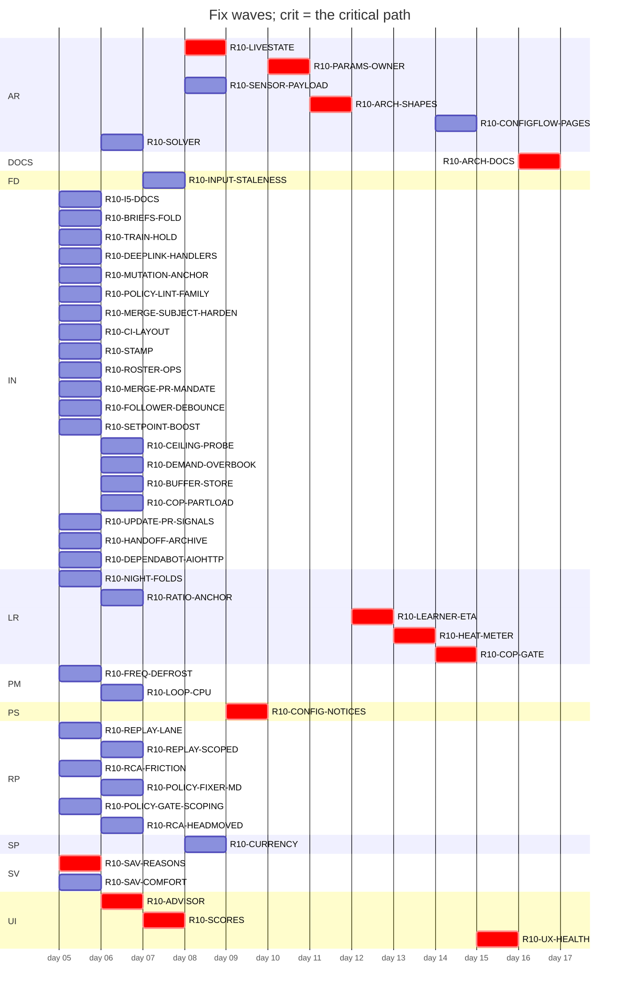

# Plan table (origin/handoff/audit-r10-roster:dev/programme/rosters/wave-r10-groups.json)
Generated by `tools/audit/seat/plan_table.py` 2026-10-20; roster origin/handoff/audit-r10-roster:dev/programme/rosters/wave-r10-groups.json.

48 open group(s) of 93; 12 wave(s); critical path: R10-SAV-REASONS -> R10-ADVISOR -> R10-SCORES -> R10-LIVESTATE -> R10-CONFIG-NOTICES -> R10-PARAMS-OWNER -> R10-ARCH-SHAPES -> R10-LEARNER-ETA -> R10-HEAT-METER -> R10-COP-GATE -> R10-UX-HEALTH -> R10-ARCH-DOCS (12).

## Swimlanes

| lane \ wave | 1 | 2 | 3 | 4 | 5 | 6 | 7 | 8 | 9 | 10 | 11 | 12 |
|---|---|---|---|---|---|---|---|---|---|---|---|---|
| AR |  | R10-SOLVER |  | R10-LIVESTATE R10-SENSOR-PAYLOAD |  | R10-PARAMS-OWNER | R10-ARCH-SHAPES |  |  | R10-CONFIGFLOW-PAGES |  |  |
| DOCS |  |  |  |  |  |  |  |  |  |  |  | R10-ARCH-DOCS |
| FD |  |  | R10-INPUT-STALENESS |  |  |  |  |  |  |  |  |  |
| IN | R10-I5-DOCS R10-BRIEFS-FOLD R10-TRAIN-HOLD R10-DEEPLINK-HANDLERS R10-MUTATION-ANCHOR R10-POLICY-LINT-FAMILY R10-MERGE-SUBJECT-HARDEN R10-CI-LAYOUT R10-STAMP R10-ROSTER-OPS R10-MERGE-PR-MANDATE R10-FOLLOWER-DEBOUNCE R10-SETPOINT-BOOST R10-UPDATE-PR-SIGNALS R10-HANDOFF-ARCHIVE R10-DEPENDABOT-AIOHTTP | R10-CEILING-PROBE R10-DEMAND-OVERBOOK R10-BUFFER-STORE R10-COP-PARTLOAD |  |  |  |  |  |  |  |  |  |  |
| LR | R10-NIGHT-FOLDS | R10-RATIO-ANCHOR |  |  |  |  |  | R10-LEARNER-ETA | R10-HEAT-METER | R10-COP-GATE |  |  |
| PM | R10-FREQ-DEFROST | R10-LOOP-CPU |  |  |  |  |  |  |  |  |  |  |
| PS |  |  |  |  | R10-CONFIG-NOTICES |  |  |  |  |  |  |  |
| RP | R10-REPLAY-LANE R10-RCA-FRICTION R10-POLICY-GATE-SCOPING | R10-REPLAY-SCOPED R10-POLICY-FIXER-MD R10-RCA-HEADMOVED |  |  |  |  |  |  |  |  |  |  |
| SP |  |  |  | R10-CURRENCY |  |  |  |  |  |  |  |  |
| SV | R10-SAV-REASONS R10-SAV-COMFORT |  |  |  |  |  |  |  |  |  |  |  |
| UI |  | R10-ADVISOR | R10-SCORES |  |  |  |  |  |  |  | R10-UX-HEALTH |  |

## Waves

## Groups

| group | lane | wave | stage | issues | models | owner gate | what | live note |
|---|---|---|---|---|---|---|---|---|
| R10-FAHRENHEIT | SP | 1 | done | #2242, #2243, #2247 | opus/opus | - | A degF climate entity is written in degC. |  |
| R10-FEEDS | FD | 1 | done | **#2226**, **#2229**, **#2233**, #2236 | opus/opus | - | The price and weather ingest seam of the coordinator. |  |
| R10-RATIO-SITES | LR | 1 | done | #2239 | opus/opus | - | From STUDY R10-RESEED (NO-GO; harnesses `tools/audit/round10/study-reseed/reparam_sites.py` at 2c42ba4a0): `_space_demand_kw` in custom_components/heatpump_o... |  |
| R10-VENT-DETECTOR | LR | 1 | done | **#2241** | opus/opus | - | G-ID-2 from STUDY R10-IDENT. |  |
| R10-NIGHT-FOLDS | LR | 1 | not-started | **#2223** | opus/opus | - | G-ID-1. |  |
| R10-RATIO-ANCHOR | LR | 2 | not-started | #2239 | opus/opus | - | D-3 (D12-s2-71, medium, verified): the lower-floor learned ratio has no re-anchor, so a nameplate edit or a snapshot restore misattributes the change, upper... |  |
| R10-INPUT-STALENESS | FD | 3 | not-started | **#2234** | opus/opus | - | `INPUT_MAX_AGE_MINUTES` in custom_components/heatpump_optimizer/const.py is shorter than a report-on-change source's legitimate quiet interval: D14-s3-02 (me... |  |
| R10-CURRENCY | SP | 4 | not-started | **#2222**, **#2243** | opus/opus | - | A money figure is resolved by divergent currency precedence on different surfaces: D14-s3-01 (medium, verified; D14-s2-01 merged) finds 1 of 14 money seams m... |  |
| R10-STORE | PS | 5 | done | **#2224**, #2232, #2236, #2238 | opus/opus | - | Persistence: defects first, then the owner moves. |  |
| R10-TARIFF | TF | 1 | done | **#2230**, #2238 | opus/opus | - | 1. |  |
| R10-LEAF-IMPORTS | PS | 2 | done | #2247 | opus/opus | - | Structure-reducing; it goes before the groups that add code. |  |
| R10-TRUST-RELATIVE | LR | 1 | done | #2252 | opus/opus | - | From STUDY R10-RESEED: the learner's trust region is fixed in multiplier units, so its step grows with learned/prior, and reseeding only changes the step siz... |  |
| R10-DEEPLINK | UI | 1 | done | #2238, #2253 | sonnet/opus | - | The deep-link class (owner, 2026-10-14): one mechanism is broken in three places, Advisor "Open settings", Setup "Configure" and Health "Show". |  |
| R10-UX-SETUP | UI | 1 | done | #2222, #2238, #2254 | opus/opus | - | Owner-reported Setup-tab redesign (tvofi, 2026-10-14), in the product's design identity: the same tokens, typography, chips and table styles as Plan, Savings... |  |
| R10-FREQ-DEFROST | PM | 1 | not-started | #2238 | sonnet/opus | - | D7-s2-01: `_observe_frequency` folds 8 defrost intervals into the frequency map over 8 defrost intervals; defrost is decided twice by divergent predicates (c... |  |
| R10-LOOP-CPU | PM | 2 | not-started | **#2237** | opus/opus | - | `estimate_recovery_hours` in custom_components/heatpump_optimizer/away.py runs a model kernel on the event loop (183 loop kernel calls over 6 cycles; `_repla... |  |
| R10-SAV-BASELINE | SV | 3 | done | **#2255** | opus/opus | - | Owner-reported (tvofi, 2026-10-14), savings items 1, 2 and 5: September shows 1435.11 SEK saved (81 %) against a plain-thermostat baseline, which is implausi... |  |
| R10-SAV-REASONS | SV | 1 | not-started | #2256 | opus/opus | - | Owner-reported savings items 3 and 4: "Not heating" is the most expensive attribution category (137.58 SEK), and idle time cannot cost the most, so the reaso... |  |
| R10-ADVISOR | UI | 2 | not-started | #2253, #2257 | opus/opus | - | Owner-reported Advisor items: (6) the "worth doing" savings swing day to day; use a longer horizon, for example a 30-day rolling average. |  |
| R10-SCORES | UI | 3 | not-started | #2238, #2258 | opus/opus | - | Owner-reported plan scores (tvofi, 2026-10-14), read from `_scores_view` and `_close_score_day`: (1) the heat-pump score reads 0 with too little COP data, be... |  |
| R10-REGISTRY-LEAK | PM | 1 | done | **#2231** | sonnet/opus | - | `_STATES` in custom_components/heatpump_optimizer/early_cutoff.py is a module-level registry keyed by a coordinator: setup adds an entry and unload never rem... |  |
| R10-PUMP-MODEL | PM | 1 | done | #2232, #2238 | opus/opus | - | 1. |  |
| R10-LIVESTATE | AR | 4 | not-started | #2232, #2248 | opus/opus | - | The large coordinator move; it runs after every defect fix on the coordinator. |  |
| R10-CONFIG-NOTICES | PS | 5 | not-started | #2232 | sonnet/opus | - | ARCH2-s2 P1: a config-notices owner in custom_components/heatpump_optimizer/setpoint_check.py instead of coordinator fields written from several places (`dev... |  |
| R10-SERVICES-GUARD | PM | 1 | done | #2238 | sonnet/opus | - | D10-s1-51: `handle_apply_schedule` in custom_components/heatpump_optimizer/services.py stays silent on a bogus entry while its siblings raise; one guard for... |  |
| R10-ARCHSCORE-COVERAGE | IN | 1 | done | #2228, #2235, **#2259** | opus/opus | yes: code-owned: archscore weights.json and calibration/expected.json | Fold the arch seats' leads into the archscore, one group on tools/audit/archscore/. |  |
| R10-PARAMS-OWNER | AR | 6 | not-started | **#2232**, #2249 | opus/opus | - | ARCH2-s1: a single owner of the thermal parameters with copy-on-write (`dev/audit/rounds/round10/D7/arch2-s1/P1_thermal_params_single_owner.patch` at 2c30ada... |  |
| R10-SENSOR-PAYLOAD | AR | 4 | not-started | #2238, **#2242** | opus/opus | - | Defect first: D8-s1-01 (low), the hot-water schedule sensor publishes "heating now" on 1 of 36 off-step snapshots through its fallback. |  |
| R10-ARCH-SHAPES | AR | 7 | not-started | **#2236**, #2238, **#2239** | opus/opus | - | Bug first: D7-s2-61 (P1, weakened low; D7-s3-81 merged into it): a power entity reading inf lifts the quiet-window cap to the 6.0 kW nameplate. |  |
| R10-LEARNER-ETA | LR | 8 | not-started | #2260 | opus/opus | - | G-ID-4. |  |
| R10-HEAT-METER | LR | 9 | not-started | #2261 | opus/opus | - | Owner request (tvofi, 2026-10-15). |  |
| R10-COP-GATE | LR | 10 | not-started | #2262 | opus/opus | - | From STUDY R10-IDENT Q2: no bin of the COP gate reaches 20 within 120 days, because 59 of 138 rows fall under the duty floor, and the sample definition assum... |  |
| R10-UX-HEALTH | UI | 11 | not-started | #2253, #2263 | opus/opus | - | Owner-reported Health tab (tvofi, 2026-10-14): (1) mixed casing, the integration's role labels next to the user's raw entity friendly names; every row shows... |  |
| R10-CONFIGFLOW-PAGES | AR | 10 | not-started | **#2238** | opus/opus | - | Bug first: D7-s2-56 (the catch-up judge re-classed it a bug): a cleared entity slot re-renders as the stored entity on a rejected options form (9 of 9 slots;... |  |
| R10-SOLVER | AR | 2 | not-started | **#2240**, #2250 | opus/opus | - | The solve internals of custom_components/heatpump_optimizer/optimizer.py. |  |
| R10-I1 | IN | 1 | done | **#2219** | opus/opus | yes: code-owned: tests/stress.py | A guard whose deletion leaves the gate green, or a miscounted kill: D3-s1-01 (medium, the forecast keep), D3-s1-02 (12 of 12 live guards), D3-s2-01 (the quar... |  |
| R10-PRE-EDIT-HOOK | IN | 1 | done | **#2220** | sonnet/opus | yes: code-owned: .claude/hooks/ | D11-s1-01: the pre-edit hook decides the release-notes branch for Edit and Write but not MultiEdit (16 seams, 1 escape; `dev/audit/rounds/round10/D14/I3/hook... |  |
| R10-POLICY-LINT-STATS | IN | 1 | done | **#2220**, **#2221** | opus/opus | - | Three defects in the statistics half of tools/policy/policy_lint.mjs: D13-s2-02 (I4, medium) the verdicts histogram counts the rework class beside the verdic... |  |
| R10-GATE-YIELD | IN | 1 | done | **#2225** | sonnet/opus | yes: code-owned: .claude/workflows/web-fix-wave.js | D13-s2-01 (weakened to hygiene): the root-cause-unanswered verdict class accounts for 37 of 124 blocked verdicts, more than any engineering defect class. |  |
| R10-STALE-PATHS | IN | 1 | done | **#2227** | sonnet/opus | - | D13-s3-01: archived round harnesses import or resolve paths that a file move retired (the D11 round-4 harnesses import a library no longer on the path; 35 pa... |  |
| R10-STRUCTURE-BLIND | IN | 1 | done | **#2235** | opus/opus | yes: budget: a measurement change may move a ratchet metric | The structural ratchet measures a name proxy: D7-s1-01, a 1201-line move shifts 0 of 16 budget keys because `max_class_loc` is per class, not summed; D7-s3-0... |  |
| R10-I5-DOCS | IN | 1 | not-started | #2222, #2298 | sonnet/sonnet | yes: code-owned: tests/stress.py (comment only) | Docs and comments drifted against the code: five UI labels in README.md, docs/configuration.md and docs/setup.md (D5-s1-01); the console-banner sample in doc... |  |
| R10-TICK-ORCH | IN | 1 | done | #2264 | sonnet/opus | - | The orchestrator's tick (tools/audit/seat/orchestrator_tick.py): (a) it reports a required context ABSENT when the job is only waiting on its needs; read the... |  |
| R10-TICK-DRIVERS | IN | 1 | done | #2265 | opus/opus | yes: code-owned: audit-find.js, audit-verify.js, fold_ledger.py | Round-driver repairs patched only in scratch clones this round; tools live in the repository. |  |
| R10-TICK-TRAIN | IN | 1 | done | **#2266** | sonnet/opus | - | (f) The merge train's approval carry returned no carry for #2209 at its recarried head (owner approval at the first head citing the mandate, delta main-only)... |  |
| R10-PREPR-CAP | IN | 1 | done | #2267 | sonnet/opus | - | `tools/pr/prepr.sh` runs unleased and each seat starts one independently, so the tick read 8+ concurrent preprs (each spawning its nested `--self-test`) and... |  |
| R10-D15-GRADER | IN | 1 | done | #2268 | opus/opus | yes: policy: dev/governance/dimensions/D15.md | (a) Re-key the three bundle pins in tools/policy/check-wave-script.mjs on D15's brief existing, not on the bundle-dimensions declaration in the find workflow... |  |
| R10-BRIEFS-FOLD | IN | 1 | not-started | #2222, #2269 | opus/opus | yes: policy: dimension briefs | The D7 M7/M8 policy fold (tvofi, 2026-10-14) plus every brief edit the round owes, in one policy pull request. |  |
| R10-REPLAY-LOOPNORM | RP | 1 | done | #2270 | sonnet/opus | - | The loop CPU ratio's spread comes from runner class (correlation -0.94 with the reference time): the loop measure is interpreter-bound and the reference is B... |  |
| R10-DIAG-REPLAY | RP | 1 | done | #2271 | opus/opus | - | Owner (tvofi, 2026-10-14): wire the export into Download diagnostics. |  |
| R10-REPLAY-LANE | RP | 1 | not-started | #2272 | opus/opus | yes: code-owned: .github/workflows/ | Land the replay lane fully (tvofi, 2026-10-14): a real recorded day from the owner's install, exported through the allowlist into a new fixture under tests/r... |  |
| R10-REPLAY-SCOPED | RP | 2 | not-started | #2273 | opus/opus | yes: code-owned: .github/workflows/ | Owner (tvofi, 2026-10-15) on a per-PR timed replay: "Hard no, only when relevant." Run the timed replay lane on a pull request only when its diff reaches the... |  |
| R10-TRAIN-HOLD | IN | 1 | not-started | **#2302** | sonnet/opus | yes: code-owned: .github/workflows/ (workflow change, approved under mandate 6175172275) | The record beat in .github/workflows/tests.yml auto-merges record PRs on its own schedule, so a record PR can land while a merge train waits on CI and move m... |  |
| R10-STALE-PATHS-2 | IN | 1 | done | **#2312** | sonnet/opus | - | Class N-move-stale-path (#2227), the sibling seams that the pull request for the stale-path arm (PR #2289) left open; the stale-path arm itself lives in test... |  |
| R10-REF-PRIVACY | IN | 1 | done | **#2310** | opus/opus | yes: code-owned: governance.yml, closure.py and stamp.py, approved under mandate 6175172275 | Owner-reported (tvofi, 2026-10-16, issue #2310): tools/audit/seat/wt_sync.sh builds the remote sync ref name from the worktree's absolute path, stripping onl... |  |
| R10-DEEPLINK-CENSUS | IN | 1 | done | #2317 | opus/opus | - | Split from the R10-DEEPLINK pull request (#2283) after its round-4 review (verdict on head 1826c67c3), as issue #2317: the deep-link builder and its own chec... |  |
| R10-DEEPLINK-HANDLERS | IN | 1 | planned | **#2317** | opus/opus | - | Split from R10-DEEPLINK-CENSUS by the orchestrator under the three-round rule (round 8 of #2345 found a third missed written spelling). |  |
| R10-ARCH-DOCS | DOCS | 12 | not-started | **#2395** | opus/opus | - | R10-ARCH-DOCS, the LAST stage of round 10 (owner ruling 2026-10-17, tvofi), after every other round-10 group. |  |
| R10-RCA-FRICTION | RP | 1 | not-started | **#2331**, #2353, #2409, #2428, #2429, #2436, #2437, #2438 | opus/opus | - | # Fixer brief O10-rca-friction: land the finished RCA for #2331 and #2353 (finding sweep L19)
State found: the RCA is DONE but unpublished. |  |
| R10-POLICY-FIXER-MD | RP | 2 | not-started | **#2378** | opus/opus | - | # Fixer brief O10-policy-fixer-md: dispose recurring friction #2378 (finding sweep L20, F-POL, P16, P23, P38). |  |
| R10-POLICY-GATE-SCOPING | RP | 1 | not-started | **#2381** | opus/opus | - | # Fixer brief O10-policy-gate-scoping: dispose recurring friction #2381 (finding sweep L21, P37). |  |
| R10-RCA-HEADMOVED | RP | 2 | not-started | #2389 | opus/opus | - | ROOT-CAUSE SEAT O15 (round 10, part of #201, mandate 6175172275). |  |
| R10-RCA-STRUCTURE-BLIND | RP | 1 | done | #2235 | opus/opus | - | # O16 — round-10 RCA for the N-structure-blind class (#2235)
Role: dev/governance/roles/root-cause.md. |  |
| R10-SAV-COMFORT | SV | 1 | not-started | - | opus/opus | - | Owns two limits R10-SAV-BASELINE (#2255, PR #2411) left open in the savings figures. |  |
| R10-MUTATION-ANCHOR | IN | 1 | not-started | - | opus/opus | - | Fix the vacuous kill in the entities.py `--anchor` mutation self-test soundly, and measure how many of the 123 `killed_by: tests/entities.py` pins are vacuous. |  |
| R10-N-LOG-FLOOD | PS | 1 | done | **#2337** | opus/opus | - | RECORD OF A DELIVERED GROUP (PR #2351, merged at 42e6dedb27f36d180af04069ce652eca4b345378; issue #2337). |  |
| R10-POLICY-LINT-FAMILY | IN | 1 | not-started | #2410 | opus/opus | yes: policy: tools/policy/ is in POLICY_GLOBS; tvofi approves under the mandate | Measure first, then fix `tools/policy/policy_lint.mjs`'s family count. |  |
| R10-DEAD-RATE-LIMIT | LR | 1 | done | - | opus/opus | - | Found by the R10-TRUST-RELATIVE seat (no defer): after that group's relative trust region, the rate limit `HOUSE_LOSS_MAX_STEP` (the `max_step_fraction=HOUSE... |  |
| R10-MERGE-SUBJECT-HARDEN | IN | 1 | not-started | - | opus/opus | yes: policy: tools/policy/agreement.mjs is in POLICY_GLOBS; tvofi approves under the mandate | Two review findings on #2423 (R10-MERGE-SUBJECT) that were recorded, not fixed, in tools/policy/agreement.mjs. |  |
| R10-CI-LAYOUT | IN | 1 | not-started | - | opus/opus | yes: Code-owned (`/.github/workflows/`, `tests/run.sh` for PR 0, and `/.github/actions/` after PR 1, CODEOWNERS) and policy (PR 1: `ci-autofix.md`, `defect-root-cause.md` and `rules_sync`; PR 2: R-10's `pr-contract` change, `orchestrator.md` §11, `nudge.md`, `steward/SKILL.md`, the PR template, `web-fragments.md`). PR 0 (stub plus ci-ratchet payments), PR G (after #2444, merged), PR 1 and PR 2 are each approved at their merged head by the CODEOWNER session under mandate 6175172275 (scope `all`, to 2026-10-28). tvofi's own step: the ruleset 23698884 `required_status_checks` PUT at PR 2's merge (one action, staged in PR 2's body). The design was approved at round 5 (`probe/design-ci-review5`, `afc00bfe`, on rev4 `1371a0a6`) and the plan addendum (A1-A6) was approved by the design review of 2026-10-19. R-3 needs no owner action (environments read 2026-10-19). | CI consolidation of .github/workflows/tests.yml under one umbrella workflow and one required check, in FOUR pull requests, in this order: PR 0, PR G, PR 1, P... |  |
| R10-OPENPR-SILENT | IN | 1 | done | - | sonnet/opus | - | open_pr silent-failure fix plus tick MERGE_PR/OWED folds, delivered by #2422. |  |
| R10-STAMP | IN | 1 | not-started | - | sonnet/opus | - | wave-1 stamp: restore the 19 suspended may-drift entries in tests/golden/claimed_drift.txt and stamp the golden files after the drain |  |
| R10-TICK-SELFTEST-CI | IN | 1 | done | - | opus/opus | - | Wire the orchestrator tick self-test (tools/audit/seat/orchestrator_tick.py --self-test) into the instrument-self-tests job of .github/workflows/governance.y... |  |
| R10-SEAT-SELFTESTS-CI | IN | 1 | done | - | opus/opus | - | Wire the remaining unwired tools/audit/seat/ self-tests into CI: 24 of 32 self-testing files there were named in no workflow when R10-TICK-SELFTEST-CI was cu... |  |
| R10-RECARRY-HEAD | IN | 1 | done | - | sonnet/opus | - | Recarry note placement: app_push.sh --recarry locates its note by the first '## Head' substring, so a body whose preamble quotes the heading gets the note in... |  |
| R10-SETPOINT-POWER | IN | 1 | done | - | opus/opus | - | On installs whose pump power is set through a heating-flow setpoint behind a buffer tank and mixing valve, the setpoint is a power command (owner, 2026-10-19... |  |
| R10-PREPR-UNPINNED-RED | IN | 1 | done | - | sonnet/opus | - | Found by the R10-TRUST-RELATIVE recarry seat (#2435, no defer): when tools/pr/prepr.sh step 6d prints a mutation site the diff adds unpinned, the body may st... |  |
| R10-ROSTER-OPS | IN | 1 | in-progress | - | sonnet/opus | - | roster_edit.py gains set-after <group> <G1,.../-> and drop-carry <group> <index/--match TEXT>, so replans and stale-carry drops go through the load-validate-... |  |
| R10-RCA-NIGHTLY-PYSPY | IN | 1 | done | - | sonnet/opus | - | Root-cause record for the recurring nightly-ha (stable) red: hb:positive_control fails when its single py-spy dump --nonblocking sample times out at 30 s (py... |  |
| R10-CI-RATCHET-RED | IN | 1 | done | - | opus/opus | - | main is red on ci-ratchet on most pushes since 2026-10-19 (critical path 58.65 min against the 54.825 budget; script runs 73 against 68; found by the R10-CI-... |  |
| R10-MERGE-PR-MANDATE | IN | 1 | in-progress | - | opus/opus | - | merge_pr.sh reads the mandate live through tools/policy/budget_raise_gate.py and refuses before any GitHub write without one; proof_watch owner mode hands it... |  |
| R10-FOLLOWER-DEBOUNCE | IN | 1 | in-progress | - | opus/opus | yes: code-owned .github/workflows: mandated approval under 6175172275 | Ordered by tvofi 2026-10-19 ahead of R10-CI-LAYOUT: the stale-contract follower (pr-contract-rerun.yml, workflow_run on 8 workflows) fires once per completed... |  |
| R10-POLICY-INSTRUMENTS | IN | 1 | done | - | sonnet/opus | yes: policy: mandated approval under 6175172275 (tvofi 2026-10-19 asked for this edit, budget raises ok) | Ordered by tvofi 2026-10-19: reinforce that canonical instruments in tools/audit/seat/INSTRUMENTS.md are used before any hand-rolled loop, watcher, relay or... |  |
| R10-SETPOINT-BOOST | IN | 1 | in-progress | - | opus/opus | yes: mandated approval under 6175172275 | Owner report on v7.0.1 (tvofi 2026-10-19): cheap hours with comfort headroom are planned at a 25 C flow set-point (35 before #2445) and low-power slots fill... |  |
| R10-CEILING-PROBE | IN | 2 | not-started | - | opus/opus | yes: mandated approval under 6175172275 | Ordered by tvofi 2026-10-19: fold a deliberate ceiling-set-point probe into the cheap-night system-identification experiment (sysid.py, gated on mild outdoor... |  |
| R10-SAVINGS-NEGATIVE | IN | 1 | done | - | opus/opus | yes: mandated approval under 6175172275 | Owner report on v7.0.1 (tvofi 2026-10-19): the monthly savings entity dropped to extreme negative values. |  |
| R10-DEMAND-OVERBOOK | IN | 2 | queued | - | opus/opus | yes: mandated approval under 6175172275 | Found by R10-SETPOINT-BOOST's demand analysis (tvofi 2026-10-19: the planner fills the whole day with heating; fixes must work on every install, without a he... |  |
| R10-BUFFER-STORE | IN | 2 | queued | - | opus/opus | yes: mandated approval under 6175172275 | Found by R10-SETPOINT-BOOST's census: with a 750 L manual-valve buffer configured, the planner publishes the same plans as with no buffer, and the tank stays... |  |
| R10-COP-PARTLOAD | IN | 2 | queued | - | opus/opus | yes: mandated approval under 6175172275 | Found by R10-SETPOINT-BOOST's demand analysis. |  |
| R10-UPDATE-PR-LOCK | IN | 1 | done | - | opus/opus | yes: mandated approval under 6175172275 | RCA (2026-10-20, recurrence 2): two update_pr.sh runs on one branch share the fixed worktree $HPO_STATE_DIR/pr/upd-<branch> and its log; each force-removes t... |  |
| R10-UPDATE-PR-SIGNALS | IN | 1 | queued | - | opus/opus | yes: mandated approval under 6175172275 | Signal-safe update_pr.sh: a TERM, INT, HUP or SIGKILL of a running update must not free the branch lock while its push still runs. |  |
| R10-HANDOFF-ARCHIVE | IN | 1 | not-started | - | sonnet/opus | - | Owner request (tvofi, 2026-10-20): move and archive the top-level `handoff/round9` tree to its durable home. |  |
| R10-DEPENDABOT-AIOHTTP | IN | 1 | not-started | - | sonnet/opus | - | Owner report (tvofi, 2026-10-20): six open Dependabot alerts on the default branch, all aiohttp, three advisories x two manifests. |  |

## ETA

Cadence 2 days per wave (`--cadence`); 12 wave(s) of work, total 24 days from wave-1 start.

| wave | groups | starts (day) | ends (day) |
|---|---|---|---|
| 1 | 23 | 0 | 2 |
| 2 | 11 | 2 | 4 |
| 3 | 2 | 4 | 6 |
| 4 | 3 | 6 | 8 |
| 5 | 1 | 8 | 10 |
| 6 | 1 | 10 | 12 |
| 7 | 1 | 12 | 14 |
| 8 | 1 | 14 | 16 |
| 9 | 1 | 16 | 18 |
| 10 | 2 | 18 | 20 |
| 11 | 1 | 20 | 22 |
| 12 | 1 | 22 | 24 |
