# Plan table (origin/handoff/audit-r10-roster:dev/programme/rosters/wave-r10-groups.json)
Generated by `tools/audit/seat/plan_table.py` 2026-11-01; roster origin/handoff/audit-r10-roster:dev/programme/rosters/wave-r10-groups.json.

74 open group(s) of 304; 4 wave(s); critical path: R10-ORCH-ROSTER-SCHEMA -> R10-CI-PRIORITY-PAUSE -> R10-FLOW-TOOLKIT-MODEL -> R10-ARCH-DOCS (4).

## Swimlanes

| lane \ wave | 1 | 2 | 3 | 4 |
|---|---|---|---|---|
| AR |  | R10-ARCH-SHAPES-CLASSIFIER |  |  |
| C |  |  | R10-CLOSEOUT-CLEANUP | R10-ROUND-PLAYBOOK |
| CORE | R10-FACTORY-RESET R10-PROD-RESIDUE-PINS | R10-LEARNED-STORE-LOAD |  |  |
| DOCS |  |  | R10-USER-DOCS-VERIFY | R10-ARCH-DOCS |
| F | R10-FLY-RELAY-REVIEW-FF R10-FLY-GH-READ-RETRY R10-FLY-STAMP-CHECK-NOTES R10-TRAIN-OVERLAP-GRADE R10-FLY-CLOSURE-MAJOR R10-FLY-SEAT-WAITERS R10-FLY-RAISE-REVIEWABLE | R10-FLY-CARRY-DOC-CONTEXT |  |  |
| IN | R10-PREPR-CAP R10-CEILING-PROBE R10-ORCH-ROSTER-SCHEMA R10-ORCH-REVIEW-PACKET R10-POLICY-ROLE-PACK R10-BRIEFS-FOLD-D0 R10-ARCHSCORE-SPELLINGS R10-996-RUNNER-CLAIMS R10-FLY-GH-CALL-LOG R10-FLY-BUS-BASH32 R10-FLY-STANDING-CONTRACTS R10-FLY-RELAY-DELIVERED-GUARD R10-FRICTION-RECORDS R10-PARTLOAD-PRICING R10-BASH-KILL-HOOK R10-OPENER-REUSE R10-ROSTER-OPS-2 R10-CI-RUNNER-FIXES R10-LEDGER-RESIDUE R10-PLANTED-DEFECT-AUDIT R10-TRAIN-POSTMERGE R10-SEAT-SINGLE-WRITER R10-SUITE-HOST-DETERMINISM R10-HB-PLATFORM-RULE R10-CLOUD-POOL R10-AGREEMENT-BOOTSTRAP R10-MUTANT-RUN-DRIVER R10-PLAN-REAL-DURATIONS R10-DEPS-ACTIONS-BUMP R10-DEPS-PIP-BUMP | R10-AUDIT-COVERAGE-ENDGAME R10-TWO-ZONE-HHL R10-SEAT-IDENTITY-GUARDS R10-RELAY-HANDOFF-ARM R10-BODY-CONTRACT R10-ROSTER-LIB-SCHEMA R10-ROSTER-QUEUE R10-CI-PRIORITY-PAUSE R10-TICK-PR-BUCKETS R10-TICK-GROUP-LINES R10-BEAT-JOB-TABLE R10-TRAIN-MERGE-LOOP R10-DISPATCH-AT-HANDOFF R10-MERGE-BOT-REFUSAL-TEXT R10-RAISE-GATE-SHIM | R10-FLOW-TOOLKIT-MODEL R10-TICK-DRIVERS-2 |  |
| LR |  | R10-COP-GATE-D |  |  |
| PR | R10-FLY-CIPREDICT-RESTORING |  |  | R10-CATALOG-PR |
| RP | R10-REPLAY-REAL-DAY | R10-LIVE-BUNDLE-READS R10-REPLAY-COST-BUDGET |  |  |
| SV | R10-SAV-COMFORT |  |  |  |
| UI | R10-GRADE-DRIVERS | R10-UX-HEALTH R10-ADVISOR-WHATIF R10-WHY-NOW-WIDGET |  |  |

## Waves

```mermaid
gantt
  title Fix waves; crit = the critical path
  dateFormat YYYY-MM-DD
  axisFormat day %d
  section AR
    R10-ARCH-SHAPES-CLASSIFIER :r10ARCHSHAPESCLASSIFIER, after r10996RUNNERCLAIMS, 1d
  section C
    R10-ROUND-PLAYBOOK :r10ROUNDPLAYBOOK, after r10FLYRELAYREVIEWFF r10AUDITCOVERAGEENDGAME r10ORCHROSTERSCHEMA r10FLOWTOOLKITMODEL r10TRAINOVERLAPGRADE r10POLICYROLEPACK r10ORCHREVIEWPACKET r10FRICTIONRECORDS r10COPGATED r10GRADEDRIVERS r10PARTLOADPRICING r10TWOZONEHHL r10SEATIDENTITYGUARDS r10BASHKILLHOOK r10RELAYHANDOFFARM r10OPENERREUSE r10BODYCONTRACT r10ROSTEROPS2 r10ROSTERLIBSCHEMA r10ROSTERQUEUE r10CIPRIORITYPAUSE r10CIRUNNERFIXES r10TICKPRBUCKETS r10TICKGROUPLINES r10TICKDRIVERS2 r10LEDGERRESIDUE r10PLANTEDDEFECTAUDIT r10BEATJOBTABLE r10TRAINPOSTMERGE r10TRAINMERGELOOP r10SEATSINGLEWRITER r10SUITEHOSTDETERMINISM r10HBPLATFORMRULE r10CLOUDPOOL r10DISPATCHATHANDOFF r10AGREEMENTBOOTSTRAP r10MERGEBOTREFUSALTEXT r10MUTANTRUNDRIVER r10RAISEGATESHIM r10LIVEBUNDLEREADS r10REPLAYCOSTBUDGET r10CLOSEOUTCLEANUP, 1d
    R10-CLOSEOUT-CLEANUP :r10CLOSEOUTCLEANUP, after r10AUDITCOVERAGEENDGAME, 1d
  section CORE
    R10-FACTORY-RESET :r10FACTORYRESET, 2026-01-05, 1d
    R10-LEARNED-STORE-LOAD :r10LEARNEDSTORELOAD, after r10FACTORYRESET, 1d
    R10-PROD-RESIDUE-PINS :r10PRODRESIDUEPINS, 2026-01-05, 1d
  section DOCS
    R10-ARCH-DOCS :crit, r10ARCHDOCS, after r10UXHEALTH r10SAVCOMFORT r10CEILINGPROBE r10FLYRELAYREVIEWFF r10FLYCARRYDOCCONTEXT r10FLOWTOOLKITMODEL r10FLYSTAMPCHECKNOTES r10TRAINOVERLAPGRADE r10ORCHROSTERSCHEMA r10ORCHREVIEWPACKET r10POLICYROLEPACK r10BRIEFSFOLDD0 r10REPLAYREALDAY r10ARCHSCORESPELLINGS r10FRICTIONRECORDS r10COPGATED r10GRADEDRIVERS r10PARTLOADPRICING r10TWOZONEHHL r10SEATIDENTITYGUARDS r10BASHKILLHOOK r10RELAYHANDOFFARM r10OPENERREUSE r10BODYCONTRACT r10ROSTEROPS2 r10ROSTERLIBSCHEMA r10ROSTERQUEUE r10CIPRIORITYPAUSE r10CIRUNNERFIXES r10TICKPRBUCKETS r10TICKGROUPLINES r10TICKDRIVERS2 r10LEDGERRESIDUE r10PLANTEDDEFECTAUDIT r10BEATJOBTABLE r10TRAINPOSTMERGE r10TRAINMERGELOOP r10SEATSINGLEWRITER r10SUITEHOSTDETERMINISM r10HBPLATFORMRULE r10CLOUDPOOL r10DISPATCHATHANDOFF r10AGREEMENTBOOTSTRAP r10MERGEBOTREFUSALTEXT r10MUTANTRUNDRIVER r10RAISEGATESHIM r10LIVEBUNDLEREADS r10REPLAYCOSTBUDGET, 1d
    R10-USER-DOCS-VERIFY :r10USERDOCSVERIFY, after r10UXHEALTH r10SAVCOMFORT r10CEILINGPROBE r10FACTORYRESET r10ARCHSHAPESCLASSIFIER r10FRICTIONRECORDS r10COPGATED r10GRADEDRIVERS r10PARTLOADPRICING r10TWOZONEHHL r10LIVEBUNDLEREADS r10WHYNOWWIDGET r10ADVISORWHATIF r10LEARNEDSTORELOAD, 1d
  section F
    R10-FLY-RELAY-REVIEW-FF :r10FLYRELAYREVIEWFF, 2026-01-05, 1d
    R10-FLY-CARRY-DOC-CONTEXT :r10FLYCARRYDOCCONTEXT, after r10FLYGHREADRETRY, 1d
    R10-FLY-GH-READ-RETRY :r10FLYGHREADRETRY, 2026-01-05, 1d
    R10-FLY-STAMP-CHECK-NOTES :r10FLYSTAMPCHECKNOTES, 2026-01-05, 1d
    R10-TRAIN-OVERLAP-GRADE :r10TRAINOVERLAPGRADE, 2026-01-05, 1d
    R10-FLY-CLOSURE-MAJOR :r10FLYCLOSUREMAJOR, 2026-01-05, 1d
    R10-FLY-SEAT-WAITERS :r10FLYSEATWAITERS, 2026-01-05, 1d
    R10-FLY-RAISE-REVIEWABLE :r10FLYRAISEREVIEWABLE, 2026-01-05, 1d
  section IN
    R10-PREPR-CAP :r10PREPRCAP, 2026-01-05, 1d
    R10-CEILING-PROBE :r10CEILINGPROBE, 2026-01-05, 1d
    R10-FLOW-TOOLKIT-MODEL :crit, r10FLOWTOOLKITMODEL, after r10CIPRIORITYPAUSE, 1d
    R10-ORCH-ROSTER-SCHEMA :crit, r10ORCHROSTERSCHEMA, 2026-01-05, 1d
    R10-ORCH-REVIEW-PACKET :r10ORCHREVIEWPACKET, 2026-01-05, 1d
    R10-POLICY-ROLE-PACK :r10POLICYROLEPACK, 2026-01-05, 1d
    R10-BRIEFS-FOLD-D0 :r10BRIEFSFOLDD0, 2026-01-05, 1d
    R10-ARCHSCORE-SPELLINGS :r10ARCHSCORESPELLINGS, 2026-01-05, 1d
    R10-996-RUNNER-CLAIMS :r10996RUNNERCLAIMS, 2026-01-05, 1d
    R10-FLY-GH-CALL-LOG :r10FLYGHCALLLOG, 2026-01-05, 1d
    R10-FLY-BUS-BASH32 :r10FLYBUSBASH32, 2026-01-05, 1d
    R10-AUDIT-COVERAGE-ENDGAME :r10AUDITCOVERAGEENDGAME, after r10996RUNNERCLAIMS, 1d
    R10-FLY-STANDING-CONTRACTS :r10FLYSTANDINGCONTRACTS, 2026-01-05, 1d
    R10-FLY-RELAY-DELIVERED-GUARD :r10FLYRELAYDELIVEREDGUARD, 2026-01-05, 1d
    R10-FRICTION-RECORDS :r10FRICTIONRECORDS, 2026-01-05, 1d
    R10-PARTLOAD-PRICING :r10PARTLOADPRICING, 2026-01-05, 1d
    R10-TWO-ZONE-HHL :r10TWOZONEHHL, after r10CEILINGPROBE, 1d
    R10-SEAT-IDENTITY-GUARDS :r10SEATIDENTITYGUARDS, after r10PREPRCAP, 1d
    R10-BASH-KILL-HOOK :r10BASHKILLHOOK, 2026-01-05, 1d
    R10-RELAY-HANDOFF-ARM :r10RELAYHANDOFFARM, after r10FLYRELAYREVIEWFF, 1d
    R10-OPENER-REUSE :r10OPENERREUSE, 2026-01-05, 1d
    R10-BODY-CONTRACT :r10BODYCONTRACT, after r10FLYRELAYREVIEWFF r10MUTANTRUNDRIVER, 1d
    R10-ROSTER-OPS-2 :r10ROSTEROPS2, 2026-01-05, 1d
    R10-ROSTER-LIB-SCHEMA :r10ROSTERLIBSCHEMA, after r10ORCHROSTERSCHEMA, 1d
    R10-ROSTER-QUEUE :r10ROSTERQUEUE, after r10ORCHROSTERSCHEMA, 1d
    R10-CI-PRIORITY-PAUSE :crit, r10CIPRIORITYPAUSE, after r10ORCHROSTERSCHEMA, 1d
    R10-CI-RUNNER-FIXES :r10CIRUNNERFIXES, 2026-01-05, 1d
    R10-TICK-PR-BUCKETS :r10TICKPRBUCKETS, after r10MUTANTRUNDRIVER, 1d
    R10-TICK-GROUP-LINES :r10TICKGROUPLINES, after r10ORCHROSTERSCHEMA, 1d
    R10-TICK-DRIVERS-2 :r10TICKDRIVERS2, after r10TICKGROUPLINES, 1d
    R10-LEDGER-RESIDUE :r10LEDGERRESIDUE, 2026-01-05, 1d
    R10-PLANTED-DEFECT-AUDIT :r10PLANTEDDEFECTAUDIT, 2026-01-05, 1d
    R10-BEAT-JOB-TABLE :r10BEATJOBTABLE, after r10FLYSTANDINGCONTRACTS, 1d
    R10-TRAIN-POSTMERGE :r10TRAINPOSTMERGE, 2026-01-05, 1d
    R10-TRAIN-MERGE-LOOP :r10TRAINMERGELOOP, after r10TRAINPOSTMERGE, 1d
    R10-SEAT-SINGLE-WRITER :r10SEATSINGLEWRITER, 2026-01-05, 1d
    R10-SUITE-HOST-DETERMINISM :r10SUITEHOSTDETERMINISM, 2026-01-05, 1d
    R10-HB-PLATFORM-RULE :r10HBPLATFORMRULE, 2026-01-05, 1d
    R10-CLOUD-POOL :r10CLOUDPOOL, 2026-01-05, 1d
    R10-DISPATCH-AT-HANDOFF :r10DISPATCHATHANDOFF, after r10ORCHREVIEWPACKET r10MUTANTRUNDRIVER, 1d
    R10-AGREEMENT-BOOTSTRAP :r10AGREEMENTBOOTSTRAP, 2026-01-05, 1d
    R10-MERGE-BOT-REFUSAL-TEXT :r10MERGEBOTREFUSALTEXT, after r10996RUNNERCLAIMS, 1d
    R10-MUTANT-RUN-DRIVER :r10MUTANTRUNDRIVER, 2026-01-05, 1d
    R10-RAISE-GATE-SHIM :r10RAISEGATESHIM, after r10FLYGHCALLLOG, 1d
    R10-PLAN-REAL-DURATIONS :r10PLANREALDURATIONS, 2026-01-05, 1d
    R10-DEPS-ACTIONS-BUMP :r10DEPSACTIONSBUMP, 2026-01-05, 1d
    R10-DEPS-PIP-BUMP :r10DEPSPIPBUMP, 2026-01-05, 1d
  section LR
    R10-COP-GATE-D :r10COPGATED, after r10CEILINGPROBE, 1d
  section PR
    R10-FLY-CIPREDICT-RESTORING :r10FLYCIPREDICTRESTORING, 2026-01-05, 1d
    R10-CATALOG-PR :r10CATALOGPR, after r10USERDOCSVERIFY r10AUDITCOVERAGEENDGAME, 1d
  section RP
    R10-REPLAY-REAL-DAY :r10REPLAYREALDAY, 2026-01-05, 1d
    R10-LIVE-BUNDLE-READS :r10LIVEBUNDLEREADS, after r10REPLAYREALDAY, 1d
    R10-REPLAY-COST-BUDGET :r10REPLAYCOSTBUDGET, after r10REPLAYREALDAY, 1d
  section SV
    R10-SAV-COMFORT :r10SAVCOMFORT, 2026-01-05, 1d
  section UI
    R10-UX-HEALTH :r10UXHEALTH, after r10SAVCOMFORT, 1d
    R10-ADVISOR-WHATIF :r10ADVISORWHATIF, after r10SAVCOMFORT, 1d
    R10-GRADE-DRIVERS :r10GRADEDRIVERS, 2026-01-05, 1d
    R10-WHY-NOW-WIDGET :r10WHYNOWWIDGET, after r10GRADEDRIVERS, 1d
```

## Groups

| group | lane | wave | stage | issues | models | owner gate | what | live note |
|---|---|---|---|---|---|---|---|---|
| R10-FAHRENHEIT | SP | 1 | done | #2242, #2243, #2247 | opus/opus | - | A degF climate entity is written in degC. |  |
| R10-FEEDS | FD | 1 | done | **#2226**, **#2229**, **#2233**, #2236 | opus/opus | - | The price and weather ingest seam of the coordinator. |  |
| R10-RATIO-SITES | LR | 1 | done | #2239 | opus/opus | - | From STUDY R10-RESEED (NO-GO; harnesses `tools/audit/round10/study-reseed/reparam_sites.py` at 2c42ba4a0): `_space_demand_kw` in custom_components/heatpump_o... |  |
| R10-VENT-DETECTOR | LR | 1 | done | **#2241** | opus/opus | - | G-ID-2 from STUDY R10-IDENT. |  |
| R10-NIGHT-FOLDS | LR | 1 | done | **#2223** | opus/opus | - | G-ID-1. |  |
| R10-RATIO-ANCHOR | LR | 1 | done | #2239 | opus/opus | - | D-3 (D12-s2-71, medium, verified): the lower-floor learned ratio has no re-anchor, so a nameplate edit or a snapshot restore misattributes the change, upper... |  |
| R10-INPUT-STALENESS | FD | 1 | done | **#2234** | opus/opus | - | `INPUT_MAX_AGE_MINUTES` in custom_components/heatpump_optimizer/const.py is shorter than a report-on-change source's legitimate quiet interval: D14-s3-02 (me... |  |
| R10-CURRENCY | SP | 1 | done | **#2222**, **#2243** | opus/opus | - | A money figure is resolved by divergent currency precedence on different surfaces: D14-s3-01 (medium, verified; D14-s2-01 merged) finds 1 of 14 money seams m... |  |
| R10-STORE | PS | 1 | done | **#2224**, #2232, #2236, #2238 | opus/opus | - | Persistence: defects first, then the owner moves. |  |
| R10-TARIFF | TF | 1 | done | **#2230**, #2238 | opus/opus | - | 1. |  |
| R10-LEAF-IMPORTS | PS | 1 | done | #2247 | opus/opus | - | Structure-reducing; it goes before the groups that add code. |  |
| R10-TRUST-RELATIVE | LR | 1 | done | #2252 | opus/opus | - | From STUDY R10-RESEED: the learner's trust region is fixed in multiplier units, so its step grows with learned/prior, and reseeding only changes the step siz... |  |
| R10-DEEPLINK | UI | 1 | done | #2238, #2253 | sonnet/opus | - | The deep-link class (owner, 2026-10-14): one mechanism is broken in three places, Advisor "Open settings", Setup "Configure" and Health "Show". |  |
| R10-UX-SETUP | UI | 1 | done | #2222, #2238, #2254 | opus/opus | - | Owner-reported Setup-tab redesign (tvofi, 2026-10-14), in the product's design identity: the same tokens, typography, chips and table styles as Plan, Savings... |  |
| R10-FREQ-DEFROST | PM | 1 | done | #2238 | sonnet/opus | - | D7-s2-01: `_observe_frequency` folds 8 defrost intervals into the frequency map over 8 defrost intervals; defrost is decided twice by divergent predicates (c... |  |
| R10-LOOP-CPU | PM | 1 | done | **#2237** | opus/opus | - | `estimate_recovery_hours` in custom_components/heatpump_optimizer/away.py runs a model kernel on the event loop (183 loop kernel calls over 6 cycles; `_repla... |  |
| R10-SAV-BASELINE | SV | 1 | done | **#2255** | opus/opus | - | Owner-reported (tvofi, 2026-10-14), savings items 1, 2 and 5: September shows 1435.11 SEK saved (81 %) against a plain-thermostat baseline, which is implausi... |  |
| R10-SAV-REASONS | SV | 1 | done | #2256 | opus/opus | - | Owner-reported savings items 3 and 4: "Not heating" is the most expensive attribution category (137.58 SEK), and idle time cannot cost the most, so the reaso... |  |
| R10-ADVISOR | UI | 1 | done | #2253, #2257 | opus/opus | - | Owner-reported Advisor items: (6) the "worth doing" savings swing day to day; use a longer horizon, for example a 30-day rolling average. |  |
| R10-SCORES | UI | 1 | done | #2238, #2258 | opus/opus | - | Owner-reported plan scores (tvofi, 2026-10-14), read from `_scores_view` and `_close_score_day`: (1) the heat-pump score reads 0 with too little COP data, be... |  |
| R10-REGISTRY-LEAK | PM | 1 | done | **#2231** | sonnet/opus | - | `_STATES` in custom_components/heatpump_optimizer/early_cutoff.py is a module-level registry keyed by a coordinator: setup adds an entry and unload never rem... |  |
| R10-PUMP-MODEL | PM | 1 | done | #2232, #2238 | opus/opus | - | 1. |  |
| R10-LIVESTATE | AR | 1 | done | #2232, #2248 | opus/opus | - | The large coordinator move; it runs after every defect fix on the coordinator. |  |
| R10-CONFIG-NOTICES | PS | 1 | done | #2232 | sonnet/opus | - | ARCH2-s2 P1: a config-notices owner in custom_components/heatpump_optimizer/setpoint_check.py instead of coordinator fields written from several places (`dev... |  |
| R10-SERVICES-GUARD | PM | 1 | done | #2238 | sonnet/opus | - | D10-s1-51: `handle_apply_schedule` in custom_components/heatpump_optimizer/services.py stays silent on a bogus entry while its siblings raise; one guard for... |  |
| R10-ARCHSCORE-COVERAGE | IN | 1 | done | #2228, #2235, **#2259** | opus/opus | yes: code-owned: archscore weights.json and calibration/expected.json | Fold the arch seats' leads into the archscore, one group on tools/audit/archscore/. |  |
| R10-PARAMS-OWNER | AR | 1 | done | **#2232**, #2248, #2249, #2258, #2674 | opus/opus | - | ARCH2-s1: a single owner of the thermal parameters with copy-on-write (`dev/audit/rounds/round10/D7/arch2-s1/P1_thermal_params_single_owner.patch` at 2c30ada... |  |
| R10-SENSOR-PAYLOAD | AR | 1 | done | #2238, #2242 | opus/opus | - | Defect first: D8-s1-01 (low), the hot-water schedule sensor publishes "heating now" on 1 of 36 off-step snapshots through its fallback. |  |
| R10-ARCH-SHAPES | AR | 1 | done | **#2236**, #2238, **#2239** | opus/opus | - | Bug first: D7-s2-61 (P1, weakened low; D7-s3-81 merged into it): a power entity reading inf lifts the quiet-window cap to the 6.0 kW nameplate. |  |
| R10-LEARNER-ETA | LR | 1 | done | #2260 | opus/opus | - | G-ID-4. |  |
| R10-HEAT-METER | LR | 1 | done | #2261 | opus/opus | - | Owner request (tvofi, 2026-10-15). |  |
| R10-COP-GATE | LR | 2 | done | #2262 | opus/opus | - | From STUDY R10-IDENT Q2: no bin of the COP gate reaches 20 within 120 days, because 59 of 138 rows fall under the duty floor, and the sample definition assum... |  |
| R10-UX-HEALTH | UI | 2 | carries-open | #2253, #2260, #2263, #2499, #2809, #2815 | opus/opus | - | Owner-reported Health tab (tvofi, 2026-10-14): (1) mixed casing, the integration's role labels next to the user's raw entity friendly names; every row shows... |  |
| R10-CONFIGFLOW-PAGES | AR | 1 | done | **#2238** | opus/opus | - | Bug first: D7-s2-56 (the catch-up judge re-classed it a bug): a cleared entity slot re-renders as the stored entity on a rejected options form (9 of 9 slots;... |  |
| R10-SOLVER | AR | 1 | done | **#2240**, #2250 | opus/opus | - | The solve internals of custom_components/heatpump_optimizer/optimizer.py. |  |
| R10-I1 | IN | 1 | done | **#2219** | opus/opus | yes: code-owned: tests/stress.py | A guard whose deletion leaves the gate green, or a miscounted kill: D3-s1-01 (medium, the forecast keep), D3-s1-02 (12 of 12 live guards), D3-s2-01 (the quar... |  |
| R10-PRE-EDIT-HOOK | IN | 1 | done | **#2220** | sonnet/opus | yes: code-owned: .claude/hooks/ | D11-s1-01: the pre-edit hook decides the release-notes branch for Edit and Write but not MultiEdit (16 seams, 1 escape; `dev/audit/rounds/round10/D14/I3/hook... |  |
| R10-POLICY-LINT-STATS | IN | 1 | done | **#2220**, **#2221** | opus/opus | - | Three defects in the statistics half of tools/policy/policy_lint.mjs: D13-s2-02 (I4, medium) the verdicts histogram counts the rework class beside the verdic... |  |
| R10-GATE-YIELD | IN | 1 | done | **#2225** | sonnet/opus | yes: code-owned: .claude/workflows/web-fix-wave.js | D13-s2-01 (weakened to hygiene): the root-cause-unanswered verdict class accounts for 37 of 124 blocked verdicts, more than any engineering defect class. |  |
| R10-STALE-PATHS | IN | 1 | done | **#2227** | sonnet/opus | - | D13-s3-01: archived round harnesses import or resolve paths that a file move retired (the D11 round-4 harnesses import a library no longer on the path; 35 pa... |  |
| R10-STRUCTURE-BLIND | IN | 1 | done | **#2235** | opus/opus | yes: budget: a measurement change may move a ratchet metric | The structural ratchet measures a name proxy: D7-s1-01, a 1201-line move shifts 0 of 16 budget keys because `max_class_loc` is per class, not summed; D7-s3-0... |  |
| R10-I5-DOCS | IN | 1 | done | #2222, #2298 | sonnet/sonnet | yes: code-owned: tests/stress.py (comment only) | Docs and comments drifted against the code: five UI labels in README.md, docs/configuration.md and docs/setup.md (D5-s1-01); the console-banner sample in doc... |  |
| R10-TICK-ORCH | IN | 1 | done | #2264 | sonnet/opus | - | The orchestrator's tick (tools/audit/seat/orchestrator_tick.py): (a) it reports a required context ABSENT when the job is only waiting on its needs; read the... |  |
| R10-TICK-DRIVERS | IN | 1 | done | #2265 | opus/opus | yes: code-owned: audit-find.js, audit-verify.js, fold_ledger.py | Round-driver repairs patched only in scratch clones this round; tools live in the repository. |  |
| R10-TICK-TRAIN | IN | 1 | done | **#2266** | sonnet/opus | - | (f) The merge train's approval carry returned no carry for #2209 at its recarried head (owner approval at the first head citing the mandate, delta main-only)... |  |
| R10-PREPR-CAP | IN | 1 | in-progress | #2999 | sonnet/opus | - | `tools/pr/prepr.sh` runs unleased and each seat starts one independently, so the tick read 8+ concurrent preprs (each spawning its nested `--self-test`) and... |  |
| R10-D15-GRADER | IN | 1 | done | #2268 | opus/opus | yes: policy: dev/governance/dimensions/D15.md | (a) Re-key the three bundle pins in tools/policy/check-wave-script.mjs on D15's brief existing, not on the bundle-dimensions declaration in the find workflow... |  |
| R10-BRIEFS-FOLD | IN | 1 | done | #2222, #2269 | opus/opus | yes: policy: dimension briefs | The D7 M7/M8 policy fold (tvofi, 2026-10-14) plus every brief edit the round owes, in one policy pull request. |  |
| R10-REPLAY-LOOPNORM | RP | 1 | done | #2270 | sonnet/opus | - | The loop CPU ratio's spread comes from runner class (correlation -0.94 with the reference time): the loop measure is interpreter-bound and the reference is B... |  |
| R10-DIAG-REPLAY | RP | 1 | done | #2271 | opus/opus | - | Owner (tvofi, 2026-10-14): wire the export into Download diagnostics. |  |
| R10-REPLAY-LANE | RP | 1 | done | #2271, #2272 | opus/opus | yes: code-owned: .github/workflows/ | Land the replay lane fully (tvofi, 2026-10-14): a real recorded day from the owner's install, exported through the allowlist into a new fixture under tests/r... |  |
| R10-REPLAY-SCOPED | RP | 1 | done | #2273 | opus/opus | yes: code-owned: .github/workflows/ | Owner (tvofi, 2026-10-15) on a per-PR timed replay: "Hard no, only when relevant." Run the timed replay lane on a pull request only when its diff reaches the... |  |
| R10-TRAIN-HOLD | IN | 1 | done | **#2302** | sonnet/opus | yes: code-owned: .github/workflows/ (workflow change, approved under mandate 6175172275) | The record beat in .github/workflows/tests.yml auto-merges record PRs on its own schedule, so a record PR can land while a merge train waits on CI and move m... |  |
| R10-STALE-PATHS-2 | IN | 1 | done | **#2312** | sonnet/opus | - | Class N-move-stale-path (#2227), the sibling seams that the pull request for the stale-path arm (PR #2289) left open; the stale-path arm itself lives in test... |  |
| R10-REF-PRIVACY | IN | 1 | done | **#2310** | opus/opus | yes: code-owned: governance.yml, closure.py and stamp.py, approved under mandate 6175172275 | Owner-reported (tvofi, 2026-10-16, issue #2310): tools/audit/seat/wt_sync.sh builds the remote sync ref name from the worktree's absolute path, stripping onl... |  |
| R10-DEEPLINK-CENSUS | IN | 1 | done | #2317 | opus/opus | - | Split from the R10-DEEPLINK pull request (#2283) after its round-4 review (verdict on head 1826c67c3), as issue #2317: the deep-link builder and its own chec... |  |
| R10-DEEPLINK-HANDLERS | IN | 1 | done | **#2317** | opus/opus | - | Split from R10-DEEPLINK-CENSUS by the orchestrator under the three-round rule (round 8 of #2345 found a third missed written spelling). |  |
| R10-ARCH-DOCS | DOCS | 4 | not-started | **#2395** | opus/opus | - | R10-ARCH-DOCS is the LAST stage of round 10 (owner ruling 2026-10-17, tvofi), after every other round-10 group. |  |
| R10-RCA-FRICTION | RP | 1 | done | **#2331**, #2353, #2409 | opus/opus | - | # Fixer brief O10-rca-friction: land the finished RCA for #2331 and #2353 (finding sweep L19)
State found: the RCA is DONE but unpublished. |  |
| R10-POLICY-FIXER-MD | RP | 1 | done | **#2378** | opus/opus | - | # Fixer brief O10-policy-fixer-md: dispose recurring friction #2378 (finding sweep L20, F-POL, P16, P23, P38). |  |
| R10-POLICY-GATE-SCOPING | RP | 1 | done | **#2381** | opus/opus | - | # Fixer brief O10-policy-gate-scoping: dispose recurring friction #2381 (finding sweep L21, P37). |  |
| R10-RCA-HEADMOVED | RP | 1 | done | #2389 | opus/opus | - | ROOT-CAUSE SEAT O15 (round 10, part of #201, mandate 6175172275). |  |
| R10-RCA-STRUCTURE-BLIND | RP | 1 | done | #2235 | opus/opus | - | # O16 — round-10 RCA for the N-structure-blind class (#2235)
Role: dev/governance/roles/root-cause.md. |  |
| R10-SAV-COMFORT | SV | 1 | carries-open | **#2492** | opus/opus | - | Owns two limits R10-SAV-BASELINE (#2255, PR #2411) left open in the savings figures. |  |
| R10-MUTATION-ANCHOR | IN | 1 | done | #2493, #2660 | opus/opus | - | Fix the vacuous kill in the entities.py `--anchor` mutation self-test soundly, and measure how many of the 123 `killed_by: tests/entities.py` pins are vacuous. |  |
| R10-N-LOG-FLOOD | PS | 1 | done | **#2337** | opus/opus | - | RECORD OF A DELIVERED GROUP (PR #2351, merged at 42e6dedb27f36d180af04069ce652eca4b345378; issue #2337). |  |
| R10-POLICY-LINT-FAMILY | IN | 1 | done | #2410 | opus/opus | yes: policy: tools/policy/ is in POLICY_GLOBS; tvofi approves under the mandate | Measure first, then fix `tools/policy/policy_lint.mjs`'s family count. |  |
| R10-DEAD-RATE-LIMIT | LR | 1 | done | - | opus/opus | - | Found by the R10-TRUST-RELATIVE seat (no defer): after that group's relative trust region, the rate limit `HOUSE_LOSS_MAX_STEP` (the `max_step_fraction=HOUSE... |  |
| R10-MERGE-SUBJECT-HARDEN | IN | 1 | done | #2494 | opus/opus | yes: policy: tools/policy/agreement.mjs is in POLICY_GLOBS; tvofi approves under the mandate | Two review findings on #2423 (R10-MERGE-SUBJECT) that were recorded, not fixed, in tools/policy/agreement.mjs. |  |
| R10-CI-LAYOUT | IN | 1 | done | #2495 | opus/opus | yes: Code-owned (`/.github/workflows/`, `tests/run.sh` for PR 0, and `/.github/actions/` after PR 1, CODEOWNERS) and policy (PR 1: `ci-autofix.md`, `defect-root-cause.md` and `rules_sync`; PR 2: R-10's `pr-contract` change, `orchestrator.md` §11, `nudge.md`, `steward/SKILL.md`, the PR template, `web-fragments.md`). PR 0 (stub plus ci-ratchet payments), PR G (after #2444, merged), PR 1 and PR 2 are each approved at their merged head by the CODEOWNER session under mandate 6175172275 (scope `all`, to 2026-10-28). tvofi's own step: the ruleset 23698884 `required_status_checks` PUT at PR 2's merge (one action, staged in PR 2's body). The design was approved at round 5 (`probe/design-ci-review5`, `afc00bfe`, on rev4 `1371a0a6`) and the plan addendum (A1-A6) was approved by the design review of 2026-10-19. R-3 needs no owner action (environments read 2026-10-19). | CI consolidation of .github/workflows/tests.yml under one umbrella workflow and one required check, in FOUR pull requests, in this order: PR 0, PR G, PR 1, P... |  |
| R10-OPENPR-SILENT | IN | 1 | done | - | sonnet/opus | - | open_pr silent-failure fix plus tick MERGE_PR/OWED folds, delivered by #2422. |  |
| R10-STAMP | IN | 1 | done | - | sonnet/opus | - | wave-1 stamp: restore the 19 suspended may-drift entries in tests/golden/claimed_drift.txt and stamp the golden files after the drain |  |
| R10-TICK-SELFTEST-CI | IN | 1 | done | - | opus/opus | - | Wire the orchestrator tick self-test (tools/audit/seat/orchestrator_tick.py --self-test) into the instrument-self-tests job of .github/workflows/governance.y... |  |
| R10-SEAT-SELFTESTS-CI | IN | 1 | done | - | opus/opus | - | Wire the remaining unwired tools/audit/seat/ self-tests into CI: 24 of 32 self-testing files there were named in no workflow when R10-TICK-SELFTEST-CI was cu... |  |
| R10-RECARRY-HEAD | IN | 1 | done | - | sonnet/opus | - | Recarry note placement: app_push.sh --recarry locates its note by the first '## Head' substring, so a body whose preamble quotes the heading gets the note in... |  |
| R10-SETPOINT-POWER | IN | 1 | done | - | opus/opus | - | On installs whose pump power is set through a heating-flow setpoint behind a buffer tank and mixing valve, the setpoint is a power command (owner, 2026-10-19... |  |
| R10-PREPR-UNPINNED-RED | IN | 1 | done | - | sonnet/opus | - | Found by the R10-TRUST-RELATIVE recarry seat (#2435, no defer): when tools/pr/prepr.sh step 6d prints a mutation site the diff adds unpinned, the body may st... |  |
| R10-ROSTER-OPS | IN | 1 | done | #2496 | sonnet/opus | - | roster_edit.py gains set-after <group> <G1,.../-> and drop-carry <group> <index/--match TEXT>, so replans and stale-carry drops go through the load-validate-... |  |
| R10-RCA-NIGHTLY-PYSPY | IN | 1 | done | - | sonnet/opus | - | Root-cause record for the recurring nightly-ha (stable) red: hb:positive_control fails when its single py-spy dump --nonblocking sample times out at 30 s (py... |  |
| R10-CI-RATCHET-RED | IN | 1 | done | - | opus/opus | - | main is red on ci-ratchet on most pushes since 2026-10-19 (critical path 58.65 min against the 54.825 budget; script runs 73 against 68; found by the R10-CI-... |  |
| R10-MERGE-PR-MANDATE | IN | 1 | done | #2497 | opus/opus | - | merge_pr.sh reads the mandate live through tools/policy/budget_raise_gate.py and refuses before any GitHub write without one; proof_watch owner mode hands it... |  |
| R10-FOLLOWER-DEBOUNCE | IN | 1 | done | - | opus/opus | yes: code-owned .github/workflows: mandated approval under 6175172275 | Ordered by tvofi 2026-10-19 ahead of R10-CI-LAYOUT: the stale-contract follower (pr-contract-rerun.yml, workflow_run on 8 workflows) fires once per completed... |  |
| R10-POLICY-INSTRUMENTS | IN | 1 | done | - | sonnet/opus | yes: policy: mandated approval under 6175172275 (tvofi 2026-10-19 asked for this edit, budget raises ok) | Ordered by tvofi 2026-10-19: reinforce that canonical instruments in tools/audit/seat/INSTRUMENTS.md are used before any hand-rolled loop, watcher, relay or... |  |
| R10-SETPOINT-BOOST | IN | 1 | done | - | opus/opus | yes: mandated approval under 6175172275 | Owner report on v7.0.1 (tvofi 2026-10-19): cheap hours with comfort headroom are planned at a 25 C flow set-point (35 before #2445) and low-power slots fill... |  |
| R10-CEILING-PROBE | IN | 1 | in-progress | #2498, #2808 | opus/opus | yes: mandated approval under 6175172275 | Ordered by tvofi 2026-10-19: fold a deliberate ceiling-set-point probe into the cheap-night system-identification experiment (sysid.py, gated on mild outdoor... |  |
| R10-SAVINGS-NEGATIVE | IN | 1 | done | - | opus/opus | yes: mandated approval under 6175172275 | Owner report on v7.0.1 (tvofi 2026-10-19): the monthly savings entity dropped to extreme negative values. |  |
| R10-DEMAND-OVERBOOK | IN | 1 | done | #2499 | opus/opus | yes: mandated approval under 6175172275 | Found by R10-SETPOINT-BOOST's demand analysis (tvofi 2026-10-19: the planner fills the whole day with heating; fixes must work on every install, without a he... |  |
| R10-BUFFER-STORE | IN | 1 | done | #2499, **#2500** | opus/opus | yes: mandated approval under 6175172275 | Found by R10-SETPOINT-BOOST's census: with a 750 L manual-valve buffer configured, the planner publishes the same plans as with no buffer, and the tank stays... |  |
| R10-COP-PARTLOAD | IN | 1 | done | #2501 | opus/opus | yes: mandated approval under 6175172275 | Found by R10-SETPOINT-BOOST's demand analysis. |  |
| R10-UPDATE-PR-LOCK | IN | 1 | done | - | opus/opus | yes: mandated approval under 6175172275 | RCA (2026-10-20, recurrence 2): two update_pr.sh runs on one branch share the fixed worktree $HPO_STATE_DIR/pr/upd-<branch> and its log; each force-removes t... |  |
| R10-UPDATE-PR-SIGNALS | IN | 1 | done | #2502 | opus/opus | yes: mandated approval under 6175172275 | Signal-safe update_pr.sh: a TERM, INT, HUP or SIGKILL of a running update must not free the branch lock while its push still runs. |  |
| R10-HANDOFF-ARCHIVE | IN | 1 | done | #2503 | sonnet/opus | - | Owner request (tvofi, 2026-10-20): move and archive the top-level `handoff/round9` tree to its durable home. |  |
| R10-DEPENDABOT-AIOHTTP | IN | 1 | done | #2504 | sonnet/opus | - | Owner report (tvofi, 2026-10-20): six open Dependabot alerts on the default branch, all aiohttp, three advisories x two manifests. |  |
| R10-ORCH-MACHINERY | IN | 1 | done | #2505 | -/- | yes: Mandated approval under 6175172275 for the orchestrator-owned instruments; any change to a policy file (CLAUDE.md, dev/governance, .claude/workflows, the PR template) is tvofi's and is approved before merging, per CLAUDE.md. | The orchestration machinery, built to the approved design at handoff/orch-machinery 09174d94e24faa0a02cda531164ec55ac2c49577 (design) and review/orch-machine... |  |
| R10-CARD-VOICE | UI | 1 | done | **#2506** | -/- | - | The card's setup page, to the owner's chosen design. |  |
| R10-THERMAL-POWER-OPTION | SW | 1 | done | #2507 | opus/opus | - | Fold (e) of #1955, added by tvofi on 2026-10-04 and left unbuilt when the issue closed. |  |
| R10-LEARNER-DEFAULT | LR | 1 | done | **#2508** | sonnet/opus | - | Found by the 2026-10-20 slip screen of the last 500 merged pull requests, from #2393's own Forward-carry, which routed this to the dimension briefs in prose. |  |
| R10-MUTANT-SKIP | IN | 1 | done | #2509 | opus/opus | - | Fold (e) of #1930, deferred as high risk and lost: #1975 closed #1930 with (a)-(d), the words survive only inside the done group R9-F10.16's brief, and nothi... |  |
| R10-TICK-OWED-LEVEL | IN | 1 | done | - | opus/sonnet | yes: mandated approval under 6175172275 | Found 2026-10-21 by the orchestrator: the tick board replays cloud_relay.sh's whole OWED history. |  |
| R10-REPLAY-CAP | RP | 1 | done | #2272 | opus/sonnet | yes: mandated approval under 6175172275 | Main's nightly slow lane is red: schedule run 39387919507 (2026-10-20) failed loop_cpu_ratio 0.1114 over its budget 0.111 in tests/replay.py's cost budgets,... |  |
| R10-RCA-HANDOFF-SLIP | IN | 1 | done | - | sonnet/sonnet | yes: mandated approval under 6175172275 | The root-cause analysis for the orphaned-handoff class (handoffs no pull request carried): one new record under dev/audit/rca, already handed off on handoff/... |  |
| R10-HANDOVER-REFRESH | IN | 1 | done | - | opus/sonnet | yes: mandated approval under 6175172275 | dev/programme/HANDOVER.md was measured 2026-10-21 by the tick as updated-for a commit 2072 commits behind origin/main. |  |
| R10-RCA-ORCH-CONTINUITY | IN | 1 | done | - | opus/sonnet | yes: mandated approval under 6175172275 | Root cause for the recurring class: when an orchestrator session or its host stops, the programme stops silently. |  |
| R10-TICK-RELAY-DECOUPLE | IN | 1 | done | - | opus/sonnet | yes: mandated approval under 6175172275 | tools/audit/seat/tick_loop.sh runs cloud_relay.sh pass and orchestrator_tick.py serially each pass, so a relay pass that runs update_pr.sh (a full app_push.s... |  |
| R10-PLAN-ARTIFACT | IN | 1 | done | - | opus/sonnet | yes: mandated approval under 6175172275 | Group R10-PLAN-ARTIFACT (topic r10-plan-artifact). |  |
| R10-ROSTER-PUSH-RACE | tooling | 1 | done | - | -/- | - | tools/audit/seat/roster_edit.py --push can report success for an edit that never reached origin when two seats edit the roster branch from one parent (2026-1... |  |
| R10-CI-LAYOUT-P1 | IN | 1 | done | #2495 | opus/opus | yes: Code-owned (`/.github/workflows/`, `tests/run.sh` for PR 0, and `/.github/actions/` after PR 1, CODEOWNERS) and policy (PR 1: `ci-autofix.md`, `defect-root-cause.md` and `rules_sync`; PR 2: R-10's `pr-contract` change, `orchestrator.md` §11, `nudge.md`, `steward/SKILL.md`, the PR template, `web-fragments.md`). PR 0 (stub plus ci-ratchet payments), PR G (after #2444, merged), PR 1 and PR 2 are each approved at their merged head by the CODEOWNER session under mandate 6175172275 (scope `all`, to 2026-10-28). tvofi's own step: the ruleset 23698884 `required_status_checks` PUT at PR 2's merge (one action, staged in PR 2's body). The design was approved at round 5 (`probe/design-ci-review5`, `afc00bfe`, on rev4 `1371a0a6`) and the plan addendum (A1-A6) was approved by the design review of 2026-10-19. R-3 needs no owner action (environments read 2026-10-19). | Child group of R10-CI-LAYOUT (copied from R10-CI-LAYOUT's brief and issue #2495, tvofi/heatpump_optimizer): this group is PR 1 of the four-PR sequence PR 0,... |  |
| R10-CI-LAYOUT-P2 | IN | 1 | done | **#2495** | opus/opus | yes: Code-owned (`/.github/workflows/`, `tests/run.sh` for PR 0, and `/.github/actions/` after PR 1, CODEOWNERS) and policy (PR 1: `ci-autofix.md`, `defect-root-cause.md` and `rules_sync`; PR 2: R-10's `pr-contract` change, `orchestrator.md` §11, `nudge.md`, `steward/SKILL.md`, the PR template, `web-fragments.md`). PR 0 (stub plus ci-ratchet payments), PR G (after #2444, merged), PR 1 and PR 2 are each approved at their merged head by the CODEOWNER session under mandate 6175172275 (scope `all`, to 2026-10-28). tvofi's own step: the ruleset 23698884 `required_status_checks` PUT at PR 2's merge (one action, staged in PR 2's body). The design was approved at round 5 (`probe/design-ci-review5`, `afc00bfe`, on rev4 `1371a0a6`) and the plan addendum (A1-A6) was approved by the design review of 2026-10-19. R-3 needs no owner action (environments read 2026-10-19). | Child group of R10-CI-LAYOUT (copied from R10-CI-LAYOUT's brief and issue #2495, tvofi/heatpump_optimizer): this group is PR 2 of the four-PR sequence PR 0,... |  |
| R10-FLOW-ANDON | IN | 1 | done | - | sonnet/opus | yes: mandated approval under 6175172275 | Make an orchestrator stop visible within 20 minutes (Lean study K8). |  |
| R10-FLOW-BOARD | IN | 1 | done | #2715 | sonnet/opus | yes: mandated approval under 6175172275 | Flow board (Lean study K1). |  |
| R10-FLOW-BODY-PATCH | IN | 1 | done | - | sonnet/opus | yes: mandated approval under 6175172275 | Repair a pull request's body without moving its head (Lean flow study K14; expedite, it repairs the line). |  |
| R10-FLOW-DESIGN-POLICY | IN | 1 | done | - | opus/opus | yes: policy: owner's approving review | Land the two design seats in the policy corpus (owner ruling, 2026-10-21: decision 0012's moratorium is void; L/XL groups gain a pipelined design and design... |  |
| R10-FLOW-DESIGN-STAGES | IN | 1 | done | #2718, #2800 | sonnet/opus | yes: mandated approval under 6175172275 | Mechanise the two design steps (owner ruling, 2026-10-21). |  |
| R10-FLOW-DISPATCH | IN | 1 | done | - | sonnet/opus | yes: mandated approval under 6175172275 | One call per cloud seat (Lean flow study K16; expedite since revision 4: the repo half has no dependency on any other flow group, and its cost recurs for eve... |  |
| R10-FLOW-JIDOKA | IN | 2 | done | #2428 | sonnet/opus | yes: mandated approval under 6175172275 | Error-proofing before handoff (Lean study K2). |  |
| R10-FLOW-MAIN-GATE | IN | 1 | done | - | opus/opus | yes: mandated approval under 6175172275 | The train's main-green gate tells pending from failed (Lean flow study K15; expedite, it misleads the operator today). |  |
| R10-FLOW-MQ-PROBE | IN | 1 | done | #2715 | opus/opus | yes: owner decision after the probe; the probe ruleset itself under 6175172275 | Probe GitHub's merge queue (Lean study K9). |  |
| R10-FLOW-POSTMERGE | IN | 1 | done | #2715, #2719, #2801 | sonnet/opus | yes: mandated approval under 6175172275 | After-merge bookkeeping without an agent (Lean flow study, mechanisation). |  |
| R10-FLOW-PULL | RP | 1 | done | - | opus/opus | yes: Policy: tvofi's approving review before merge (CLAUDE.md); the mandate 6175172275 covers it until 2026-10-28T18:14Z, after which a fresh grant is needed. | Pull, pitch and classes of service in the orchestrator's turn (Lean study K3 and K10). |  |
| R10-FLOW-RECHAIN | IN | 1 | done | - | opus/opus | yes: mandated approval under 6175172275 | Apply the re-chain the decision seat ruled (Lean flow study K7). |  |
| R10-FLOW-RECORD-PITCH | IN | 1 | done | #2715 | opus/opus | yes: mandated approval under 6175172275 | Records in the pitch (Lean study K6). |  |
| R10-FLOW-RELAY-HOLD | IN | 1 | done | - | sonnet/opus | yes: mandated approval under 6175172275 | A hold list the relay honours, so a frozen pull request's head stays put while its handoff branch keeps moving (Lean flow study K13a; expedite since revision... |  |
| R10-FLOW-ROSTER-FREEZE | IN | 1 | done | #2389 | opus/opus | yes: mandated approval under 6175172275 | The roster pull request as a frozen head, and carries that can name the round's roster (Lean flow study K13). |  |
| R10-FLOW-WIP | IN | 1 | done | #2715 | opus/opus | yes: mandated approval under 6175172275 | Lane caps and the work the cap cannot see (Lean study K4). |  |
| R10-FLOW-YIELD-PROBE | IN | 1 | done | - | opus/opus | yes: mandated approval under 6175172275 | Explain the fall in review strength before any guardrail relies on it (Lean flow study, owner ruling R13). |  |
| R10-FLOW-ARCH-PLANNER | IN | 1 | done | - | opus/opus | yes: policy: owner's approving review | Land the architect/planner seat in the policy corpus for round 11 (owner, 2026-10-21). |  |
| R10-FLOW-AUTOTRAIN | IN | 1 | done | #2715 | opus/opus | yes: mandated approval under 6175172275 | The merge pitch as a mechanism, not an agent's turn (Lean flow study, mechanisation). |  |
| R10-FLOW-BODY-ONLY | IN | 1 | done | #2389 | opus/opus | yes: mandated approval under 6175172275 | Make ruling R4 true in the tool (Lean flow study K12). |  |
| R10-FLOW-TOOLKIT-MEASURE | IN | 1 | done | - | sonnet/opus | yes: mandated approval under 6175172275 | Land the Lean flow study's measuring tools on main, generalised for any round (owner, 2026-10-21: the study's tools belong on main for future programmes; dec... |  |
| R10-FLY-OPENPR-ATOMIC | F | 1 | done | #2719 | opus/opus | yes: mandated approval under 6319294694 | open_pr.sh creates the PR only after the body contract (ancestry reds and ref_privacy included) passes. |  |
| R10-FLY-ROW-HEAD-CARRY | F | 1 | done | #2389 | opus/opus | yes: mandated approval under 6319294694 (code-owned .github/workflows/*) | adopt one arm only, as new fly-in R10-FLY-ROW-HEAD-CARRY (S/M, lane F, code-owned .github/workflows/*: cite mandate approval 6319294694), with after-edges R1... |  |
| R10-FLOW-AUDIT-PLAN | IN | 1 | done | #2716 | sonnet/opus | yes: mandated approval under 6175172275 | Mechanise P3 for round 11 (owner, 2026-10-21). |  |
| R10-FLY-RELAY-REVIEW-FF | F | 1 | carries-open | #2428, #2720 | opus/opus | yes: mandated approval under 6319294694 | When a review/<N> push is refused as non-fast-forward, cloud_relay.sh fetches the ref, re-applies the same verdict commit on the fresh tip and pushes; it nev... |  |
| R10-FLY-CAP-LINE | F | 1 | done | - | opus/opus | yes: mandated approval under 6319294694 | The tick's 'at the cap: do not dispatch' line names its exceptions: expedites (rule 16) and the next chain link (rule 15), instead of reading as 'hold lane d... |  |
| R10-FLY-CARRY-DISPOSITION | F | 1 | done | **#2428** | opus/opus | yes: mandated approval under 6319294694 | Let the orchestrator add 'Carry: dismissed: <reason>' or 'Carry: <group>' under its own identity, keyed to the verdict's head SHA and read back, without a re... |  |
| R10-FLY-ORPHANS-REWRITTEN | F | 1 | done | #2721 | opus/opus | yes: mandated approval under 6319294694 | bus.sh orphans treats a handoff whose patch is already on main (git apply --reverse --check passes on origin/main, forward apply fails) as landed-rewritten/s... |  |
| R10-FLY-CARRY-DOC-CONTEXT | F | 2 | in-progress | #2389, #3077 | opus/opus | yes: mandated approval under 6319294694 | P17: app_approve.sh carry condition (3): a context-only line difference introduced by main carries in *.md files, where only ' '-prefixed context lines may d... |  |
| R10-FLY-DEPGRAPH-STALE | F | 1 | done | #2722, #2777, #2806 | opus/opus | yes: mandated approval under 6319294694 (.github/ changes are code-owned) | Owner question 2026-10-21: 27 open Dependabot alerts (aiohttp x16, Pillow/pillow x9, uv x1, certifi x1; manifests tests/requirements-typing.txt and tests/req... |  |
| R10-FLOW-TOOLKIT-MODEL | IN | 3 | not-started | #2438, #2715 | sonnet/opus | yes: mandated approval under 6175172275 | Land the Lean flow study's projection model on main as part of the one plan model, not beside it (owner, 2026-10-21). |  |
| R10-FLY-GH-READ-RETRY | F | 1 | carries-open | #2731 | opus/opus | yes: mandated approval under 6319294694 | Third instance of the class one unretried GitHub read kills an instrument, together with P7's record_row.py HTTP 500: an audit-class barrier. |  |
| R10-ROUND-PLAYBOOK | C | 4 | not-started | #2716 | opus/opus | yes: owner request (tvofi, 2026-10-21); policy files, merges on mandated approval under 6319294694 | Owner request (tvofi, 2026-10-21): an audit programme playbook that lets a fresh orchestrator run round 11 onwards from the tree alone, written from round 10... |  |
| R10-FLY-BUDGET-LEAF | IN | 1 | done | - | opus/opus | - | Fix from the root-cause seat on the 'no budget leaf raised' refusals (#2591): prepr's step 7 (body_line) and step 7c (reds_line) reported a refused body chec... |  |
| R10-FLY-STAMP-CHECK-NOTES | F | 1 | not-started | #2723 | opus/opus | yes: mandated approval under 6329234399 | stamp.py --check-notes FILE [--bump patch/minor/major] derives the last v* tag and the next version as main() does, runs rule 4 alone (rule4_problem over par... |  |
| R10-FLY-MANDATE-REVOKE-GUARD | F | 1 | done | #2724 | opus/opus | yes: mandated approval under 6329234399 | tools/pr/gh_comment.py imports its revoke pattern and MANDATE_GRAMMAR from tools/policy/budget_raise_gate.py (one definition, not a copy) and refuses an owne... |  |
| R10-RCA-FRICTION-RESIDUE | C | 1 | done | #2428, #2429, #2436, #2437, #2438, **#2597**, **#2660**, **#2784**, #2855 | opus/opus | - | Root-cause record for the five recurring-friction keys that #2561's record (R10-RCA-HARNESS-FRICTION) left unmeasured: carry-missing #2428 (12/15), other #24... |  |
| R10-NIGHTLY-PYSPY-RETRY | F | 1 | done | - | opus/opus | - | Build countermeasure A of dev/audit/rca/nightly-ha-pyspy-timeout.md (#2479) in tests/nightly_ha.py: retry the py-spy sample with a per-attempt timeout so one... |  |
| R10-TRAIN-OVERLAP-GRADE | F | 1 | carries-open | #2725 | opus/opus | - | Barrier owed by a third instance (6077bf70e, 143e2d0ac, a2576fcb2): `merge_train.py batch --overlap` merged #2586 onto a tree no CI had checked, because the... |  |
| R10-ARCH-DOCS-FIRST | DOCS | 1 | done | **#2395** | opus/opus | - | R10-ARCH-DOCS-FIRST, rescheduled to ASAP by the owner (tvofi, 2026-10-22) as the FIRST delivery of round 10's architecture, CI-shape and development-shape do... |  |
| R10-RCA-INSTALL-RATELIMIT | IN | 1 | done | - | opus/opus | - | Root-cause record for the recurring 'API rate limit exceeded for installation' reds on required checks (2026-10-22 06:27Z, 08:40Z, 09:44Z). |  |
| R10-RECORD-API-BUDGET | IN | 1 | done | - | opus/opus | - | Countermeasure of dev/audit/rca/install-ratelimit.md (the record is at handoff/r10-rca-install-ratelimit 0a8c4523a). |  |
| R10-NIGHTLY-HB-RESPAWN | F | 1 | done | #2726 | opus/opus | - | Owner of the residual left by R10-NIGHTLY-PYSPY-RETRY (#2605; verdict review/2605 f00094d17, finding 2). |  |
| R10-RCA-BODY-LINT | RP | 1 | done | - | opus/opus | - | Root-cause countermeasure for the recurring class of fixer bodies refused at prepr by the pr-body lint (#2524 twice, R10-CURRENCY three times, P2a once; 36 o... |  |
| R10-NIGHTLY-ABSENT-NEW | IN | 1 | done | - | opus/opus | - | nightly-status (tests/nightly_status.py, classify(), the ABSENT arm around l.346) turns every PR head and main red with 'NIGHTLY ABSENT: no scheduled run of... |  |
| R10-FLY-PRUNE-REFS | IN | 1 | done | #2727 | sonnet/opus | - | Fly-in from the s4 branch-pruning seat (owner request, tvofi 2026-10-22): two defects in tools/audit/seat/prune_refs.py, which no roster group owned. |  |
| R10-ORCH-LEDGER | IN | 1 | done | #2265, #2505, #2715, #2721 | opus/opus | - | Re-cut of R10-ORCH-MACHINERY (orchestrator decision under mandate 6329234399, 2026-10-23): the old group bundled concerns with different owners; this group o... |  |
| R10-ORCH-DISPATCH-REG | IN | 1 | done | #2505 | opus/opus | - | Re-cut of R10-ORCH-MACHINERY (orchestrator decision under mandate 6329234399, 2026-10-23): the old group bundled concerns with different owners; this group o... |  |
| R10-ORCH-BEATD | IN | 2 | done | #2505 | opus/opus | - | Re-cut of R10-ORCH-MACHINERY (orchestrator decision under mandate 6329234399, 2026-10-23): the old group bundled concerns with different owners; this group o... |  |
| R10-ORCH-PLANPAGE | IN | 1 | done | #2505 | opus/opus | - | Re-cut of R10-ORCH-MACHINERY (orchestrator decision under mandate 6329234399, 2026-10-23): the old group bundled concerns with different owners; this group o... |  |
| R10-ORCH-ROSTER-SCHEMA | IN | 1 | carries-open | #2505, #2733 | opus/opus | yes: Policy: tvofi approves at merge (design section 8 rows vii and viii, DONE_STAGES and the roster schema); mandate 6329234399 applies. | Re-cut of R10-ORCH-MACHINERY (orchestrator decision under mandate 6329234399, 2026-10-23): the old group bundled concerns with different owners; this group o... |  |
| R10-FLY-WORKTREE-GC | IN | 1 | done | #2505 | sonnet/opus | - | Fly-in carved out of R10-ORCH-MACHINERY's re-cut (orchestrator decision under mandate 6329234399, 2026-10-23; note on design/R10-ORCH-MACHINERY at 2fc665c61,... |  |
| R10-FLY-DAEMONIZE-ARGV | IN | 1 | done | #2505 | sonnet/opus | - | Fly-in carved out of R10-ORCH-MACHINERY's re-cut (orchestrator decision under mandate 6329234399, 2026-10-23; note on design/R10-ORCH-MACHINERY at 2fc665c61,... |  |
| R10-FLY-CIPREDICT-LAYOUT | IN | 1 | done | #2505 | sonnet/opus | - | Fly-in carved out of R10-ORCH-MACHINERY's re-cut (orchestrator decision under mandate 6329234399, 2026-10-23; note on design/R10-ORCH-MACHINERY at 2fc665c61,... |  |
| R10-FLY-CLOUD-SETUP-TOOLCHAIN | IN | 1 | done | #2505 | sonnet/opus | - | Fly-in carved out of R10-ORCH-MACHINERY's re-cut (orchestrator decision under mandate 6329234399, 2026-10-23; note on design/R10-ORCH-MACHINERY at 2fc665c61,... |  |
| R10-FLY-YIELD-GUARD | IN | 1 | done | #2505 | sonnet/opus | - | Fly-in carved out of R10-ORCH-MACHINERY's re-cut (orchestrator decision under mandate 6329234399, 2026-10-23; note on design/R10-ORCH-MACHINERY at 2fc665c61,... |  |
| R10-FLY-ENVMATRIX-NOREMOTE | IN | 1 | done | #2505 | sonnet/opus | - | Fly-in carved out of R10-ORCH-MACHINERY's re-cut (orchestrator decision under mandate 6329234399, 2026-10-23; note on design/R10-ORCH-MACHINERY at 2fc665c61,... |  |
| R10-FLY-SUITE-ENV-FLAKES | IN | 2 | done | #2726, #2730 | sonnet/opus | - | Suite determinism, three seams found in round 10 and left unowned: (1) tests/features.py fails under HASTUB_TZ=Europe/Stockholm at the merge base as well as... |  |
| R10-FLY-NO-FOOTERS | FLY | 1 | done | #2732 | sonnet/opus | - | Owner ruling (tvofi, 2026-10-22): no Claude attribution footers or session links in seat output, that is no generated-with line, no co-author or session trai... |  |
| R10-FLY-NO-FOOTERS-EMITTERS | FLY | 1 | done | - | sonnet/opus | - | delivery_row.sh line 40 and stamp.py line 2114 hardcode Co-Authored-By trailers that ref_privacy and policy_lint have refused since #2636. |  |
| R10-STRUCTURE-ALIAS | FLY | 1 | done | #2235 | opus/opus | yes: budget: a measurement change may move a ratchet metric | seam_cut_total in tests/structure.py counts cross-seam attribute-reference occurrences, so a local alias pays (O19, planted as `prices = self._prices`, -2) a... |  |
| R10-FLY-NO-FOOTERS-PUSH-PATHS | FLY | 1 | done | - | opus/opus | - | From #2662 round 2 (P2b coordinator, 2026-10-23): two holes let commit 767a06f7f (Co-Authored-By plus Claude-Session, authored 03:51Z on 2026-10-23, after th... |  |
| R10-FLY-INERT-LOAD-TIME | FLY | 1 | done | - | opus/opus | - | Barrier for audit class I2 (RCA R10-RCA-INERT-CLOSURE-RECORDING, root-cause seat beside #2662, 2026-10-23). |  |
| R10-ORCH-REVIEW-PACKET | IN | 1 | carries-open | #2717 | sonnet/opus | yes: mandated approval under 6329234399 | Reviewer reads a script-built review packet (owner ruling tvofi 2026-10-24, card 8). |  |
| R10-POLICY-ROLE-PACK | IN | 1 | not-started | #2717 | sonnet/opus | yes: mandated approval under 6329234399 | Per-role policy pack from the SessionStart hook (owner ruling tvofi 2026-10-24, recommendation (b) of the token pre-study). |  |
| R10-CLOSEOUT-CLEANUP | C | 3 | in-progress | #2505, #2727, #2728 | sonnet/opus | yes: mandated approval under 6329234399 | Programme-closeout work, and it runs LAST: after R10-ARCH-DOCS and R10-ROUND-PLAYBOOK have merged, after the roster and the state docs have moved into main,... |  |
| R10-IMMERSION-LATCH | IN | 1 | done | #2729, #2805 | sonnet/opus | - | Proposed new fly-in group R10-IMMERSION-LATCH (size S). |  |
| R10-DIAG-REDACT | RP | 1 | done | #2271, #2814 | sonnet/opus | yes: mandated approval under 6329234399 | D15 production triage (2026-10-24) found that the diagnostics bundle exposes owner data that should be redacted. |  |
| R10-ADVISOR-RESIDUE | UI | 1 | done | **#2257** | opus/opus | yes: mandated approval under 6329234399 | Residue of #2257 that R10-ADVISOR (#2572, merged f24895c) recorded and left: its body's open seams (a) the what-if's single-solve monthly_cost_delta that the... |  |
| R10-BRIEFS-FOLD-D0 | IN | 1 | not-started | **#2269** | sonnet/opus | yes: policy: dimension briefs (mandated approval under 6329234399) | The D0 residue of #2269 that R10-BRIEFS-FOLD (#2631, merged b24cfe5) did not land, both carried from #2612 (R10-SOLVER): (1) a stop-tolerance change is refus... |  |
| R10-REPLAY-REAL-DAY | RP | 1 | in-progress | #2271, **#2272**, #2810 | sonnet/opus | yes: code-owned: tests/replay.py (mandated approval under 6329234399) | #2272's headline item, a real recorded day as a replay fixture gated nightly, never landed: R10-REPLAY-LANE (#2514) and R10-REPLAY-CAP (#2548) delivered the... |  |
| R10-ARCHSCORE-SPELLINGS | IN | 1 | not-started | **#2259** | opus/opus | yes: code-owned: archscore weights.json and calibration/expected.json | The last open row of #2259, from #2401's own table (R10-ARCHSCORE-COVERAGE p5, merged 07a0940): item 2, card coverage, duplicated spellings of a one-statemen... |  |
| R10-ROUTING-INVARIANTS | IN | 2 | done | #2733 | opus/opus | yes: mandated approval under 6329234399 | Owner request (tvofi, 2026-10-24), issue #2733: three routing invariants hold at every roster state. |  |
| R10-SAV-ACTUATION | SV | 2 | done | #2492 | opus/opus | - | R10-SAV-ACTUATION (owner #2492 carry 5, seam 2). |  |
| R10-FLY-POOL-INSTRUMENT | IN | 1 | done | #2800 | sonnet/opus | - | GROUP R10-FLY-POOL-INSTRUMENT (new, size S, triage: dev/programme/triage/s6-batch4.md#P55 and #P60). |  |
| R10-FLY-RECORD-BEAT | IN | 1 | done | #2801 | sonnet/opus | - | GROUP R10-FLY-RECORD-BEAT (new, size S, triage: dev/programme/triage/s6-batch4.md#P61). |  |
| R10-RCA-CODESCAN-WAIT | IN | 1 | done | - | sonnet/opus | - | Root-cause seat, topic r10-rca-codescan-wait. |  |
| R10-GATE-DEFER | IN | 1 | done | - | opus/opus | yes: code-owned CI: mandated approval under 6329234399 | Fixer brief, critical path, owner's word: fixing the gate race is top priority. |  |
| R10-TRAIN-UPGRADE | IN | 1 | done | - | opus/opus | yes: mandated approval under 6329234399 | Owner-ordered (tvofi 2026-10-24, prioritized): upgrade tools/audit/seat/merge_train.py so that (1) policy and triage-record heads batch with code under a val... |  |
| R10-FLY-LEDGER-SAMPLE | IN | 1 | done | #2802 | sonnet/opus | - | triage: dev/programme/triage/s6-batch16.md#P85. |  |
| R10-MERGE-SUBJECT-CASEARM | IN | 1 | done | #2803 | opus/opus | yes: policy: tools/policy/agreement.mjs is in POLICY_GLOBS; tvofi approves under the mandate | Split from #2697 under the three-round rule (orchestrator ruling 2026-10-25, mandate 6329234399). |  |
| R10-HOUSE-GRADE | IN | 1 | done | #2258, #2816 | opus/opus | - | From D15 triage (#2816, medium, a spec gap; the coordinator's ruling 2026-10-25). |  |
| R10-LEGIONELLA-COMPLETION | IN | 1 | done | - | opus/opus | - | GROUP R10-LEGIONELLA-COMPLETION (new, size S, triage: dev/programme/triage/s6-batch24.md#P120). |  |
| R10-PLAN-ISSUES-CHART | IN | 1 | done | - | sonnet/sonnet | - | GROUP R10-PLAN-ISSUES-CHART (new, size S, owner request tvofi 2026-10-25 in the orchestrator session: 'fold the issues chart into tools/audit/seat/plan_page.... |  |
| R10-PROOF-CODEQL | IN | 1 | done | - | opus/opus | - | GROUP R10-PROOF-CODEQL (new, size S, orchestrator-sourced under mandate 6329234399; triage ruling P158 in PR #2829). |  |
| R10-996-RUNNER-CLAIMS | IN | 1 | carries-open | #3099 | opus/opus | - | GROUP R10-996-RUNNER-CLAIMS (new, size M, orchestrator-sourced under mandate 6329234399, 2026-10-25; reopens the claim-grammar decision of issue #996, whose... |  |
| R10-ARCH-SHAPES-CLASSIFIER | AR | 2 | queued | #3101 | opus/opus | - | GROUP R10-ARCH-SHAPES-CLASSIFIER (new, size S, split from R10-ARCH-SHAPES at its round 4 under the three-round rule, orchestrator ruling 2026-10-25, mandate... |  |
| R10-HOTFIX-BATCH-ERREXIT | IN | 1 | done | - | opus/opus | yes: mandated approval under 6329234399 | Hotfix: the record-autofix batch gate dies under bash -e (defect from #2836). |  |
| R10-RCA-RATELIMIT-RECUR | IN | 1 | done | - | opus/opus | yes: mandated approval under 6329234399 | Root-cause seat on dev/governance/roles/root-cause.md and dev/governance/rules/defect-root-cause.md for the recurrence of the installation rate-limit red aft... |  |
| R10-ERREXIT-COUNTERMEASURES | IN | 1 | done | - | opus/opus | yes: mandated approval under 6329234399 | Fixer for the errexit countermeasures that the root cause of the Nightly record-autofix batch=$? defect (R10-RCA-HOTFIX-BATCH-ERREXIT, PR #2849, hotfix #2848... |  |
| R10-RECORD-API-O1 | IN | 1 | done | - | opus/opus | yes: mandated approval under 6329234399 | Fixer for the decisions and measurements the root cause of the 04:53Z installation rate-limit burst (R10-RCA-RATELIMIT-RECUR, PR #2852) left open: carry 1, d... |  |
| R10-RECORD-HOLD-APPROVE | IN | 1 | done | - | opus/opus | yes: mandated approval under 6329234399 | Record PRs deadlock under back-to-back trains (V118). |  |
| R10-FRICTION-REGRESSION | C | 1 | done | #2429, #2436, #2437, #2835, #2840, #2860, #2875, #2895, #2907, #2950, #2998 | opus/opus | - | Root-cause seat for issue #2860, the governance cron's recurring-friction key regression (three distinct pull requests in the v7.0.4..origin/main window, thr... |  |
| R10-FRICTION-MUTATION-SURVIVOR | C | 1 | done | #2840, #2942 | opus/opus | - | Root-cause seat for issue #2840, the recurring-friction key mutation-survivor (verdict class at threshold in the v7.0.4..origin/main window). |  |
| R10-FRICTION-GATE-SCOPING | C | 1 | done | #2835 | opus/opus | - | Root-cause seat for issue #2835, the recurring-friction rule id .claude/rules/gate-scoping.md (cited in the Friction section of distinct pull requests in the... |  |
| R10-DIAG-AGES | RP | 1 | done | #2814 | opus/opus | - | Residue of issue #2814 that R10-DIAG-REDACT (#2824) recorded and left, per that body's Forward-carry: (1) re-base the published input ages to the export cloc... |  |
| R10-ADVISOR-WHATIF | UI | 2 | carries-open | **#2257** | opus/opus | - | The follow-on sub-PR R10-ADVISOR-RESIDUE (#2834) owed and its group was closed without: issue #2257's residual, per #2834's Forward-carry. |  |
| R10-DEPENDABOT-SETUPTOOLS | F | 1 | done | #2722 | sonnet/opus | - | Land Dependabot pull request #2678 (setuptools 84.0.0 to 84.1.0 in tests/requirements-build.txt). |  |
| R10-STORE-RACES | IN | 1 | done | #2248, #2249, #2674 | -/- | - | Store seam races, after R10-BUFFER-STORE (same store seam; ordered behind its running fixer to avoid conflict). |  |
| R10-PLAN-PRIO | IN | 1 | done | - | -/- | - | tools/plan/replan.py pick() inside build_plan orders candidates by remaining longest path only. |  |
| R10-TRIAGE-B36 | IN | 1 | done | - | opus/opus | - | Own the triage s6 batch 36 pull request to a merge-ready head. |  |
| R10-ROSTER-BATCH24 | IN | 1 | done | - | opus/opus | - | Own the round-10 roster batch 24 pull request to a merge-ready head. |  |
| R10-TRIAGE-B37 | IN | 1 | done | - | opus/opus | - | Own the triage s6 batch 37 pull request from its handoff refs to a merge-ready head. |  |
| R10-REVIEW-CARRY | IN | 1 | done | - | opus/opus | - | Make the owner's 2026-10-27 ruling mechanical: a head that carries no code change keeps its review, and no seat has to judge which moves those are. |  |
| R10-TRIAGE-S6 | IN | 1 | done | - | opus/opus | - | Own the standing triage seat's batch pull requests to a merge-ready head, one at a time (resume.pr). |  |
| R10-FRICTION-FIXER-MD | C | 1 | done | #2895 | opus/opus | - | Root-cause seat for issue #2895, the governance cron's recurring-friction key `tools/audit/briefs/fixer.md` (5 distinct pull requests, 7 entries, in the v7.0... |  |
| R10-FRICTION-CLAIM-FALSE | C | 1 | done | #2907 | opus/opus | - | Root-cause seat for issue #2907, the governance cron's recurring-friction key `claim-false` (verdict class: 4 distinct pull requests, 8 entries, in the v7.0.... |  |
| R10-FLY-SWEEP-DEFAULTS | IN | 1 | done | - | sonnet/opus | - | Owner order (tvofi, 2026-10-28). |  |
| R10-FLY-CACHE-PROMPTS | IN | 1 | done | - | sonnet/opus | - | Owner order (tvofi, 2026-10-28). |  |
| R10-FLY-PREPR-SUMMARY | IN | 1 | done | - | sonnet/opus | - | Owner order (tvofi, 2026-10-28). |  |
| R10-FLY-INSTRUMENTS-SPLIT | IN | 1 | done | - | sonnet/opus | - | Owner order (tvofi, 2026-10-28). |  |
| R10-FLY-MUTANT-RESTORE | IN | 1 | done | - | sonnet/opus | - | From triage P247 (V161, fixer s10 #2903): the mutant harnesses under dev/audit/harnesses/*_mutants.py mutate a tracked file in place and restore it in `final... |  |
| R10-FLY-TRAIN-DEFAULTS | IN | 1 | done | #2715, #2719, #2801 | sonnet/opus | - | From triage P269 (V183, owner-directed by tvofi 2026-10-28T20:20:27Z: train.sh and the merge sweep default to the recommended set, each switchable off; the m... |  |
| R10-FLY-NIGHTLY-HB | IN | 1 | done | - | opus/opus | - | Make the nightly-ha heartbeat positive control (check_hb_positive_control in tests/nightly_ha.py, failure key hb:positive_control) deterministic on a loaded... |  |
| R10-FLY-ABORT-OWN-MERGE | IN | 1 | done | - | sonnet/opus | - | From triage P276 (orchestrator 2026-10-29T05:58Z: abandoned merge worktrees hold a PR's branch; #2935 staged half-merge, #2936 106-file conflicted merge, #29... |  |
| R10-FLY-OWED-LEVELS | IN | 1 | done | - | sonnet/opus | - | From triage P277 (orchestrator, measured 2026-10-29T08:10Z): the tick prints flagged `MERGE-READY: #N <head8>` and `BLOCKED-UNFIXED: #N <head8>` lines (orche... |  |
| R10-FLY-RELAY-TOOLS-LEVEL | IN | 1 | done | - | sonnet/opus | - | From triage P283 (orchestrator, 2026-10-29T12:00Z): update_pr.sh's STALE CHECKOUT guard (`pr_tools_fresh`, tools/audit/seat/pr_args.sh:166-178) refuses when... |  |
| R10-FLY-GH-CALL-LOG | IN | 1 | carries-open | #3111 | sonnet/opus | - | From triage P284 (proposal V187, orchestrator 2026-10-29T16:40Z): the shared token's core REST bucket was spent at about 15:11Z, blinding the sweep and refus... |  |
| R10-FLY-PACKET-RED-PATHS | IN | 1 | done | - | sonnet/opus | - | From triage P282 (orchestrator, 2026-10-29T11:46Z): the review packet's red-unanswered signal refused dispatch for #2933, #2946, #2948 and #2925 on `tests /... |  |
| R10-FLY-TICK-TRAIN-RC | IN | 1 | done | - | sonnet/opus | - | From triage P279 (orchestrator, 2026-10-29T11:08Z): the tick's TRAIN section reads the train's exit status from `Path(train_log).with_suffix('.rc')` (tools/a... |  |
| R10-MARKETPLACE-EXTRAS | PR | 1 | done | #2965 | opus/opus | yes: D10.md is policy; .github/workflows code-owned (approve under mandate 6329234399) | land the optional Marketplace items from the investigation seat's report (issue #2965, section 3). |  |
| R10-STAMP-ROUND-MAJOR | PR | 1 | done | - | opus/opus | yes: tools/release is code-owned (approve under mandate 6329234399) | Fixer seat (dev/governance/roles/fixer.md), new group R10-STAMP-ROUND-MAJOR, tvofi/heatpump_optimizer, fork from origin/main e5ddba1fad5e6eccfeceaeaaa249bc45... |  |
| R10-NIGHTLY-SLOW-ROLLING | PR | 1 | done | - | opus/opus | - | HOTFIX (main-graded red blocking the record beat): the Nightly `slow` lane fails on main. |  |
| R10-FLY-CIPREDICT-RESTORING | PR | 1 | queued | **#2952** | sonnet/opus | - | Issue #2952: ci_predict's graders arm does not grade the restoring jobs outside governance.yml. |  |
| R10-FLY-CARRY-CLAIM-DRIVER | IN | 1 | done | - | sonnet/opus | - | From triage P290 (orchestrator queue line 2026-10-29T22:30Z): critical-path #2917's merge verdict never carries across a main move. |  |
| R10-FLY-PR-CAP-COUNT | IN | 1 | done | - | sonnet/opus | - | From triage P286 (proposal V189, orchestrator 2026-10-29): the owner restated the soft cap on 2026-10-29 as 6-10 open pull requests gating only a new group's... |  |
| R10-FLY-RELAY-FREEZE-REGISTRY | IN | 1 | done | - | sonnet/opus | - | From triage P288 (proposal V191, orchestrator 2026-10-29): cloud_relay.sh's review_freeze holds a handoff as REVIEW on a bus.sh dispatch record of the PR at... |  |
| R10-FLY-RECORD-RED-NAMES | IN | 1 | done | - | sonnet/opus | - | From triage P292 (orchestrator queue line 2026-10-29T23:45Z): record_row.py writes the record body's `## Red checks` with the short names `record`, `nightly-... |  |
| R10-MARKETPLACE | PR | 1 | done | - | opus/opus | - | Owner request, 2026-10-29 (tvofi chose option (a)): adapt the integration for the Home Assistant Marketplace, which replaces HACS in core from 2026.11 and ke... |  |
| R10-CATALOG-PR | PR | 4 | not-started | #2965 | -/- | yes: tvofi personal account opens the hacs/default PR | Owner directive 2026-10-29: open the Home Assistant Marketplace catalog PR once round 10 is closed out and v10.0.0 is stamped, not before. |  |
| R10-FLY-CANCEL-SWEEP | IN | 1 | done | - | sonnet/opus | - | From triage P266 (V180, owner-directed by tvofi 2026-10-28: the account's concurrent-job limit is the CI bottleneck; cancel superseded runs). |  |
| R10-FLY-TICK-APPROVAL-OWED | IN | 1 | done | - | sonnet/opus | - | From triage P294 (orchestrator, 2026-10-30): orchestrator_tick.py verdict_levels() prints MERGE-READY only for a merge verdict at the head with mergeStateSta... |  |
| R10-FLY-SEAT-ALIVE-ID | IN | 1 | done | - | sonnet/opus | - | From triage P299 (orchestrator s8, 2026-10-30T09:33Z), re-routing two carries R10-ORCH-BEATD closed without building (done at #2916; `git grep 'seat-alive' -... |  |
| R10-FLY-BUS-BASH32 | IN | 1 | in-progress | #3109 | sonnet/opus | - | From triage P303 (orchestrator s8, 2026-10-30T09:54Z): tools/audit/seat/bus.sh orphans dies on macOS /bin/bash 3.2.57 under `set -uo pipefail` (line 135) wit... |  |
| R10-ARCH-DOCS-WIRING | DOCS | 1 | done | - | opus/opus | - | Split from R10-ARCH-DOCS by lever L4 (tvofi, 2026-10-30, #201 comment 6527969942). |  |
| R10-HOTFIX-AWAY-SETBACK | CORE | 1 | done | - | opus/opus | - | Hotfix from a live user finding (tvofi, 2026-10-30, #201 comment 6528614583): with away mode on, the plan kept heating slots. |  |
| R10-HOTFIX-AWAY-LIVE | CORE | 1 | done | - | opus/opus | - | Hotfix from a live user defect (tvofi, 2026-10-30): the away switch's override persisted in the away store (active, with a return time) while the coordinator... |  |
| R10-README-GRAPHICS | PR | 1 | done | - | sonnet/opus | - | the Home Assistant Marketplace repository page does not show the front-page README graphics. |  |
| R10-HOTFIX-LEARNER-INPUTS | CORE | 1 | done | - | opus/opus | - | Measure-first hotfix from a live user finding (tvofi, 2026-10-30). |  |
| R10-FACTORY-RESET | CORE | 1 | in-progress | #3108 | opus/opus | - | Owner request (tvofi, 2026-10-30): "There should also be an option to reset all parameters to factory integration defaults if there currently is none". |  |
| R10-WOOD-NOTIFY | CORE | 1 | done | - | opus/opus | - | Owner request (tvofi, 2026-10-30): "A Blueprint that sends app notifications when the wood cheaper than pump is expected to turn on during the day, along wit... |  |
| R10-USER-DOCS-FINAL | DOCS | 1 | done | - | opus/opus | - | Owner request (tvofi, 2026-10-30): "does the plan currently cover an update of all user facing documentation at the end of the plan, to make sure all feature... |  |
| R10-FLY-BEAT-FETCH-RACE | FLY | 1 | done | - | sonnet/opus | - | Defect, measured twice on 2026-10-30 (19:2xZ and 21:2xZ): the detached state_docs.py beat died with roster_edit.Refuse from fetch_origin in tools/audit/seat/... |  |
| R10-FLY-CIPREDICT-GAPS | FLY | 1 | done | - | sonnet/opus | - | Two reds prepr's CI-predict step should have predicted and did not, both in tools/pr/ci_predict.py, the cheaper detector for CI reds (defect-root-cause.md). |  |
| R10-RCA-JIDOKA-YIELD | IN | 1 | done | - | sonnet/opus | - | From triage P309 (root-cause probe R10-RCA-JIDOKA-YIELD, filed by the orchestrator s8 2026-10-30): the RCA's own countermeasure M1, plus landing the RCA. |  |
| R10-FLY-BASH-KILL-GUARD | IN | 1 | done | - | sonnet/opus | - | From triage P323 (orchestrator s8, 2026-10-31): a seat ran `pkill -f` with an empty pattern while restarting its watch loop. |  |
| R10-USER-DOCS-VERIFY | DOCS | 3 | not-started | #3139 | opus/opus | - | Split from R10-USER-DOCS-FINAL (tvofi, 2026-10-31: "split USER-DOCS-FINAL"). |  |
| R10-HOTFIX-PREHEAT-LABEL | CORE | 1 | done | - | opus/opus | - | Hotfix from a live user defect. |  |
| R10-HOTFIX-AWAY-PRESENCE | CORE | 1 | done | #3117 | opus/opus | - | Hotfix from a live user defect. |  |
| R10-AUDIT-COVERAGE-ENDGAME | IN | 2 | queued | #3102 | opus/opus | - | Pre-study: the design note on the design/r10-audit-coverage ref. |  |
| R10-LEARNED-STORE-LOAD | CORE | 2 | not-started | #3119 | opus/opus | - | Two latent learned-store lifecycle defects found by the R10-FACTORY-RESET fixer (orchestrator s9, 2026-10-31). |  |
| R10-FLY-STANDING-CONTRACTS | IN | 1 | not-started | #3115 | sonnet/opus | yes: mandated approval under 6329234399 | Standing-seat mechanisation, made permanent (owner, tvofi 2026-10-31, verbatim: "Fold in making this mechanisation/updated sweep and contracts permanent in a... |  |
| R10-FLY-RELAY-DELIVERED-GUARD | IN | 1 | not-started | #3113 | sonnet/sonnet | - | Root-cause countermeasure (RCA by orchestrator s9, 2026-10-31; out-of-tree RCA at the orchestrator's seat-rca-reviewrefs, which this group lands under the de... |  |
| R10-FLY-CLOSURE-MAJOR | F | 1 | carries-open | #3110 | opus/opus | - | Fly-in split from R10-FLOW-TOOLKIT-MODEL's carry "Round closure is v10.0.0" (tvofi 2026-10-29, restated 2026-10-31). |  |
| R10-FLY-SEAT-WAITERS | F | 1 | not-started | #3114 | sonnet/opus | - | From triage P338 and P339 (script census, orchestrator s9, 2026-10-31; owner rule: reusable scripts in a generalized form belong on main). |  |
| R10-FLY-RAISE-REVIEWABLE | F | 1 | in-progress | #3112 | sonnet/opus | - | From triage P345 (orchestrator s9, 2026-10-31). |  |
| R10-FRICTION-RECORDS | IN | 1 | not-started | #2429, #2436, #2437, #2835, #2840, #2860, #2875, #2895, #2907, #2950, #2998 | sonnet/opus | yes: Policy: two records touch policy (ci-autofix.md, policy_lint.mjs families); tvofi approves at merge, or mandate 6329234399 applies | Root-cause records for the recurring-friction keys R10-FRICTION-REGRESSION left owed (its PR #3000 landed the #2860 record only), plus two record items stran... |  |
| R10-COP-GATE-D | LR | 2 | not-started | #3106 | opus/opus | - | Part D of R10-COP-GATE, split out so the parent can close: the learned top of the pump's draw range reaches the plan, as the approved design for part D rules... |  |
| R10-GRADE-DRIVERS | UI | 1 | not-started | #3116 | opus/opus | - | Item B of R10-COP-GATE, never started (#3005, #3038): the heat-pump grade publishes its own drivers and the card shows their hover reason codes, mirroring th... |  |
| R10-PARTLOAD-PRICING | IN | 1 | not-started | #3124 | opus/opus | - | The residue of R10-COP-PARTLOAD (#2872, #3006): with a part-load derate the electrical cost of heat is convex, and several valuations still price it linearly... |  |
| R10-TWO-ZONE-HHL | IN | 2 | not-started | #3138 | opus/opus | - | R10-UX-HEALTH's carry on the two-zone house heat-loss coefficient, which #3062 found is not inert: the system-identification step sizer in custom_components/... |  |
| R10-SEAT-IDENTITY-GUARDS | IN | 2 | not-started | #3133 | sonnet/opus | - | Seat identity and privacy guards left by R10-FLY-NO-FOOTERS and R10-FLOW-BODY-ONLY: refuse commits authored by the Claude identity at the push guard in tools... |  |
| R10-BASH-KILL-HOOK | IN | 1 | not-started | #2732 | sonnet/opus | yes: code-owned: .claude/hooks/ and .claude/settings.json (tvofi approves, or mandate 6329234399) | The hooks-registration residue of R10-FLY-NO-FOOTERS: a PreToolUse Bash hook that refuses pkill, killall and pgrep-fed kill at command position (the folded R... |  |
| R10-RELAY-HANDOFF-ARM | IN | 2 | not-started | #2389 | sonnet/opus | - | The relay handoff arm's residue of R10-FLOW-BODY-ONLY (#3037 built the Code trailer and the stale-body hold; the rest it left owed): exit 75 and body-sha key... |  |
| R10-OPENER-REUSE | IN | 1 | not-started | #3123 | sonnet/opus | - | Stop re-running a full prepr on a code head that already passed it: tools/audit/seat/update_pr.sh merges origin/main unconditionally, so the row-only path re... |  |
| R10-BODY-CONTRACT | IN | 2 | not-started | #3103 | sonnet/opus | - | The pull-request body contract's residue: the offline contract resolves cited paths at the gated head and reads the round roster ref, every body figure comes... |  |
| R10-ROSTER-OPS-2 | IN | 1 | not-started | #3131 | sonnet/opus | - | Roster write-op residue of R10-ORCH-ROSTER-SCHEMA that its open #3054 leaves on the carry list: the triage gate's label grammar, the ops harness's fail-close... |  |
| R10-ROSTER-LIB-SCHEMA | IN | 2 | not-started | #3130 | sonnet/opus | yes: Policy: tvofi approves at merge where DONE_STAGES or the roster schema change; mandate 6329234399 applies | Roster-library predicates R10-ORCH-ROSTER-SCHEMA still owes after #3054: structured owner gates and the gate-kind classifier the tick and the planner call, a... |  |
| R10-ROSTER-QUEUE | IN | 2 | not-started | #3132 | sonnet/opus | - | The roster queue's residue of R10-ORCH-ROSTER-SCHEMA: a trailing comment on a queue line is never passed as arguments, a run marks each applied line in place... |  |
| R10-CI-PRIORITY-PAUSE | IN | 2 | not-started | #3104 | sonnet/opus | - | The CI-priority tier module and its config file, the merge train's pause and resume of the lowest-priority pull request's CI when the account's job limit bin... |  |
| R10-CI-RUNNER-FIXES | IN | 1 | not-started | #3105 | sonnet/opus | yes: code-owned: .github/workflows/ (tvofi approves, owner card 9 2026-11-01) | Two gate-runner changes that each force a MODE: FULL gate, so they share one: an edit run that finds no finished code run exits without holding a runner, the... |  |
| R10-TICK-PR-BUCKETS | IN | 2 | not-started | #3136 | sonnet/opus | yes: Policy: one sentence in standing-dispatch.md; tvofi approves or mandate 6329234399 | The tick's pull-request levels: an approval-owed line for a merge-verdicted head waiting on the train's approval (priority, ahead of other instrument fly-ins... |  |
| R10-TICK-GROUP-LINES | IN | 2 | not-started | #3135 | sonnet/opus | yes: mandated approval under 6175172275 (the folded R10-FLOW-WIP gate) | The tick's roster-group lines left on R10-ORCH-LEDGER: a gate-race line instead of NOT REVIEWABLE, the critical-path mark and age on a ready group, an in-pro... |  |
| R10-TICK-DRIVERS-2 | IN | 3 | not-started | #2265 | sonnet/opus | - | The tick-drivers follow-on items of #2265 that never reached main, the two liveness alarms R10-FLOW-ANDON left (a handoff tip ahead of its PR head, an old se... |  |
| R10-LEDGER-RESIDUE | IN | 1 | not-started | #2721 | sonnet/opus | - | Obligations-ledger residue of R10-ORCH-LEDGER (#2671 built the ledger): a record-owed kind for an approved record PR left open, the two review findings on #2... |  |
| R10-PLANTED-DEFECT-AUDIT | IN | 1 | not-started | #3126 | sonnet/opus | - | tvofi 2026-11-01: dispatch one planted-defect audit per tripped arm, adopt P0=0.28/ALPHA=0.05, never block. |  |
| R10-BEAT-JOB-TABLE | IN | 2 | not-started | #2505 | opus/opus | - | Arms (b) and (c) of the approved R10-ORCH-BEATD design (design/R10-ORCH-BEATD at 32e249d2ed66, dev/programme/designs/R10-ORCH-BEATD.md), stranded when R10-OR... |  |
| R10-TRAIN-POSTMERGE | IN | 1 | not-started | #2715, #2801 | sonnet/opus | - | Part 2 of R10-FLY-TRAIN-DEFAULTS (#3010 landed the recommended flag set only): the folded R10-FLOW-POSTMERGE after-merge bookkeeping in both merge paths, the... |  |
| R10-TRAIN-MERGE-LOOP | IN | 2 | not-started | #3137 | sonnet/opus | - | Three merge-train loop residues: the review settle bounded by the review run rather than a fixed poll count, a train stats reading (the train log needs a UTC... |  |
| R10-SEAT-SINGLE-WRITER | IN | 1 | not-started | #3134 | sonnet/opus | - | One writer per standing seat and per orchestrator session: a generation token a superseded seat's lingering job checks before it writes, and a session lock k... |  |
| R10-SUITE-HOST-DETERMINISM | IN | 1 | not-started | #2730 | sonnet/opus | - | Suite determinism residue of R10-FLY-SUITE-ENV-FLAKES (#2659 fixed only the closure recording's CPU grade): the features checks that fail under a non-UTC HAS... |  |
| R10-HB-PLATFORM-RULE | IN | 1 | not-started | #2726 | sonnet/opus | - | The heartbeat hang-control family in tests/entities.py and tests/nightly_ha.py: one platform rule for the stdlib sampler's macOS entitlement refusal (a skip... |  |
| R10-CLOUD-POOL | IN | 1 | not-started | #2800 | sonnet/opus | - | The cloud seat pool as tracked code (the folded R10-FLY-POOL-INSTRUMENT and its arms, #2800), left on R10-FLOW-DESIGN-STAGES when #3012 closed every other it... |  |
| R10-DISPATCH-AT-HANDOFF | IN | 2 | not-started | #3107 | sonnet/opus | yes: Policy: fix-review.md and standing-dispatch.md; tvofi approves or mandate 6329234399 | The reviewer-dispatch residue of R10-ORCH-REVIEW-PACKET (its open #3061 stops on it for the orchestrator): dispatch the reviewer at the handoff ref with its... |  |
| R10-AGREEMENT-BOOTSTRAP | IN | 1 | not-started | #3100 | sonnet/opus | - | The bootstrap deadlock of a shared grammar under a pinned grader in tools/policy/agreement.mjs, stranded on R10-MERGE-SUBJECT-CASEARM after #3076 merged. |  |
| R10-MERGE-BOT-REFUSAL-TEXT | IN | 2 | not-started | #3121 | sonnet/opus | - | The merge-main bot carries the claimnotes driver's own refusal text, left on R10-996-RUNNER-CLAIMS by its open #3066 because the bot was outside that group's... |  |
| R10-MUTANT-RUN-DRIVER | IN | 1 | not-started | #3122 | sonnet/opus | - | One tracked mutant driver that restores under a kill, replacing the seat-local copies the s9 script census found, plus the two options seat-local block runne... |  |
| R10-RAISE-GATE-SHIM | IN | 2 | not-started | #3128 | sonnet/opus | - | Gaps the R10-FLY-MANDATE-REVOKE-GUARD fixer stated after #3064: a raw post to #201 bypasses the gh_comment.py guard (close it at the seat gh shim R10-FLY-GH-... |  |
| R10-LIVE-BUNDLE-READS | RP | 2 | not-started | #3120 | sonnet/opus | yes: owner step first: the owner supplies the next live diagnostics bundle; a local seat holding it does the reads (owner data, never committed) | The live-bundle reads #3078 (R10-REPLAY-REAL-DAY) could not do because the replay export carries no learner snapshots or self-test record: read unhealthy_inp... |  |
| R10-REPLAY-COST-BUDGET | RP | 2 | not-started | #3129 | sonnet/opus | yes: code-owned: tests/replay.py (mandated approval under 6329234399) | Record the real recorded day's cost budget in tests/replay.py from #3078's CI replay job (its record lines), the second runner class, once #3078 has merged;... |  |
| R10-WHY-NOW-WIDGET | UI | 2 | not-started | #3140 | opus/opus | - | A live "why now" widget for the current slot (tvofi 2026-11-01, rulings card 2 option (c) Both, part (b)): it shows the reasons behind that slot's decision,... |  |
| R10-PROD-RESIDUE-PINS | CORE | 1 | not-started | #3127 | sonnet/opus | - | Two production residuals the s9 residual sweep re-verified LIVE at origin/main 92588d581, from review notes that never reached a group. |  |
| R10-HOTFIX-UUTILS-SLEEP | IN | 1 | done | - | opus/opus | - | HOTFIX, critical path: main is red (governance / instrument-self-tests, 'pr_args self-test: 158 checks, 2 failed', main 6421fe135, job 124813746788; green at... |  |
| R10-PLAN-REAL-DURATIONS | IN | 1 | in-progress | #3125 | sonnet/opus | - | Measured duration model for the round plan: tools/plan/size_durations.py (at handoff dcc49953a3a0) re-derives replan.py's duration model (tools/plan/duration... |  |
| R10-DEPS-ACTIONS-BUMP | IN | 1 | not-started | - | opus/opus | - | Replace dependabot PR #3087 (the GitHub Actions group, 12 version bumps across the workflow files listed in files) with a fixer-authored PR, tvofi 2026-11-01... |  |
| R10-DEPS-PIP-BUMP | IN | 1 | not-started | - | opus/opus | - | Replace dependabot PR #3088 (the pip group, 44 version bumps across the test requirements files listed in files) with a fixer-authored PR, tvofi 2026-11-01:... |  |

## ETA

Cadence 2 days per wave (`--cadence`); 4 wave(s) of work, total 8 days from wave-1 start.

| wave | groups | starts (day) | ends (day) |
|---|---|---|---|
| 1 | 43 | 0 | 2 |
| 2 | 24 | 2 | 4 |
| 3 | 4 | 4 | 6 |
| 4 | 3 | 6 | 8 |
