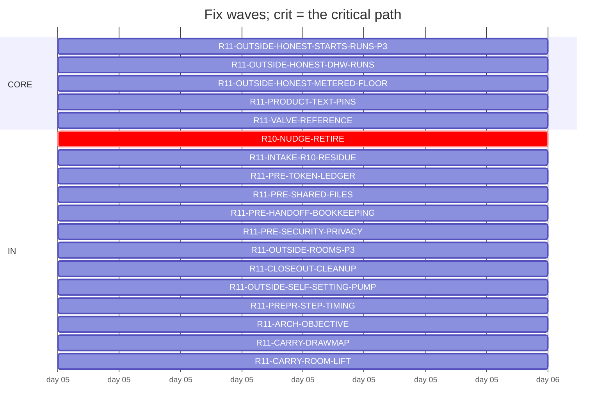

# Plan table (origin/handoff/audit-r10-roster:dev/programme/rosters/wave-r11-groups.json)
Generated by `tools/audit/seat/plan_table.py` 2026-11-18; roster origin/handoff/audit-r10-roster:dev/programme/rosters/wave-r11-groups.json.

18 open group(s) of 83; 1 wave(s); critical path: R10-NUDGE-RETIRE (1).

## Swimlanes

| lane \ wave | 1 |
|---|---|
| CORE | R11-OUTSIDE-HONEST-STARTS-RUNS-P3 R11-OUTSIDE-HONEST-DHW-RUNS R11-OUTSIDE-HONEST-METERED-FLOOR R11-PRODUCT-TEXT-PINS R11-VALVE-REFERENCE |
| IN | R10-NUDGE-RETIRE R11-INTAKE-R10-RESIDUE R11-PRE-TOKEN-LEDGER R11-PRE-SHARED-FILES R11-PRE-HANDOFF-BOOKKEEPING R11-PRE-SECURITY-PRIVACY R11-OUTSIDE-ROOMS-P3 R11-CLOSEOUT-CLEANUP R11-OUTSIDE-SELF-SETTING-PUMP R11-PREPR-STEP-TIMING R11-ARCH-OBJECTIVE R11-CARRY-DRAWMAP R11-CARRY-ROOM-LIFT |

## Waves

## Groups

| group | lane | wave | stage | issues | models | owner gate | what | live note |
|---|---|---|---|---|---|---|---|---|
| R10-CLOSEOUT-CLEANUP | C | 1 | absorbed | #2505, #2727, #2728 | sonnet/opus | yes: mandated approval under 6329234399 | Programme-closeout work, and it runs LAST: after R10-ARCH-DOCS and R10-ROUND-PLAYBOOK have merged, after the roster and the state docs have moved into main,... |  |
| R10-START-COUNTER-EDGES | CORE | 1 | done | #3420 | opus/opus | - | Outside pull request 3420 by Bankaifan (fork head 2599cc38ed when this was written; re-read it with git ls-remote origin refs/pull/3420/head). |  |
| R10-GH-READ-RESIDUE-P3 | IN | 1 | done | - | sonnet/opus | - | triage: dev/programme/triage/r10-round-end.md#P755 at 2e17928032 Narrowed by the round-10 round-end triage (ratified by tvofi 2026-11-15, cards C14 and O1: a... |  |
| R10-PREPR-DARWIN-SELFTEST-LANE | IN | 1 | done | - | sonnet/claude-opus-5-5 | - | triage: dev/programme/triage/r10-round-end.md#P761 at 2e17928032 Re-cut by the round-10 round-end triage (ratified by tvofi 2026-11-15, cards C7, C14 and O1). |  |
| R10-NUDGE-RETIRE | IN | 1 | carries-open | - | opus/opus | yes: policy: merges under mandate 6715477401 | Owner instruction, tvofi, 2026-11-12, verbatim: "ok, correct any references to that script or remove it entirely". |  |
| R11-OUTSIDE-HONEST-STARTS-RUNS | CORE | 1 | done | - | opus/opus | yes: merges and code-owner approvals stay with the owner (2026-11-12 ruling on the contributor); the design review rules the note's three owner decisions | Outside pull request 3529 by Bankaifan (fork head 1f9daef4d93f at acceptance; re-read it with git ls-remote origin refs/pull/3529/head), accepted for round 1... |  |
| R10-SELFTEST-SCOPE-UNION-GUARD | IN | 1 | absorbed | - | sonnet/opus | - | AUDIT-CLASS BARRIER, part C of the root-cause analysis R10-RCA-SELFTEST-SCOPE-DRIFT (triage ACCEPT, round 10). |  |
| R11-INTAKE-R10-RESIDUE | IN | 1 | not-started | #2389, #2731, #2999, #3314, #3369 | sonnet/opus | - | Round 11, deferred. |  |
| R11-PRE-TOOLCHAIN-PIN | IN | 1 | done | - | fable/fable | - | Owner ruling 2026-11-13 on decision card P1 (yes): seats and the beat run their tools from a promoted stable ref instead of the tip of main, main reports pro... |  |
| R11-PRE-MACHINERY-LIMITER | IN | 1 | done | - | opus/opus | - | Owner ruling 2026-11-13 on decision card P2 (declining cap, one in one out, severity route narrowed): the machinery ratchet becomes a target that declines ov... |  |
| R11-PRE-ROUND-METRICS | IN | 1 | done | - | opus/opus | - | Owner ruling 2026-11-13 on decision card P3 and P8 (yes): the scorecard gets a producer for its inputs and a row in the running job list, with lead-time perc... |  |
| R11-PRE-TOKEN-LEDGER | IN | 1 | not-started | - | opus/opus | - | Owner ruling 2026-11-13 on decision card P4 (yes, local and cloud): every dispatch writes group, role and model in a header, and a daily job sums token usage... |  |
| R11-PRE-RULINGS-FILE | IN | 1 | done | - | opus/opus | - | Owner ruling 2026-11-13 on decision card P6 (yes) and R3 (core in full, instrument pages by change): a file of the owner s standing rulings, verbatim and dat... |  |
| R11-PRE-SHARED-FILES | IN | 1 | in-progress | - | fable/fable | - | Owner ruling 2026-11-13 on decision card P9 (yes, design first): shared files stop coupling every pull request. |  |
| R11-PRE-HANDOFF-BOOKKEEPING | IN | 1 | carries-open | #3313 | opus/opus | - | Owner ruling 2026-11-13 on decision card P10 (yes): carry, body and red-check items are decided mechanically at the handoff, and a reviewer blocks only on pr... |  |
| R11-PRE-RELAY-REBUILD | IN | 1 | done | - | opus/opus | - | Owner ruling 2026-11-13 on decision card P12 (yes): the relay posts a returned verdict without waiting behind a pull request update. |  |
| R11-PRE-ACK-COMPLETION | IN | 1 | done | - | sonnet/opus | - | Owner ruling 2026-11-13 on decision card P14 (yes): an acknowledgement of an owed item names the event that closes it and is renewed twice at most before it... |  |
| R11-PRE-STANDING-SCRIPTS | IN | 1 | done | - | opus/opus | - | Owner ruling 2026-11-13 on decision card R1 (yes, keep one exception seat): the mechanical standing roles (merge operation after an approved verdict, reviewe... |  |
| R11-PRE-PLAN-RENDER | IN | 1 | done | - | sonnet/opus | - | Owner ruling 2026-11-13 on decision card R2 (yes, render on change): the plan page is rendered and committed when scope or order changes, not every 30 minute... |  |
| R10-COP-LEARNER-DRAW-FLOOR | IN | 1 | done | #3106 | opus/opus | - | Owner 2026-11-13: design can be prepared now. |  |
| R11-PRE-PARALLEL-PIPELINE | IN | 1 | done | - | opus/opus | - | Owner instruction 2026-11-14, his words: "Have a fable seat with web access and sendmessage capability study and design a high throughput pipeline, using a b... |  |
| R10-DRAW-MAP-EVIDENCE | IN | 2 | done | #3106 | opus/opus | - | Owner order 2026-11-14, after the linearity measurement for issue 3106 item 4 on the owner's own install: build the correction the data supports now, and imp... |  |
| R11-OUTSIDE-CONTRIBUTOR-CYCLE-P3 | IN | 1 | done | - | opus/opus | - | Part 3 of R10-OUTSIDE-CONTRIBUTOR-CYCLE (an outside request, ruled by the owner 2026-11-12), cut at the round-11 pickup: part 1 (#3514) and part 2 (#3521) ar... |  |
| R11-HOTFIX-FIGURE-BLOCK-BASE | IN | 1 | done | - | sonnet/opus | - | triage: dev/programme/triage/r10-round-end.md#P774 at 2e17928032 Hotfix, S. |  |
| R11-HOTFIX-SELFTEST-FLAKE-ARMS | IN | 1 | done | - | sonnet/opus | - | triage: dev/programme/triage/r10-round-end.md#P782 at 2e17928032 Hotfix, S (root-cause countermeasure). |  |
| R11-HOTFIX-POLICY-DOCS-TIMEOUT | IN | 1 | done | - | sonnet/opus | - | triage: dev/programme/triage/r10-round-end.md#P786 at 2e17928032 Hotfix, S (root-cause countermeasure). |  |
| R11-OUTSIDE-HONEST-STARTS-RUNS-P2 | CORE | 1 | done | - | opus/opus | yes: merges and code-owner approvals stay with the owner (2026-11-12 ruling on the contributor) | Part 2 of R11-OUTSIDE-HONEST-STARTS-RUNS, group A of the approved design for outside pull request 3529 by Bankaifan (credit them by name), cut before pull re... |  |
| R11-OUTSIDE-HONEST-STARTS-RUNS-P3 | CORE | 1 | carries-open | - | opus/opus | yes: merges and code-owner approvals stay with the owner (2026-11-12 ruling on the contributor) | Part 3 of R11-OUTSIDE-HONEST-STARTS-RUNS (outside pull request 3529 by Bankaifan; credit them by name), cut before pull request 3602 merged: the parent goes... |  |
| R11-OUTSIDE-HONEST-DHW-RUNS | CORE | 1 | in-progress | #3529 | fable/fable | yes: merges and code-owner approvals stay with the owner (2026-11-12 ruling on the contributor) | Group B of the approved design for outside pull request 3529 by Bankaifan: hot-water charges as runs (design/R11-OUTSIDE-HONEST-STARTS-RUNS at a63a2ca6cd, ru... |  |
| R11-OUTSIDE-HONEST-METERED-FLOOR | CORE | 1 | carries-open | - | opus/opus | yes: merges and code-owner approvals stay with the owner (2026-11-12 ruling on the contributor) | Group C of the approved design for outside pull request 3529 by Bankaifan: the metered floor, the note's part 3 (design/R11-OUTSIDE-HONEST-STARTS-RUNS at a63... |  |
| R11-PRE-FINDER-CONTRACT | IN | 1 | done | - | opus/opus | - | Finder-critical. |  |
| R11-PRE-BRIEFS-CENSUS | IN | 1 | done | - | fable/fable | - | Finder-critical. |  |
| R11-PRE-BRIEFS-TEXT | IN | 1 | done | - | opus/opus | - | Finder-critical. |  |
| R11-PRE-NEW-DIMENSIONS | IN | 1 | done | - | fable/fable | - | Finder-critical. |  |
| R11-PRE-OWNER-CRITERIA | IN | 1 | done | - | opus/opus | - | Finder-critical by tvofi's ruling of 2026-11-15 on the owner-criteria cards, "All four before finders". |  |
| R11-PRE-NO-READ-BUILDERS | IN | 1 | done | - | fable/fable | - | NOT finder-critical. |  |
| R11-PRE-RCA-LATCH-CLAUSES | IN | 1 | done | - | opus/opus | - | NOT finder-critical, and HELD: tvofi has not ruled card E11-INJECTED; dispatch only on his ruling, building what it accepts. |  |
| R11-OWNER-GENERIC-CONTROL-TEXT | DOCS | 1 | done | #3643 | opus/opus | - | Owner item, tvofi 2026-11-15, folded into round 11. |  |
| R11-PRE-ROUND-CHECK-GATE | IN | 1 | done | - | opus/opus | - | Finder-critical. |  |
| R11-PRE-PRODUCT-READS | IN | 1 | done | - | opus/opus | - | tvofi 2026-11-15 on evaluation card E11-N-INTAKE-BUILDER, verbatim: "New L group, design first (Recommended)" (one new group for the product reads, beside th... |  |
| R11-OWNER-COMMUNITY-STANDARDS | DOCS | 1 | done | - | opus/opus | - | Owner item, tvofi 2026-11-15, folded into round 11 (not finder-critical). |  |
| R11-PRE-SECURITY-PRIVACY | IN | 1 | carries-open | - | fable/fable | - | Owner item, tvofi 2026-11-15, verbatim: "The new dimension should be about both security and privacy, and Scan the codebase for any security or privacy vulne... |  |
| R11-HOTFIX-CI-PREDICT-TIMEOUT | IN | 1 | done | - | sonnet/opus | - | Hotfix R11-HOTFIX-CI-PREDICT-TIMEOUT (instrument, size S). |  |
| R11-OUTSIDE-SLAB-SEED-GUARD | IN | 1 | done | #3616 | opus/opus | - | tvofi 2026-11-15, verbatim: "Yes, create roadmap, post, and start design immediately." Issue #3616 (outside reporter); the round-11 study of it is kept out o... |  |
| R11-OUTSIDE-ROOMS-P1 | IN | 1 | done | #3616 | opus/opus | - | tvofi 2026-11-15, verbatim: "Yes, create roadmap, post, and start design immediately." Issue #3616 (outside reporter); the round-11 study of it is kept out o... |  |
| R11-OUTSIDE-ROOMS-P2 | IN | 1 | done | #3616 | fable/fable | - | tvofi 2026-11-15, verbatim: "Yes, create roadmap, post, and start design immediately." Issue #3616 (outside reporter); the round-11 study of it is kept out o... |  |
| R11-OUTSIDE-ROOMS-P3 | IN | 1 | in-progress | #3616 | fable/fable | - | tvofi 2026-11-15, verbatim: "Yes, create roadmap, post, and start design immediately." Issue #3616 (outside reporter); the round-11 study of it is kept out o... |  |
| R11-OPENER-SCOPED-PREPR | IN | 1 | refused | - | sonnet/opus | - | Instrument change, owner ruling tvofi 2026-11-15, verbatim: "THE OPENER ALSO RUNS SCOPED. |  |
| R11-HOTFIX-MAIN-SELFTEST-RED | IN | 1 | done | - | opus/opus | - | Main red, instrument (the main-red exception to the round-11 instrument freeze). |  |
| R11-CLOSEOUT-CLEANUP | IN | 1 | not-started | #3637, #3656 | sonnet/opus | - | Round 11's closeout, run at round end after every other round-11 group is closed (owner ruling 2026-11-15: each round owns its own closeout group; round 10's... |  |
| R11-OUTSIDE-SELF-SETTING-PUMP | IN | 1 | carries-open | - | opus/opus | - | Owner ruling D4 (2026-11-15): the self-setting pump residual of pull request 3593 (flat asks fold the learner scale to 0.500 at the base and the head alike)... |  |
| R11-OUTSIDE-APPLY-PLAN-CEILING | IN | 1 | done | **#3636** | opus/opus | - | Issue 3636 (outside report): Apply this plan in the dashboard card fails whenever the published plan has a slot starting more than 20 hours from now. |  |
| R11-HOTFIX-TICK-SEAT-WINDOW | IN | 1 | done | - | opus/opus | - | Hotfix, S. |  |
| R11-OUTSIDE-DEARER-WORDING | DOCS | 1 | absorbed | #3643 | opus/opus | - | Outside issue 3643, size S, text only. |  |
| R11-PREPR-STEP-TIMING | IN | 1 | not-started | - | opus/opus | - | Two remeasured countermeasures from dev/audit/rca/R10-RCA-OPEN-PREPR-SLOW.md, both in tools/pr/prepr.sh, carried below verbatim: the per-step elapsed field (... |  |
| R11-SERVICE-SCHEMA | CORE | 1 | done | - | opus/opus | - | Service schema and service text disagreements carried below verbatim. |  |
| R11-PRODUCT-TEXT-PINS | CORE | 1 | not-started | - | opus/opus | - | Stale product docstrings, a stray entry-data key in the config flow's device_prefill step, and corrected user text with no behavioural pin, carried below ver... |  |
| R11-ADVISOR-MEASURES | CORE | 1 | done | - | opus/opus | - | Advisor design items that the steady-start work left unmeasured, carried below verbatim: the hot-water, weight and floor asks measured for sign on a tanked f... |  |
| R11-VALVE-REFERENCE | CORE | 1 | carries-open | - | opus/opus | - | Single-zone valve behaviour against the thermostat reference, carried below verbatim: the derived valve curve misses its own target on a single-zone house, t... |  |
| R11-POLICY-TOKEN-CAP | IN | 1 | done | - | opus/opus | - | Drop the files_tokens cap kept for the retired orchestrator turn and extend policy_lint.mjs's orphan-cap check to files_tokens, as the carry below states ver... |  |
| R11-START-EVALUATION-LAND | IN | 1 | done | - | opus/opus | - | Land the approved round-11 start evaluation (eval/r11, approved at the evaluation review round 4, c04cef7fca) on main so check_scopes.py --round 11 can read... |  |
| R11-HOTFIX-MAIN-SELFTEST-DRIFT | IN | 1 | done | - | opus/opus | - | Hotfix, S. |  |
| R11-RCA-SELFTEST-TABLE-DRIFT | IN | 1 | done | - | opus/opus | - | Root-cause record, S. |  |
| R11-ARCH-OBJECTIVE | IN | 1 | carries-open | - | opus/opus | yes: policy | Owner item (tvofi 2026-11-16 ~22:05Z): make decision 0018's objective function one of the round architect's goals beside the architecture score, so P3's plan... |  |
| R11-CARRY-DRAWMAP | IN | 1 | not-started | #3106 | opus/opus | - | The unbuilt parts of the approved draw-map evidence design (tag archive/design/R10-DRAW-MAP-EVIDENCE): part A (the sweep and its routing), part B (the ceilin... |  |
| R11-CARRY-ROOM-LIFT | IN | 1 | not-started | - | opus/opus | - | Two owner rulings the room phase-2 lift in custom_components/heatpump_optimizer/rooms.py still awaits: the 1.0 K lift cap with its opt-in toggle, and whether... |  |
| R11-CARRY-MERGE-TRAIN | IN | 1 | deferred | - | opus/opus | - | The merge-train routing and shadow-benchmark residue of R11-PRE-PARALLEL-PIPELINE (PR #3675): the shadow benchmark of landing chains against the train's merg... |  |
| R11-CARRY-ROSTER-WRITE | IN | 1 | deferred | - | opus/opus | - | One roster writer of record: tools/audit/seat/postmerge.py queues its stage op to the roster-drain on a lost race and derives keyed mark-carry ops from the m... |  |
| R11-CARRY-FOLD-ARM | IN | 1 | deferred | - | sonnet/opus | - | The relay's carry-fold arm in tools/audit/seat/cloud_relay.sh and its contract with tools/audit/seat/body_push.sh: body_push writes a REFUSAL record the arm... |  |
| R11-CARRY-RELAY-P12 | IN | 1 | deferred | - | opus/opus | - | The P12 core of R11-PRE-RELAY-REBUILD that PR #3648 did not build (it built carries 0-4): the relay's serial-pass stalls, update_pr's holder loop over seat w... |  |
| R11-CARRY-FIXER-CONTRACT | IN | 1 | deferred | - | opus/opus | - | Contract text owed in dev/governance/roles/fixer.md and the documents beside it: the predicate domain probe after a class opens (steps 8 and 18), the 40-muta... |  |
| R11-CARRY-PREDICT | IN | 2 | deferred | - | opus/opus | - | Handoff red-check prediction in tools/pr: prepr.sh body-check parity with pr-contract, one owner of the Forward-carry grammar, ci_predict reading the roster,... |  |
| R11-CARRY-LOOP-LEDGER | IN | 1 | deferred | - | opus/opus | - | tools/audit/seat/loop_ledger.py: a run-red column split product/machinery read from tools/ci/gate.py status, edited/labeled/review runs at the same head read... |  |
| R11-CARRY-TICK-OWED | IN | 1 | deferred | - | opus/opus | - | The owed levels tools/audit/seat/orchestrator_tick.py prints: NOT REVIEWABLE deferral vs a real split and the disabled Gate sweep flag, probe-refused lines c... |  |
| R11-CARRY-BEAT-RECORD | IN | 2 | deferred | - | sonnet/opus | - | The record beat and the standing seats' record: tools/audit/seat/record_beat.py and postmerge.py post nothing when #3394 already carries the sha40 and read t... |  |
| R11-CARRY-DISPATCH | IN | 2 | deferred | - | opus/opus | - | The seat prompts and part cuts tools/audit/seat/cloud_dispatch.py renders: a fixer repairs non-CARRY-LANDED body_push refusals in its own seat, no wait hande... |  |
| R11-CARRY-PLAN-PAGE | IN | 1 | deferred | - | opus/opus | - | The round plan page in tools/audit/seat/plan_page.py, built to the two-tab the plan page's tab builder script prototype: next-round groups on a second tab wi... |  |
| R11-CARRY-ROUND-METRICS | IN | 1 | deferred | - | opus/opus | - | The convergence records decision 0018 (dev/governance/decisions/0018-objective-function.md, sections 2 and 4) still owes, and the escapes record they read: t... |  |
| R11-CARRY-ROUND-START | IN | 1 | deferred | - | sonnet/opus | - | tools/audit/check_scopes.py refuses a round start while any pickup line is undispositioned. |  |
| R11-CARRY-POLICY-BUDGETS | IN | 1 | deferred | - | sonnet/opus | - | Stale corpus keys: dev/governance/config/policy_budgets.json caps keyed on the removed tools/audit/README.md path, and the README citing the census directory... |  |
| R11-CARRY-LOOP-POLICY | IN | 1 | deferred | - | opus/opus | - | The loop-study countermeasure cards L2, L4, L5, L7 and L8 into policy: countermeasure order (delete, self-repair, narrow, new refusal last), induced follow-u... |  |
| R11-CARRY-MACHINERY-CHECK | IN | 1 | deferred | - | opus/opus | - | A machinery check that cannot read its input prints unread, never red, and escalates after three: tests/ci_ratchet.py's advisory on push (the prelude-cancell... |  |
| R11-CARRY-TOOLCHAIN | IN | 2 | deferred | - | opus/opus | - | The toolchain design's unbuilt parts p1/p2 in tools/audit/seat/toolchain.py and its consumers: the freshness sites, merge_train's main mirror, refusing a tra... |  |

## ETA

Cadence 2 days per wave (`--cadence`); 1 wave(s) of work, total 2 days from wave-1 start.

| wave | groups | starts (day) | ends (day) |
|---|---|---|---|
| 1 | 18 | 0 | 2 |
