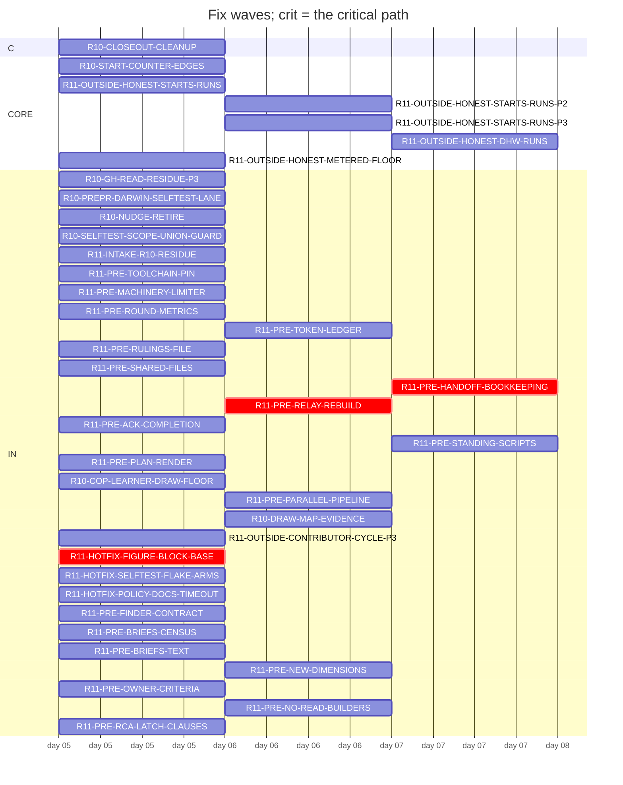

# Plan table (origin/handoff/audit-r10-roster:dev/programme/rosters/wave-r11-groups.json)
Generated by `tools/audit/seat/plan_table.py` 2026-11-15; roster origin/handoff/audit-r10-roster:dev/programme/rosters/wave-r11-groups.json.

37 open group(s) of 37; 3 wave(s); critical path: R11-HOTFIX-FIGURE-BLOCK-BASE -> R11-PRE-RELAY-REBUILD -> R11-PRE-HANDOFF-BOOKKEEPING (3).

## Swimlanes

| lane \ wave | 1 | 2 | 3 |
|---|---|---|---|
| C | R10-CLOSEOUT-CLEANUP |  |  |
| CORE | R10-START-COUNTER-EDGES R11-OUTSIDE-HONEST-STARTS-RUNS R11-OUTSIDE-HONEST-METERED-FLOOR | R11-OUTSIDE-HONEST-STARTS-RUNS-P2 R11-OUTSIDE-HONEST-STARTS-RUNS-P3 | R11-OUTSIDE-HONEST-DHW-RUNS |
| IN | R10-GH-READ-RESIDUE-P3 R10-PREPR-DARWIN-SELFTEST-LANE R10-NUDGE-RETIRE R10-SELFTEST-SCOPE-UNION-GUARD R11-INTAKE-R10-RESIDUE R11-PRE-TOOLCHAIN-PIN R11-PRE-MACHINERY-LIMITER R11-PRE-ROUND-METRICS R11-PRE-RULINGS-FILE R11-PRE-SHARED-FILES R11-PRE-ACK-COMPLETION R11-PRE-PLAN-RENDER R10-COP-LEARNER-DRAW-FLOOR R11-OUTSIDE-CONTRIBUTOR-CYCLE-P3 R11-HOTFIX-FIGURE-BLOCK-BASE R11-HOTFIX-SELFTEST-FLAKE-ARMS R11-HOTFIX-POLICY-DOCS-TIMEOUT R11-PRE-FINDER-CONTRACT R11-PRE-BRIEFS-CENSUS R11-PRE-BRIEFS-TEXT R11-PRE-OWNER-CRITERIA R11-PRE-RCA-LATCH-CLAUSES | R11-PRE-TOKEN-LEDGER R11-PRE-RELAY-REBUILD R11-PRE-PARALLEL-PIPELINE R10-DRAW-MAP-EVIDENCE R11-PRE-NEW-DIMENSIONS R11-PRE-NO-READ-BUILDERS | R11-PRE-HANDOFF-BOOKKEEPING R11-PRE-STANDING-SCRIPTS |

## Waves

## Groups

| group | lane | wave | stage | issues | models | owner gate | what | live note |
|---|---|---|---|---|---|---|---|---|
| R10-CLOSEOUT-CLEANUP | C | 1 | carries-open | #2505, #2727, #2728 | sonnet/opus | yes: mandated approval under 6329234399 | Programme-closeout work, and it runs LAST: after R10-ARCH-DOCS and R10-ROUND-PLAYBOOK have merged, after the roster and the state docs have moved into main,... |  |
| R10-START-COUNTER-EDGES | CORE | 1 | in-progress | #3420 | opus/opus | - | Outside pull request 3420 by Bankaifan (fork head 2599cc38ed when this was written; re-read it with git ls-remote origin refs/pull/3420/head). |  |
| R10-GH-READ-RESIDUE-P3 | IN | 1 | not-started | - | sonnet/opus | - | triage: dev/programme/triage/r10-round-end.md#P755 at 2e17928032 Narrowed by the round-10 round-end triage (ratified by tvofi 2026-11-15, cards C14 and O1: a... |  |
| R10-PREPR-DARWIN-SELFTEST-LANE | IN | 1 | not-started | - | sonnet/sonnet | - | triage: dev/programme/triage/r10-round-end.md#P761 at 2e17928032 Re-cut by the round-10 round-end triage (ratified by tvofi 2026-11-15, cards C7, C14 and O1). |  |
| R10-NUDGE-RETIRE | IN | 1 | in-progress | - | opus/opus | yes: policy: merges under mandate 6715477401 | Owner instruction, tvofi, 2026-11-12, verbatim: "ok, correct any references to that script or remove it entirely". |  |
| R11-OUTSIDE-HONEST-STARTS-RUNS | CORE | 1 | in-progress | #3529 | opus/opus | yes: merges and code-owner approvals stay with the owner (2026-11-12 ruling on the contributor); the design review rules the note's three owner decisions | Outside pull request 3529 by Bankaifan (fork head 1f9daef4d93f at acceptance; re-read it with git ls-remote origin refs/pull/3529/head), accepted for round 1... |  |
| R10-SELFTEST-SCOPE-UNION-GUARD | IN | 1 | in-progress | - | sonnet/opus | - | AUDIT-CLASS BARRIER, part C of the root-cause analysis R10-RCA-SELFTEST-SCOPE-DRIFT (triage ACCEPT, round 10). |  |
| R11-INTAKE-R10-RESIDUE | IN | 1 | not-started | #2389, #2731, #2999, #3313, #3314, #3369 | sonnet/opus | - | Round 11, deferred. |  |
| R11-PRE-TOOLCHAIN-PIN | IN | 1 | not-started | - | fable/fable | - | Owner ruling 2026-11-13 on decision card P1 (yes): seats and the beat run their tools from a promoted stable ref instead of the tip of main, main reports pro... |  |
| R11-PRE-MACHINERY-LIMITER | IN | 1 | not-started | - | opus/opus | - | Owner ruling 2026-11-13 on decision card P2 (declining cap, one in one out, severity route narrowed): the machinery ratchet becomes a target that declines ov... |  |
| R11-PRE-ROUND-METRICS | IN | 1 | not-started | - | opus/opus | - | Owner ruling 2026-11-13 on decision card P3 and P8 (yes): the scorecard gets a producer for its inputs and a row in the running job list, with lead-time perc... |  |
| R11-PRE-TOKEN-LEDGER | IN | 2 | not-started | - | opus/opus | - | Owner ruling 2026-11-13 on decision card P4 (yes, local and cloud): every dispatch writes group, role and model in a header, and a daily job sums token usage... |  |
| R11-PRE-RULINGS-FILE | IN | 1 | not-started | - | opus/opus | - | Owner ruling 2026-11-13 on decision card P6 (yes) and R3 (core in full, instrument pages by change): a file of the owner s standing rulings, verbatim and dat... |  |
| R11-PRE-SHARED-FILES | IN | 1 | not-started | - | fable/fable | - | Owner ruling 2026-11-13 on decision card P9 (yes, design first): shared files stop coupling every pull request. |  |
| R11-PRE-HANDOFF-BOOKKEEPING | IN | 3 | not-started | - | opus/opus | - | Owner ruling 2026-11-13 on decision card P10 (yes): carry, body and red-check items are decided mechanically at the handoff, and a reviewer blocks only on pr... |  |
| R11-PRE-RELAY-REBUILD | IN | 2 | not-started | - | opus/opus | - | Owner ruling 2026-11-13 on decision card P12 (yes): the relay posts a returned verdict without waiting behind a pull request update. |  |
| R11-PRE-ACK-COMPLETION | IN | 1 | not-started | - | sonnet/opus | - | Owner ruling 2026-11-13 on decision card P14 (yes): an acknowledgement of an owed item names the event that closes it and is renewed twice at most before it... |  |
| R11-PRE-STANDING-SCRIPTS | IN | 3 | not-started | - | opus/opus | - | Owner ruling 2026-11-13 on decision card R1 (yes, keep one exception seat): the mechanical standing roles (merge operation after an approved verdict, reviewe... |  |
| R11-PRE-PLAN-RENDER | IN | 1 | not-started | - | sonnet/opus | - | Owner ruling 2026-11-13 on decision card R2 (yes, render on change): the plan page is rendered and committed when scope or order changes, not every 30 minute... |  |
| R10-COP-LEARNER-DRAW-FLOOR | IN | 1 | carries-open | #3106 | opus/opus | - | Owner 2026-11-13: design can be prepared now. |  |
| R11-PRE-PARALLEL-PIPELINE | IN | 2 | design | - | opus/opus | - | Owner instruction 2026-11-14, his words: "Have a fable seat with web access and sendmessage capability study and design a high throughput pipeline, using a b... |  |
| R10-DRAW-MAP-EVIDENCE | IN | 2 | in-progress | #3106 | opus/opus | - | Owner order 2026-11-14, after the linearity measurement for issue 3106 item 4 on the owner's own install: build the correction the data supports now, and imp... |  |
| R11-OUTSIDE-CONTRIBUTOR-CYCLE-P3 | IN | 1 | not-started | - | opus/opus | - | Part 3 of R10-OUTSIDE-CONTRIBUTOR-CYCLE (an outside request, ruled by the owner 2026-11-12), cut at the round-11 pickup: part 1 (#3514) and part 2 (#3521) ar... |  |
| R11-HOTFIX-FIGURE-BLOCK-BASE | IN | 1 | not-started | - | sonnet/opus | - | triage: dev/programme/triage/r10-round-end.md#P774 at 2e17928032 Hotfix, S. |  |
| R11-HOTFIX-SELFTEST-FLAKE-ARMS | IN | 1 | not-started | - | sonnet/opus | - | triage: dev/programme/triage/r10-round-end.md#P782 at 2e17928032 Hotfix, S (root-cause countermeasure). |  |
| R11-HOTFIX-POLICY-DOCS-TIMEOUT | IN | 1 | not-started | - | sonnet/opus | - | triage: dev/programme/triage/r10-round-end.md#P786 at 2e17928032 Hotfix, S (root-cause countermeasure). |  |
| R11-OUTSIDE-HONEST-STARTS-RUNS-P2 | CORE | 2 | not-started | - | opus/opus | yes: merges and code-owner approvals stay with the owner (2026-11-12 ruling on the contributor) | Part 2 of R11-OUTSIDE-HONEST-STARTS-RUNS, group A of the approved design for outside pull request 3529 by Bankaifan (credit them by name), cut before pull re... |  |
| R11-OUTSIDE-HONEST-STARTS-RUNS-P3 | CORE | 2 | not-started | - | opus/opus | yes: merges and code-owner approvals stay with the owner (2026-11-12 ruling on the contributor) | Part 3 of R11-OUTSIDE-HONEST-STARTS-RUNS (outside pull request 3529 by Bankaifan; credit them by name), cut before pull request 3602 merged: the parent goes... |  |
| R11-OUTSIDE-HONEST-DHW-RUNS | CORE | 3 | not-started | - | fable/fable | yes: merges and code-owner approvals stay with the owner (2026-11-12 ruling on the contributor) | Group B of the approved design for outside pull request 3529 by Bankaifan: hot-water charges as runs (design/R11-OUTSIDE-HONEST-STARTS-RUNS at a63a2ca6cd, ru... |  |
| R11-OUTSIDE-HONEST-METERED-FLOOR | CORE | 1 | not-started | - | opus/opus | yes: merges and code-owner approvals stay with the owner (2026-11-12 ruling on the contributor) | Group C of the approved design for outside pull request 3529 by Bankaifan: the metered floor, the note's part 3 (design/R11-OUTSIDE-HONEST-STARTS-RUNS at a63... |  |
| R11-PRE-FINDER-CONTRACT | IN | 1 | not-started | - | opus/opus | - | Finder-critical. |  |
| R11-PRE-BRIEFS-CENSUS | IN | 1 | not-started | - | fable/fable | - | Finder-critical. |  |
| R11-PRE-BRIEFS-TEXT | IN | 1 | not-started | - | opus/opus | - | Finder-critical. |  |
| R11-PRE-NEW-DIMENSIONS | IN | 2 | design | - | fable/fable | - | Finder-critical. |  |
| R11-PRE-OWNER-CRITERIA | IN | 1 | not-started | - | opus/opus | - | Finder-critical by tvofi's ruling of 2026-11-15 on the owner-criteria cards, "All four before finders". |  |
| R11-PRE-NO-READ-BUILDERS | IN | 2 | not-started | - | fable/fable | - | NOT finder-critical. |  |
| R11-PRE-RCA-LATCH-CLAUSES | IN | 1 | not-started | - | opus/opus | - | NOT finder-critical, and HELD: tvofi has not ruled card E11-INJECTED; dispatch only on his ruling, building what it accepts. |  |

## ETA

Cadence 2 days per wave (`--cadence`); 3 wave(s) of work, total 6 days from wave-1 start.

| wave | groups | starts (day) | ends (day) |
|---|---|---|---|
| 1 | 26 | 0 | 2 |
| 2 | 8 | 2 | 4 |
| 3 | 3 | 4 | 6 |
